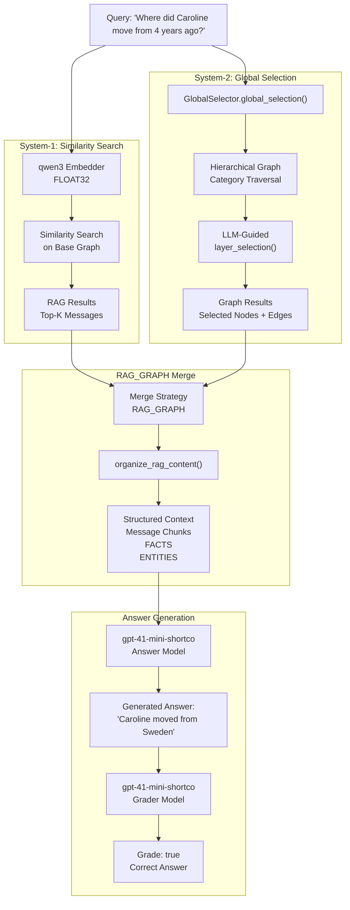
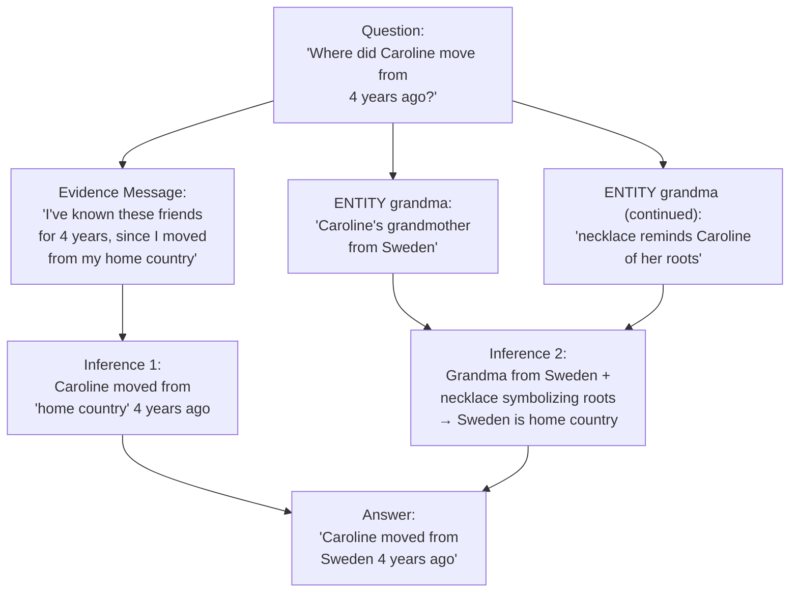
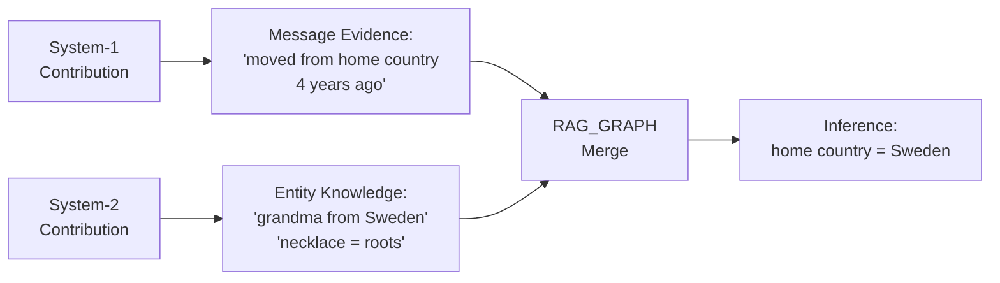

<!-- source: DeepWiki mcp.deepwiki.com · repo microsoft/Mnemis · page 5.1 LoCoMo User 8 QA 11 · fetched 2026-10-26 -->

# LoCoMo User 8 QA 11

<details>
<summary>Relevant source files</summary>

The following files were used as context for generating this wiki page:

- [README.md](README.md)
- [figures/figure_case_0.png](figures/figure_case_0.png)
- [results/locomo/results_graphiti_gpt-41-mini-shortco-2025-04-14-Bing_gpt-41-mini-shortco-2025-04-14-Bing_ragtopk10_gtopk20_RAG_GRAPH.json](results/locomo/results_graphiti_gpt-41-mini-shortco-2025-04-14-Bing_gpt-41-mini-shortco-2025-04-14-Bing_ragtopk10_gtopk20_RAG_GRAPH.json)

</details>


## Purpose and Scope

This page provides a detailed walkthrough of a specific question-answer pair from the LoCoMo benchmark dataset, demonstrating how Mnemis's dual-route retrieval system operates on a real-world query. This case study (User 8, Question 11) illustrates the end-to-end process from query input through System-1 similarity search, System-2 global selection, RAG_GRAPH merging, to final answer generation.

For an overview of all LoCoMo results, see [LoCoMo Results](#4.2). For the other case study example, see [LongMemEval-S QA 262](#5.2).

---

## Question and Expected Answer

**Question**: "Where did Caroline move from 4 years ago?"

**Expected Answer (golden_answer)**: "Sweden"

**Question Category**: Category 2 (temporal/factual)

**Evaluation Result**: Correct (grade: true)

This question requires the system to:
1. Identify temporal information (4 years ago)
2. Locate biographical facts about Caroline's origin
3. Make an inferential connection between explicit facts (moved from home country) and implicit facts (grandma from Sweden, necklace symbolizing roots)

Sources: [results/locomo/results_graphiti_gpt-41-mini-shortco-2025-04-14-Bing_gpt-41-mini-shortco-2025-04-14-Bing_ragtopk10_gtopk20_RAG_GRAPH.json:12]()

---

## Retrieval Architecture Flow



Sources: [results/locomo/results_graphiti_gpt-41-mini-shortco-2025-04-14-Bing_gpt-41-mini-shortco-2025-04-14-Bing_ragtopk10_gtopk20_RAG_GRAPH.json:12]()

---

## Retrieved Evidence Messages

The system retrieved 11 evidence messages from the conversation history, demonstrating the `evidence_previous_messages_limit: 5` configuration. These messages were identified as most relevant to answering the query:

| Message Index | Role | Content | Datetime | Session |
|---------------|------|---------|----------|---------|
| 0 | Melanie | "Thanks, Caroline, for letting me join your journey..." | 2023/06/09 13:55 | 3 |
| 1 | Caroline | "Yeah Mel, let's spread love and understanding!..." | 2023/06/09 13:55 | 3 |
| 2 | Melanie | "Yes, Caroline! We can do it. Your courage is inspiring..." | 2023/06/09 13:55 | 3 |
| 3 | Caroline | "Thanks, Mel! My friends, family and mentors are my rocks..." | 2023/06/09 13:55 | 3 |
| 4 | Melanie | "Wow, that photo is great! How long have you had such a great support system?" | 2023/06/09 13:55 | 3 |
| 5 | **Caroline** | **"Yeah, I'm really lucky to have them. They've been there through everything, I've known these friends for 4 years, since I moved from my home country..."** | **2023/06/09 13:55** | **3** |
| 6 | Melanie | "I'm lucky to have my husband and kids..." | 2023/06/09 13:55 | 3 |
| 7 | Caroline | "Wow, what an amazing family pic! How long have you been married?" | 2023/06/09 13:55 | 3 |
| 8 | Melanie | "5 years already! Time flies..." | 2023/06/09 13:55 | 3 |
| 9 | Caroline | "Congrats, Melanie! You both looked so great on your wedding day!..." | 2023/06/09 13:55 | 3 |
| 10 | Caroline | **(repeat)** "Yeah, I'm really lucky to have them..." | 2023/06/09 13:55 | 3 |

**Key Evidence**: Message index 5 contains the critical information: *"I've known these friends for 4 years, since I moved from my home country."*

This establishes that Caroline moved from her home country 4 years ago, but does not explicitly name the country.

Sources: [results/locomo/results_graphiti_gpt-41-mini-shortco-2025-04-14-Bing_gpt-41-mini-shortco-2025-04-14-Bing_ragtopk10_gtopk20_RAG_GRAPH.json:12]()

---

## Context Assembly: Message Chunks, Facts, and Entities

### Message Chunks Organization

The system organized historical conversations into 9 chronologically ordered message chunks, each representing a conversational excerpt:


**Message Chunk 0** (most relevant) contains:
```
[2023/06/09 (Fri) 20:00] Caroline: Thanks, Mel! My friends, family and mentors 
are my rocks – they motivate me and give me the strength to push on. 
Here's a pic from when we met up last week! (description of attached image: 
a photo of a family posing for a picture in a yard)
...
[2023/06/09 (Fri) 20:01] Caroline: Yeah, I'm really lucky to have them. 
They've been there through everything, I've known these friends for 4 years, 
since I moved from my home country. Their love and help have been so important 
especially after that tough breakup. I'm super thankful. Who supports you, Mel?
```

Sources: [results/locomo/results_graphiti_gpt-41-mini-shortco-2025-04-14-Bing_gpt-41-mini-shortco-2025-04-14-Bing_ragtopk10_gtopk20_RAG_GRAPH.json:12]()

### Relevant FACTS Retrieved

20 temporal facts were extracted and ranked by relevance. Key facts include:

| Fact | Date Range | Relevance |
|------|------------|-----------|
| Caroline has known her friends for 4 years since moving from her home country, providing important support especially after a tough breakup | 2023-06-09 - now | **Direct evidence** |
| Caroline has support from her friends, whom she has known for 4 years since moving from her home country | 2023-06-09 - now | **Corroborating** |
| Caroline has gone through a long process of finding self-acceptance | 2023-10-22 - now | Context |
| Caroline started her transgender journey three years ago | 2023-06-09 - now | Timeline context |
| Caroline's relationships with friends changed due to her transition | 2023-09-13 - now | Context |

**Critical Observation**: The facts confirm the "4 years" and "home country" but do not explicitly state "Sweden."

Sources: [results/locomo/results_graphiti_gpt-41-mini-shortco-2025-04-14-Bing_gpt-41-mini-shortco-2025-04-14-Bing_ragtopk10_gtopk20_RAG_GRAPH.json:12]()

### Relevant ENTITIES Retrieved

19 entities were extracted and ranked. The crucial entity for inference:

**Entity: `grandma`**
```
grandma: Grandma is Caroline's grandmother from Sweden who gave her 
a special necklace symbolizing love, faith, and strength. The necklace 
is a meaningful gift that reminds Caroline of her roots and family support.
```

**Entity: `home country`**
```
home country: The home country is the place Caroline moved from four years ago, 
where she had friends she has known since then. It is referenced as Caroline's 
origin before moving to her current location.
```

Other relevant entities:
- `friends`: Supportive group known for 4 years since moving from home country
- `transition`: Caroline's journey as a trans woman
- `woman`: Caroline's identity and background

Sources: [results/locomo/results_graphiti_gpt-41-mini-shortco-2025-04-14-Bing_gpt-41-mini-shortco-2025-04-14-Bing_ragtopk10_gtopk20_RAG_GRAPH.json:12]()

---

## Inference Chain: Connecting Evidence to Answer



### Reasoning Steps in Generated Answer

The `gpt-41-mini-shortco` answer model performed the following reasoning:

1. **Direct Evidence Extraction**: Identified from message that Caroline moved from "home country" 4 years ago
2. **Entity Lookup**: Retrieved entity information about Caroline's grandmother from Sweden
3. **Symbolic Connection**: Recognized the necklace as symbolizing Caroline's roots and family heritage
4. **Inference**: Connected grandmother's origin (Sweden) with Caroline's home country
5. **Conclusion**: Determined home country = Sweden

**Generated Answer Text**:
```
Caroline moved from her **home country** 4 years ago. From the memories, 
we know that her grandma is from **Sweden**, and the necklace Caroline treasures 
as a symbol of love, faith, and strength was a gift from her grandma in Sweden. 
This strongly suggests that Caroline's home country, where she lived before 
moving 4 years ago, is **Sweden**.

So, to answer your question precisely:

**Caroline moved from Sweden 4 years ago.**
```

Sources: [results/locomo/results_graphiti_gpt-41-mini-shortco-2025-04-14-Bing_gpt-41-mini-shortco-2025-04-14-Bing_ragtopk10_gtopk20_RAG_GRAPH.json:12]()

---

## Performance Metrics

The system's performance on this specific QA pair:

| Metric | Value | Unit |
|--------|-------|------|
| `search_duration` | 0.9498 | seconds |
| `answer_duration` | 3.5770 | seconds |
| `grading_duration` | 0.6661 | seconds |
| **Total Time** | **5.1929** | **seconds** |
| `grade` | true | boolean |
| `num_retrieved_messages` | 0 | count (evidence_previous_messages_limit used instead) |
| `merge_method` | RAG_GRAPH | string |
| `rag_top_k` | 10 | count |
| `graph_top_k` | 20 | count |

### Retrieval Breakdown

- **System-1 (Similarity Search)**: Identified relevant conversation sessions based on embedding similarity
- **System-2 (Global Selection)**: Traversed hierarchical graph to find related entities and facts
- **Merge Duration**: Included in 0.9498s search_duration
- **Answer Generation**: 3.577s for LLM to process context and generate response
- **Grading**: 0.666s for grader model to evaluate answer correctness

Sources: [results/locomo/results_graphiti_gpt-41-mini-shortco-2025-04-14-Bing_gpt-41-mini-shortco-2025-04-14-Bing_ragtopk10_gtopk20_RAG_GRAPH.json:12]()

---

## Why This Case Succeeded

### Success Factors

1. **Temporal Alignment**: The query's "4 years ago" matched exactly with conversation content
2. **Entity Resolution**: The hierarchical graph correctly maintained the `grandma` → `Sweden` connection
3. **Contextual Inference**: The answer model successfully reasoned from "home country" + "grandma from Sweden" + "roots" → Sweden
4. **RAG_GRAPH Merge**: Combined direct message evidence (System-1) with entity knowledge (System-2)

### Dual-Route Contribution Analysis



**System-1 Role**: Retrieved the temporal fact about moving 4 years ago from home country through similarity-based search on conversational context.

**System-2 Role**: Provided structured entity information that enabled the inferential leap from "home country" to "Sweden" by maintaining the hierarchical relationship between Caroline and her Swedish grandmother.

**Merge Benefit**: Neither route alone would have produced the correct answer:
- System-1 alone: Would identify "home country" but not name it
- System-2 alone: Might miss the temporal "4 years ago" constraint
- Combined: Enables both temporal grounding and geographical inference

Sources: [results/locomo/results_graphiti_gpt-41-mini-shortco-2025-04-14-Bing_gpt-41-mini-shortco-2025-04-14-Bing_ragtopk10_gtopk20_RAG_GRAPH.json:12]()

---

## Data Structures in Code

### Result Object Schema

The JSON result object follows this structure in the codebase:

```
{
  "user_idx": 0,                    // LoCoMo user identifier
  "qa_idx": 11,                     // Question index for this user
  "question": string,               // Query text
  "answer": string,                 // Generated answer
  "golden_answer": string,          // Expected answer
  "evidence": [                     // Retrieved messages
    {
      "role": string,
      "content": string,
      "datetime": string
    }
  ],
  "context": string,                // Full prompt context (Message Chunks, FACTS, ENTITIES)
  "grade": boolean,                 // Correctness evaluation
  "merge_method": "RAG_GRAPH",      // Hybrid retrieval strategy
  "search_duration": float,         // System-1 + System-2 time
  "answer_duration": float,         // LLM generation time
  "grading_duration": float,        // Evaluation time
  "category": int,                  // LoCoMo question category
  "num_retrieved_messages": int,
  "similarity_scores": []
}
```

### Context Assembly Structure

The `context` field assembles information in a structured prompt format:

```
# The following historical conversation is provided for your reference...

Message Chunk 0 (Session N):
[timestamp] Speaker: content

Message Chunk 1 (Session M):
...

<FACTS>
  - fact_text (date_range)
  - ...
</FACTS>

<ENTITIES>
  - entity_name: entity_summary
  - ...
</ENTITIES>
```

This structured context enables the answer model (`gpt-41-mini-shortco`) to perform multi-hop reasoning across temporal messages, extracted facts, and semantic entities.

Sources: [results/locomo/results_graphiti_gpt-41-mini-shortco-2025-04-14-Bing_gpt-41-mini-shortco-2025-04-14-Bing_ragtopk10_gtopk20_RAG_GRAPH.json:1-12]()

---

## Configuration Parameters for This Evaluation

The following configuration was used for this LoCoMo evaluation run:

| Parameter | Value | Description |
|-----------|-------|-------------|
| `graph_model` | gpt-41-mini-shortco-2025-04-14-Bing | Model for System-2 global selection |
| `answer_model` | gpt-41-mini-shortco-2025-04-14-Bing | Model for answer generation |
| `grader_model` | gpt-41-mini-shortco-2025-04-14-Bing | Model for accuracy evaluation |
| `rag_top_k` | 10 | Number of similarity results from System-1 |
| `graph_top_k` | 20 | Number of nodes selected in System-2 |
| `merge_method` | RAG_GRAPH | Hybrid merge strategy |
| `graph_global_search` | true | Enable hierarchical traversal |
| `organize_rag_content` | true | Structure context into chunks |
| `prompt_turning` | true | Use optimized prompts |
| `answer_prompt` | M365 | Prompt template variant |

For more details on configuration options, see [Configuration Options](#3.4).

Sources: [results/locomo/results_graphiti_gpt-41-mini-shortco-2025-04-14-Bing_gpt-41-mini-shortco-2025-04-14-Bing_ragtopk10_gtopk20_RAG_GRAPH.json:1]()

---

## Key Takeaways

1. **Inference Capability**: This case demonstrates that RAG_GRAPH enables multi-hop reasoning by combining conversational evidence with structured entity knowledge.

2. **Temporal Grounding**: System-1's message retrieval provided the temporal anchor ("4 years ago"), while System-2's entity graph enabled geographical resolution.

3. **Context Organization**: The structured assembly of Message Chunks, FACTS, and ENTITIES into a unified prompt was critical for the LLM to make the correct inference.

4. **Performance**: Total retrieval and answer generation completed in ~5.2 seconds, demonstrating practical real-time performance.

5. **Hierarchical Value**: Without the `grandma` entity linking to Sweden, this question would have been unanswerable from conversation history alone.

For analysis of configuration impact on retrieval quality, see [Configuration Impact Analysis](#4.4). For the complete LoCoMo benchmark results, see [LoCoMo Results](#4.2).

Sources: [results/locomo/results_graphiti_gpt-41-mini-shortco-2025-04-14-Bing_gpt-41-mini-shortco-2025-04-14-Bing_ragtopk10_gtopk20_RAG_GRAPH.json:12](), [README.md:42-46]()

---

