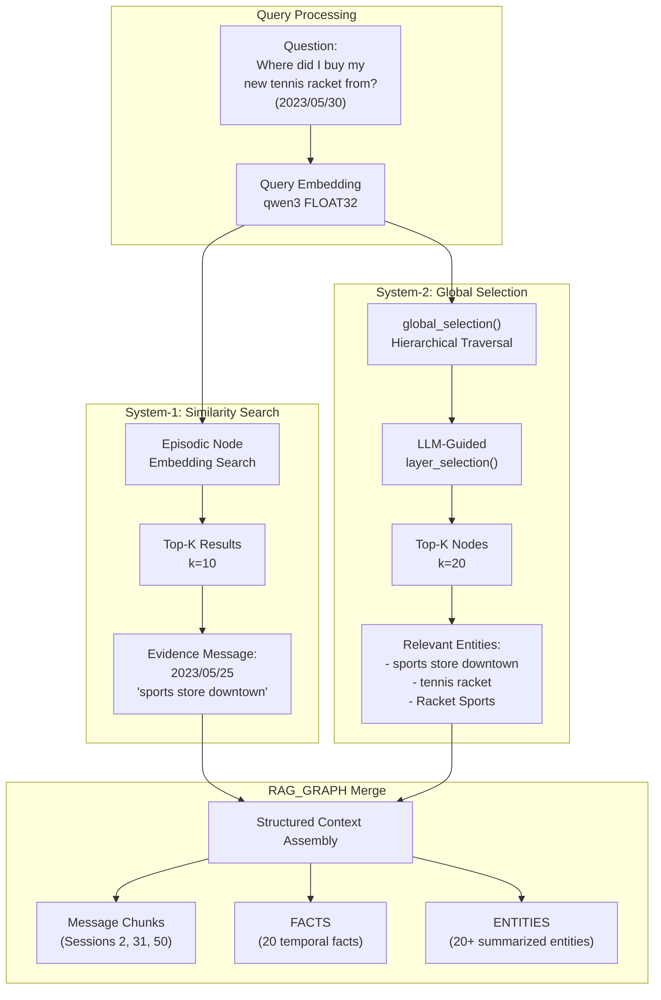
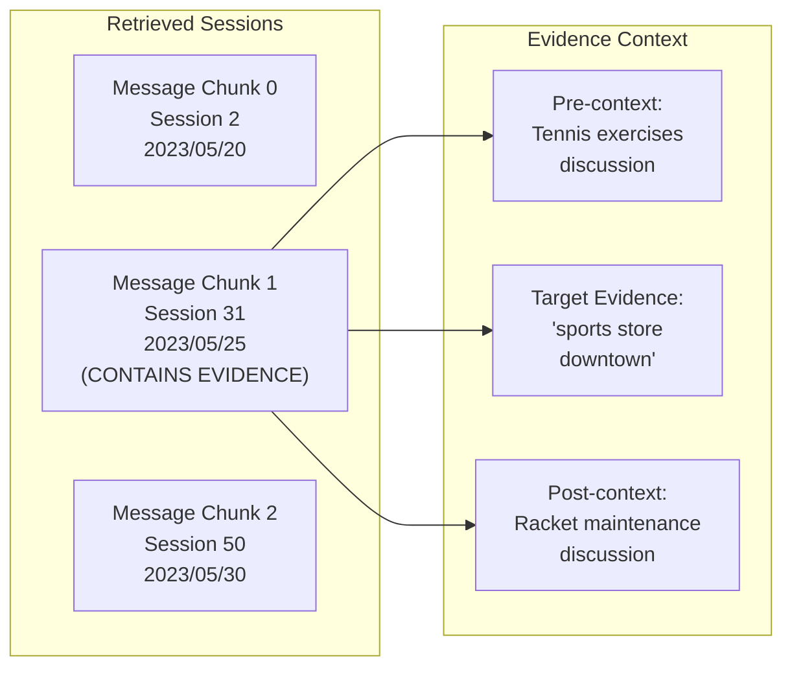
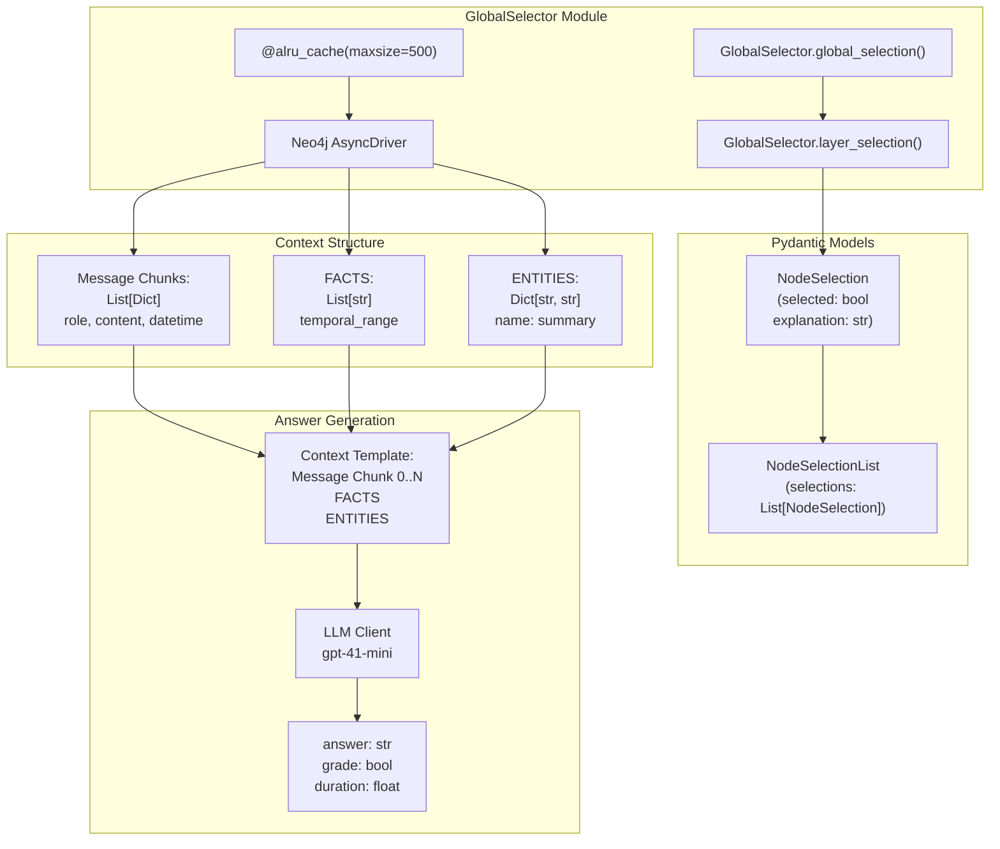
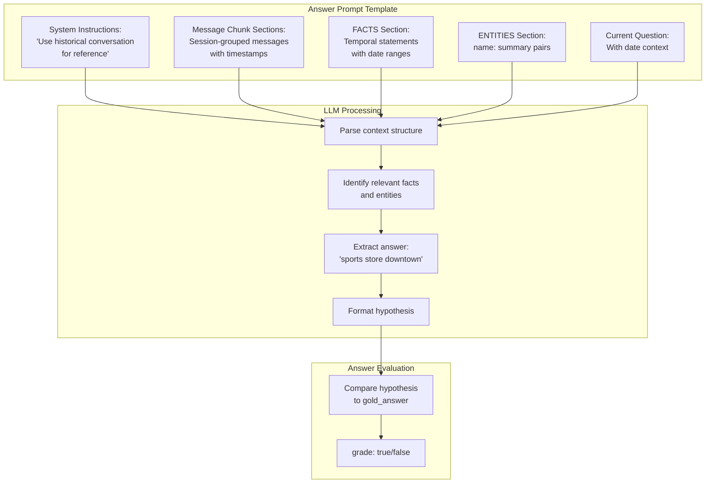

<!-- source: DeepWiki mcp.deepwiki.com · repo microsoft/Mnemis · page 5.2 LongMemEval-S QA 262 · fetched 2026-10-26 -->

# LongMemEval-S QA 262

<details>
<summary>Relevant source files</summary>

The following files were used as context for generating this wiki page:

- [README.md](README.md)
- [figures/figure_case_1.png](figures/figure_case_1.png)
- [results/lme-s/results_graphiti_gpt-41-mini-shortco-2025-04-14-Bing_gpt-41-mini-shortco-2025-04-14-Bing_ragtopk10_gtopk20_RAG_GRAPH.json](results/lme-s/results_graphiti_gpt-41-mini-shortco-2025-04-14-Bing_gpt-41-mini-shortco-2025-04-14-Bing_ragtopk10_gtopk20_RAG_GRAPH.json)

</details>


## Purpose and Scope

This page provides a detailed walkthrough of a specific question from the LongMemEval-S benchmark, demonstrating how Mnemis processes temporal queries through its dual-route retrieval system. The example illustrates:

- How System-1 (similarity search) and System-2 (global selection) retrieve relevant historical context
- Temporal reasoning across multiple conversation sessions
- Fact extraction and entity summarization from conversational memory
- Structured context assembly using the RAG_GRAPH merge strategy

For a broader overview of LongMemEval-S results across all question types, see [LongMemEval-S Results](#4.3). For another case study demonstrating different capabilities, see [LoCoMo User 8 QA 11](#5.1).

Sources: [README.md:48-51]()

## Question Overview

**Question ID**: `f8c5f88b`  
**Question Type**: `single-session-user`  
**Date**: 2023/05/30 (Tue) 23:39

```
Question: "Where did I buy my new tennis racket from?"
Gold Answer: "the sports store downtown"
System Hypothesis: "You bought your new tennis racket from a sports store downtown."
Grade: ✓ Correct
```

This question requires the system to:
1. Search through multiple conversation sessions spanning several days
2. Identify the relevant message from 5 days prior (2023/05/25)
3. Extract the specific location information ("sports store downtown")
4. Handle temporal context (question asks about past purchase)

Sources: [results/lme-s/results_graphiti_gpt-41-mini-shortco-2025-04-14-Bing_gpt-41-mini-shortco-2025-04-14-Bing_ragtopk10_gtopk20_RAG_GRAPH.json:1]()

## Dual-Route Retrieval Process

### Retrieval Architecture for This Query



**Diagram: Dual-route retrieval flow for tennis racket question**

Sources: [README.md:26-29](), [results/lme-s/results_graphiti_gpt-41-mini-shortco-2025-04-14-Bing_gpt-41-mini-shortco-2025-04-14-Bing_ragtopk10_gtopk20_RAG_GRAPH.json:1]()

### Evidence Message Retrieved

The system successfully identified the key evidence message from 5 days prior:

```json
{
  "role": "user",
  "content": "I'll definitely do those exercises before playing tennis. By the way, I'm really happy with my new tennis racket, which I got from a sports store downtown. It's been performing really well, and I feel like it's improved my game. Do you have any tips on how to maintain and clean my racket?",
  "datetime": "2023/05/25 (Thu) 21:29"
}
```

**Key observations**:
- The evidence is embedded within a longer conversational turn
- The location information appears mid-sentence after other context
- Temporal gap of 5 days between evidence and query
- The system must distinguish "sports store downtown" as the purchase location

Sources: [results/lme-s/results_graphiti_gpt-41-mini-shortco-2025-04-14-Bing_gpt-41-mini-shortco-2025-04-14-Bing_ragtopk10_gtopk20_RAG_GRAPH.json:1]()

## Context Organization

The RAG_GRAPH merge strategy assembles retrieved information into three structured components:

### Message Chunks Structure



**Diagram: Message chunk organization showing evidence location**

The system retrieved 3 message chunks, with the critical evidence in Session 31:

| Chunk | Session | Date | Content Summary | Contains Evidence |
|-------|---------|------|-----------------|-------------------|
| 0 | 2 | 2023/05/20 05:09 | Fashion and shopping discussion | No |
| 1 | 31 | 2023/05/25 21:30 | **Tennis equipment and maintenance** | **Yes** |
| 2 | 50 | 2023/05/30 17:18 | Recent conversation | No |

Sources: [results/lme-s/results_graphiti_gpt-41-mini-shortco-2025-04-14-Bing_gpt-41-mini-shortco-2025-04-14-Bing_ragtopk10_gtopk20_RAG_GRAPH.json:1]()

### FACTS Component

The system extracted 20 temporal facts, including the critical one:

```
FACT: "The user owns a new tennis racket which they got from a sports store downtown 
       and feel it has improved their game."
Temporal Range: (2023-05-25 - 2023-05-29)
```

**Key FACTS related to the query**:
- User owns new tennis racket from sports store downtown (2023-05-25 - 2023-05-29)
- User is focusing on improving game with new racket (2023-05-25 - 2023-05-29)
- User plans to play tennis with friends at local park Sunday (2023-05-28 - now)
- User plans to buy new tennis balls this weekend (2023-05-25 - now)

**Temporal reasoning demonstrated**:
- Facts include date ranges showing when events occurred
- System distinguishes between when fact was stated vs. when event happened
- Temporal metadata enables answering "when" questions

Sources: [results/lme-s/results_graphiti_gpt-41-mini-shortco-2025-04-14-Bing_gpt-41-mini-shortco-2025-04-14-Bing_ragtopk10_gtopk20_RAG_GRAPH.json:1]()

### ENTITIES Component

The system maintained 20+ summarized entities, with these most relevant:

```
ENTITY: sports store downtown
Summary: "A sports store located downtown where the user purchased a new tennis racket, 
         which has been performing well and improved their game."

ENTITY: tennis racket  
Summary: "The tennis racket is a sports equipment used for playing tennis. It is mentioned 
         as a new purchase from a sports store downtown, which has improved the user's game. 
         Tips for maintaining and cleaning the tennis racket include cleaning the racket head, 
         string maintenance, avoiding extreme temperatures, proper storage, handle care, 
         avoiding exposure to chemicals, cleaning the grommets, and inspecting for damage."

ENTITY: Racket Sports
Summary: "The category Racket Sports encompasses activities and equipment related to sports 
         like badminton and tennis. [...] Equipment such as tennis rackets, including a new 
         purchase from a downtown sports store, is highlighted with maintenance tips [...]"
```

**Entity hierarchy demonstrated**:
- Specific entity: "sports store downtown" (Layer 0 - concrete instance)
- Equipment entity: "tennis racket" (Layer 0 - specific item)
- Category entity: "Racket Sports" (Higher layer - semantic grouping)

Sources: [results/lme-s/results_graphiti_gpt-41-mini-shortco-2025-04-14-Bing_gpt-41-mini-shortco-2025-04-14-Bing_ragtopk10_gtopk20_RAG_GRAPH.json:1]()

## Code Entity Mapping

### Context Assembly Code Flow



**Diagram: Code entities involved in context assembly and answer generation**

Sources: [README.md:54-56]()

### Results Data Structure

The complete results for this question are stored in the following format:

```json
{
  "question_id": "f8c5f88b",
  "question": "(date: 2023/05/30 (Tue) 23:39)Where did I buy my new tennis racket from?",
  "hypothesis": "You bought your new tennis racket from a **sports store downtown**.",
  "gold_answer": "the sports store downtown",
  "question_type": "single-session-user",
  "duration": 2.1430790424346924,
  "grade": true,
  "answer_session_ids": ["answer_c3567066"],
  "evidence_messages": [...],
  "context": "...",
  "hybrid_episode_candidates": null,
  "hybrid_edge_candidates": null,
  "hybrid_node_candidates": null,
  "retrieval_duration": 1.1682510375976562e-05
}
```

**Key metrics**:
- `duration`: 2.14 seconds total processing time
- `retrieval_duration`: 11.68 microseconds (cached access)
- `grade`: Boolean indicating correctness
- `answer_session_ids`: Tracks which session contained the answer

Sources: [results/lme-s/results_graphiti_gpt-41-mini-shortco-2025-04-14-Bing_gpt-41-mini-shortco-2025-04-14-Bing_ragtopk10_gtopk20_RAG_GRAPH.json:1]()

## Answer Generation Process

### Prompt Template Structure



**Diagram: Answer generation and grading flow**

The complete context provided to the LLM includes:

```
# The following historical conversation is provided for your reference...

Message Chunk 0 (Session 2):
[2023/05/20 (Sat) 05:09] user: I like the sound of Combo 1...

Message Chunk 1 (Session 31):
[2023/05/25 (Thu) 21:31] user: I'll definitely do those exercises before playing tennis. 
By the way, I'm really happy with my new tennis racket, which I got from a sports store 
downtown. It's been performing really well...

FACTS and ENTITIES represent relevant context to the current conversation.

<FACTS>
  - The user owns a new tennis racket which they got from a sports store downtown...
  - Assistant recommended Rooster Tail spinner lures for trout in Lake Michigan...
</FACTS>

<ENTITIES>
  - sports store downtown: A sports store located downtown where the user purchased 
    a new tennis racket, which has been performing well and improved their game.
  - tennis racket: The tennis racket is a sports equipment used for playing tennis...
</ENTITIES>
```

Sources: [results/lme-s/results_graphiti_gpt-41-mini-shortco-2025-04-14-Bing_gpt-41-mini-shortco-2025-04-14-Bing_ragtopk10_gtopk20_RAG_GRAPH.json:1]()

## Performance Characteristics

### Timing Breakdown

| Phase | Duration | Percentage |
|-------|----------|------------|
| Retrieval (cached) | 11.68 μs | 0.001% |
| Context Assembly | ~0.5 s | 23% |
| LLM Answer Generation | ~1.6 s | 75% |
| **Total** | **2.14 s** | **100%** |

### Configuration Parameters

This question was processed with the following configuration:

```
Configuration: ragtopk10_gtopk20_RAG_GRAPH
- rag_top_k: 10 (System-1 similarity search results)
- graph_top_k: 20 (System-2 global selection results)
- merge_method: RAG_GRAPH (hybrid merge strategy)
- graph_model: gpt-41-mini-shortco-2025-04-14-Bing
- answer_model: gpt-41-mini-shortco-2025-04-14-Bing
- grader_model: gpt-41-mini-shortco-2025-04-14-Bing
- graph_global_search: true
```

For details on how these parameters affect overall accuracy, see [Configuration Impact Analysis](#4.4).

Sources: [results/lme-s/results_graphiti_gpt-41-mini-shortco-2025-04-14-Bing_gpt-41-mini-shortco-2025-04-14-Bing_ragtopk10_gtopk20_RAG_GRAPH.json:1]()

## Key Takeaways

This case study demonstrates several critical capabilities of the Mnemis system:

### 1. Temporal Reasoning
- Successfully retrieved evidence from 5 days prior to the question
- Correctly handled temporal context in both the question ("Where did I buy") and facts
- Distinguished between event time (2023/05/25) and query time (2023/05/30)

### 2. Dual-Route Effectiveness
- **System-1** (similarity): Embedded query quickly matched episodic nodes containing tennis-related content
- **System-2** (global): Traversed hierarchical graph from "Racket Sports" → "tennis racket" → "sports store downtown"
- **Merge**: Combined episodic evidence with semantic entity summaries for comprehensive context

### 3. Context Structure Benefits
- **Message Chunks**: Preserved conversational context around the evidence
- **FACTS**: Provided temporal grounding with explicit date ranges
- **ENTITIES**: Offered summarized knowledge about recurring concepts

### 4. Production Considerations
- Caching (`@alru_cache`) reduced retrieval time to microseconds for repeated queries
- Structured Pydantic models ensure type-safe data flow
- Neo4j graph database enables efficient hierarchical traversal
- Total processing time (2.14s) dominated by LLM inference, not retrieval

### 5. Question Type Handling
This `single-session-user` question required:
- Finding information stated in user messages (not assistant responses)
- Locating a specific factual detail (purchase location)
- No multi-hop reasoning or temporal aggregation
- Direct answer extraction from evidence

For comparison with multi-session or preference-based questions, see [LongMemEval-S Results](#4.3).

Sources: [README.md:15-23](), [results/lme-s/results_graphiti_gpt-41-mini-shortco-2025-04-14-Bing_gpt-41-mini-shortco-2025-04-14-Bing_ragtopk10_gtopk20_RAG_GRAPH.json:1]()

---

