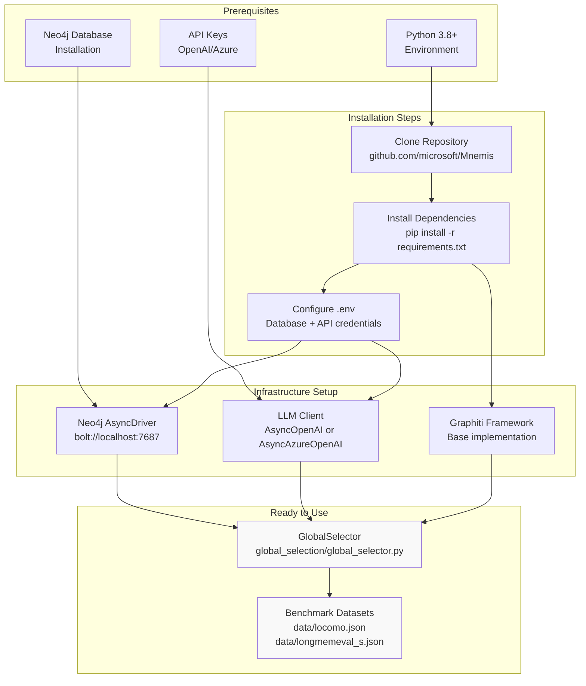
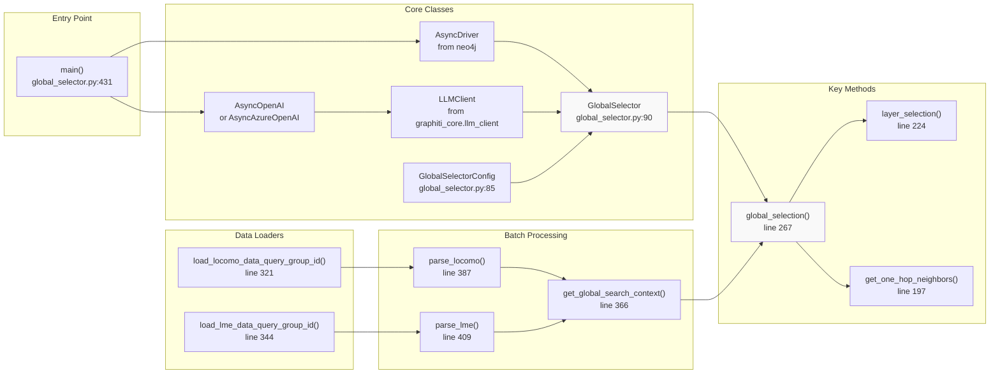
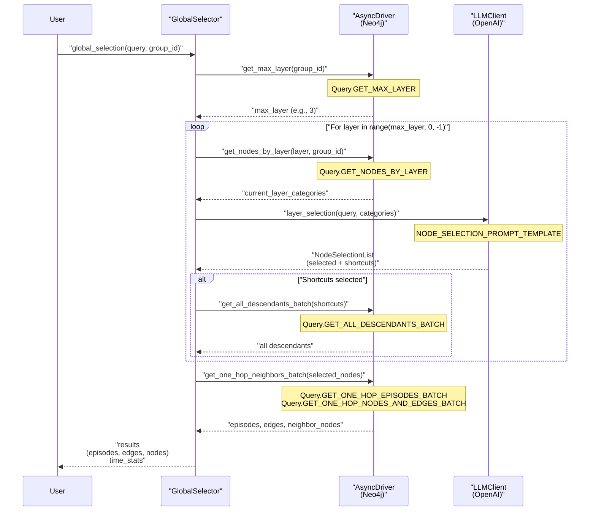

<!-- source: DeepWiki mcp.deepwiki.com · repo microsoft/Mnemis · page 6 Getting Started · fetched 2026-10-26 -->

# Getting Started

<details>
<summary>Relevant source files</summary>

The following files were used as context for generating this wiki page:

- [README.md](README.md)
- [global_selection/global_selector.py](global_selection/global_selector.py)

</details>


This page provides a quickstart guide to set up and run Mnemis, a dual-route retrieval system for long-term LLM memory. It covers the prerequisites, essential setup steps, and basic usage workflows. For detailed installation instructions, see [Installation & Setup](#6.1). For code examples, see [Usage Examples](#6.2). For reproducing benchmark results, see [Running Evaluations](#6.3).

## Purpose and Scope

This guide helps you:
- Set up the required infrastructure (Neo4j database, LLM services)
- Install Mnemis dependencies
- Run your first global selection query
- Execute evaluation scripts on benchmark datasets

For architectural details about how the system works, see [Architecture Overview](#2). For implementation details about the `GlobalSelector` class, see [GlobalSelector Class Reference](#3.1).

## Prerequisites Overview

Mnemis requires the following components to operate:

| Component | Purpose | Configuration Location |
|-----------|---------|----------------------|
| **Neo4j Database** | Stores base graph and hierarchical graph structures | Connection URL, credentials |
| **LLM Service** | Powers System-2 layer selection decisions | OpenAI/Azure API keys |
| **Embedding Service** | Enables System-1 similarity search (via Graphiti) | Model configuration |
| **Python 3.8+** | Runtime environment | Dependencies in requirements |
| **Graphiti Framework** | Base graph operations and memory extraction | Installed as dependency |

**Sources:** [README.md:54-56](), [global_selection/global_selector.py:1-19]()

## System Setup Flow

The following diagram shows the setup process and how components connect:



**Sources:** [global_selection/global_selector.py:431-449](), [README.md:54-56]()

## Core Components and Code Entities

Understanding the key code entities is essential for working with Mnemis:



**Sources:** [global_selection/global_selector.py:85-95](), [global_selection/global_selector.py:224-319](), [global_selection/global_selector.py:321-429]()

## Basic Usage Workflow

Once set up, the typical workflow involves these steps:

### 1. Initialize Infrastructure

Create connections to Neo4j and LLM services:

```python
# From global_selection/global_selector.py:431-441
driver = AsyncGraphDatabase.driver(url, auth=(user, password), 
                                  max_connection_pool_size=1000)
raw_client = AsyncOpenAI(base_url="xxx", api_key="EMPTY")
llm_client = OpenAIClient(client=raw_client)
```

**Sources:** [global_selection/global_selector.py:432-440]()

### 2. Create GlobalSelector Instance

The `GlobalSelector` class orchestrates System-2 retrieval:

```python
# From global_selection/global_selector.py:441
selector = GlobalSelector(driver, llm_client)
```

Configuration options can be provided via `GlobalSelectorConfig`:
- `use_summary`: Include node summaries in selection prompts (default: False)
- `use_tag`: Include node tags in selection prompts (default: True)

**Sources:** [global_selection/global_selector.py:85-94]()

### 3. Execute Global Selection

Call the `global_selection()` method with a query and group_id:

```python
# Returns results dict and time statistics
results, time_stats = await selector.global_selection(query, group_id=group_id)
```

The results contain:
- `episodes`: Retrieved episodic memory nodes (conversations)
- `edges`: Facts (RELATES_TO relationships) with temporal information
- `nodes`: Selected entities and categories with summaries

**Sources:** [global_selection/global_selector.py:267-319]()

### 4. Process Results

Results are structured for downstream LLM consumption:

| Field | Type | Content |
|-------|------|---------|
| `episodes` | list[dict] | Historical conversation chunks with `uuid`, `content`, `valid_at` |
| `edges` | list[dict] | Temporal facts with `fact`, `valid_at`, `invalid_at`, `uuid` |
| `nodes` | list[dict] | Entities/categories with `name`, `tag`, `summary`, `uuid` |

**Sources:** [global_selection/global_selector.py:302-318]()

## Execution Flow Diagram

This diagram shows the runtime flow when executing a global selection query:



**Sources:** [global_selection/global_selector.py:267-319]()

## Running Benchmark Evaluations

Mnemis includes evaluation scripts for two benchmarks:

### LoCoMo Evaluation
```python
# From global_selection/global_selector.py:387-407
await parse_locomo(selector)
```

Configuration:
- Dataset: `data/locomo.json`
- Batch size: 50 queries
- Max concurrent: 10 requests
- Total queries: 1,986 (all users)

**Sources:** [global_selection/global_selector.py:387-407]()

### LongMemEval-S Evaluation
```python
# From global_selection/global_selector.py:409-429
await parse_lme(selector)
```

Configuration:
- Dataset: `data/longmemeval_s.json`
- Batch size: 30 queries
- Max concurrent: 10 requests
- Total queries: 500

**Sources:** [global_selection/global_selector.py:409-429]()

Both evaluation functions:
1. Load query-group_id pairs from JSON datasets
2. Execute `get_global_search_context()` with concurrency control
3. Save results to output JSONL files for downstream answer generation

For detailed evaluation methodology and result analysis, see [Evaluation & Results](#4).

## Caching and Performance

The `GlobalSelector` uses `alru_cache` decorators for performance optimization:

| Method | Cache Size | Purpose |
|--------|-----------|---------|
| `get_max_layer()` | 500 per query | Avoid repeated hierarchy depth lookups |
| `get_nodes_by_layer()` | 500 per query | Cache layer node lists |
| `get_child_nodes()` | 500 per query | Cache parent-child relationships |
| `get_all_descendants()` | 500 per query | Cache subtree traversals |
| `get_one_hop_neighbors()` | 500 per query | Cache neighborhood expansions |

The cache can be cleared manually using `selector.clear_cache()`.

**Sources:** [global_selection/global_selector.py:20](), [global_selection/global_selector.py:96-101](), [global_selection/global_selector.py:103-222]()

## Connection Pooling

The Neo4j driver is configured with a large connection pool to support high concurrency:

```python
# From global_selection/global_selector.py:435
driver = AsyncGraphDatabase.driver(url, auth=(user, password), 
                                  max_connection_pool_size=1000)
```

This enables:
- 50 concurrent QA operations in batch processing
- 10 parallel user evaluations
- Efficient handling of multiple simultaneous global selection queries

**Sources:** [global_selection/global_selector.py:435]()

## Next Steps

After completing basic setup:

1. **For detailed installation**: See [Installation & Setup](#6.1) for step-by-step instructions including Neo4j configuration and API key setup
2. **For code examples**: See [Usage Examples](#6.2) for complete working examples of initializing and using the `GlobalSelector`
3. **For evaluation**: See [Running Evaluations](#6.3) for reproducing benchmark results and interpreting metrics
4. **For configuration**: See [Configuration Options](#3.4) for tuning retrieval parameters and model settings
5. **For architecture**: See [System-2 Global Selection](#2.3) to understand the hierarchical traversal mechanism

**Sources:** [README.md:1-72]()

---

