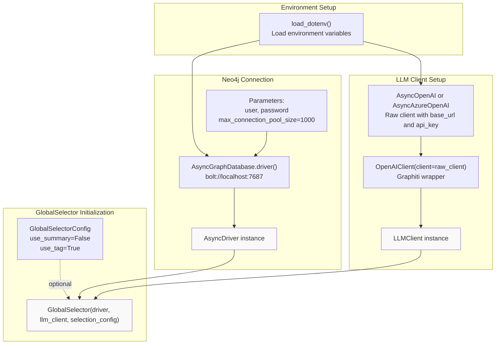
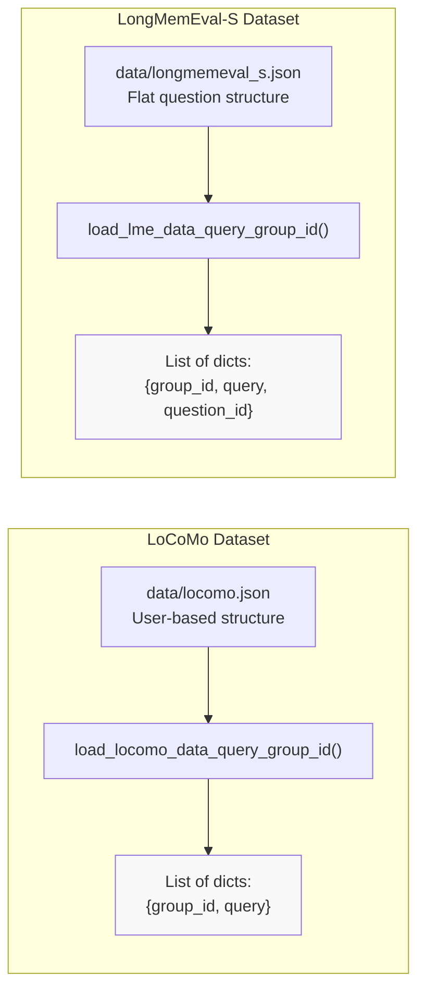
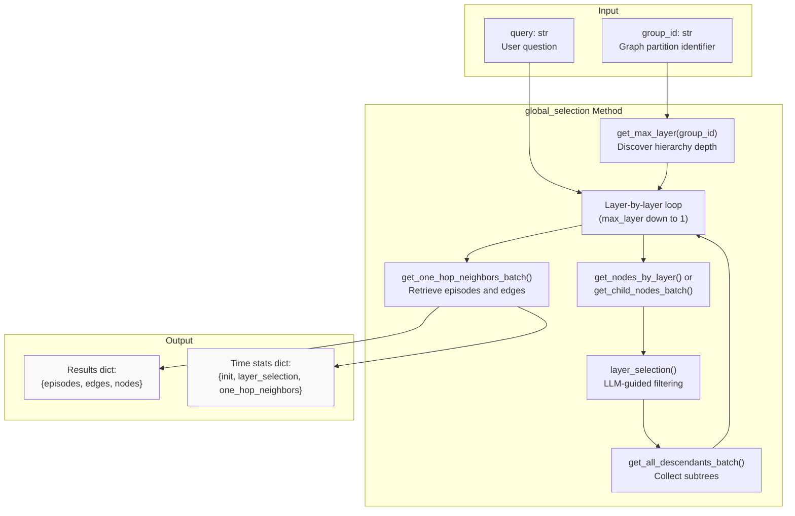
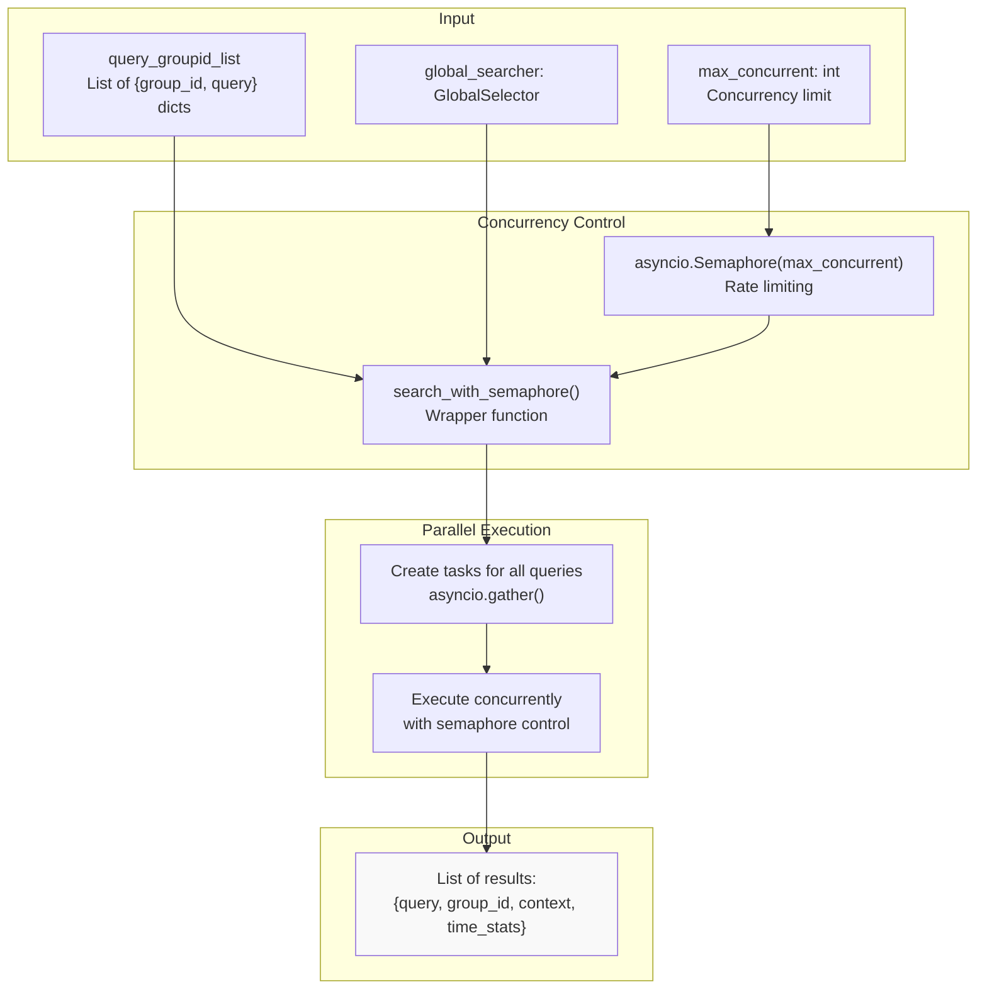
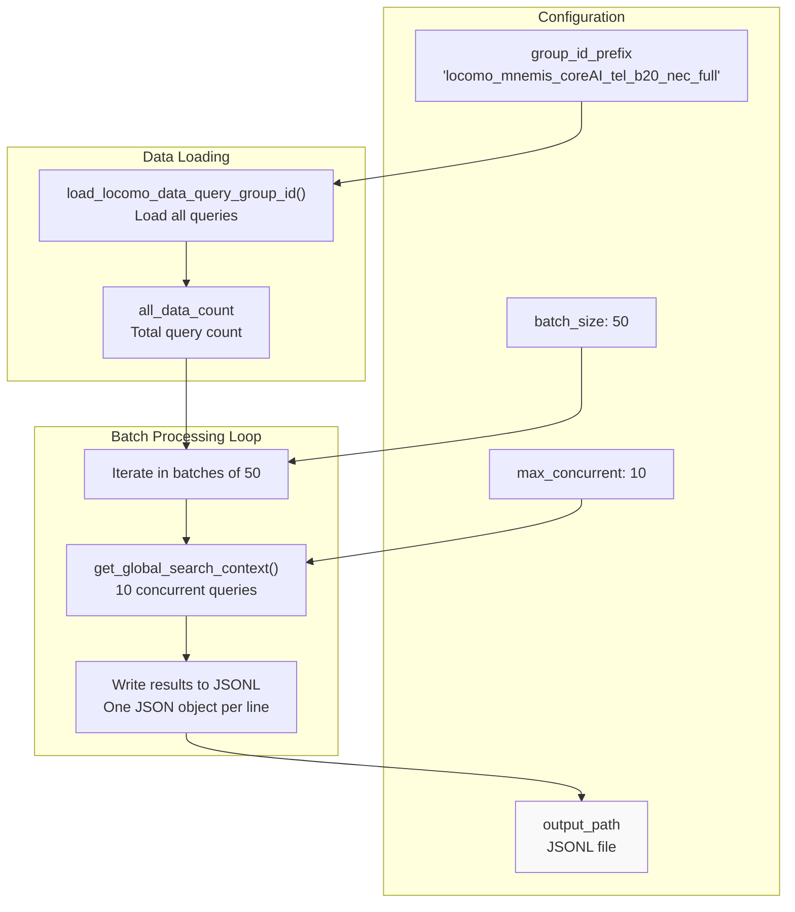
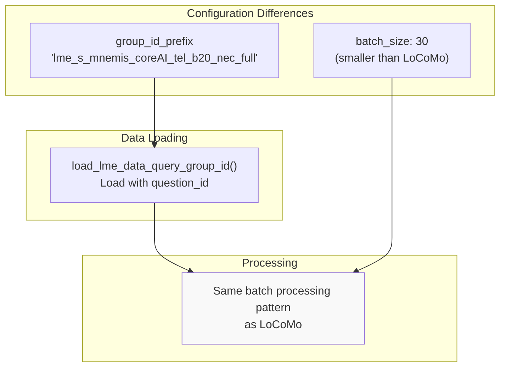

<!-- source: DeepWiki mcp.deepwiki.com · repo microsoft/Mnemis · page 6.2 Usage Examples · fetched 2026-10-26 -->

# Usage Examples

<details>
<summary>Relevant source files</summary>

The following files were used as context for generating this wiki page:

- [README.md](README.md)
- [global_selection/global_selector.py](global_selection/global_selector.py)

</details>


This page provides practical code examples demonstrating how to use the GlobalSelector class for System-2 hierarchical retrieval. It covers initialization, dataset loading, query execution, batch processing, and result handling.

For installation and environment setup, see [Installation & Setup](#6.1). For complete evaluation workflows, see [Running Evaluations](#6.3). For detailed API documentation, see [GlobalSelector Class Reference](#3.1).

---

## Initialization Workflow

The GlobalSelector requires three components: a Neo4j AsyncDriver, an LLM client, and an optional configuration object.



**Sources:** [global_selection/global_selector.py:431-441]()

### Basic Initialization Example

The main initialization pattern follows these steps:

1. **Create Neo4j AsyncDriver** - Establishes connection to the graph database with a large connection pool (1000 connections) to support high concurrency [global_selection/global_selector.py:435]()

2. **Initialize LLM Client** - Creates an AsyncOpenAI or AsyncAzureOpenAI client and wraps it in Graphiti's OpenAIClient [global_selection/global_selector.py:436-440]()

3. **Instantiate GlobalSelector** - Combines the driver and LLM client [global_selection/global_selector.py:441]()

The GlobalSelectorConfig controls which node fields are included during layer selection. By default, it uses `use_tag=True` and `use_summary=False` [global_selection/global_selector.py:85-87]().

**Sources:** [global_selection/global_selector.py:85-94](), [global_selection/global_selector.py:431-441]()

---

## Loading Dataset Queries

Mnemis provides two dataset loader functions that parse benchmark JSON files and extract query-group_id pairs.



**Sources:** [global_selection/global_selector.py:321-364]()

### LoCoMo Dataset Loading

The `load_locomo_data_query_group_id()` function processes LoCoMo's user-based structure [global_selection/global_selector.py:321-342]():

| Parameter | Type | Description |
|-----------|------|-------------|
| `file_path` | str | Path to locomo.json file |
| `group_id_prefix` | str | Prefix for generating group IDs (default: 'locomo_ziyu') |

**Returns:** List of dictionaries, each containing:
- `group_id`: Formatted as `{prefix}_{user_id}`
- `query`: The question text from the QA pair

The function iterates through users and their QA pairs, creating a flat list of queries with corresponding group IDs [global_selection/global_selector.py:335-340]().

**Sources:** [global_selection/global_selector.py:321-342]()

### LongMemEval-S Dataset Loading

The `load_lme_data_query_group_id()` function handles LongMemEval-S's flat structure [global_selection/global_selector.py:344-364]():

| Parameter | Type | Description |
|-----------|------|-------------|
| `file_path` | str | Path to longmemeval_s.json file |
| `group_id_prefix` | str | Prefix for generating group IDs (default: 'lme_s_ziyu') |

**Returns:** List of dictionaries, each containing:
- `group_id`: Formatted as `{prefix}_{user_id}`
- `query`: The question text
- `question_id`: Original question identifier from the dataset

This function uses pandas to read the JSON file and converts it to a list of records [global_selection/global_selector.py:354]().

**Sources:** [global_selection/global_selector.py:344-364]()

---

## Single Query Execution

The core method for executing hierarchical retrieval is `global_selection()`, which performs top-down traversal with LLM-guided node selection.



**Sources:** [global_selection/global_selector.py:267-319]()

### Method Signature

The `global_selection()` method is defined at [global_selection/global_selector.py:267]():

```python
async def global_selection(self, query: str, group_id: str) -> tuple[dict, dict]:
```

### Execution Flow

1. **Initialize** - Get the maximum layer in the hierarchy [global_selection/global_selector.py:271-272]()

2. **Layer Traversal** - Iterate from max_layer down to layer 1 [global_selection/global_selector.py:277]():
   - Get nodes at current layer [global_selection/global_selector.py:279-283]()
   - Perform LLM-guided selection [global_selection/global_selector.py:285]()
   - Collect descendants of shortcut nodes [global_selection/global_selector.py:289-291]()

3. **Context Expansion** - Retrieve one-hop neighbors (episodes and edges) for all selected nodes [global_selection/global_selector.py:299]()

4. **Format Results** - Convert timestamps to readable strings [global_selection/global_selector.py:302-312]()

### Result Structure

The method returns a tuple containing two dictionaries:

**Results Dictionary:**
| Key | Type | Description |
|-----|------|-------------|
| `episodes` | list[dict] | Episodic nodes (memories) connected to selected entities |
| `edges` | list[dict] | RELATES_TO relationships with fact text and timestamps |
| `nodes` | list[dict] | All selected Category and Entity nodes |

**Time Statistics Dictionary:**
| Key | Type | Description |
|-----|------|-------------|
| `init` | float | Time to discover hierarchy depth |
| `layer_selection` | float | Time for all layer-by-layer selections |
| `one_hop_neighbors` | float | Time to retrieve context expansion |

**Sources:** [global_selection/global_selector.py:267-319]()

---

## Batch Processing

For processing multiple queries concurrently, Mnemis provides the `get_global_search_context()` helper function with semaphore-based concurrency control.



**Sources:** [global_selection/global_selector.py:366-385]()

### Batch Processing Configuration

The `get_global_search_context()` function accepts:

| Parameter | Type | Description |
|-----------|------|-------------|
| `query_groupid_list` | list[dict] | List of query-group_id pairs from dataset loaders |
| `global_searcher` | GlobalSelector | Initialized GlobalSelector instance |
| `max_concurrent` | int | Maximum concurrent queries (default: 5) |

**Returns:** List of dictionaries containing query, group_id, context (results from global_selection), and time_stats.

The function uses `asyncio.Semaphore` to limit concurrent operations, preventing database connection exhaustion [global_selection/global_selector.py:367-373]().

**Sources:** [global_selection/global_selector.py:366-385]()

### Batch Mode Selection

Several GlobalSelector methods support two batch processing modes [global_selection/global_selector.py:129-142](), [global_selection/global_selector.py:203-222]():

| Mode | Description | Use Case |
|------|-------------|----------|
| `mp` | Multiprocessing - Creates separate tasks for each UUID and uses asyncio.gather | Better cache utilization via `@alru_cache` decorator |
| `batch` | Single query - Passes all UUIDs in one Cypher query | More efficient database query when cache is cold |

The default mode is `batch` [global_selection/global_selector.py:269](), which is used for all batch operations during global_selection.

**Sources:** [global_selection/global_selector.py:129-142](), [global_selection/global_selector.py:153-166](), [global_selection/global_selector.py:203-222](), [global_selection/global_selector.py:269]()

---

## Complete Workflow Examples

Mnemis includes two complete workflow functions demonstrating end-to-end processing for each benchmark dataset.

### LoCoMo Processing Workflow

The `parse_locomo()` function demonstrates a complete LoCoMo evaluation workflow [global_selection/global_selector.py:387-407]():



**Key parameters:**
- `batch_size=50` - Process 50 queries before writing to disk [global_selection/global_selector.py:390]()
- `max_concurrent=10` - Run 10 global_selection operations concurrently [global_selection/global_selector.py:389]()
- Output format: JSONL (one JSON object per line) [global_selection/global_selector.py:404-405]()

The function includes progress tracking via tqdm and periodic saving to prevent data loss [global_selection/global_selector.py:397]().

**Sources:** [global_selection/global_selector.py:387-407]()

### LongMemEval-S Processing Workflow

The `parse_lme()` function follows a similar pattern for LongMemEval-S [global_selection/global_selector.py:409-429]():



**Key differences from LoCoMo:**
- Smaller batch size (30 vs 50) due to potentially longer conversations [global_selection/global_selector.py:412]()
- Uses `load_lme_data_query_group_id()` which includes `question_id` field [global_selection/global_selector.py:415]()

**Sources:** [global_selection/global_selector.py:409-429]()

### Main Function Pattern

The `main()` function demonstrates the complete initialization and execution pattern [global_selection/global_selector.py:431-448]():

| Step | Code Location | Description |
|------|---------------|-------------|
| 1. Load environment | [global_selection/global_selector.py:5]() | Load .env configuration |
| 2. Create driver | [global_selection/global_selector.py:435]() | AsyncGraphDatabase.driver with 1000 connection pool |
| 3. Create LLM client | [global_selection/global_selector.py:436-440]() | AsyncOpenAI wrapped in OpenAIClient |
| 4. Initialize selector | [global_selection/global_selector.py:441]() | GlobalSelector instance |
| 5. Execute workflow | [global_selection/global_selector.py:444-445]() | Call parse_locomo() or parse_lme() |
| 6. Track statistics | [global_selection/global_selector.py:448]() | Print token usage via llm_client.get_token_stats() |

The main function is designed to run as an async entry point via `asyncio.run(main())` [global_selection/global_selector.py:452]().

**Sources:** [global_selection/global_selector.py:431-452]()

---

## Cache Management

The GlobalSelector uses `@alru_cache` decorators with 500 entries per query to optimize repeated database operations [global_selection/global_selector.py:20]().

### Cached Methods

The following methods are cached [global_selection/global_selector.py:103-201]():

| Method | Cache Key | Purpose |
|--------|-----------|---------|
| `get_max_layer` | (group_id) | Hierarchy depth per graph partition |
| `get_nodes_by_layer` | (layer, group_id) | All nodes at a specific layer |
| `get_child_nodes` | (parent_uuid, group_id) | Children of a category node |
| `get_all_descendants` | (parent_uuid, group_id) | All descendants in subtree |
| `get_one_hop_neighbors` | (node_uuid, group_id) | Episodes and edges connected to node |

### Cache Clearing

To clear all caches (e.g., between different user queries), use the `clear_cache()` method [global_selection/global_selector.py:96-101]():

```python
selector.clear_cache()
```

This calls `cache_clear()` on all five cached methods. Cache clearing is typically not needed during batch processing of a single benchmark since each query operates on a different group_id.

**Sources:** [global_selection/global_selector.py:20](), [global_selection/global_selector.py:96-101](), [global_selection/global_selector.py:103-201]()

---

## Result Processing

Each result from `global_selection()` contains structured memory context suitable for RAG_GRAPH merging with System-1 similarity search results.

### Episode Structure

Episodes represent historical conversation messages [global_selection/global_selector.py:309]():

```
{
  "uuid": "episode-uuid-string",
  "content": "Message text content",
  "valid_at": "2024/01/15 (Mon) 14:30"
}
```

### Edge (Fact) Structure

Edges represent RELATES_TO relationships with temporal information [global_selection/global_selector.py:310]():

```
{
  "uuid": "fact-uuid-string",
  "fact": "Fact statement text",
  "valid_at": "2024/01/15 (Mon) 14:30",
  "invalid_at": "2024/01/20 (Sat) 09:00"  // or null if still valid
}
```

### Node (Entity/Category) Structure

Nodes include both selected categories and entities from context expansion [global_selection/global_selector.py:312]():

```
{
  "uuid": "node-uuid-string",
  "name": "Node name",
  "tag": "node-type-tag",
  "summary": "Node summary text",
  "layer": 0  // for entities, or layer number for categories
}
```

### Timestamp Formatting

All timestamps are converted from datetime objects to human-readable strings in the format "YYYY/MM/DD (Day) HH:MM" [global_selection/global_selector.py:302-306]().

**Sources:** [global_selection/global_selector.py:302-319]()

---

**Sources:** [README.md:1-72](), [global_selection/global_selector.py:1-453]()

---

