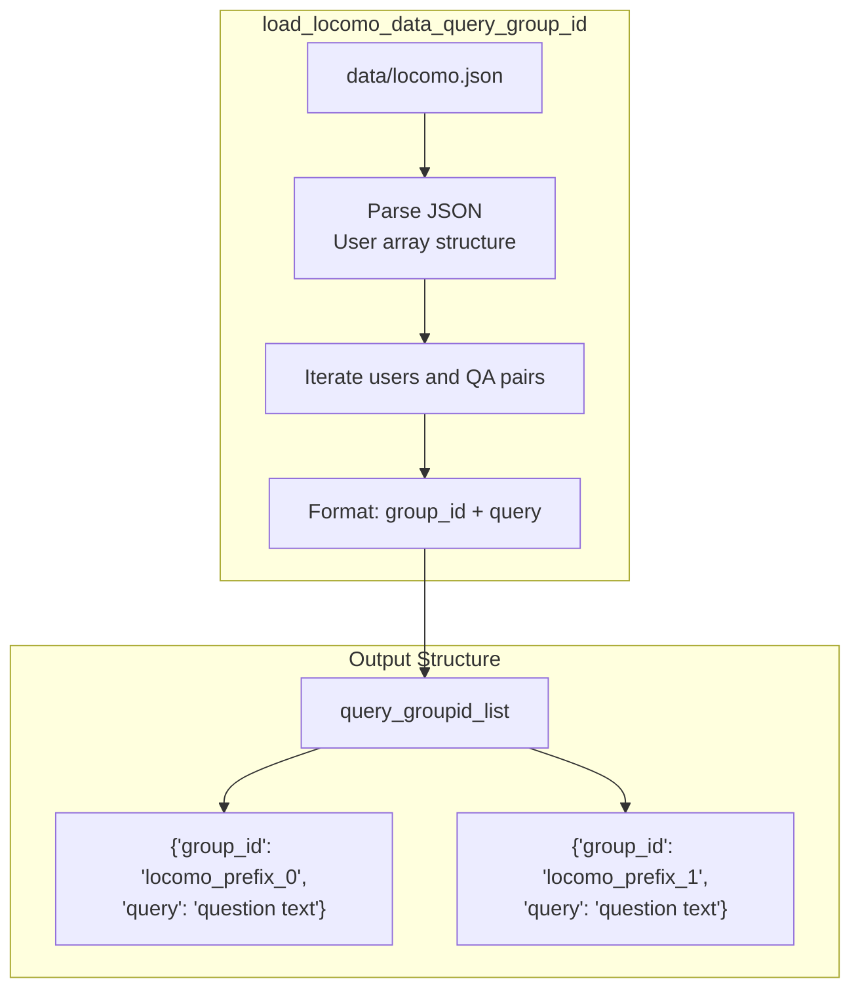
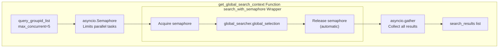
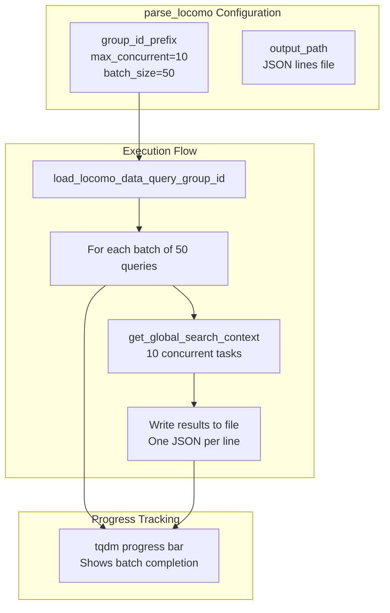
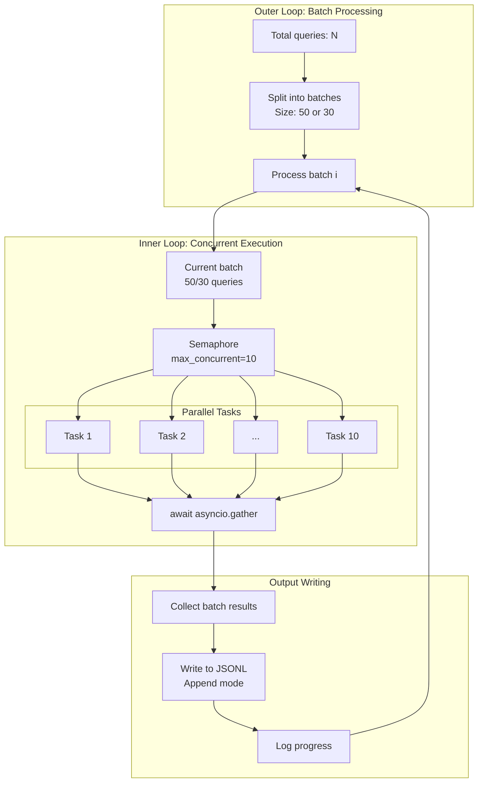
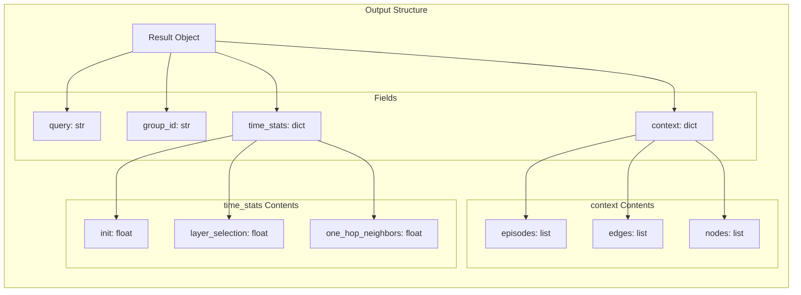
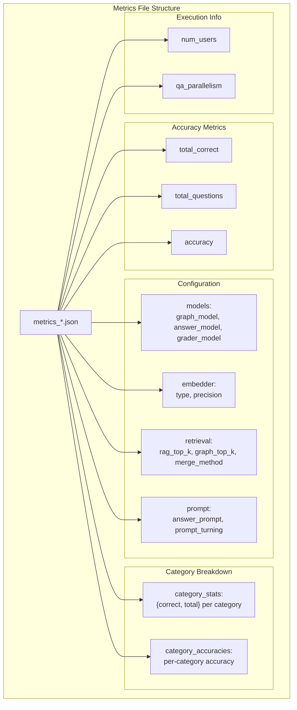
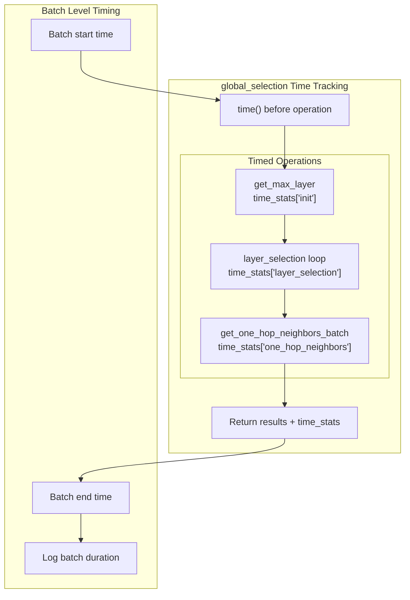

<!-- source: DeepWiki mcp.deepwiki.com · repo microsoft/Mnemis · page 6.3 Running Evaluations · fetched 2026-10-26 -->

# Running Evaluations

<details>
<summary>Relevant source files</summary>

The following files were used as context for generating this wiki page:

- [global_selection/global_selector.py](global_selection/global_selector.py)
- [results/locomo/metrics_graphiti_gpt-41-mini-shortco-2025-04-14-Bing_gpt-41-mini-shortco-2025-04-14-Bing_ragtopk10_gtopk20_RAG_GRAPH.json](results/locomo/metrics_graphiti_gpt-41-mini-shortco-2025-04-14-Bing_gpt-41-mini-shortco-2025-04-14-Bing_ragtopk10_gtopk20_RAG_GRAPH.json)

</details>


This page provides a practical guide to reproducing Mnemis benchmark results by running evaluation scripts on LoCoMo and LongMemEval-S datasets. It covers dataset loading, configuration setup, batch processing execution, and output interpretation. For information about the benchmark datasets themselves, see [Benchmark Datasets](#4.1). For analysis of results and accuracy metrics, see [Evaluation & Results](#4).

## Dataset Preparation

The evaluation system provides two loader functions that parse benchmark JSON files and extract query-group_id pairs for processing.

### LoCoMo Dataset Loading

The `load_locomo_data_query_group_id` function [global_selection/global_selector.py:321-342]() reads the LoCoMo benchmark file and generates a list of query-group_id mappings:



**Dataset Loading for LoCoMo**

| Parameter | Type | Description |
|-----------|------|-------------|
| `file_path` | str | Path to `locomo.json` file |
| `group_id_prefix` | str | Prefix for generated group IDs (default: `'locomo_ziyu'`) |
| **Returns** | list[dict] | List of `{'group_id': str, 'query': str}` dictionaries |

The function iterates through the JSON structure, which contains an array of users, each with a `qa` array. For each question, it creates a unique `group_id` by appending the user index to the prefix: `f"{group_id_prefix}_{user_id}"`.

**Sources:** [global_selection/global_selector.py:321-342]()

### LongMemEval-S Dataset Loading

The `load_lme_data_query_group_id` function [global_selection/global_selector.py:344-364]() handles the LongMemEval-S dataset with a slightly different structure:

```python
# Example usage
query_groupid_list = load_lme_data_query_group_id(
    'data/longmemeval_s.json', 
    group_id_prefix='lme_s_ziyu'
)
```

| Parameter | Type | Description |
|-----------|------|-------------|
| `file_path` | str | Path to `longmemeval_s.json` file |
| `group_id_prefix` | str | Prefix for generated group IDs (default: `'lme_s_ziyu'`) |
| **Returns** | list[dict] | List of `{'group_id': str, 'query': str, 'question_id': str}` dictionaries |

This loader uses pandas to read the JSON and includes the `question_id` field from the source data, which is useful for tracking specific questions during analysis.

**Sources:** [global_selection/global_selector.py:344-364]()

## Evaluation Pipeline Architecture

The evaluation system orchestrates batch processing of queries through a concurrent execution pipeline:

```mermaid
graph LR
    subgraph "Data Loading"
        LOAD_FUNC["load_*_data_query_group_id"]
        QUERY_LIST["query_groupid_list<br/>[{group_id, query}, ...]"]
    end
    
    subgraph "Batch Processing Loop"
        BATCH["Batch Splitter<br/>batch_size=50 (locomo)<br/>batch_size=30 (lme_s)"]
        GET_CONTEXT["get_global_search_context"]
    end
    
    subgraph "Concurrent Execution"
        SEMAPHORE["asyncio.Semaphore<br/>max_concurrent=10"]
        GS["global_searcher.global_selection"]
    end
    
    subgraph "Output"
        FILE["Output JSONL file<br/>One result per line"]
        RESULT["{'query', 'group_id',<br/>'context', 'time_stats'}"]
    end
    
    LOAD_FUNC --> QUERY_LIST
    QUERY_LIST --> BATCH
    BATCH --> GET_CONTEXT
    GET_CONTEXT --> SEMAPHORE
    SEMAPHORE --> GS
    GS --> RESULT
    RESULT --> FILE
```



**Evaluation Pipeline from Data to Results**

**Sources:** [global_selection/global_selector.py:366-429]()

## Execution Setup

### GlobalSelector Initialization

Before running evaluations, initialize the required components [global_selection/global_selector.py:431-441]():

```python
# Database connection
driver = AsyncGraphDatabase.driver(
    url='bolt://localhost:7687',
    auth=(user, password),
    max_connection_pool_size=1000
)

# LLM client setup
raw_client = AsyncOpenAI(base_url="...", api_key="...")
llm_client = OpenAIClient(client=raw_client)

# GlobalSelector instantiation
selector = GlobalSelector(driver, llm_client)
```

| Component | Configuration | Purpose |
|-----------|---------------|---------|
| `AsyncDriver` | `max_connection_pool_size=1000` | Supports high concurrency |
| `AsyncOpenAI` | Base URL + API key | LLM service for layer selection |
| `OpenAIClient` | Wraps raw client | Graphiti-compatible interface |
| `GlobalSelector` | Driver + LLM client | Main evaluation orchestrator |

**Sources:** [global_selection/global_selector.py:431-441]()

### Concurrency Control

The `get_global_search_context` function [global_selection/global_selector.py:366-385]() implements semaphore-based concurrency:



**Semaphore-Controlled Concurrent Execution**

The semaphore ensures that at most `max_concurrent` queries execute simultaneously, preventing database overload while maintaining parallelism.

**Sources:** [global_selection/global_selector.py:366-385]()

## Running LoCoMo Evaluation

The `parse_locomo` function [global_selection/global_selector.py:387-408]() orchestrates the full LoCoMo benchmark evaluation:



**LoCoMo Evaluation Execution Flow**

### Configuration Parameters

| Parameter | Value | Rationale |
|-----------|-------|-----------|
| `group_id_prefix` | `'locomo_mnemis_coreAI_tel_b20_nec_full'` | Identifies the specific Neo4j data partition |
| `max_concurrent` | `10` | Balances throughput and resource usage |
| `batch_size` | `50` | Queries per processing batch |
| `output_path` | JSONL file path | Incremental result storage |

The function processes 1,986 total queries in batches, writing results incrementally to avoid memory issues.

**Sources:** [global_selection/global_selector.py:387-408]()

## Running LongMemEval-S Evaluation

The `parse_lme` function [global_selection/global_selector.py:409-429]() follows a similar pattern with adjusted parameters:

```python
# Key differences from parse_locomo
group_id_prefix = 'lme_s_mnemis_coreAI_tel_b20_nec_full'
batch_size = 30  # Smaller batches
```

| Parameter | LoCoMo Value | LME-S Value | Reason for Difference |
|-----------|--------------|-------------|----------------------|
| `batch_size` | 50 | 30 | LME-S queries may require more processing time |
| Total queries | 1,986 | 500 | Different dataset sizes |
| `group_id_prefix` | `'locomo_mnemis_...'` | `'lme_s_mnemis_...'` | Different data partitions |

**Sources:** [global_selection/global_selector.py:409-429]()

## Batch Processing Mechanics

The evaluation system uses nested concurrency control for efficient processing:



**Nested Batch and Concurrent Processing Architecture**

### Processing Characteristics

| Level | Mechanism | Purpose |
|-------|-----------|---------|
| Batch Loop | Sequential iteration with `tqdm` | Process dataset in manageable chunks |
| Concurrent Execution | `asyncio.gather` with semaphore | Parallelize within batch |
| Result Writing | Incremental file append | Avoid memory overflow, enable resume |

The two-level structure allows processing large datasets (1,986 queries) while maintaining bounded resource usage.

**Sources:** [global_selection/global_selector.py:387-429]()

## Output Format

Each evaluation produces a JSONL (JSON Lines) file where each line contains a complete search result:



**Output Result Object Structure**

### Result Schema

```python
{
    "query": "What is the user's favorite restaurant?",
    "group_id": "locomo_mnemis_exp_41mini_0",
    "context": {
        "episodes": [
            {
                "uuid": "...",
                "content": "User mentioned they love Italian food",
                "valid_at": "2024/03/15 (Fri) 14:30"
            }
        ],
        "edges": [
            {
                "uuid": "...",
                "fact": "User PREFERS Italian cuisine",
                "valid_at": "2024/03/15 (Fri) 14:30",
                "invalid_at": null
            }
        ],
        "nodes": [
            {
                "uuid": "...",
                "name": "Italian Cuisine",
                "tag": "Preference",
                "summary": "User's food preference"
            }
        ]
    },
    "time_stats": {
        "init": 0.002,
        "layer_selection": 1.234,
        "one_hop_neighbors": 0.456
    }
}
```

**Sources:** [global_selection/global_selector.py:366-385](), [global_selection/global_selector.py:302-319]()

## Metrics File Format

After evaluation completes, a separate metrics file summarizes accuracy results [results/locomo/metrics_*.json]():



**Metrics JSON Structure**

### Key Metrics Fields

| Field | Example Value | Description |
|-------|---------------|-------------|
| `total_correct` | 1590 | Number of correctly answered questions |
| `total_questions` | 1986 | Total questions evaluated |
| `accuracy` | 0.8006 | Overall accuracy (80.06%) |
| `config.models.graph_model` | `"gpt-41-mini-shortco-2025-04-14-Bing"` | Model used for global selection |
| `config.retrieval.rag_top_k` | 10 | RAG retrieval limit |
| `config.retrieval.graph_top_k` | 20 | Graph retrieval limit |
| `config.retrieval.merge_method` | `"RAG_GRAPH"` | Hybrid merge strategy |
| `category_accuracies` | Per-category dict | Breakdown by question category |

**Sources:** [results/locomo/metrics_graphiti_gpt-41-mini-shortco-2025-04-14-Bing_gpt-41-mini-shortco-2025-04-14-Bing_ragtopk10_gtopk20_RAG_GRAPH.json]()

## Performance Monitoring

The evaluation system tracks timing statistics at multiple levels:

### Time Statistics Collection



**Multi-Level Performance Tracking**

The `time_stats` dictionary provides insight into which operations consume the most time:
- `init`: Graph structure discovery (max layer calculation)
- `layer_selection`: Iterative LLM-guided filtering
- `one_hop_neighbors`: Context expansion for selected nodes

**Sources:** [global_selection/global_selector.py:267-319]()

## Example Execution

Complete example of running evaluations [global_selection/global_selector.py:431-452]():

```python
async def main():
    # Setup
    url = 'bolt://localhost:7687'
    user = 'neo4j'
    password = 'your_password'
    driver = AsyncGraphDatabase.driver(
        url, 
        auth=(user, password), 
        max_connection_pool_size=1000
    )
    raw_client = AsyncOpenAI(base_url="...", api_key="EMPTY")
    llm_client = OpenAIClient(client=raw_client)
    selector = GlobalSelector(driver, llm_client)
    
    # Run evaluation
    start = time()
    await parse_locomo(selector)
    # Or: await parse_lme(selector)
    end = time()
    
    # Report statistics
    print(f"Total time taken: {end - start} s")
    print(selector.llm_client.get_token_stats())

if __name__ == "__main__":
    asyncio.run(main())
```

### Expected Console Output

```
Loaded 1986 queries from locomo data.
Processing Batches (locomo, b=50): 100%|██████████| 40/40 [12:34<00:00, 18.5s/it]
Processed 50 queries, saving results...
Batch 1 results saved to /data/zh/gs/v2_locomo_mnemis_coreAI_tel_b20_nec_full.json
...
Total time taken: 754.23 s
Token usage: {'total_tokens': 1234567, 'prompt_tokens': 987654, ...}
```

**Sources:** [global_selection/global_selector.py:431-452]()

## Troubleshooting

### Common Issues

| Issue | Symptom | Solution |
|-------|---------|----------|
| Database connection errors | "Unable to connect to bolt://..." | Verify Neo4j is running, check credentials |
| Memory overflow | Python process killed | Reduce `batch_size` or `max_concurrent` |
| Slow execution | Progress bar stalls | Check LLM API latency, consider increasing `max_connection_pool_size` |
| Cache misses | Repeated database queries | Ensure `CACHE_SIZE_PER_QUERY=500` is sufficient |
| LLM timeout | Requests fail intermittently | Add retry logic or increase timeout in `OpenAIClient` |

### Cache Management

The `GlobalSelector` maintains an LRU cache for frequently accessed graph queries [global_selection/global_selector.py:96-101]():

```python
# Clear cache between evaluation runs if needed
selector.clear_cache()
```

This clears caches for:
- `get_max_layer`
- `get_nodes_by_layer`
- `get_child_nodes`
- `get_all_descendants`
- `get_one_hop_neighbors`

**Sources:** [global_selection/global_selector.py:96-101](), [global_selection/global_selector.py:20]()

## Next Steps

After running evaluations:
1. Analyze results using the metrics files - see [LoCoMo Results](#4.2) and [LongMemEval-S Results](#4.3)
2. Compare different configurations - see [Configuration Impact Analysis](#4.4)
3. Examine specific QA examples - see [Results Data Format](#4.5) and [Case Studies](#5)
4. Tune retrieval parameters based on results - see [Configuration Options](#3.4)

**Sources:** [global_selection/global_selector.py:387-452](), [results/locomo/metrics_graphiti_gpt-41-mini-shortco-2025-04-14-Bing_gpt-41-mini-shortco-2025-04-14-Bing_ragtopk10_gtopk20_RAG_GRAPH.json]()

---

