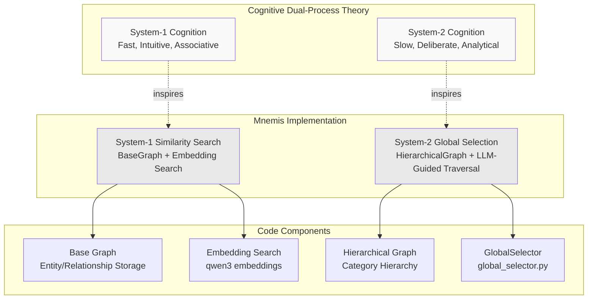
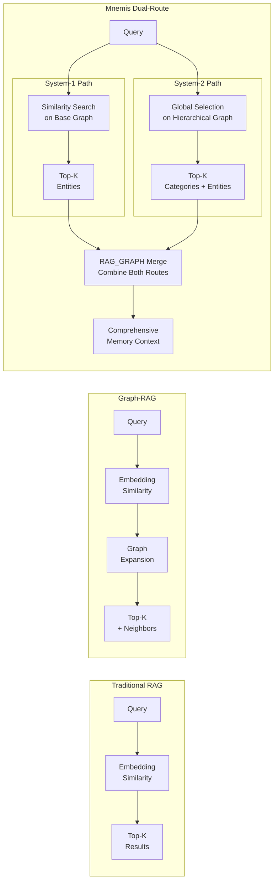
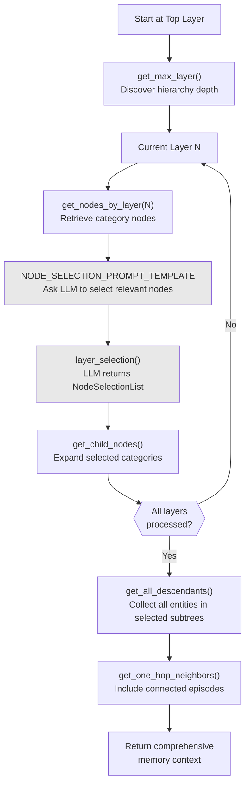
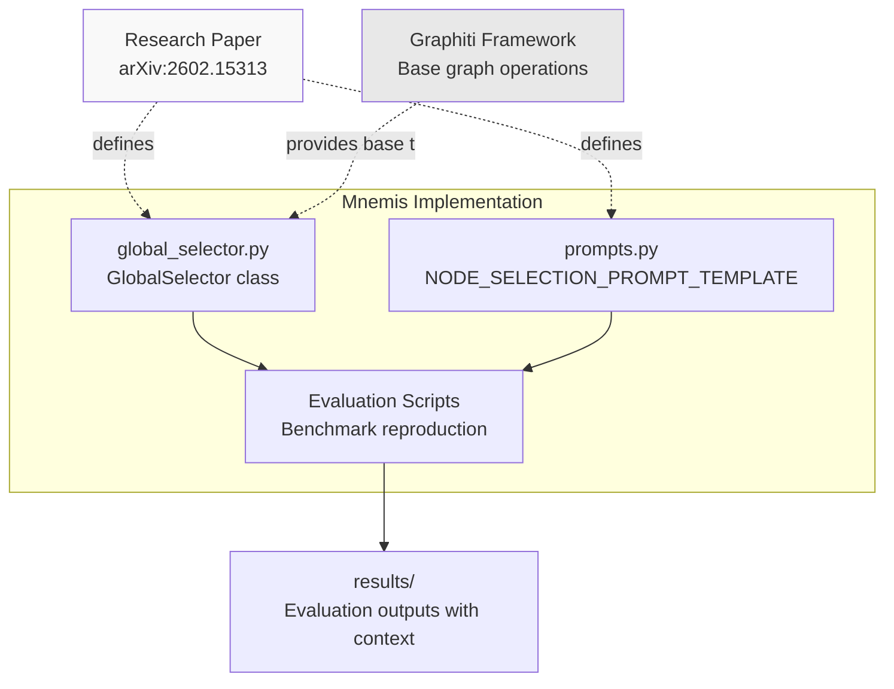

<!-- source: DeepWiki mcp.deepwiki.com · repo microsoft/Mnemis · page 7 Research Background · fetched 2026-10-26 -->

# Research Background

<details>
<summary>Relevant source files</summary>

The following files were used as context for generating this wiki page:

- [Mnemis_paper.pdf](Mnemis_paper.pdf)
- [README.md](README.md)

</details>


## Purpose and Scope

This page provides an overview of the research foundations underlying Mnemis, including its theoretical motivation from cognitive dual-process theory, the limitations of existing memory retrieval approaches, and how Mnemis addresses these gaps through a dual-route architecture. This material contextualizes the technical implementation documented elsewhere in this wiki.

For detailed technical explanations of the memory components, see [Memory Components](#2.1). For implementation details of the retrieval mechanisms, see [System-1 Similarity Search](#2.2) and [System-2 Global Selection](#2.3). For theoretical depth and cognitive science connections, see [Theoretical Foundation](#7.1). For comprehensive comparisons with existing approaches, see [Comparison with Existing Approaches](#7.2).

---

## Research Motivation

Mnemis addresses a fundamental limitation in existing long-term memory systems for Large Language Models: **similarity-based retrieval mechanisms alone are insufficient for comprehensive memory access**. While traditional Retrieval-Augmented Generation (RAG) and Graph-RAG approaches excel at retrieving semantically similar memories, they struggle with scenarios requiring global reasoning or complete information coverage.

### The Core Problem

Current memory systems primarily rely on **System-1-style retrieval**—fast, intuitive similarity searches using embedding-based techniques. This approach encounters failures in three key scenarios:

1. **Global Information Needs**: Queries requiring comprehensive understanding across multiple semantic domains
2. **Structural Reasoning**: Questions that depend on relationships and hierarchical organization rather than local similarity
3. **Complete Coverage**: Situations where all relevant information must be retrieved, not just the most similar items

The research insight motivating Mnemis is that human memory operates through **two complementary routes**: fast associative retrieval (System-1) and deliberate analytical reasoning (System-2). Effective AI memory systems should mirror this dual-process architecture.

**Sources:** [README.md:15-23]()

---

## Dual-Process Theory Foundation

Mnemis is grounded in cognitive dual-process theory, which posits that human cognition operates through two distinct systems with complementary strengths.

### Cognitive Systems Mapping



**Diagram: Mapping from Cognitive Theory to Code Implementation**

### System Characteristics

| Aspect | System-1 (Similarity Search) | System-2 (Global Selection) |
|--------|------------------------------|------------------------------|
| **Cognitive Process** | Intuitive, associative | Deliberate, analytical |
| **Speed** | Fast, parallel | Slower, sequential |
| **Mechanism** | Embedding similarity | LLM-guided reasoning |
| **Graph Type** | Base graph (flat structure) | Hierarchical graph (semantic layers) |
| **Retrieval Pattern** | Local neighborhood expansion | Top-down hierarchical traversal |
| **Key Implementation** | Vector similarity search | `GlobalSelector.global_selection()` |
| **Best For** | Semantically similar content | Comprehensive, structured coverage |

The key innovation is that Mnemis implements **both systems simultaneously** and merges their results using the `RAG_GRAPH` merge strategy, combining semantic relevance with structural completeness.

**Sources:** [README.md:15-23]()

---

## Architectural Innovation

Mnemis introduces three core innovations that differentiate it from existing memory approaches:

### 1. Dual-Route Retrieval Architecture



**Diagram: Architectural Comparison - Traditional vs. Mnemis**

### 2. Hierarchical Graph Construction

Mnemis extends the base graph with a hierarchical semantic structure guided by three principles:

- **Minimum Concept Abstraction**: Each category node represents the most specific abstraction that covers its children
- **Many-to-Many Mapping**: Entities can belong to multiple categories, reflecting natural semantic overlap
- **Compression Efficiency Constraint**: Hierarchical layers provide meaningful information compression

This hierarchy enables the `GlobalSelector` class to perform top-down traversal, using LLM intelligence at each layer to select relevant branches.

### 3. LLM-Guided Traversal

Unlike similarity search which operates on static embeddings, System-2 uses the LLM's reasoning capabilities dynamically during retrieval:



**Diagram: System-2 LLM-Guided Traversal Process with Code Entity References**

**Sources:** [README.md:25-29]()

---

## Key Research Contributions

The Mnemis paper presents three main contributions that advance the field of long-term LLM memory:

### 1. Dual-Route Framework Integration

First systematic integration of System-1 (similarity-based) and System-2 (reasoning-based) retrieval mechanisms for LLM memory, enabling both semantic retrieval and deliberate top-down reasoning over memory structures.

### 2. Hierarchical Graph Design with Guiding Principles

Novel construction methodology for hierarchical memory graphs with three design constraints:
- **Minimum Concept Abstraction**: Ensures semantic coherence at each layer
- **Many-to-Many Mapping**: Allows flexible, realistic semantic relationships
- **Compression Efficiency**: Maintains manageable hierarchy depth while preserving information

### 3. State-of-the-Art Empirical Results

Comprehensive experimental validation demonstrating effectiveness:

| Benchmark | Mnemis Score | Previous SOTA | Improvement |
|-----------|--------------|---------------|-------------|
| **LoCoMo** | 93.9% | 87.2% | +6.7pp |
| **LongMemEval-S** | 91.6% | 87.8% | +3.8pp |

Both scores achieved using `gpt-4.1-mini` (referred to as `gpt-41-mini` in configuration files), demonstrating efficiency with smaller models.

**Sources:** [README.md:20-23](), [README.md:32-40]()

---

## Implementation Foundation

Mnemis is implemented as an extension of the **Graphiti framework**, an open-source library for graph-based memory management. The core System-2 implementation is contained in the `global_selection` module.

### Code Organization



**Diagram: From Research Paper to Code Implementation**

The implementation enables researchers and practitioners to:
- Reproduce benchmark results documented in the paper
- Extend the System-2 global selection mechanism
- Experiment with alternative hierarchical graph designs
- Apply Mnemis to new long-term memory tasks

**Sources:** [README.md:54-56]()

---

## Paper Access and Citation

The complete research paper is available through multiple channels:

### Access Points

- **arXiv**: [2602.15313](https://arxiv.org/abs/2602.15313)
- **Hugging Face Papers**: [🤗 HuggingFace](https://huggingface.co/papers/2602.15313)
- **Repository**: [github.com/microsoft/Mnemis](https://github.com/microsoft/Mnemis)

### Citation

```bibtex
@misc{tang2026mnemisdualrouteretrievalhierarchical,
      title={Mnemis: Dual-Route Retrieval on Hierarchical Graphs for Long-Term LLM Memory}, 
      author={Zihao Tang and Xin Yu and Ziyu Xiao and Zengxuan Wen and Zelin Li and Jiaxi Zhou and Hualei Wang and Haohua Wang and Haizhen Huang and Weiwei Deng and Feng Sun and Qi Zhang},
      year={2026},
      eprint={2602.15313},
      archivePrefix={arXiv},
      primaryClass={cs.CL},
      url={https://arxiv.org/abs/2602.15313}, 
}
```

For detailed citation information and related publications, see [Paper & Citations](#7.3).

**Sources:** [README.md:3-13](), [README.md:58-71]()

---

## Related Research Areas

Mnemis connects to several active research domains:

### Memory-Augmented LLMs
- Long-term memory systems for conversational AI
- Persistent context management across sessions
- Memory consolidation and forgetting mechanisms

### Retrieval-Augmented Generation
- Hybrid retrieval strategies combining multiple signals
- Context selection for generation tasks
- Retrieval evaluation methodologies

### Graph-Based Knowledge Representation
- Hierarchical knowledge graphs
- Semantic categorization systems
- Graph neural networks for retrieval

### Cognitive Architectures
- Dual-process theory in AI systems
- Fast-and-slow thinking for language models
- Deliberate reasoning mechanisms

For in-depth theoretical discussion connecting these areas to Mnemis, see [Theoretical Foundation](#7.1). For direct comparisons with specific existing systems, see [Comparison with Existing Approaches](#7.2).

**Sources:** [README.md:15-23]()

---

