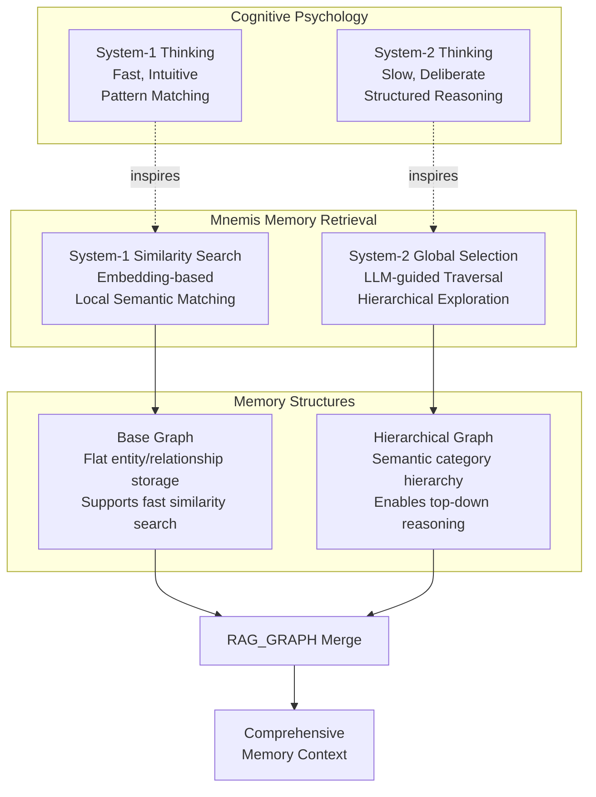
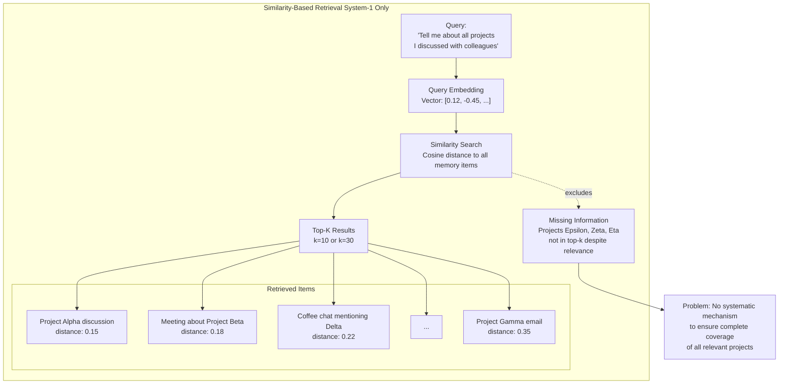
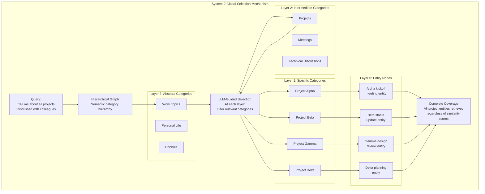
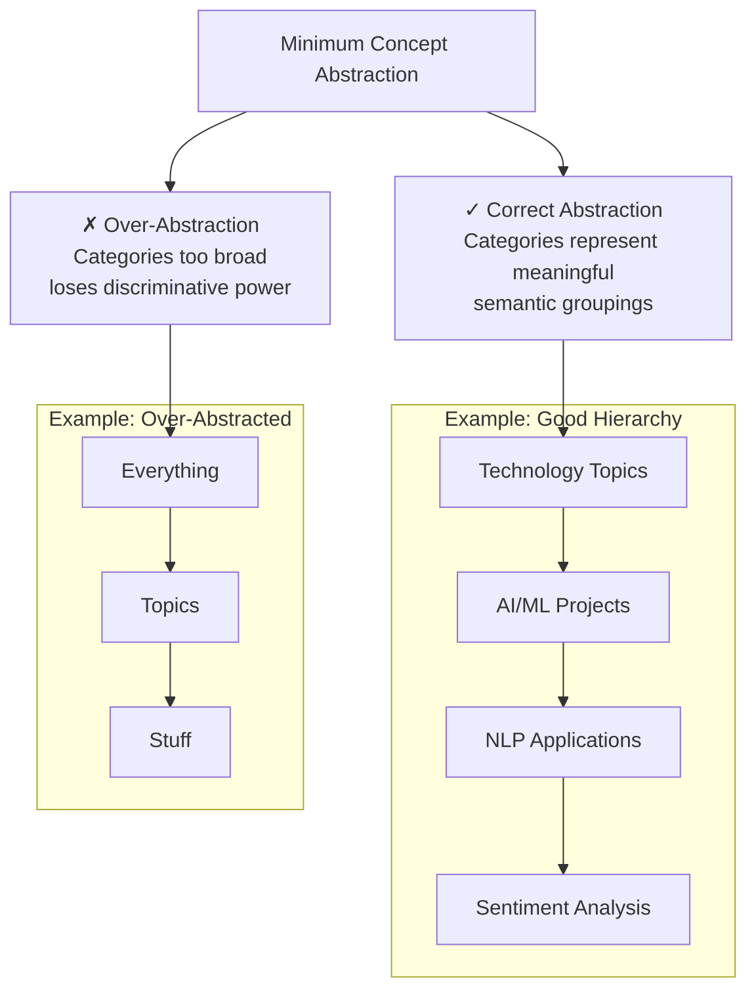
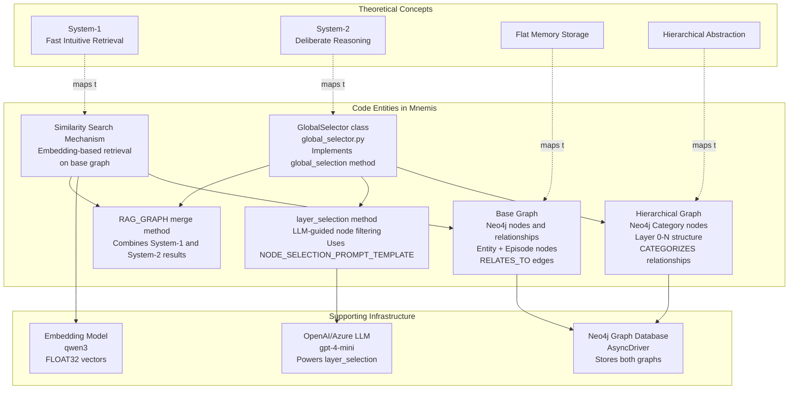
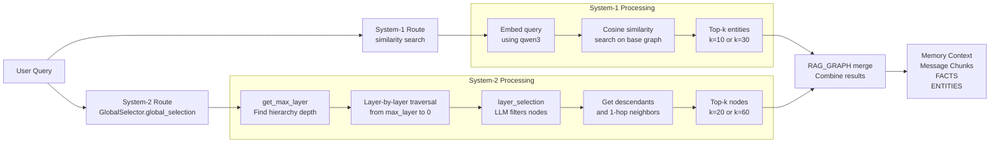

<!-- source: DeepWiki mcp.deepwiki.com · repo microsoft/Mnemis · page 7.1 Theoretical Foundation · fetched 2026-10-26 -->

# Theoretical Foundation

<details>
<summary>Relevant source files</summary>

The following files were used as context for generating this wiki page:

- [Mnemis_paper.pdf](Mnemis_paper.pdf)
- [README.md](README.md)

</details>


## Purpose and Scope

This document explains the cognitive science foundations underlying Mnemis's dual-route retrieval architecture. It covers dual-process theory from cognitive psychology, identifies fundamental limitations of similarity-based retrieval mechanisms, and demonstrates how hierarchical reasoning addresses global information needs in long-term LLM memory systems.

For implementation details of the System-2 global selection mechanism, see [System-2 Global Selection](#2.3). For the complete system architecture, see [Architecture Overview](#2).

**Sources:** [README.md:1-72]()

---

## Dual-Process Theory and Memory Retrieval

### Cognitive Science Background

Dual-process theory in cognitive psychology distinguishes between two modes of thinking:

- **System-1**: Fast, automatic, intuitive processing that relies on pattern matching and associative memory
- **System-2**: Slow, deliberate, analytical reasoning that performs structured exploration and logical inference

These two systems complement each other: System-1 provides rapid initial responses based on similarity and familiarity, while System-2 engages when comprehensive coverage or global reasoning is required.

### Mapping to LLM Memory Retrieval

Mnemis applies dual-process theory to long-term memory retrieval for LLMs:



**Diagram: Dual-Process Theory Mapping to Mnemis Architecture**

The base graph supports System-1's rapid similarity-based retrieval using embeddings, while the hierarchical graph enables System-2's deliberate top-down traversal through semantic categories. Both routes merge to produce comprehensive memory context that captures both local semantic similarity and global structural relevance.

**Sources:** [README.md:15-29]()

---

## The Limitation of Similarity-Based Retrieval

### Problem: Local vs Global Information Needs

Traditional RAG and Graph-RAG approaches rely exclusively on similarity-based retrieval mechanisms. While efficient for queries requiring local information, this System-1-only approach exhibits fundamental limitations:

| Query Type | Information Need | Similarity-Based Performance | Root Cause |
|-----------|------------------|------------------------------|------------|
| **Local Queries** | Specific facts near query embedding | ✓ High accuracy | Direct semantic match works well |
| **Global Queries** | Comprehensive coverage across topics | ✗ Incomplete retrieval | No mechanism for systematic exploration |
| **Reasoning Queries** | Information requiring structural inference | ✗ Missing context | Cannot traverse semantic hierarchies |
| **Coverage Queries** | All relevant entities in a category | ✗ Arbitrary subset | Top-k cutoff misses related items |

### Why Similarity Alone Is Insufficient



**Diagram: Limitations of Pure Similarity-Based Retrieval**

The core issue: **similarity-based retrieval performs local optimization** around the query embedding but lacks a mechanism for global exploration. Items semantically distant from the query (low cosine similarity) but structurally relevant (belonging to the same semantic category) are systematically excluded.

**Sources:** [README.md:18-18]()

---

## Hierarchical Reasoning for Global Information

### Top-Down Deliberate Traversal

To address the limitations of similarity-based retrieval, Mnemis introduces System-2 global selection, which performs **top-down deliberate traversal** through a hierarchical graph structure:



**Diagram: Hierarchical Reasoning Enables Systematic Exploration**

System-2 global selection performs layer-by-layer traversal from abstract categories to specific entities. At each layer, an LLM evaluates category relevance to the query, enabling **intelligent filtering** while ensuring **complete coverage** within selected branches. This systematic exploration retrieves all relevant items regardless of their similarity to the query embedding.

**Sources:** [README.md:18-23]()

---

## Guiding Principles for Hierarchical Graph Construction

Mnemis constructs the hierarchical graph following three key principles to maintain hierarchical quality:

### 1. Minimum Concept Abstraction



**Diagram: Minimum Concept Abstraction Principle**

Categories should represent the **minimum level of abstraction** necessary to group related entities. Over-abstraction creates categories that are too broad, reducing the selectivity of LLM-guided filtering.

### 2. Many-to-Many Mapping

Entities and lower-level categories can belong to multiple parent categories, reflecting the multi-faceted nature of real-world concepts:

```
Entity: "Discussion about using GPT-4 for customer support chatbot"
├─ Category: "AI/ML Projects"
├─ Category: "Customer Service Initiatives"  
└─ Category: "Technical Architecture Decisions"
```

This many-to-many relationship ensures that the same information can be accessed through different semantic paths during hierarchical traversal.

### 3. Compression Efficiency Constraint

The hierarchical graph must provide **compression** over the base graph:

```
Compression Ratio = (Number of Hierarchical Nodes) / (Number of Base Graph Entities)
```

If the hierarchical graph contains similar or more nodes than the base graph, it fails to provide abstraction benefits. The hierarchy should reduce information dimensionality while preserving semantic structure.

**Sources:** [README.md:22-22]()

---

## Mapping Theory to Code Architecture

### Dual-Route Implementation

The theoretical framework materializes in Mnemis through specific code entities:



**Diagram: Theoretical Concepts to Code Entity Mapping**

### Key Code Entity Correspondences

| Theoretical Concept | Code Entity | File/Location | Purpose |
|-------------------|-------------|---------------|---------|
| System-1 Retrieval | Similarity search on base graph | Inherited from Graphiti framework | Fast embedding-based retrieval |
| System-2 Retrieval | `GlobalSelector.global_selection()` | `global_selector.py` | Top-down hierarchical traversal |
| Layer-by-layer filtering | `GlobalSelector.layer_selection()` | `global_selector.py` | LLM-guided node selection at each layer |
| LLM guidance prompt | `NODE_SELECTION_PROMPT_TEMPLATE` | `prompts.py` | Instructs LLM on selection criteria |
| Base graph | Entity and Episode nodes with relationships | Neo4j database | Flat storage for System-1 |
| Hierarchical graph | Category nodes with layers 0-N | Neo4j database | Hierarchical structure for System-2 |
| Dual-route merge | `RAG_GRAPH` merge strategy | Evaluation code | Combines both retrieval routes |
| Abstraction principles | Graph construction logic | Built on Graphiti | Implements the three guiding principles |

### Query Processing Flow



**Diagram: Dual-Route Query Processing Flow**

The query simultaneously initiates both retrieval routes:
- **System-1** embeds the query and performs cosine similarity search on the base graph
- **System-2** invokes `global_selection()`, which traverses the hierarchical graph layer-by-layer, using `layer_selection()` for LLM-guided filtering

Results merge via the `RAG_GRAPH` strategy to produce comprehensive memory context containing both similarity-matched items (System-1) and structurally relevant items (System-2).

**Sources:** [README.md:15-29]()

---

## Theoretical Advantages and Empirical Validation

### Why Dual-Route Outperforms Single-Route

The theoretical advantages of combining System-1 and System-2 retrieval:

1. **Complementary Strengths**: System-1 captures items with high semantic similarity; System-2 ensures complete coverage of structurally relevant items
2. **Robustness**: System-2 compensates when System-1 fails on global queries; System-1 provides efficiency when full traversal is unnecessary  
3. **Flexibility**: Different query types automatically benefit from whichever route is more suitable
4. **Comprehensiveness**: The merged result contains both local context (similarity) and global context (hierarchy)

### Benchmark Performance

The theoretical framework achieves empirical validation through state-of-the-art performance:

| Benchmark | Score | Significance |
|-----------|-------|-------------|
| **LoCoMo** | 93.9% | Demonstrates ability to handle diverse query types across 5 categories |
| **LongMemEval-S** | 91.6% | Shows effectiveness on 6 question types requiring temporal reasoning |

These results confirm that dual-route retrieval addresses the fundamental limitations of similarity-based approaches. For detailed result analysis, see [LoCoMo Results](#4.2) and [LongMemEval-S Results](#4.3).

**Sources:** [README.md:18-23]()

---

## Summary

The theoretical foundation of Mnemis rests on three key insights:

1. **Dual-process theory applies to memory retrieval**: Fast similarity-based retrieval (System-1) and deliberate hierarchical reasoning (System-2) serve complementary roles in information access
2. **Similarity alone is insufficient**: Pure embedding-based retrieval fails on queries requiring global reasoning, comprehensive coverage, or structural inference
3. **Hierarchical reasoning enables systematic exploration**: Top-down traversal through semantic hierarchies, guided by LLM intelligence at each layer, ensures complete coverage of relevant information

The Mnemis architecture materializes these theoretical principles through specific code entities: the base graph supporting System-1, the hierarchical graph enabling System-2, and the `GlobalSelector` class implementing deliberate traversal. The `RAG_GRAPH` merge strategy combines both routes to leverage their complementary strengths.

For implementation details of System-2 global selection, see [System-2 Global Selection](#2.3). For the complete architectural design, see [Architecture Overview](#2). For comparison with other approaches, see [Comparison with Existing Approaches](#7.2).

**Sources:** [README.md:1-72]()

---

