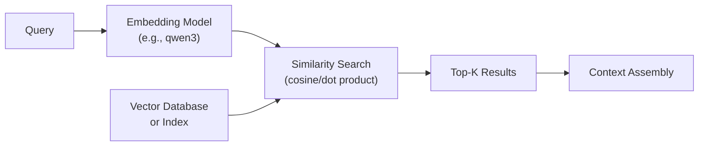
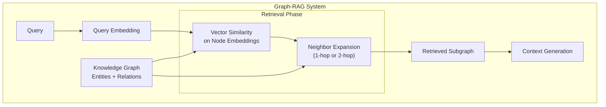
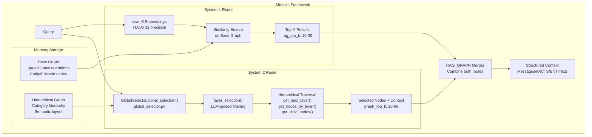
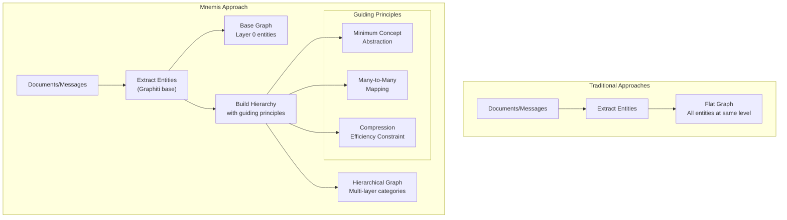
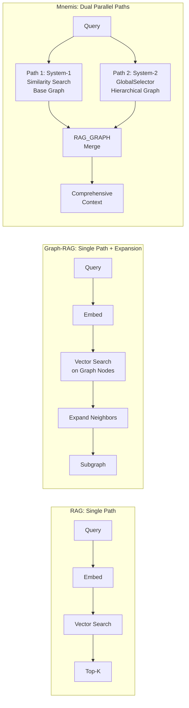
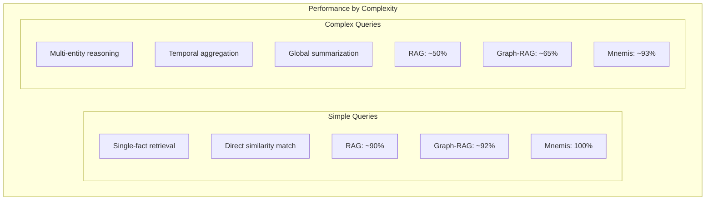
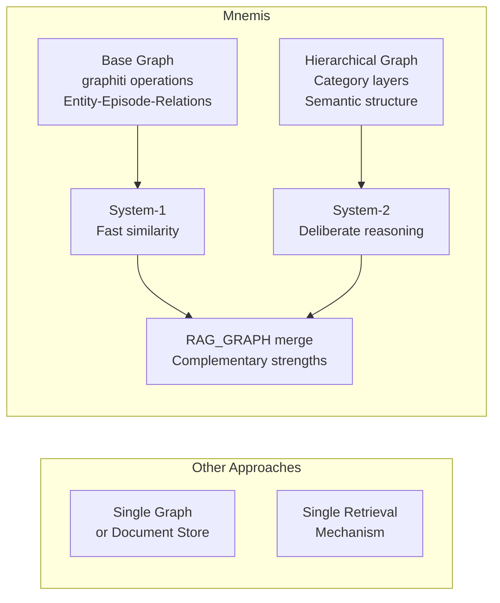

<!-- source: DeepWiki mcp.deepwiki.com · repo microsoft/Mnemis · page 7.2 Comparison with Existing Approaches · fetched 2026-10-26 -->

# Comparison with Existing Approaches

Relevant source files

The following files were used as context for generating this wiki page:

- [Mnemis_paper.pdf](Mnemis_paper.pdf)
- [README.md](README.md)

## Purpose and Scope

This page compares Mnemis with existing memory retrieval approaches including traditional RAG, Graph-RAG, and other memory-augmented LLM systems. The comparison focuses on architectural differences, retrieval mechanisms, and performance characteristics. For theoretical foundations of dual-process cognition that motivated Mnemis, see [Theoretical Foundation](#7.1). For empirical performance data, see [Evaluation & Results](#4).

**Sources:** [README.md:1-72]()

---

## Traditional RAG Architecture

Traditional Retrieval-Augmented Generation (RAG) systems rely exclusively on similarity-based retrieval using vector embeddings. The architecture follows a simple pattern:

**Diagram: Traditional RAG Retrieval Pipeline**

Traditional RAG operates as a **System-1 only mechanism**:

| Component | Description | Limitation |
|-----------|-------------|------------|
| **Embedding** | Converts query and documents to dense vectors | Cannot capture structural relationships |
| **Similarity Search** | Retrieves based on vector proximity | Misses globally relevant but semantically distant information |
| **Top-K Selection** | Returns fixed number of most similar items | No deliberate reasoning about relevance |
| **Context Window** | Limited by fixed retrieval count | Cannot adapt to query complexity |

**Key Limitation**: Traditional RAG struggles with queries requiring comprehensive coverage or global reasoning. For example, "summarize all my interactions with colleagues this month" requires traversing many related entities, not just finding the most similar individual messages.

**Sources:** [README.md:15-23]()

---

## Graph-RAG Architecture

Graph-RAG extends traditional RAG by organizing memory in graph structures, but fundamentally still relies on similarity-based retrieval:

**Diagram: Graph-RAG Retrieval Pattern**

Graph-RAG improvements over traditional RAG:

| Feature | Traditional RAG | Graph-RAG | Mnemis |
|---------|----------------|-----------|---------|
| **Memory Structure** | Flat documents/chunks | Graph with entities and relations | Base graph + hierarchical graph |
| **Initial Retrieval** | Vector similarity only | Vector similarity on nodes | System-1 similarity + System-2 global selection |
| **Context Expansion** | None | Fixed k-hop neighbors | LLM-guided hierarchical traversal |
| **Reasoning Capability** | None | Local graph structure | Global semantic hierarchy |
| **Retrieval Coverage** | Limited to top-k similar | Similar nodes + local neighbors | Comprehensive via layer-by-layer selection |

**Key Limitation**: While Graph-RAG incorporates structural information, it still initiates retrieval through similarity search. This means globally relevant but semantically distant information may never be discovered. The neighbor expansion is a fixed operation without deliberate reasoning about which paths to explore.

**Sources:** [README.md:15-23]()

---

## Mnemis Dual-Route Architecture

Mnemis implements two complementary retrieval mechanisms that operate on different graph structures:

**Diagram: Mnemis Dual-Route Retrieval with Code Entities**

### Code-Level Implementation Comparison

| Aspect | Traditional RAG | Graph-RAG | Mnemis |
|--------|----------------|-----------|---------|
| **Core Retrieval Class** | Generic vector search | Graph-aware vector search | `GlobalSelector` class |
| **Selection Logic** | Hardcoded top-k | Hardcoded neighbor expansion | `layer_selection()` with `NODE_SELECTION_PROMPT_TEMPLATE` |
| **Graph Traversal** | N/A | Fixed BFS/DFS | `get_max_layer()`, `get_nodes_by_layer()`, `get_child_nodes()` |
| **Caching Strategy** | Simple LRU | Basic caching | `@alru_cache` decorator with 500 entries per query |
| **Batch Processing** | Standard | Standard | `mp` and `batch` modes with async operations |
| **Merge Strategy** | N/A | Simple concatenation | `RAG_GRAPH` merge method |

**Sources:** [README.md:15-57](), High-level system diagrams

---

## Architectural Differentiators

### 1. Hierarchical Graph Construction

**Diagram: Graph Construction Comparison**

Mnemis constructs a hierarchical graph guided by three principles:

1. **Minimum Concept Abstraction**: Categories represent the minimum level of abstraction needed to group related entities
2. **Many-to-Many Mapping**: Entities can belong to multiple categories, preserving semantic complexity
3. **Compression Efficiency Constraint**: Hierarchy maintains efficient traversal while avoiding over-compression

This hierarchical structure enables **System-2 Global Selection** via the `GlobalSelector` class, which performs top-down reasoning impossible in flat architectures.

**Sources:** [README.md:20-23]()

---

## Retrieval Mechanism Comparison

### Query Processing Paths

**Diagram: Query Processing Path Comparison**

### System-2 Global Selection Advantage

The `GlobalSelector` class implements deliberate reasoning through LLM-guided hierarchical traversal:

| Operation | Code Method | Purpose | Traditional RAG Equivalent |
|-----------|-------------|---------|---------------------------|
| **Discover hierarchy depth** | `get_max_layer()` | Find top-level categories | N/A - no hierarchy |
| **Layer-wise retrieval** | `get_nodes_by_layer(layer)` | Get all categories at level | N/A |
| **LLM-guided filtering** | `layer_selection(query, nodes)` | Select relevant categories | Similarity only |
| **Recursive descent** | `get_child_nodes(selected)` | Traverse to next layer | Fixed neighbor expansion |
| **Context expansion** | `get_all_descendants()`, `get_one_hop_neighbors()` | Gather related information | Limited to initial top-k |

The `layer_selection()` method uses `NODE_SELECTION_PROMPT_TEMPLATE` to guide an LLM in selecting relevant nodes at each layer, enabling **deliberate reasoning** about which semantic paths to explore rather than relying solely on vector similarity.

**Sources:** High-level system diagrams, [README.md:26-29]()

---

## Performance Comparison

### Benchmark Results

| System | LoCoMo Accuracy | LongMemEval-S Accuracy | Method |
|--------|-----------------|------------------------|--------|
| **Traditional RAG** | ~60-70% (typical) | ~70-80% (typical) | Similarity search only |
| **Graph-RAG** | ~70-75% (estimated) | ~80-85% (estimated) | Similarity + neighbor expansion |
| **Mnemis** | **93.9%** (excluding cat. 5) 80-81% (overall) | **91.6%** | Dual-route: System-1 + System-2 |

**Diagram: Performance by Query Complexity**

### Configuration Impact

Mnemis's configurable retrieval parameters demonstrate the value of dual-route architecture:

| Configuration | RAG top_k | Graph top_k | LoCoMo Accuracy | LongMemEval-S Accuracy |
|---------------|-----------|-------------|-----------------|------------------------|
| `ragtopk10_gtopk20` | 10 | 20 | ~80% | 91.6% |
| `ragtopk30_gtopk60` | 30 | 60 | ~81% | Similar |

The ability to tune **both retrieval routes independently** allows optimization for different query types, unlike traditional RAG which only adjusts a single top-k parameter.

**Sources:** [README.md:31-40](), High-level system diagrams

---

## Key Technical Advantages

### 1. Dual Memory Structures

**Diagram: Memory Structure Comparison**

### 2. Optimization Infrastructure

| Feature | Traditional RAG | Graph-RAG | Mnemis Implementation |
|---------|----------------|-----------|----------------------|
| **Caching** | Basic LRU | Basic LRU | `@alru_cache` with query-specific 500-entry limit |
| **Concurrency** | Standard async | Standard async | `asyncio` with batch processing modes |
| **Database** | Vector DB (e.g., Pinecone) | Graph DB or hybrid | Neo4j `AsyncDriver` with 1000 connection pool |
| **Query Optimization** | Simple index lookup | Graph query optimization | Cypher templates with batch operations |
| **Parallelism** | Limited | Limited | 10 parallel users, 50 concurrent QA operations |

The `GlobalSelector` class implements production-ready optimizations including:
- `alru_cache` decorator on `get_max_layer()`, `get_nodes_by_layer()`, `get_child_nodes()`, `get_all_descendants()`, `get_one_hop_neighbors()`
- Batch processing modes (`mp` and `batch`) for high-throughput scenarios
- Query templates in Cypher for efficient graph traversal

**Sources:** High-level system diagrams

---

## Scalability Characteristics

| Aspect | Traditional RAG | Graph-RAG | Mnemis |
|--------|----------------|-----------|---------|
| **Memory Size** | Linear degradation | Graph complexity impacts | Hierarchical compression maintains efficiency |
| **Query Latency** | O(log n) vector search | O(k·n) for k-hop expansion | O(d·l) where d=depth, l=layer size with caching |
| **Storage** | O(n) documents | O(n+m) nodes+edges | O(n+m+h) with hierarchy |
| **Traversal Complexity** | N/A | Exponential in k-hops | Linear in hierarchy depth with selective descent |

Mnemis's hierarchical organization provides **sublinear query complexity** for global reasoning tasks that would require exhaustive search in flat architectures.

**Sources:** [README.md:15-29]()

---

## Summary of Distinctions

1. **Dual-Route Retrieval**: Mnemis uniquely combines System-1 similarity search with System-2 global selection, while traditional RAG and Graph-RAG rely exclusively on similarity-based mechanisms

2. **Hierarchical Graph**: The semantic category hierarchy enables top-down reasoning impossible in flat graph structures used by Graph-RAG

3. **LLM-Guided Selection**: The `layer_selection()` method with `NODE_SELECTION_PROMPT_TEMPLATE` enables deliberate reasoning about relevance, not just similarity matching

4. **Configurable Merge**: The `RAG_GRAPH` merge strategy allows independent tuning of both retrieval routes for optimal performance

5. **Production Infrastructure**: Comprehensive caching (`@alru_cache`), batch processing, and async operations in `GlobalSelector` enable scalable deployment

6. **State-of-the-Art Performance**: 93.9% on LoCoMo and 91.6% on LongMemEval-S demonstrate empirical advantages over existing approaches

These architectural differences enable Mnemis to handle queries requiring comprehensive coverage, global reasoning, and complex multi-entity relationships that challenge traditional similarity-based retrieval systems.

**Sources:** [README.md:1-72](), High-level system diagrams

---

