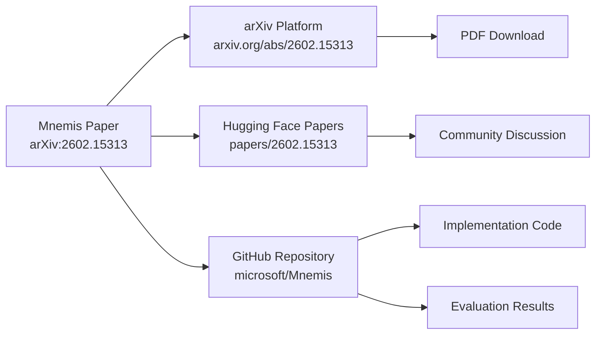
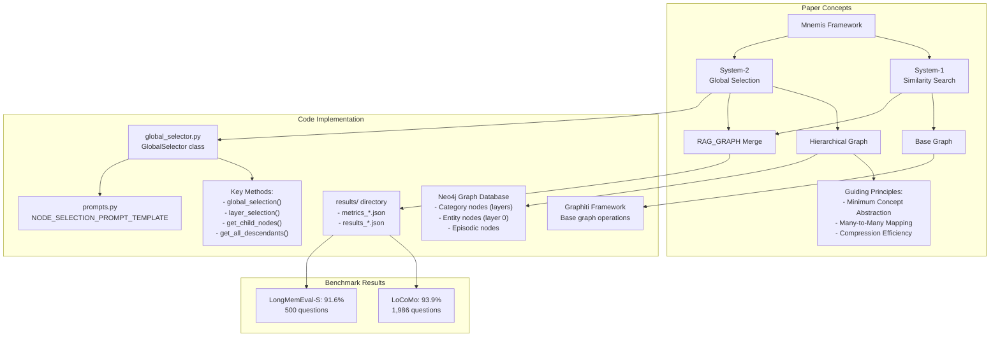
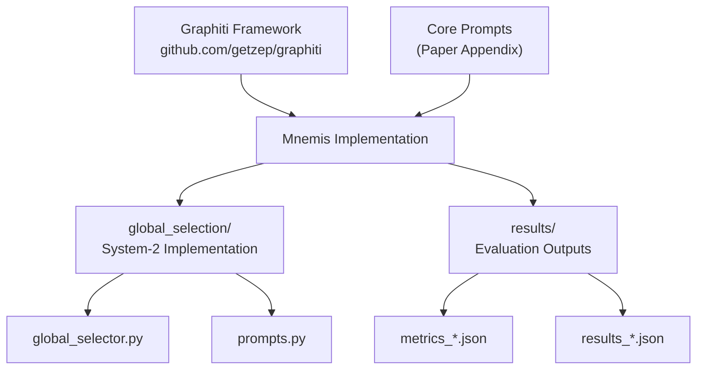

<!-- source: DeepWiki mcp.deepwiki.com · repo microsoft/Mnemis · page 7.3 Paper & Citations · fetched 2026-10-26 -->

# Paper & Citations

<details>
<summary>Relevant source files</summary>

The following files were used as context for generating this wiki page:

- [Mnemis_paper.pdf](Mnemis_paper.pdf)
- [README.md](README.md)

</details>


This page provides the full citation information for the Mnemis research paper, including links to the published versions, citation formats, and guidance on how to reference this work in academic publications and technical documentation.

For theoretical background on dual-process theory and System-1/System-2 concepts, see [Theoretical Foundation](#7.1). For technical comparisons with RAG and Graph-RAG approaches, see [Comparison with Existing Approaches](#7.2).

---

## Paper Information

The Mnemis framework is described in the following research paper:

| **Attribute** | **Details** |
|--------------|-------------|
| **Title** | Mnemis: Dual-Route Retrieval on Hierarchical Graphs for Long-Term LLM Memory |
| **Authors** | Zihao Tang, Xin Yu, Ziyu Xiao, Zengxuan Wen, Zelin Li, Jiaxi Zhou, Hualei Wang, Haohua Wang, Haizhen Huang, Weiwei Deng, Feng Sun, Qi Zhang |
| **Publication Year** | 2026 |
| **Venue** | arXiv preprint |
| **arXiv ID** | 2602.15313 |
| **Primary Category** | cs.CL (Computation and Language) |
| **License** | MIT License |

**Sources:** [README.md:1-72]()

---

## Access Links

The paper is publicly available through multiple platforms:



**Primary Access Points:**

| **Platform** | **URL** | **Badge** |
|-------------|---------|-----------|
| **arXiv** | https://arxiv.org/abs/2602.15313 |  |
| **Hugging Face** | https://huggingface.co/papers/2602.15313 |  |
| **GitHub** | https://github.com/microsoft/Mnemis |  |

**Sources:** [README.md:2-13]()

---

## Citation Formats

### BibTeX

The recommended citation format for LaTeX documents:

```bibtex
@misc{tang2026mnemisdualrouteretrievalhierarchical,
      title={Mnemis: Dual-Route Retrieval on Hierarchical Graphs for Long-Term LLM Memory}, 
      author={Zihao Tang and Xin Yu and Ziyu Xiao and Zengxuan Wen and Zelin Li and Jiaxi Zhou and Hualei Wang and Haohua Wang and Haizhen Huang and Weiwei Deng and Feng Sun and Qi Zhang},
      year={2026},
      eprint={2602.15313},
      archivePrefix={arXiv},
      primaryClass={cs.CL},
      url={https://arxiv.org/abs/2602.15313}, 
}
```

**Sources:** [README.md:58-71]()

### APA Style (7th Edition)

```
Tang, Z., Yu, X., Xiao, Z., Wen, Z., Li, Z., Zhou, J., Wang, H., Wang, H., 
Huang, H., Deng, W., Sun, F., & Zhang, Q. (2026). Mnemis: Dual-route retrieval 
on hierarchical graphs for long-term LLM memory. arXiv preprint arXiv:2602.15313. 
https://arxiv.org/abs/2602.15313
```

### MLA Style (9th Edition)

```
Tang, Zihao, et al. "Mnemis: Dual-Route Retrieval on Hierarchical Graphs for 
Long-Term LLM Memory." arXiv, 2026, arxiv.org/abs/2602.15313.
```

### Chicago Style (17th Edition)

```
Tang, Zihao, Xin Yu, Ziyu Xiao, Zengxuan Wen, Zelin Li, Jiaxi Zhou, Hualei Wang, 
Haohua Wang, Haizhen Huang, Weiwei Deng, Feng Sun, and Qi Zhang. 2026. 
"Mnemis: Dual-Route Retrieval on Hierarchical Graphs for Long-Term LLM Memory." 
arXiv preprint arXiv:2602.15313. https://arxiv.org/abs/2602.15313.
```

**Sources:** [README.md:62-70]()

---

## Paper Concepts to Code Mapping

The following diagram maps the key concepts introduced in the paper to their corresponding implementations in the codebase:



**Implementation Correspondence:**

| **Paper Concept** | **Code Location** | **Description** |
|------------------|------------------|-----------------|
| System-2 Global Selection | `global_selector.py` | Core implementation of top-down hierarchical traversal |
| Node Selection Prompt | `prompts.py` | LLM prompt template for layer-by-layer node filtering |
| Hierarchical Graph | Neo4j schema with Category/Entity nodes | Graph database structure supporting hierarchical organization |
| Base Graph | Graphiti framework | Foundation for entity/relationship extraction and similarity search |
| RAG_GRAPH Merge | Evaluation configurations | Merge strategy combining System-1 and System-2 results |
| Guiding Principles | Hierarchical graph construction | Quality constraints for category hierarchy |
| Benchmark Results | `results/` directory | Complete evaluation outputs with metrics and contexts |

**Sources:** [README.md:15-56]()

---

## Key Contributions

The paper presents three primary contributions to the field of long-term LLM memory:

### Contribution 1: Dual-Route Architecture

Integration of System-1 similarity search with System-2 global selection, enabling both semantic retrieval and deliberate top-down reasoning over memory structures.

**Code Implementation:** [`global_selector.py`]() (System-2), Graphiti framework integration (System-1)

### Contribution 2: Hierarchical Graph Design

Improved base graph extraction and construction of a hierarchical graph guided by three principles:
- **Minimum Concept Abstraction**: Categories represent minimum abstraction levels
- **Many-to-Many Mapping**: Flexible entity-category relationships
- **Compression Efficiency Constraint**: Balanced hierarchy depth and breadth

**Code Implementation:** Neo4j graph schema with `CATEGORIZES` relationships between Category and Entity nodes

### Contribution 3: State-of-the-Art Performance

Comprehensive experimental validation demonstrating effectiveness across long-term memory benchmarks:
- **LoCoMo**: 93.9% accuracy
- **LongMemEval-S**: 91.6% accuracy
- Using GPT-4.1-mini for all experiments

**Code Implementation:** Evaluation results in `results/` directory with multiple configuration variants

**Sources:** [README.md:20-24]()

---

## Abstract

The paper addresses a fundamental limitation in existing AI memory systems: while RAG and Graph-RAG methods efficiently retrieve memory through similarity-based mechanisms (System-1 style), they struggle with scenarios requiring global reasoning or comprehensive information coverage.

**Key Problem:** Similarity-based retrieval alone is insufficient for scenarios requiring:
- Global reasoning across distributed information
- Comprehensive coverage of all relevant context
- Deliberate, top-down traversal of semantic hierarchies

**Proposed Solution:** Mnemis integrates complementary retrieval mechanisms:
1. **Base Graph**: Supports fast similarity-based retrieval
2. **Hierarchical Graph**: Enables deliberate top-down traversal over semantic hierarchies
3. **Dual-Route Retrieval**: Combines semantically and structurally relevant memory items

The combined approach achieves state-of-the-art results by leveraging both intuitive (System-1) and analytical (System-2) retrieval strategies.

**Sources:** [README.md:18-19]()

---

## Related Resources

### Figures and Visualizations

The paper includes several key figures that are also available in the repository:

| **Figure** | **Location** | **Description** |
|-----------|-------------|-----------------|
| Architecture Diagram | `figures/figure_intro.png` | Complete Mnemis system architecture |
| LoCoMo Results | `figures/results_locomo.png` | Performance comparison on LoCoMo benchmark |
| LongMemEval-S Results | `figures/results_lme_s.png` | Performance comparison on LongMemEval-S benchmark |
| Case Study 1 | `figures/figure_case_0.png` | LoCoMo User 8 QA 11 walkthrough |
| Case Study 2 | `figures/figure_case_1.png` | LongMemEval-S QA 262 analysis |

**Sources:** [README.md:27-51]()

### Implementation Base

Mnemis is implemented on top of the Graphiti framework:



**Framework Reference:**
- **Graphiti**: https://github.com/getzep/graphiti
- **Core Prompts**: Available in paper appendix
- **Implementation**: `global_selection/` directory contains System-2 logic
- **Evaluation Results**: `results/` directory contains complete benchmark outputs

**Sources:** [README.md:54-56]()

---

## Usage in Documentation

When citing Mnemis in technical documentation or discussions:

### In Academic Papers
Use the BibTeX format provided above and reference specific contributions:
- Cite the dual-route architecture when discussing hybrid retrieval systems
- Reference the hierarchical graph design principles for graph construction methods
- Cite the benchmark results when comparing memory-augmented LLM approaches

### In Technical Documentation
Reference specific implementation files:
- System-2 implementation: `global_selector.py`
- Prompt engineering: `prompts.py`
- Complete results: `results/` directory

### In Code Comments
Use inline references to the paper concepts:
```python
# Implements System-2 Global Selection from Mnemis paper (arXiv:2602.15313)
# See Section 3.2 for detailed algorithm description
```

**Sources:** [README.md:58-71]()

---

## Repository Metadata

The codebase itself should be cited when referencing the implementation:

```bibtex
@software{mnemis_implementation,
  author = {Tang, Zihao and Yu, Xin and Xiao, Ziyu and Wen, Zengxuan and 
            Li, Zelin and Zhou, Jiaxi and Wang, Hualei and Wang, Haohua and 
            Huang, Haizhen and Deng, Weiwei and Sun, Feng and Zhang, Qi},
  title = {Mnemis: Implementation of Dual-Route Retrieval on Hierarchical Graphs},
  year = {2026},
  publisher = {GitHub},
  journal = {GitHub repository},
  howpublished = {\url{https://github.com/microsoft/Mnemis}},
  license = {MIT}
}
```

**Sources:** [README.md:1-72]()

---

