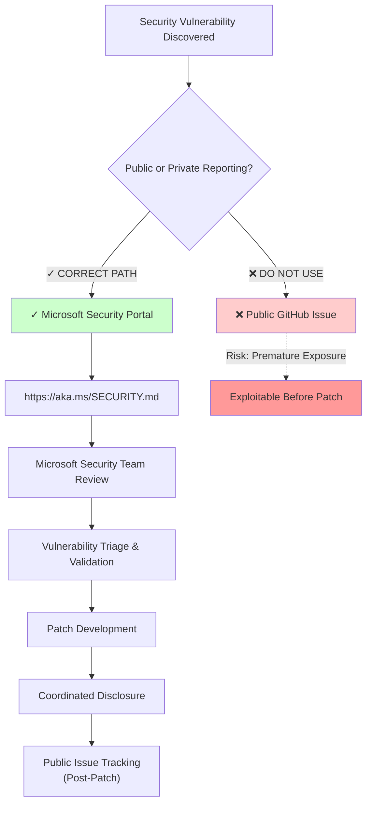
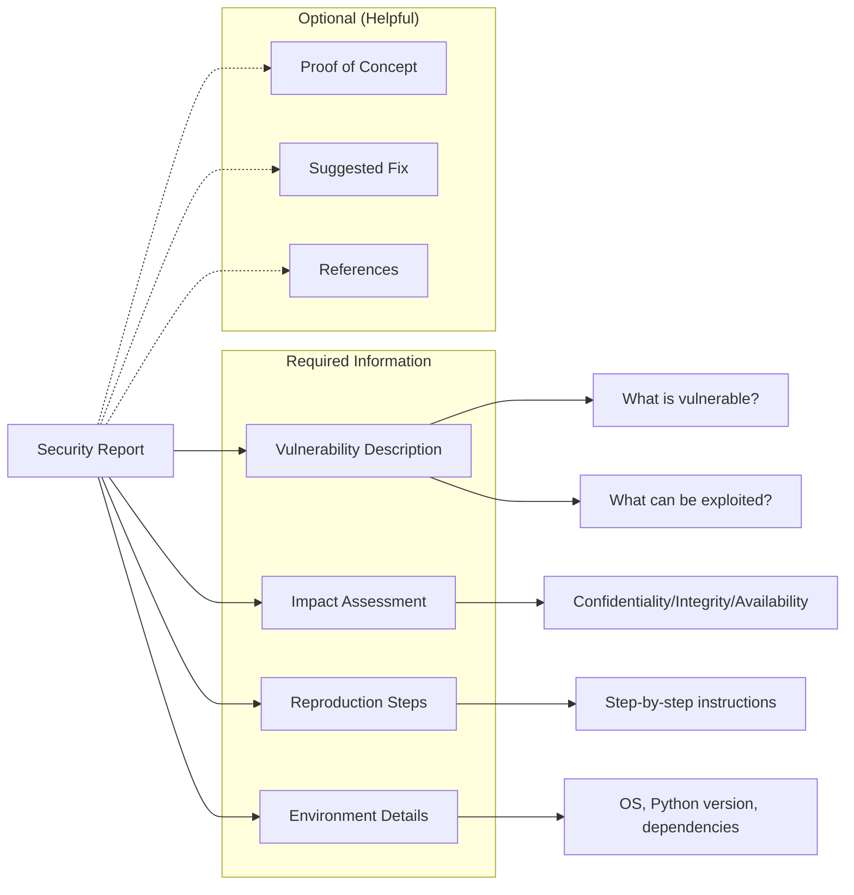
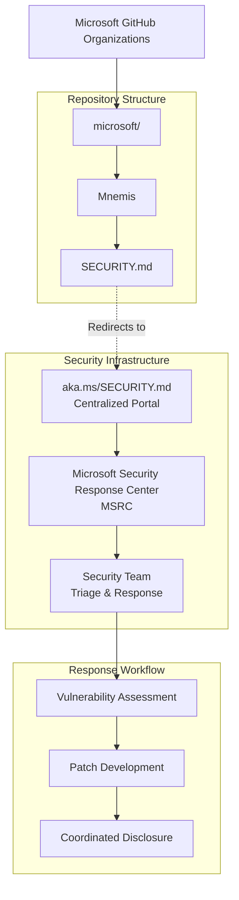
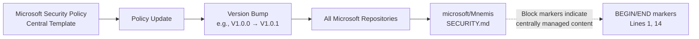

<!-- source: DeepWiki mcp.deepwiki.com · repo microsoft/Mnemis · page 8.2 Security Policy · fetched 2026-10-26 -->

# Security Policy

<details>
<summary>Relevant source files</summary>

The following files were used as context for generating this wiki page:

- [CODE_OF_CONDUCT.md](CODE_OF_CONDUCT.md)
- [SECURITY.md](SECURITY.md)

</details>


This page documents the security vulnerability reporting procedures for the Mnemis codebase. It outlines how to responsibly disclose security issues, where to report them, and what to expect from the security response process.

For general community guidelines and conduct expectations, see [Code of Conduct](#8.1). For licensing terms, see [License](#8.3).

---

## Overview

Microsoft takes the security of software products and services seriously, including all source code repositories managed through GitHub organizations. The Mnemis project follows Microsoft's standardized security reporting procedures to ensure vulnerabilities are handled promptly and responsibly.

**Critical Rule**: Security vulnerabilities must **never** be reported through public GitHub issues, as this could expose users to unnecessary risk before patches are available.

Sources: [SECURITY.md:5-8]()

---

## Security Reporting Workflow

The following diagram illustrates the proper security reporting workflow for the Mnemis repository:



Sources: [SECURITY.md:8-12]()

---

## Prohibited Reporting Channels

The following channels must **not** be used for security vulnerability reporting:

| Channel | Status | Reason |
|---------|--------|--------|
| Public GitHub Issues | ❌ Prohibited | Exposes vulnerability details before patches are available |
| GitHub Discussions | ❌ Prohibited | Public forum visible to all users and potential attackers |
| Pull Requests | ❌ Prohibited | Changes are visible in repository history |
| Social Media | ❌ Prohibited | No secure communication channel |
| Email to Repository Maintainers | ⚠️ Discouraged | Not centrally tracked; use Microsoft portal instead |

**Explicit prohibition statement**: [SECURITY.md:8]() states:

> "**Please do not report security vulnerabilities through public GitHub issues.**"

This directive is absolute and applies to all security-related findings, regardless of perceived severity.

Sources: [SECURITY.md:8]()

---

## Approved Reporting Process

### Primary Reporting Portal

All security vulnerabilities should be reported through Microsoft's centralized security portal:

**Portal URL**: [https://aka.ms/SECURITY.md](https://aka.ms/SECURITY.md)

This portal provides:
- Secure, encrypted submission channels
- Centralized tracking across all Microsoft repositories
- Integration with Microsoft Security Response Center (MSRC)
- Standardized triage and response procedures
- Coordinated disclosure workflows

Sources: [SECURITY.md:10-12]()

### Information to Include

When reporting a security vulnerability, provide the following information:



Sources: [SECURITY.md:5-12]()

---

## Security Scope for Mnemis

### Components Covered

The security policy applies to all components of the Mnemis system:

| Component | Security Considerations | Examples |
|-----------|------------------------|-----------|
| Core Retrieval Logic | Input validation, injection attacks | `global_selector.py`, query construction |
| LLM Integration | Prompt injection, API key exposure | OpenAI/Azure client configurations |
| Database Operations | Cypher injection, connection security | Neo4j AsyncDriver, query templates |
| API Endpoints | Authentication, authorization | Any future REST/GraphQL interfaces |
| Configuration Files | Credential exposure | Environment variables, config files |
| Dependencies | Vulnerable third-party packages | Python package dependencies |

Sources: [SECURITY.md:5-6]()

### Example Vulnerability Categories

Common vulnerability types that should be reported:

```mermaid
graph TB
    VULNS["Security Vulnerabilities"]
    
    subgraph "Injection Attacks"
        PROMPT["Prompt Injection<br/>in LLM queries"]
        CYPHER["Cypher Injection<br/>in Neo4j queries"]
        CODE["Code Injection<br/>in eval/exec"]
    end
    
    subgraph "Data Exposure"
        CREDS["Credential Leakage<br/>in logs/errors"]
        PII["PII Exposure<br/>in memory graphs"]
        API["API Key Exposure<br/>in config files"]
    end
    
    subgraph "Access Control"
        AUTH["Authentication Bypass"]
        AUTHZ["Authorization Failures"]
        PRIV["Privilege Escalation"]
    end
    
    subgraph "Availability"
        DOS["Denial of Service<br/>via expensive queries"]
        MEM["Memory Exhaustion"]
        CONN["Connection Pool Exhaustion"]
    end
    
    VULNS --> PROMPT
    VULNS --> CYPHER
    VULNS --> CODE
    VULNS --> CREDS
    VULNS --> PII
    VULNS --> API
    VULNS --> AUTH
    VULNS --> AUTHZ
    VULNS --> PRIV
    VULNS --> DOS
    VULNS --> MEM
    VULNS --> CONN
```



Sources: [SECURITY.md:5-6]()

---

## Repository Security Configuration

### Security.md File Location

The security policy is defined in the repository root:

```
microsoft/Mnemis/
├── SECURITY.md           # Security vulnerability reporting policy
├── CODE_OF_CONDUCT.md    # Community conduct guidelines
├── LICENSE               # MIT License
└── README.md             # Project overview
```

File path: [SECURITY.md:1-14]()

This placement ensures:
- Visibility in GitHub's Security tab
- Automatic detection by GitHub's security features
- Easy discovery by security researchers
- Compliance with Microsoft's security standards

Sources: [SECURITY.md:1-14]()

### Policy Version Control

The security policy uses Microsoft's standardized template:

```
<!-- BEGIN MICROSOFT SECURITY.MD V1.0.0 BLOCK -->
...
<!-- END MICROSOFT SECURITY.MD BLOCK -->
```

**Version**: V1.0.0 (as indicated in [SECURITY.md:1]())

This versioning ensures:
- Consistency across Microsoft repositories
- Centralized policy updates
- Clear change tracking
- Standardized response procedures

Sources: [SECURITY.md:1,14]()

---

## Microsoft Security Infrastructure

### Organizational Scope

The security policy applies repository-wide as part of Microsoft's GitHub organization:



Sources: [SECURITY.md:5-6,11-12]()

### Multi-Repository Coverage

Microsoft's security approach covers all source code repositories:

- **Scope**: All repositories in Microsoft GitHub organizations [SECURITY.md:6]()
- **Consistency**: Standardized `SECURITY.md` files across repositories
- **Centralization**: Single portal (`aka.ms/SECURITY.md`) for all reports
- **Coordination**: Cross-repository vulnerability tracking

Sources: [SECURITY.md:5-6]()

---

## Responsible Disclosure Guidelines

### Timeline Expectations

While not explicitly documented in the Mnemis repository, Microsoft generally follows industry-standard coordinated disclosure timelines:

| Phase | Typical Duration | Description |
|-------|-----------------|-------------|
| Initial Response | 1-3 business days | Acknowledgment of receipt |
| Triage | 1-2 weeks | Severity assessment and validation |
| Patch Development | 2-12 weeks | Depends on complexity |
| Pre-Disclosure Notification | 1 week | Advance notice to reporter |
| Public Disclosure | Variable | Coordinated release of patch and advisory |

### Reporter Expectations

Security researchers should:

1. **Wait for Acknowledgment**: Allow time for initial response
2. **Provide Additional Information**: Respond to triage team requests
3. **Maintain Confidentiality**: Do not disclose until coordinated release
4. **Test Patches**: Verify proposed fixes when requested
5. **Accept Credit**: Agree to public acknowledgment (optional)

Sources: [SECURITY.md:5-12]()

---

## Security Policy Update Process

The security policy file is maintained by Microsoft and follows centralized updates:



**Block markers**: [SECURITY.md:1,14]()

The comment blocks (`<!-- BEGIN/END MICROSOFT SECURITY.MD -->`) indicate that this content is centrally managed and should not be modified at the repository level.

Sources: [SECURITY.md:1,14]()

---

## Related Policies

### Code of Conduct

For non-security community issues, refer to the Code of Conduct:
- See [Code of Conduct](#8.1) for community guidelines
- See [CODE_OF_CONDUCT.md:1-10]() for the full policy text
- Contact: `opencode@microsoft.com` for conduct questions

### License

For intellectual property and usage terms:
- See [License](#8.3) for MIT License details
- The security policy does not affect licensing terms

Sources: [SECURITY.md:1-14](), [CODE_OF_CONDUCT.md:1-10]()

---

## Contact Information

### For Security Vulnerabilities

**Primary Portal**: [https://aka.ms/SECURITY.md](https://aka.ms/SECURITY.md)

This portal provides:
- Latest reporting guidance for Microsoft repositories [SECURITY.md:11]()
- Contact information for security teams
- Detailed submission procedures
- Policy updates and additional resources

### For Other Issues

| Issue Type | Contact Channel |
|-----------|-----------------|
| Security Vulnerabilities | [aka.ms/SECURITY.md](https://aka.ms/SECURITY.md) |
| Code of Conduct Violations | opencode@microsoft.com (see [8.1](#8.1)) |
| General Questions | GitHub Issues (non-security) |
| Feature Requests | GitHub Discussions or Issues |

Sources: [SECURITY.md:10-12](), [CODE_OF_CONDUCT.md:9]()

---

## Summary

The Mnemis security policy follows Microsoft's standardized approach:

1. **Never report security issues publicly** via GitHub issues [SECURITY.md:8]()
2. **Use the centralized portal** at [aka.ms/SECURITY.md](https://aka.ms/SECURITY.md) [SECURITY.md:11-12]()
3. **Provide detailed information** to enable effective triage
4. **Follow coordinated disclosure** timelines
5. **Maintain confidentiality** until patches are released

This approach ensures vulnerabilities are addressed responsibly while protecting the security of all Mnemis users.

Sources: [SECURITY.md:1-14]()

---

