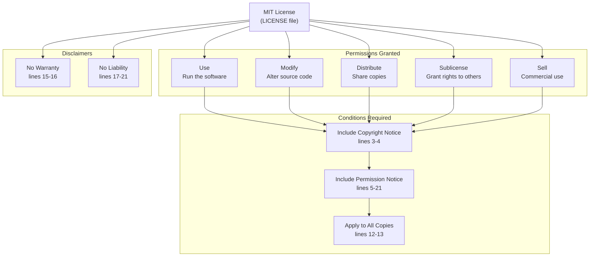
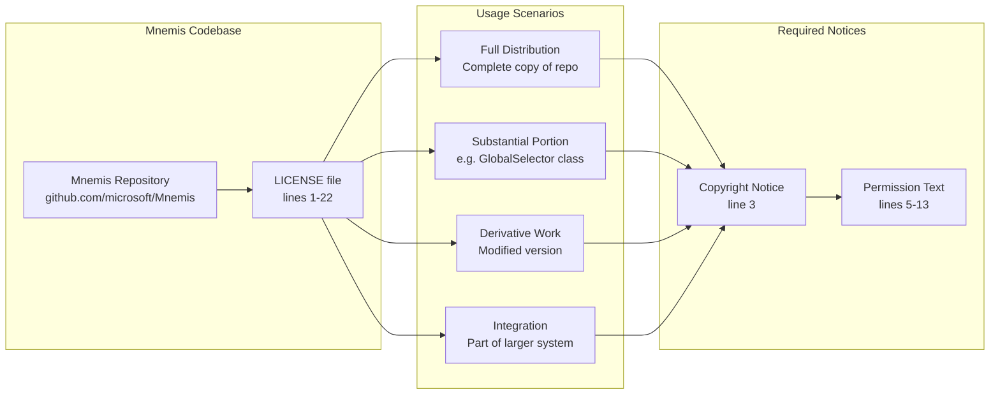
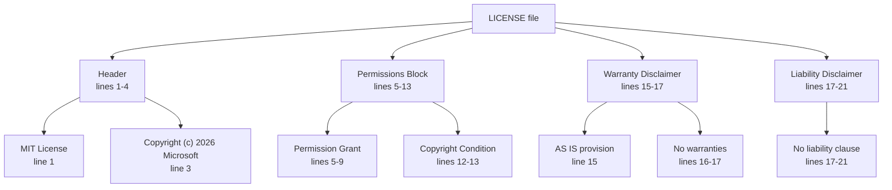

<!-- source: DeepWiki mcp.deepwiki.com · repo microsoft/Mnemis · page 8.3 License · fetched 2026-10-26 -->

# License

<details>
<summary>Relevant source files</summary>

The following files were used as context for generating this wiki page:

- [LICENSE](LICENSE)

</details>


## Purpose and Scope

This page documents the licensing terms for the Mnemis codebase. The project is released under the MIT License, which governs the terms of use, modification, and distribution of the software. This information is relevant for contributors, users, and organizations that wish to use or build upon the Mnemis framework.

For information about contributing to the project, see [Contributing](#8). For security policies, see [Security Policy](#8.2).

---

## License Overview

The Mnemis project is licensed under the **MIT License**, one of the most permissive open-source licenses. The license is simple, business-friendly, and allows for extensive commercial and non-commercial use with minimal restrictions.

### Copyright Information

| Field | Value |
|-------|-------|
| **License Type** | MIT License |
| **Copyright Holder** | Microsoft |
| **Copyright Year** | 2026 |
| **License File** | [LICENSE:1-22]() |

Sources: [LICENSE:1-4]()

---

## License Components

The MIT License consists of three main components: permissions, conditions, and warranty disclaimers.



Sources: [LICENSE:1-22]()

---

## Permissions Granted

The MIT License grants users comprehensive rights to work with the Mnemis software without restriction. The following permissions are explicitly granted:

### Software Usage Rights

The license permits any person obtaining a copy of the software to "deal in the Software without restriction" ([LICENSE:6-7]()), which includes:

| Permission | Description | License Reference |
|------------|-------------|-------------------|
| **Use** | Run and execute the software for any purpose | [LICENSE:7]() |
| **Copy** | Create copies of the software | [LICENSE:5]() |
| **Modify** | Alter, enhance, or adapt the source code | [LICENSE:7]() |
| **Merge** | Combine with other software or code | [LICENSE:7]() |
| **Publish** | Make the software publicly available | [LICENSE:8]() |
| **Distribute** | Share copies with others | [LICENSE:8]() |
| **Sublicense** | Grant these same rights to third parties | [LICENSE:8]() |
| **Sell** | Use commercially, including selling copies | [LICENSE:8-9]() |

These rights apply to the entire Mnemis codebase, including:
- Core implementation files (e.g., `global_selector.py`, `prompts.py`)
- Benchmark datasets and evaluation scripts
- Configuration files and utilities
- Documentation and examples

Sources: [LICENSE:5-9]()

---

## Required Conditions

The MIT License requires that users fulfill two simple conditions when using, modifying, or distributing the software:

### 1. Copyright Notice Inclusion

The copyright notice must be included in all copies or substantial portions of the Software:

```
Copyright (c) 2026 Microsoft
```

This notice appears at [LICENSE:3]() and must be preserved.

### 2. Permission Notice Inclusion

The full permission text ([LICENSE:5-13]()) must be included alongside the copyright notice. This ensures that downstream users understand their rights and obligations.

### Application Scope

These conditions apply "in all copies or substantial portions of the Software" ([LICENSE:12-13]()). This means:

- **Full Distributions**: Any distribution of the complete Mnemis codebase must include the LICENSE file
- **Substantial Portions**: Large code excerpts or modules (e.g., the entire `GlobalSelector` class) require attribution
- **Derivative Works**: Modified versions or works built on Mnemis must preserve the notices
- **Documentation**: Projects that incorporate Mnemis should acknowledge the license



Sources: [LICENSE:3](), [LICENSE:5-13](), [LICENSE:12-13]()

---

## Warranty and Liability Disclaimers

The MIT License includes important disclaimers that protect the copyright holder from liability.

### No Warranty

The software is provided "AS IS", WITHOUT WARRANTY OF ANY KIND ([LICENSE:15-16]()). This means:

- **No Express Warranties**: Microsoft makes no promises about functionality or fitness
- **No Implied Warranties**: No guarantees of merchantability or suitability for purpose
- **User Responsibility**: Users accept the software in its current state

The disclaimer explicitly excludes all warranties including, but not limited to:
- Merchantability ([LICENSE:16]())
- Fitness for a particular purpose ([LICENSE:17]())
- Non-infringement ([LICENSE:17]())

### No Liability

Microsoft and the authors are not liable for any claims, damages, or other liability ([LICENSE:17-21]()). This covers:

| Liability Type | Description | Coverage |
|----------------|-------------|----------|
| **Contract** | Breach of agreement | [LICENSE:19]() |
| **Tort** | Civil wrongs or negligence | [LICENSE:19]() |
| **Other Liability** | Any other legal theory | [LICENSE:19]() |

The disclaimer applies to liability arising from:
- Use of the software ([LICENSE:20]())
- Connection with the software ([LICENSE:20]())
- Other dealings in the software ([LICENSE:20-21]())

Sources: [LICENSE:15-21]()

---

## Practical Implications

### For Users and Integrators

When using Mnemis in your projects:

1. **Include the License**: Copy the LICENSE file to your project or documentation
2. **Preserve Attribution**: Maintain copyright and permission notices
3. **No Restrictions**: You may use Mnemis for any purpose, including commercial applications
4. **Accept As-Is**: Understand that no warranties are provided

### For Contributors

Contributors to the Mnemis project should be aware that:

- Contributions are subject to the same MIT License
- Your code becomes part of the Microsoft-copyrighted work
- Others can freely use, modify, and commercialize your contributions
- See [Code of Conduct](#8.1) for community guidelines

### For Derivative Works

If you create a derivative work based on Mnemis:

1. You must include the original MIT License text
2. You may add your own copyright notice for your modifications
3. You may choose any license for your additions (the MIT License only requires that the original notices be preserved)
4. You have no obligation to share your changes (though open-source contributions are encouraged)

Sources: [LICENSE:1-22]()

---

## License Text Reference

The complete license text is available in the root of the repository at [LICENSE:1-22](). The text follows the standard MIT License format and is compatible with OSI (Open Source Initiative) approval and GPL compatibility.

### Full License Structure



Sources: [LICENSE:1-22]()

---

## Summary

The MIT License provides maximum flexibility for using, modifying, and distributing the Mnemis codebase. The only requirements are to preserve copyright and license notices when redistributing the software. This permissive approach encourages adoption and contribution while protecting the copyright holder from liability.

| Aspect | Details |
|--------|---------|
| **License Type** | MIT License |
| **Permissions** | Use, copy, modify, merge, publish, distribute, sublicense, sell |
| **Conditions** | Include copyright and permission notices |
| **Warranties** | None (software provided "AS IS") |
| **Liability** | None (no liability for damages or claims) |
| **Commercial Use** | Permitted without restriction |
| **File Location** | [LICENSE:1-22]() |

For questions about licensing, contribution guidelines, or commercial use cases, refer to the [Contributing](#8) section or contact Microsoft through the repository's official channels.

Sources: [LICENSE:1-22]()