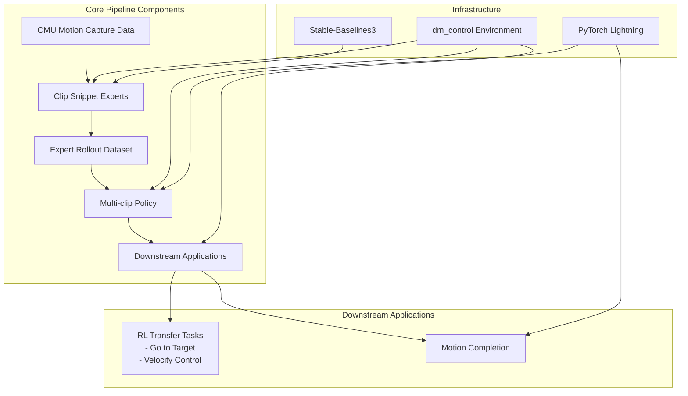
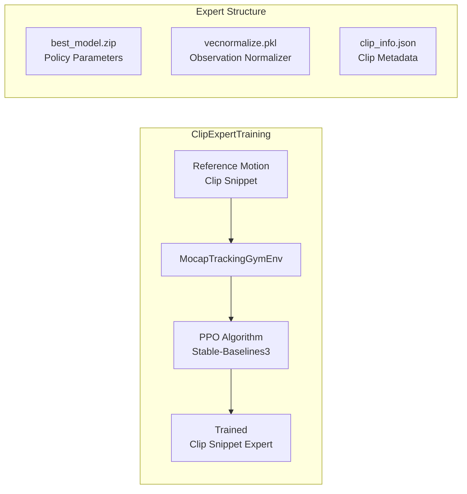
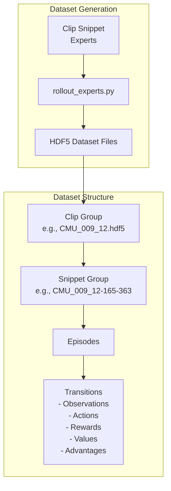
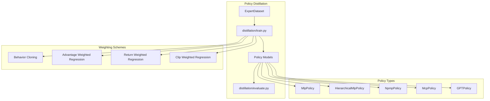
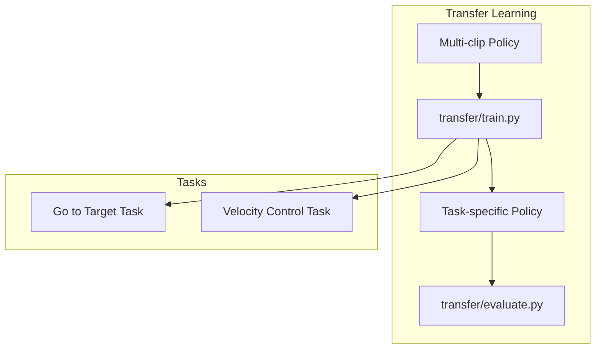
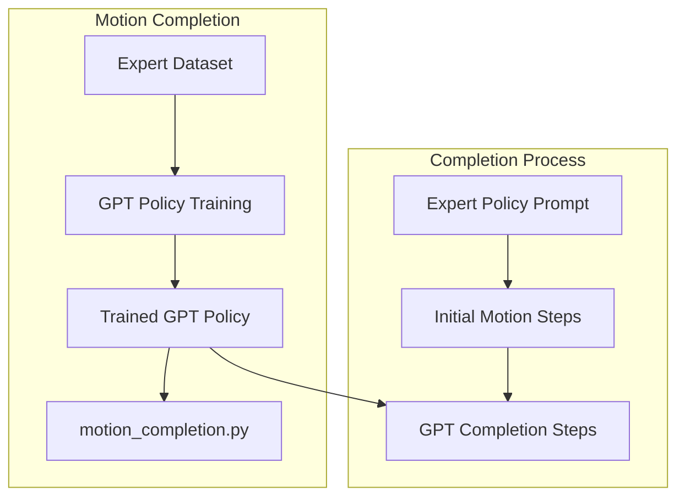
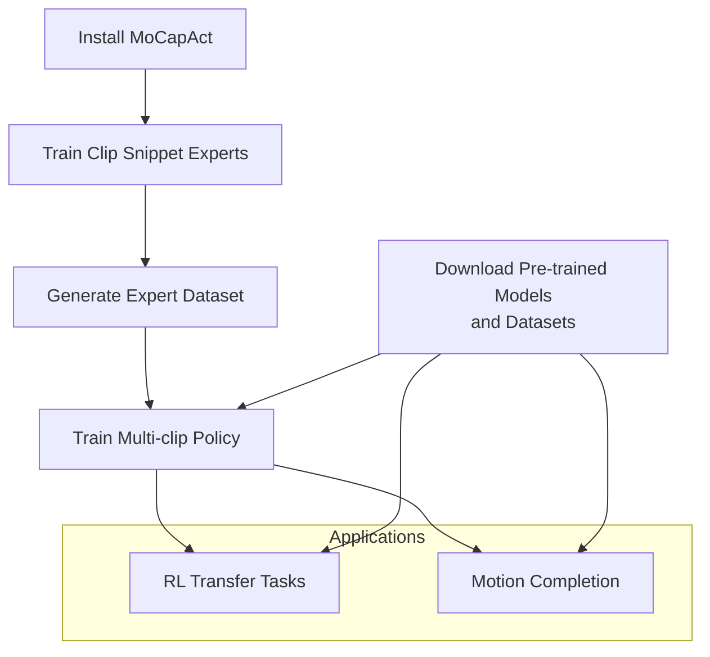

<!-- source: DeepWiki mcp.deepwiki.com · repo microsoft/MoCapAct · page 1 Overview · fetched 2026-10-26 -->

# Overview

Relevant source files

The following files were used as context for generating this wiki page:

- [README.md](README.md)
- [mocapact/download_dataset.py](mocapact/download_dataset.py)

## Purpose and Scope

MoCapAct is a comprehensive framework for learning low-level motor skills for the CMU Humanoid model using motion capture (MoCap) data. This document provides an introduction to the MoCapAct repository, explaining its key components and workflow. The framework enables users to train humanoid controllers that can accurately reproduce human movements and adapt these skills to new tasks.

This overview covers the high-level architecture, core components, and typical workflows within MoCapAct. For detailed information about specific components, see the dedicated pages in this wiki: [Installation and Setup](#2), [Clip Experts](#3.1), [Policy Distillation](#3.3), [Transfer Learning](#3.4), and [Motion Completion](#3.5).

Sources: [README.md:11-18]()

## High-Level Architecture

MoCapAct consists of five main components organized in a pipeline that transforms raw motion capture data into trained policies for humanoid control.

**Diagram: MoCapAct Architecture Overview**

Sources: [README.md:11-20]()

## Core Components

### 1. Clip Snippet Experts

Clip snippet experts are specialized policies trained to accurately track specific segments of motion capture clips. Each expert is specialized in reproducing a particular motion snippet from the CMU MoCap database.

**Diagram: Clip Snippet Expert Training and Structure**

The experts are trained using Proximal Policy Optimization (PPO) from Stable-Baselines3, which receives observations from the MocapTrackingGymEnv environment and learns to match the reference motion.

Sources: [README.md:50-80]()

### 2. Expert Dataset Generation

The expert dataset consists of rollouts collected from the trained clip snippet experts. These rollouts contain observations, actions, rewards, and other data useful for training downstream policies.

**Diagram: Expert Dataset Generation and Structure**

The dataset is organized hierarchically in HDF5 files, with each file containing rollouts for a specific clip, which in turn contains multiple snippets and episodes.

Sources: [README.md:83-156]()

### 3. Policy Distillation

Policy distillation trains a general multi-clip policy from the expert dataset, creating a model that can perform across a variety of motion clips.

**Diagram: Policy Distillation Process and Model Types**

PyTorch Lightning is used for efficient training, and multiple policy architectures are available, from simple MLPs to more complex models like Neural Probabilistic Motor Primitives (NPMP) and transformer-based GPT policies.

Sources: [README.md:159-191](), [README.md:226-291]()

### 4. Reinforcement Learning Transfer Tasks

The multi-clip policy can be used as a base for reinforcement learning on downstream tasks, such as goal-directed movement or velocity control.

**Diagram: Reinforcement Learning Transfer Process**

The transfer tasks use Proximal Policy Optimization (PPO) to train policies for specific tasks, optionally using a pre-trained low-level policy as a foundation.

Sources: [README.md:192-210](), [README.md:295-310]()

### 5. Motion Completion

Motion completion involves training a GPT policy to complete partial motion sequences, given an initial prompt of motion.

**Diagram: Motion Completion Process**

The GPT policy is trained to predict the next motion steps given a sequence of previous steps, enabling it to complete motions in a coherent and realistic manner.

Sources: [README.md:211-240](), [README.md:313-339]()

## Key Components Table

| Component | Purpose | Key Files | Dependencies |
|-----------|---------|-----------|-------------|
| Clip Snippet Experts | Train policies that track specific motion clip segments | `mocapact/clip_expert/train.py`, `mocapact/clip_expert/evaluate.py` | Stable-Baselines3, dm_control |
| Expert Dataset | Store and manage expert rollouts | `mocapact/distillation/rollout_experts.py`, `mocapact/distillation/dataset.py` | HDF5, PyTorch |
| Policy Distillation | Train multi-clip policies from expert data | `mocapact/distillation/train.py`, `mocapact/distillation/model.py` | PyTorch Lightning |
| RL Transfer | Adapt policies to new tasks | `mocapact/transfer/train.py`, `mocapact/transfer/evaluate.py` | Stable-Baselines3 |
| Motion Completion | Complete partial motion sequences | `mocapact/distillation/motion_completion.py` | PyTorch Lightning |

Sources: [README.md:11-20](), [README.md:160-339]()

## System Requirements and Dependencies

MoCapAct requires:
- Python 3.7+
- Core dependencies:
  - dm_control: Provides the CMU Humanoid model and simulation environment
  - Stable-Baselines3: Implements reinforcement learning algorithms
  - PyTorch Lightning: Facilitates training of neural network models
  - HDF5: Stores expert rollouts and dataset information

A virtual environment is recommended for installation, as detailed in the [Installation and Setup](#2) guide.

Sources: [README.md:27-41]()

## Workflow

**Diagram: Typical MoCapAct Workflow**

The workflow typically starts with installing MoCapAct, then either downloading pre-trained models and datasets or training them from scratch. The trained policies can then be used for downstream applications like transfer learning or motion completion.

Sources: [README.md:160-339]()

## Dataset Interface

MoCapAct provides two main dataset interfaces:
1. `ExpertDataset`: Used for imitation learning to train multi-clip tracking policies or GPT policies for motion completion
2. `D4RLDataset`: Used for offline reinforcement learning

For smaller datasets that fit in memory, users can use `D4RLDataset.get_in_memory_rollouts()`. For larger datasets, iterators can be used via PyTorch's `Dataset` interface.

Sources: [README.md:342-347]()

## Applications and Extensions

MoCapAct has been used as a foundation for several research projects, including:
- H-GAP: Humanoid Control with a Generalist Planner
- Leveraging Demonstrations with Latent Space Priors
- Hierarchical World Models as Visual Whole-Body Humanoid Controllers
- Body Transformer: Leveraging Robot Embodiment for Policy Learning

These projects demonstrate the extensibility and utility of the MoCapAct framework for advanced humanoid control research.

Sources: [README.md:349-353]()

---

