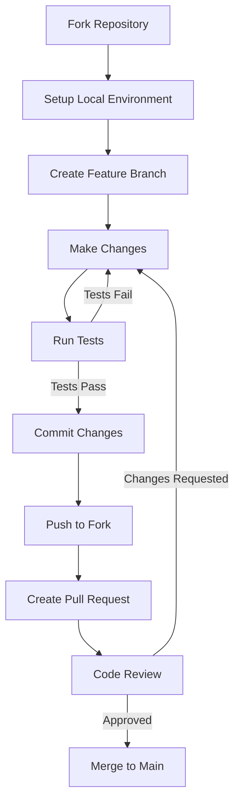
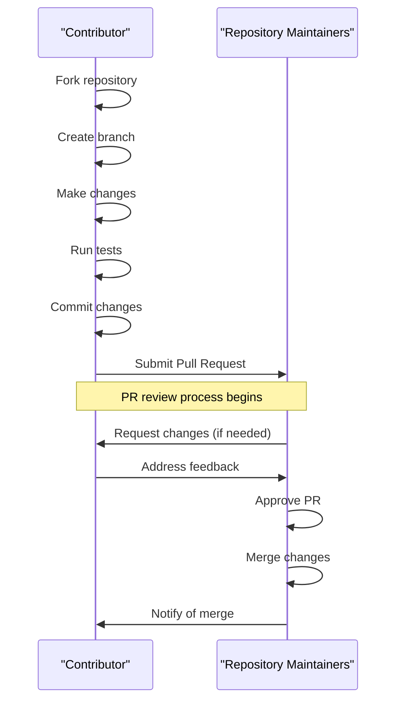
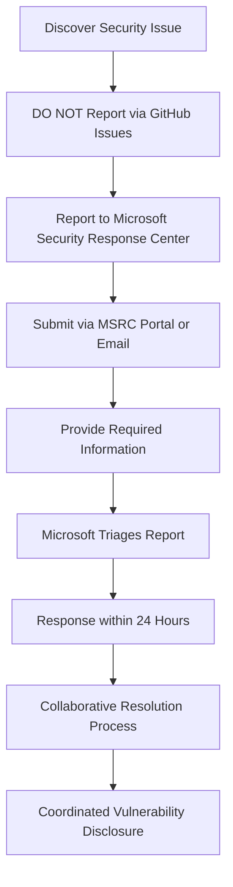
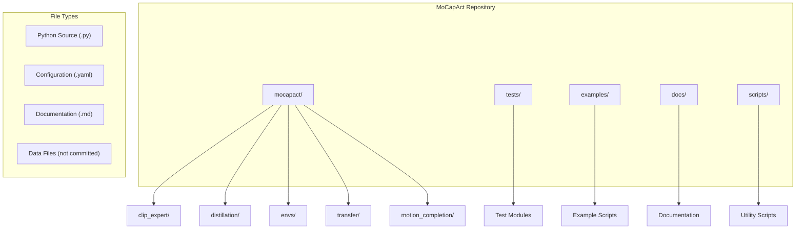

<!-- source: DeepWiki mcp.deepwiki.com · repo microsoft/MoCapAct · page 10 Contributing and Security · fetched 2026-10-26 -->

# Contributing and Security

<details>
<summary>Relevant source files</summary>

The following files were used as context for generating this wiki page:

- [.gitignore](.gitignore)
- [LICENSE](LICENSE)
- [SECURITY.md](SECURITY.md)

</details>


This document provides guidelines for contributing to the MoCapAct project and outlines the security policies. It covers the development workflow, code contribution standards, and procedures for reporting security vulnerabilities. For information about installation and setup, see [Installation and Setup](#2).

## Contributing to MoCapAct

MoCapAct is an open-source project under the MIT License. Contributions from the community are welcome to help improve the framework's functionality, documentation, and usability.

### Contribution Workflow

The following diagram illustrates the general workflow for contributing to the MoCapAct repository:



Sources: [LICENSE](). [.gitignore]().

### Setting Up Development Environment

To set up your development environment for contributing to MoCapAct:

1. Fork the repository at https://github.com/microsoft/MoCapAct
2. Clone your fork to your local machine
3. Install dependencies as described in the [Installation and Setup](#2) page
4. Create a new branch for your feature or fix

### Coding Standards

When contributing code to MoCapAct, please follow these guidelines:

- Follow the existing code style in the repository
- Write comprehensive docstrings for all new functions and classes
- Add appropriate unit tests for new functionality
- Update documentation as needed
- Keep commits focused and with clear messages

### Pull Request Process



Sources: [LICENSE]().

1. Ensure your code passes all tests
2. Submit a pull request with a clear description of:
   - What changes were made
   - Why the changes are necessary
   - Any potential impacts on existing functionality
3. Address any feedback from code reviewers
4. Once approved, your contribution will be merged

## Security Policy

MoCapAct follows Microsoft's security reporting and handling practices as outlined in the SECURITY.md file.

### Reporting Security Vulnerabilities

The following diagram illustrates the process for reporting and handling security vulnerabilities:



Sources: [SECURITY.md:9-29]().

**Important:** Do not report security vulnerabilities through public GitHub issues.

Instead:
1. Report to the Microsoft Security Response Center (MSRC) through:
   - MSRC Portal: https://msrc.microsoft.com/create-report
   - Email: secure@microsoft.com

2. When reporting, include as much of the following information as possible:
   - Type of issue
   - Relevant source file paths
   - Location of affected code
   - Configuration required to reproduce
   - Step-by-step reproduction instructions
   - Proof-of-concept code
   - Potential impact and exploitation methods

Microsoft follows the [Coordinated Vulnerability Disclosure](https://aka.ms/opensource/security/cvd) principle for handling security issues.

### Security Best Practices for Contributors

When contributing to MoCapAct, follow these security best practices:

1. Do not commit sensitive information such as:
   - API keys
   - Passwords
   - Private configuration
   - Personal data

2. Be mindful of importing dependencies that might introduce security vulnerabilities

3. Follow secure coding practices, especially when handling user input or external data

## License Information

MoCapAct is released under the MIT License, which is a permissive open-source license.

```
MIT License

Copyright (c) 2022 Microsoft Corporation

Permission is hereby granted, free of charge, to any person obtaining a copy
of this software and associated documentation files (the "Software"), to deal
in the Software without restriction, including without limitation the rights
to use, copy, modify, merge, publish, distribute, sublicense, and/or sell
copies of the Software, and to permit persons to whom the Software is
furnished to do so, subject to the following conditions:

The above copyright notice and this permission notice shall be included in all
copies or substantial portions of the Software.
```

Sources: [LICENSE:1-21]().

The MIT License allows you to:
- Use, copy, modify, merge, publish, distribute, sublicense, and/or sell copies of the software
- Use the software for private, commercial, or open-source projects

With the requirement that:
- The original copyright notice and permission notice must be included in all copies or substantial portions of the software

## Code of Conduct

Contributors to MoCapAct are expected to adhere to a respectful and inclusive approach when interacting with other contributors through issues, pull requests, or discussions.

## Repository Structure for Contributors

The following diagram shows the key areas of the repository that contributors might need to modify:



Sources: [.gitignore:1-132]().

Note that certain files and directories should not be committed to the repository as specified in the `.gitignore` file, including:
- Python bytecode files (`__pycache__/`, `*.pyc`, etc.)
- Build and distribution directories (`build/`, `dist/`, etc.)
- Environment directories (`.env`, `.venv`, etc.)
- Data directories (`data/`)