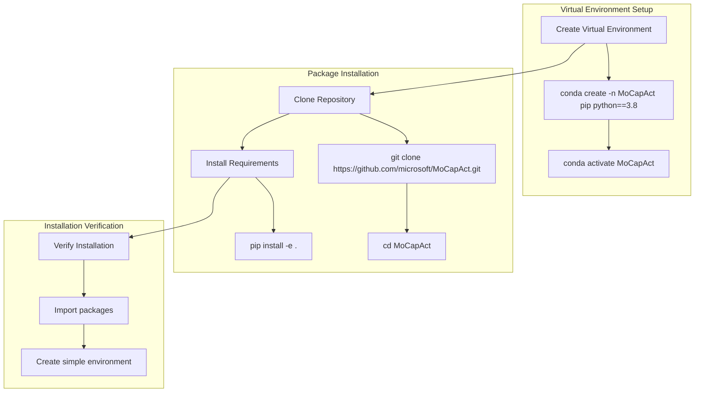
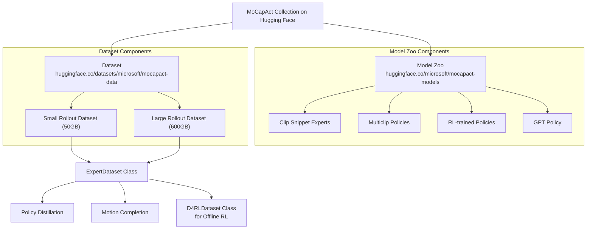
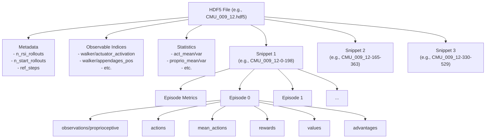
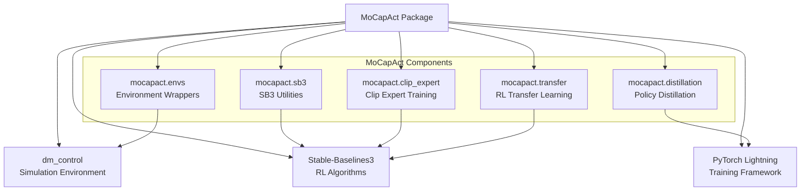

<!-- source: DeepWiki mcp.deepwiki.com · repo microsoft/MoCapAct · page 2 Installation and Setup · fetched 2026-10-26 -->

# Installation and Setup

<details>
<summary>Relevant source files</summary>

The following files were used as context for generating this wiki page:

- [README.md](README.md)
- [mocapact/download_dataset.py](mocapact/download_dataset.py)
- [requirements.txt](requirements.txt)
- [setup.py](setup.py)

</details>


This page documents the installation and setup process for the MoCapAct framework. It covers system requirements, package installation, and instructions for accessing the dataset of motion capture experts and rollouts. For information about training clip snippet experts or creating your own dataset, see [Clip Experts](#3.1) and [Dataset Generation and Management](#3.2).

## System Requirements

MoCapAct requires the following system components to function properly:

- Python 3.7 or higher
- MuJoCo physics engine (included as a dependency)
- GPU recommended for training models but not required for inference
- Sufficient storage space for datasets (approximately 50GB for small dataset, 600GB for full dataset)

The package has been tested on Linux and macOS platforms. Windows users may need additional configuration steps for MuJoCo.

Sources: [README.md:27-28](), [setup.py:11-23]()

## Installation Process

The installation workflow consists of setting up a virtual environment and installing the MoCapAct package and its dependencies.



### Setting up a Virtual Environment

It's recommended to use a virtual environment to avoid dependency conflicts. You can create one using conda or venv:

```bash
# Using conda
conda create -n MoCapAct pip python==3.8
conda activate MoCapAct

# OR using venv (Python's built-in virtual environment)
python -m venv mocapact-env
source mocapact-env/bin/activate  # On Windows: mocapact-env\Scripts\activate
```

### Installing MoCapAct

Clone the repository and install the package:

```bash
git clone https://github.com/microsoft/MoCapAct.git
cd MoCapAct
pip install -e .
```

The `-e` flag installs the package in "editable" mode, allowing you to modify the source code if needed.

Sources: [README.md:27-41](), [setup.py:4-24]()

### Dependencies

MoCapAct has several key dependencies that will be automatically installed:

| Dependency | Version | Purpose |
|------------|---------|---------|
| dm_control | >=1.0.7 | Physics simulation environment for the CMU Humanoid |
| mujoco | >=2.2.2 | Physics engine powering the simulation |
| pytorch-lightning | <1.7 | Machine learning framework for training policies |
| stable-baselines3 | >=1.5.0 | Reinforcement learning algorithms |
| gym | <0.24 | Interface standard for reinforcement learning environments |
| h5py | - | Library for working with HDF5 dataset files |

For reproducibility, you can install the exact versions used in the paper by running:

```bash
pip install -r requirements.txt
```

Sources: [setup.py:11-23](), [requirements.txt:1-6]()

## Dataset Access

The MoCapAct dataset consists of trained clip snippet experts and their rollouts. This section explains how to access and use this data.



### Downloading the Dataset

The dataset is hosted on Hugging Face and is organized into two main components:

1. **Model Zoo**: Contains trained models including clip snippet experts, multiclip policies, RL-trained policies, and the GPT policy.
   - Available at: huggingface.co/microsoft/mocapact-models

2. **Dataset**: Contains expert rollouts in two sizes:
   - Small dataset (50GB): 10 rollouts per snippet
   - Large dataset (600GB): 100 rollouts per snippet
   - Available at: huggingface.co/datasets/microsoft/mocapact-data

To download the dataset, follow the instructions on the Hugging Face collection page. The older download script referenced in the source code is no longer functional.

Sources: [README.md:43-48](), [mocapact/download_dataset.py:1-10]()

### Dataset Structure

The dataset is organized as a collection of HDF5 files, with one file per clip. Each file contains rollouts for all snippets within that clip.



The dataset can be loaded and used in Python using the `ExpertDataset` class for imitation learning or the `D4RLDataset` class for offline reinforcement learning.

Sources: [README.md:82-156](), [README.md:342-347]()

### Sample Dataset Usage

Here's a simple example of loading the dataset:

```python
import h5py

# Load a specific clip file
dset = h5py.File("path/to/dataset/CMU_009_12.hdf5", "r")

# Access actions from a specific snippet and episode
actions = dset["CMU_009_12-165-363/0/actions"][...]

# Close the file when done
dset.close()
```

For more advanced usage, MoCapAct provides dedicated dataset interfaces:

```python
# For imitation learning (e.g., policy distillation)
from mocapact.distillation.dataset import ExpertDataset

# For offline reinforcement learning
from mocapact.offline_rl.d4rl_dataset import D4RLDataset
```

Sources: [README.md:146-153](), [README.md:342-347]()

## System Verification

After installation, you can verify that everything is working correctly by loading an expert policy and running a simple simulation:

```python
from mocapact import observables
from mocapact.sb3 import utils
from mocapact.envs import tracking
from dm_control.locomotion.tasks.reference_pose import types

# Load a clip snippet expert
expert_path = "path/to/experts/CMU_009_12-165-363/eval_rsi/model"
expert = utils.load_policy(expert_path, observables.TIME_INDEX_OBSERVABLES)

# Create an environment
dataset = types.ClipCollection(ids=['CMU_009_12'], start_steps=[165], end_steps=[363])
env = tracking.MocapTrackingGymEnv(dataset)

# Run a simple loop
obs, done = env.reset(), False
while not done:
    action, _ = expert.predict(obs, deterministic=True)
    obs, rew, done, _ = env.step(action)
    print(rew)
```

This should load an expert policy and run it in the environment, printing the reward at each step.

Sources: [README.md:64-80]()

## System Integration

After installation, the MoCapAct system components integrate as follows:



Now you have successfully installed and set up MoCapAct. You can proceed to training clip snippet experts ([Clip Experts](#3.1)), generating datasets ([Dataset Generation and Management](#3.2)), or training multi-clip policies ([Policy Distillation](#3.3)).

Sources: [README.md:11-18](), [setup.py:11-23]()

---

