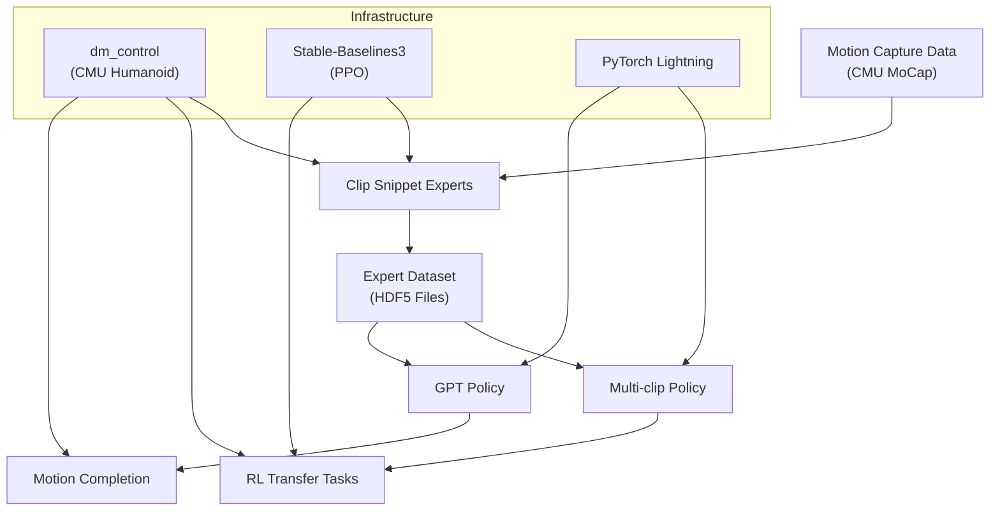
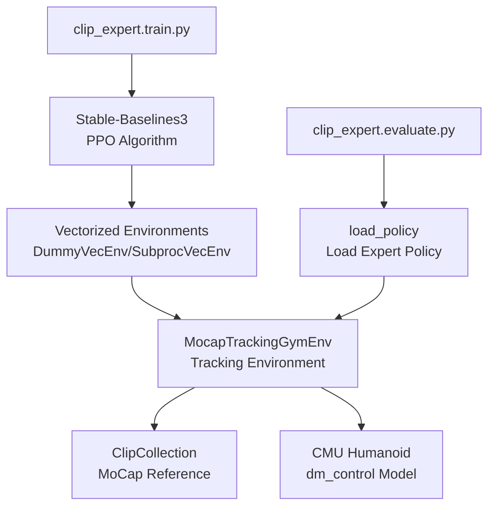
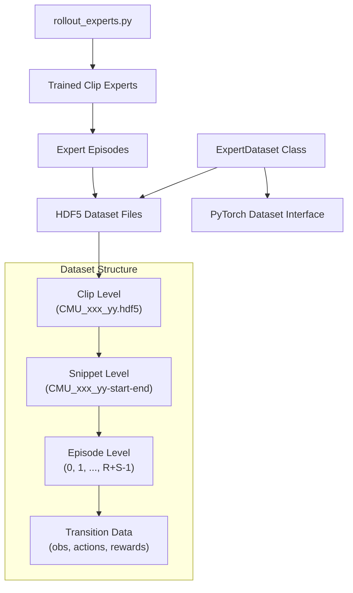
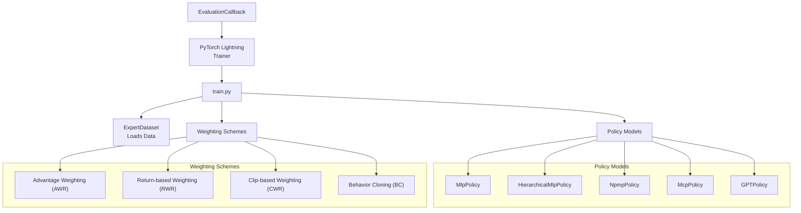
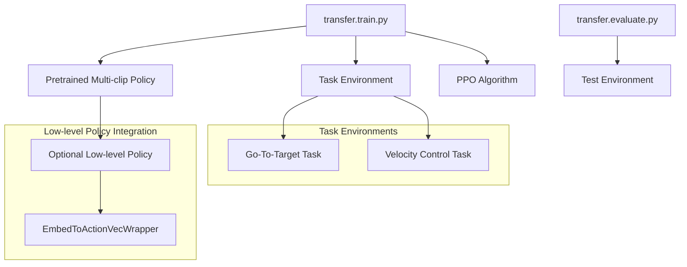
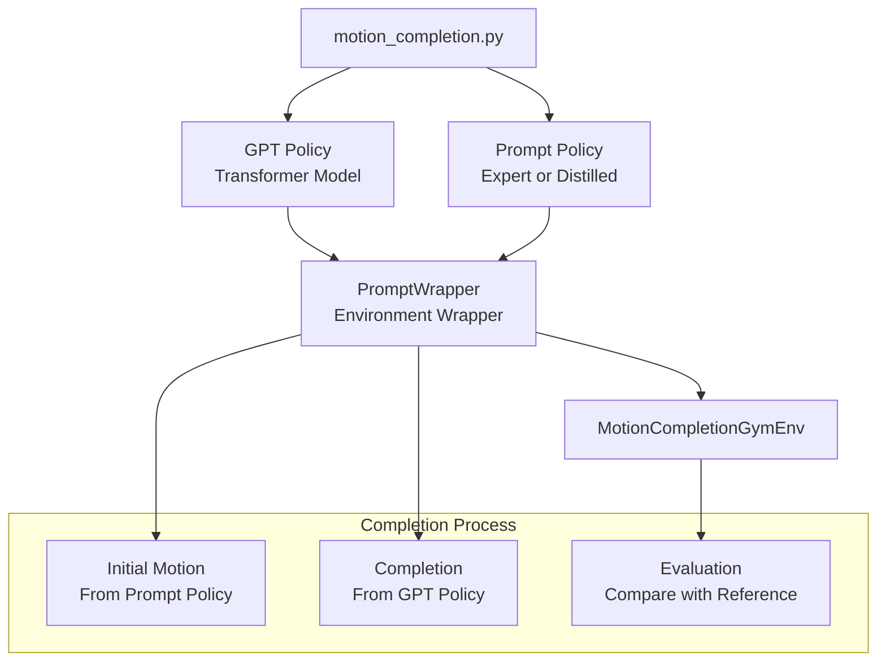
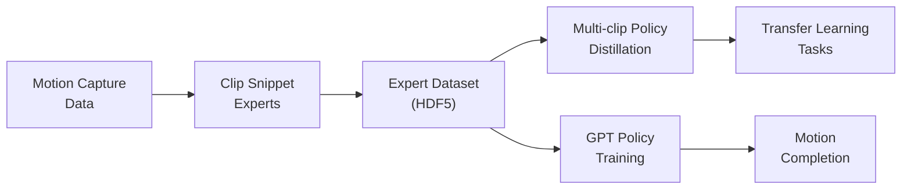

<!-- source: DeepWiki mcp.deepwiki.com · repo microsoft/MoCapAct · page 3 Core Components · fetched 2026-10-26 -->

# Core Components

Relevant source files

The following files were used as context for generating this wiki page:

- [README.md](README.md)
- [mocapact/download_dataset.py](mocapact/download_dataset.py)

This document provides an overview of the main components of the MoCapAct system and their interactions. It serves as a central reference for understanding the system architecture and how different parts work together to train humanoid controllers using motion capture data.

For specific implementation details about individual components, see their dedicated pages:
- [Clip Experts](#3.1)
- [Dataset Generation and Management](#3.2)
- [Policy Distillation](#3.3)
- [Transfer Learning](#3.4)
- [Motion Completion](#3.5)

## System Architecture Overview

Sources: [README.md:9-20]()

The MoCapAct system consists of five core components working together to train and utilize humanoid controllers based on motion capture data. The system pipeline begins with training expert policies for specific motion clip snippets, then collecting rollouts from these experts to create a dataset. This dataset is used to train either a multi-clip policy (for general motion tracking) or a GPT policy (for motion completion). The multi-clip policy can be further refined for downstream tasks through reinforcement learning.

## 1. Clip Snippet Experts

Clip snippet experts are specialized policies trained to track specific segments (snippets) of motion capture clips.

Sources: [README.md:163-202]()

Each clip snippet expert focuses on accurately reproducing a single segment of motion. These experts are the foundation of the MoCapAct system, as they generate the data used in subsequent components.

| Component | Description | Source File |
|-----------|-------------|-------------|
| Trainer | Trains clip snippet experts using PPO | `mocapact/clip_expert/train.py` |
| Evaluator | Evaluates expert performance | `mocapact/clip_expert/evaluate.py` |
| Environment | MoCap tracking Gym environment | `mocapact/envs/tracking.py` |
| Utilities | Helper functions for setup | `mocapact/clip_expert/utils.py` |
| Callbacks | Training callbacks | `mocapact/clip_expert/callbacks.py` |

Technical details:
- Uses Proximal Policy Optimization (PPO) from Stable-Baselines3
- Employs vectorized environments for parallel training
- Includes evaluation callbacks with early stopping
- CMU Humanoid model from dm_control serves as the physical agent
- Stores both policy parameters and observation normalizers

## 2. Expert Dataset Generation

The expert dataset consists of rollouts collected from trained clip snippet experts, providing the foundation for policy distillation.

Sources: [README.md:205-224](), [README.md:81-144]()

The dataset maintains a hierarchical structure in HDF5 format, organizing data by clips, snippets, and episodes. This organization facilitates efficient storage and retrieval of expert demonstrations.

| Component | Description | Source File |
|-----------|-------------|-------------|
| Rollout Generator | Collects expert rollouts | `mocapact/distillation/rollout_experts.py` |
| Dataset Class | Manages dataset access | `mocapact/distillation/dataset.py` |
| D4RL Dataset | Interface for offline RL | `mocapact/offline_rl/d4rl_dataset.py` |

Dataset structure details:
- HDF5 files organized by clip, snippet, and episode
- Contains proprioceptive observations, actions, rewards, values, advantages
- Includes episodes starting from beginning of snippets and random points
- Stores statistics (means, variances) for observation and action normalization
- Accessible through `ExpertDataset` and `D4RLDataset` classes

## 3. Policy Distillation

Policy distillation trains a general multi-clip policy using the expert dataset, creating a model that can perform across various motion clips.

Sources: [README.md:227-290]()

Policy distillation is the process of transferring knowledge from multiple specialized experts into a single, versatile policy. MoCapAct offers several policy architectures and weighting schemes to optimize this process.

| Model | Description | Use Case |
|-------|-------------|----------|
| MlpPolicy | Basic feedforward network | Simple tracking |
| HierarchicalMlpPolicy | Encoder-decoder architecture | Better generalization |
| NpmpPolicy | Neural Probabilistic Motor Primitives | Complex motion tracking |
| McpPolicy | Multiplicative Compositional Policy | Compositional control |
| GPTPolicy | Transformer-based model | Motion completion |

Key features:
- PyTorch Lightning framework for efficient training
- Multiple policy architectures with different capabilities
- Various weighting schemes (AWR, RWR, CWR, BC) for training optimization
- Regular evaluation during training with multiple metrics
- Checkpoint saving and training resumption

## 4. Transfer Learning

The multi-clip policy serves as a foundation for reinforcement learning on downstream tasks, such as goal-directed movement or velocity control.

Sources: [README.md:293-310]()

Transfer learning enables the application of learned motion skills to practical tasks. MoCapAct supports two primary transfer tasks: go-to-target (navigation) and velocity control (speed management).

| Component | Description | Source File |
|-----------|-------------|-------------|
| Trainer | Trains policies for transfer tasks | `mocapact/transfer/train.py` |
| Evaluator | Evaluates transfer task performance | `mocapact/transfer/evaluate.py` |
| Task Configurations | Task definitions | `mocapact/transfer/config.py` |

Technical details:
- Uses Proximal Policy Optimization (PPO) for transfer learning
- Supports optional integration with a pre-trained low-level policy
- Implements action embedding for more effective control
- Includes regular evaluation during training with model saving
- Supports go-to-target and velocity control tasks

## 5. Motion Completion

Motion completion uses a GPT-based policy to complete partial motion sequences, enabling the generation of continued movements from an initial prompt.

Sources: [README.md:313-340]()

Motion completion represents a more advanced application of the system, where a transformer-based model learns to predict and generate continuation motions based on initial movement patterns.

| Component | Description | Source File |
|-----------|-------------|-------------|
| Completion Runner | Executes motion completion | `mocapact/distillation/motion_completion.py` |
| GPT Policy | Transformer model for completion | `mocapact/distillation/model.py` |
| Completion Environment | Environment for completion | `mocapact/envs/motion_completion.py` |
| Prompt Wrapper | Handles transition from prompt to completion | `mocapact/envs/wrappers.py` |

Technical details:
- GPT-based transformer model for sequence completion
- Prompt-based approach using an initial expert policy
- PromptWrapper environment to handle the transition from prompt to completion
- Supports both numerical evaluation and visualization

## Integration and Data Flow

The complete system integrates these components through a data flow pipeline:

Sources: [README.md:11-20]()

This flow represents the full life cycle from raw motion capture data to practical applications:

1. Motion capture data is used to train specialized expert policies
2. These experts generate a dataset of demonstrations
3. The dataset trains either general policies (multi-clip) or specialized ones (GPT)
4. The trained policies enable downstream applications like task-specific control or motion completion

## Infrastructure Dependencies

MoCapAct relies on several key external libraries that provide the foundation for its functionality:

| Dependency | Usage | Integration Point |
|------------|-------|-------------------|
| dm_control | Provides the CMU Humanoid model and physics simulation | `mocapact/envs/tracking.py` |
| Stable-Baselines3 | Reinforcement learning algorithms (PPO) | `mocapact/clip_expert/train.py`, `mocapact/transfer/train.py` |
| PyTorch Lightning | Training framework for distilled policies | `mocapact/distillation/train.py` |
| HDF5 | Storage format for expert rollouts | `mocapact/distillation/dataset.py` |

Sources: [README.md:21-25](), [README.md:27-41]()

These dependencies provide the infrastructure necessary for simulation, reinforcement learning, neural network training, and efficient data storage.

---

