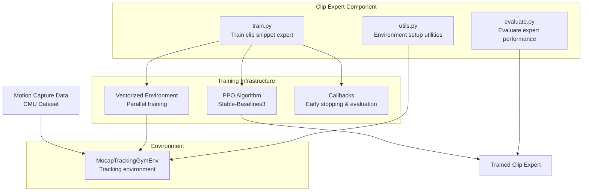
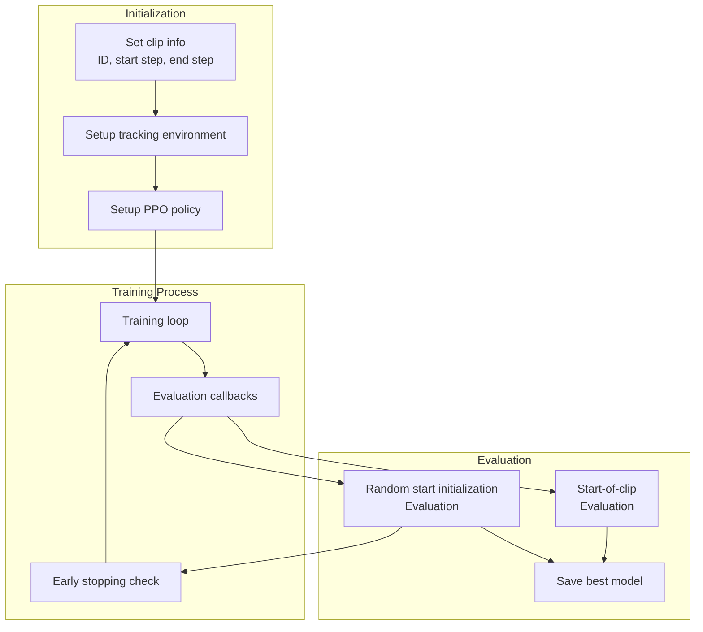
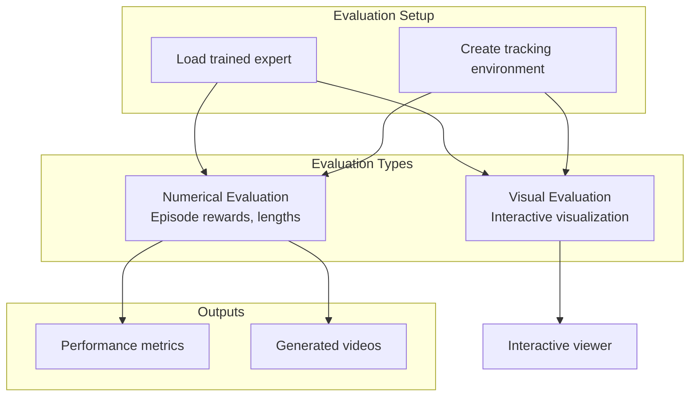
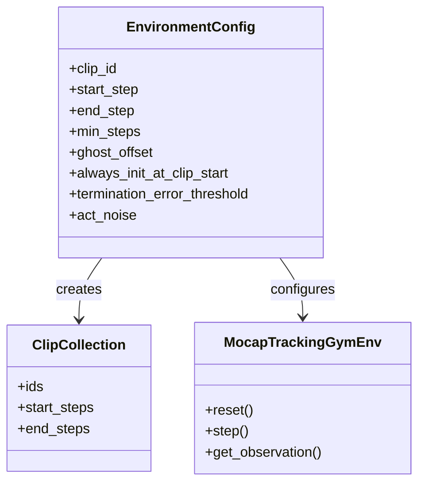

<!-- source: DeepWiki mcp.deepwiki.com · repo microsoft/MoCapAct · page 3.1 Clip Experts · fetched 2026-10-26 -->

# Clip Experts

<details>
<summary>Relevant source files</summary>

The following files were used as context for generating this wiki page:

- [README.md](README.md)
- [mocapact/clip_expert/evaluate.py](mocapact/clip_expert/evaluate.py)
- [mocapact/clip_expert/train.py](mocapact/clip_expert/train.py)
- [mocapact/clip_expert/utils.py](mocapact/clip_expert/utils.py)
- [mocapact/download_dataset.py](mocapact/download_dataset.py)

</details>


## Purpose and Scope

Clip Experts are fundamental components in the MoCapAct system that serve as specialized policies trained to accurately track specific segments (snippets) of motion capture clips. This document explains how to train, evaluate, and use these clip snippet experts, which form the foundation for downstream capabilities such as expert dataset generation, policy distillation, and transfer learning.

For information about converting these experts into a dataset of rollouts, see [Dataset Generation and Management](#3.2). For information on distilling knowledge from multiple experts into a single policy, see [Policy Distillation](#3.3).

## Overview

Clip Experts are policies trained using reinforcement learning (specifically PPO) to mimic specific segments of motion capture data with the CMU Humanoid model. Each expert specializes in tracking a single clip snippet, which is defined by a clip ID, start step, and end step.



Sources: [README.md:11-14](), [mocapact/clip_expert/train.py:1-17](), [mocapact/clip_expert/evaluate.py:1-4]()

## Clip Expert Structure

A clip expert model is saved with the following structure:

```
CMU_XXX_YY-start-end/
├── clip_info.json         # Contains clip ID, start step, and end step
└── eval_rsi/model/
    ├── best_model.zip     # Contains policy parameters and hyperparameters
    └── vecnormalize.pkl   # Used to get normalizer for observation and reward
```

Each expert is trained to track a specific segment of a motion capture clip, denoted by:
- **Clip ID**: The identifier for the MoCap clip (e.g., "CMU_009_12")
- **Start Step**: The first frame in the segment
- **End Step**: The last frame in the segment

Sources: [README.md:51-62]()

## Training Clip Experts

Training a clip expert involves using reinforcement learning to teach the CMU Humanoid model to track a specific motion capture clip segment.



### Training Script

To train a clip expert, use the `mocapact.clip_expert.train` script with the following key parameters:

| Parameter | Description |
|-----------|-------------|
| `--clip_id` | Identifier for the clip (e.g., "CMU_016_22") |
| `--start_step` | Starting frame in the clip |
| `--max_steps` | Maximum number of steps from start |
| `--log_root` | Directory to store results |
| `--n_workers` | Number of parallel environments |
| `--total_timesteps` | Total environment steps for training |

Example command:
```
python -m mocapact.clip_expert.train \
  --clip_id CMU_016_22 \
  --start_step 0 \
  --max_steps 210 \
  --n_workers 8 \
  --log_root experts \
  [additional parameters]
```

Sources: [mocapact/clip_expert/train.py:1-41](), [README.md:162-175]()

### Training Pipeline

1. **Environment Setup**: The function `make_env` in [mocapact/clip_expert/train.py:92-115]() creates vectorized tracking environments.
2. **Evaluation Environments**: Two environments are created:
   - RSI (Random State Initialization): Starts from random points in the clip
   - Start: Always starts from the beginning of the clip
3. **Policy Definition**: A PPO policy with specified neural network architecture is created using Stable-Baselines3.
4. **Training Loop**: The policy is trained with periodic evaluation and early stopping.

The training uses a combination of callbacks:
- `MocapTrackingEvalCallback`: Regular policy evaluation
- `EarlyStoppingCallback`: Terminates training when performance plateaus
- `SaveVecNormalizeCallback`: Saves observation/reward normalizers
- `NormalizedRolloutCallback`: Logs normalized performance metrics

Sources: [mocapact/clip_expert/train.py:117-278]()

### Advanced Configuration

The training script supports various hyperparameters:

- **Network Architecture**:
  - `--n_layers`: Number of hidden layers (default: 3)
  - `--layer_size`: Neurons per hidden layer (default: 1024)
  - `--activation_fn`: Activation function (default: Tanh)

- **PPO Parameters**:
  - `--n_steps`: Steps per policy update (default: 4096)
  - `--n_epochs`: Epochs for updating PPO (default: 10)
  - `--batch_size`: Minibatch size (default: 256)
  - `--clip_range`: PPO clipping parameter (default: 0.2)

- **Learning Rate**:
  - `--learning_rate.start_val`: Initial learning rate
  - `--learning_rate.decay`: Decay rate

Sources: [mocapact/clip_expert/train.py:44-86]()

## Evaluating Clip Experts

Once trained, clip experts can be evaluated to measure their performance in tracking the motion capture clip segment.



### Evaluation Script

To evaluate a clip expert, use the `mocapact.clip_expert.evaluate` script:

| Parameter | Description |
|-----------|-------------|
| `--policy_root` | Path to the expert policy |
| `--n_eval_episodes` | Number of episodes for numerical evaluation |
| `--n_workers` | Number of parallel workers |
| `--visualize` | Whether to show interactive visualization |
| `--eval_save_path` | Path to save evaluation results |
| `--video_save_path` | Path to save videos |

Example command:
```
python -m mocapact.clip_expert.evaluate \
  --policy_root experts/CMU_016-22-0-82/0/eval_rsi/model \
  --n_workers 8 \
  --n_eval_episodes 1000 \
  [additional parameters]
```

Sources: [mocapact/clip_expert/evaluate.py:1-124](), [README.md:177-184]()

### Evaluation Metrics

The evaluation reports several key metrics:
- Mean episode return (total reward)
- Mean episode length
- Mean normalized return
- Mean normalized episode length
- Mean reward per step

These metrics are logged and can be saved to a file for further analysis.

Sources: [mocapact/clip_expert/evaluate.py:82-105]()

### Visualization

The evaluation script can also create an interactive visualization using the dm_control viewer:
- Shows the humanoid controlled by the expert
- Optionally displays a "ghost" of the reference motion
- Helps visually assess tracking performance

Sources: [mocapact/clip_expert/evaluate.py:111-121]()

## Using Clip Experts

Clip experts can be loaded programmatically to control the humanoid in Python:

```python
from mocapact import observables
from mocapact.sb3 import utils
expert_path = "experts/CMU_016_22-0-82/0/eval_rsi/model"
expert = utils.load_policy(expert_path, observables.TIME_INDEX_OBSERVABLES)

from mocapact.envs import tracking
from dm_control.locomotion.tasks.reference_pose import types
dataset = types.ClipCollection(ids=['CMU_016_22'])
env = tracking.MocapTrackingGymEnv(dataset)
obs, done = env.reset(), False
while not done:
    action, _ = expert.predict(obs, deterministic=True)
    obs, rew, done, _ = env.step(action)
```

This allows for the integration of clip experts into larger systems, such as:
- Creating datasets of expert rollouts for policy distillation
- Transferring skills to new tasks
- Analyzing expert behavior

Sources: [README.md:185-201]()

## Implementation Details

### Environment Configuration

The function `make_env_kwargs` in [mocapact/clip_expert/utils.py:6-41]() sets up the environment for clip experts:



Key environment parameters include:
- `clip_id`: Identifier for the motion capture clip
- `start_step`/`end_step`: Define the segment of the clip to track
- `min_steps`: Minimum number of steps in an episode
- `ghost_offset`: Offset for the reference ghost
- `always_init_at_clip_start`: Whether to always start at the beginning of the clip
- `termination_error_threshold`: Error threshold for early termination
- `act_noise`: Action noise for the humanoid

Sources: [mocapact/clip_expert/utils.py:6-41]()

### Neural Network Architecture

Clip experts use a neural network policy with the following structure:

- Input: Proprioceptive observations from the humanoid and reference motion
- Hidden layers: Multiple fully-connected layers with a configurable size and activation function
- Output: Action distribution parameters (mean and standard deviation)

The features extractor (`CmuHumanoidFeaturesExtractor`) processes the multi-modal input observations and provides a consolidated feature vector to the policy network.

Sources: [mocapact/clip_expert/train.py:251-258]()

## Common Issues and Troubleshooting

- **Early Termination**: If the expert consistently terminates early, consider increasing the `termination_error_threshold` parameter.
- **Poor Performance**: Try increasing the neural network size or training duration.
- **Unstable Training**: Adjust PPO hyperparameters like learning rate or clip range.
- **Slow Training**: Increase the number of workers for parallel training.

## Next Steps

Once clip experts are trained, they can be:
1. Evaluated individually
2. Used to generate datasets of expert rollouts
3. Used as building blocks for multi-clip policies through distillation

For dataset generation, see [Dataset Generation and Management](#3.2).

---

