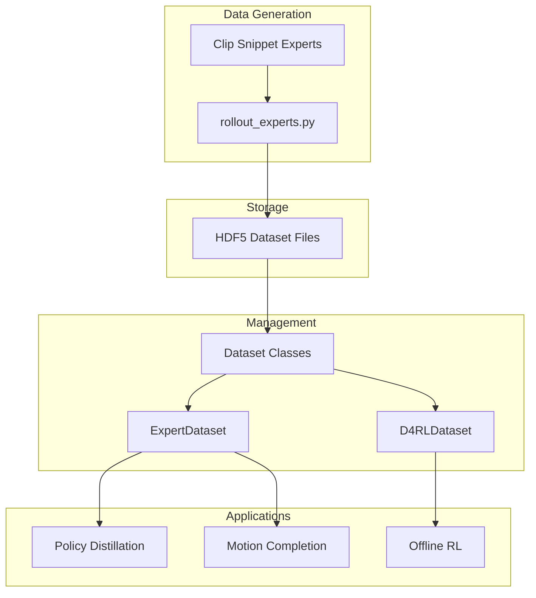
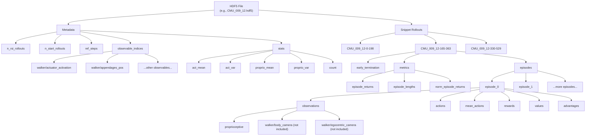
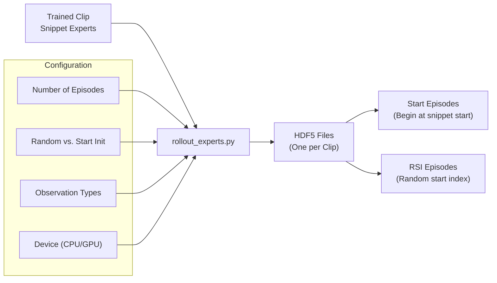
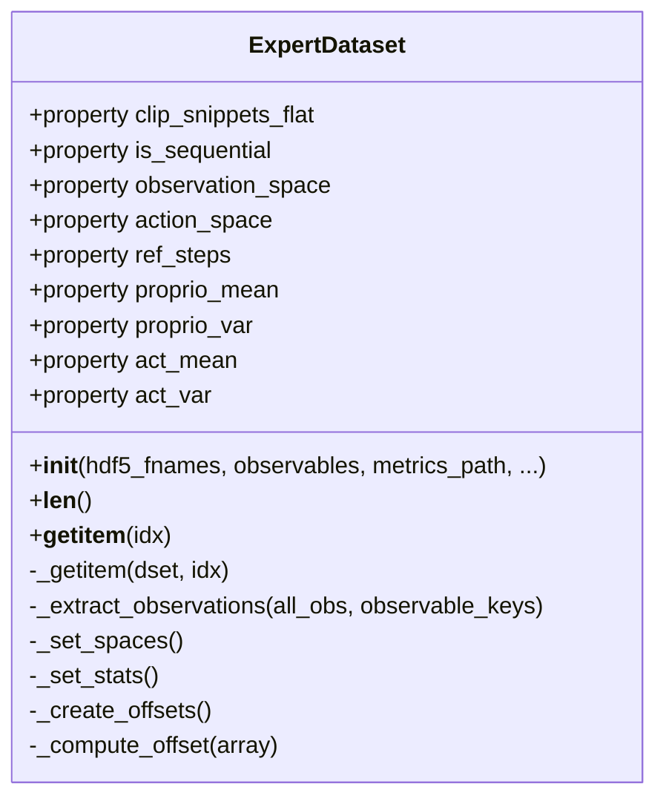
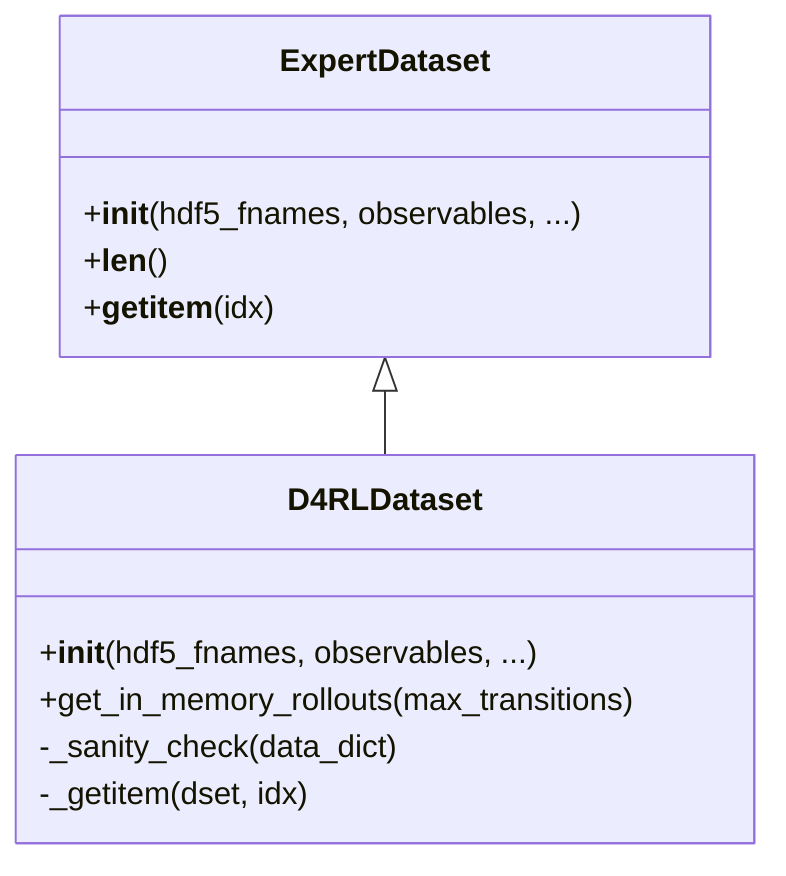

<!-- source: DeepWiki mcp.deepwiki.com · repo microsoft/MoCapAct · page 3.2 Dataset Generation and Management · fetched 2026-10-26 -->

# Dataset Generation and Management

<details>
<summary>Relevant source files</summary>

The following files were used as context for generating this wiki page:

- [README.md](README.md)
- [mocapact/distillation/dataset.py](mocapact/distillation/dataset.py)
- [mocapact/download_dataset.py](mocapact/download_dataset.py)
- [mocapact/offline_rl/d4rl_dataset.py](mocapact/offline_rl/d4rl_dataset.py)
- [mocapact/utils.py](mocapact/utils.py)

</details>


This page documents the process of generating, loading, and managing expert rollout datasets in MoCapAct. It covers how to create datasets from trained clip snippet experts and the data structures used to efficiently access and manipulate this data. For information about training the clip snippet experts themselves, see [Clip Experts](#3.1).

## Overview

The MoCapAct dataset consists of rollouts from clip snippet experts—policies trained to mimic specific segments of motion capture data. These rollouts are stored in a hierarchical structure that enables efficient access for training multi-clip policies, offline reinforcement learning, and motion completion tasks.



Sources: [README.md:42-157](), [mocapact/distillation/dataset.py:1-25]()

## Dataset Structure

The MoCapAct dataset is stored as a collection of HDF5 files, with one file per motion capture clip. Each file contains rollouts for all snippets within that clip, along with metadata and statistics.



Sources: [README.md:80-157]()

### Key Components

| Component | Description |
|-----------|-------------|
| Metadata | Contains information about the dataset, such as number of rollouts and reference steps |
| Observable Indices | Maps observable names to their indices in the proprioceptive observation array |
| Statistics | Precomputed means and variances for observations and actions across the dataset |
| Snippets | Individual segments of motion capture clips (e.g., `CMU_009_12-165-363`) |
| Episodes | Individual rollout trajectories for each snippet, including observations, actions, and rewards |
| Metrics | Performance metrics for each snippet, such as episode returns and lengths |

Sources: [README.md:80-157](), [mocapact/distillation/dataset.py:97-107]()

## Dataset Generation

The dataset is generated by running trained clip snippet experts and collecting their rollouts. This process is handled by the `rollout_experts.py` script.



Sources: [README.md:205-225]()

### Generation Process

1. For each clip snippet expert, the script runs multiple episodes from:
   - The start of the snippet (`start_rollouts`)
   - Random points within the snippet (`rsi_rollouts` - Random Start Index)

2. For each episode, it collects:
   - Proprioceptive observations (joint angles, velocities, etc.)
   - Actions taken by the expert
   - Mean actions (for deterministic policies)
   - Rewards from the environment
   - Value function estimates
   - Advantage estimates (for weighting in policy distillation)

3. The data is organized hierarchically and saved to HDF5 files.

### Command Line Usage

```bash
python -m mocapact.distillation.rollout_experts \
  --input_dirs [EXPERT_ROOT] \
  --n_workers [N_CPU] \
  --device [DEVICE] \
  --output_path dataset/file_name_ignored.hdf5 \
  $(cat cfg/rollout.txt)
```

Sources: [README.md:205-225]()

## Dataset Management with ExpertDataset

The `ExpertDataset` class provides a PyTorch-compatible interface for loading and managing the expert rollout data. It supports various features for efficient training, including observation normalization, action normalization, and different weighting schemes.



Sources: [mocapact/distillation/dataset.py:24-387]()

### Key Features

#### 1. Data Loading and Access

The `ExpertDataset` loads data from multiple HDF5 files and provides a unified interface for accessing observations, actions, and weights:

```python
dataset = ExpertDataset(
    hdf5_fnames=["dataset/CMU_009_12.hdf5", "dataset/CMU_016_22.hdf5"],
    observables=["walker/joints_pos", "walker/joints_vel", "walker/actuator_activation"],
    metrics_path="dataset/metrics.npz"
)

# Access a sample
obs, act, weight = dataset[100]
```

Sources: [mocapact/distillation/dataset.py:315-386]()

#### 2. Observation and Action Normalization

The dataset can normalize observations and actions using precomputed statistics:

```python
dataset = ExpertDataset(
    # ...
    normalize_obs=True,   # Normalize observations
    normalize_act=True,   # Normalize actions
    # ...
)
```

Sources: [mocapact/distillation/dataset.py:350-353]()

#### 3. Weighting Schemes

The dataset supports different weighting schemes for sampling or prioritizing data:

| Scheme | Description | Parameter |
|--------|-------------|-----------|
| Advantage Weighting | Weights data by the advantage function (AWR) | `advantage_weights=True` |
| Return Weighting | Weights data by the episode return (RWR) | `clip_weighted=True` |
| Clip-based Weighting | Weights data by clip length | `clip_len_upsampling=True` |
| Uniform Weighting | Equal weights for all data points | `temperature=None` |

Sources: [mocapact/distillation/dataset.py:368-385]()

#### 4. Sequential vs. Single-step Data

The dataset can return either single transitions or sequences of transitions, useful for training different types of models:

```python
# Single-step transitions (for MLPs)
dataset = ExpertDataset(min_seq_steps=1, max_seq_steps=1, ...)

# Sequential transitions (for RNNs, Transformers)
dataset = ExpertDataset(min_seq_steps=10, max_seq_steps=50, ...)
```

Sources: [mocapact/distillation/dataset.py:342-348]()

## Offline Reinforcement Learning with D4RLDataset

The `D4RLDataset` extends `ExpertDataset` to provide compatibility with the D4RL interface for offline reinforcement learning.



Sources: [mocapact/offline_rl/d4rl_dataset.py:7-154]()

### Key Features

#### 1. D4RL Compatibility

The `D4RLDataset` provides a standard interface that works with offline RL algorithms:

```python
d4rl_dataset = D4RLDataset(
    hdf5_fnames=["dataset/CMU_009_12.hdf5"],
    observables=["walker/joints_pos", "walker/joints_vel"],
    metrics_path="dataset/metrics.npz"
)

# Returns observations, actions, rewards, next_observations, terminals, timeouts
obs, act, rew, next_obs, terminal, timeout = d4rl_dataset[100]
```

Sources: [mocapact/offline_rl/d4rl_dataset.py:107-154]()

#### 2. In-Memory Rollouts

For smaller datasets, the entire dataset can be loaded into memory for faster access:

```python
# Load up to 2 million transitions into memory
rollouts = d4rl_dataset.get_in_memory_rollouts(max_transitions=2000000)

# Access components
observations = rollouts['observations']
actions = rollouts['actions']
rewards = rollouts['rewards']
next_observations = rollouts['next_observations']
terminals = rollouts['terminals']
timeouts = rollouts['timeouts']
```

Sources: [mocapact/offline_rl/d4rl_dataset.py:51-80]()

## Dataset Availability

MoCapAct provides two pre-generated datasets:

1. **Large Dataset**: 600 GB, with 100 start rollouts and 100 RSI rollouts per snippet
2. **Small Dataset**: 50 GB, with 10 start rollouts and 10 RSI rollouts per snippet

These datasets can be downloaded from the [MoCapAct Hugging Face collection](https://huggingface.co/datasets/microsoft/mocapact-data).

Sources: [README.md:43-49](), [README.md:156-157]()

## Usage Examples

### Loading and Exploring Dataset

```python
import h5py

# Open a dataset file
dset = h5py.File("dataset/CMU_009_12.hdf5", "r")

# View expert actions from the first rollout episode of the second snippet
print(dset["CMU_009_12-165-363/0/actions"][...])

# View metadata
print("Number of start rollouts:", dset["n_start_rollouts"][...])
print("Number of RSI rollouts:", dset["n_rsi_rollouts"][...])
```

Sources: [README.md:147-154]()

### Creating a Dataset for Policy Distillation

```python
from mocapact.distillation.dataset import ExpertDataset

# Create dataset for policy distillation
dataset = ExpertDataset(
    hdf5_fnames=["dataset/CMU_009_12.hdf5", "dataset/CMU_016_22.hdf5"],
    observables=["walker/joints_pos", "walker/joints_vel", "walker/actuator_activation"],
    metrics_path="dataset/metrics.npz",
    normalize_obs=True,
    normalize_act=True,
    advantage_weights=True,
    temperature=0.1
)

# Use with PyTorch DataLoader
from torch.utils.data import DataLoader
dataloader = DataLoader(dataset, batch_size=64, shuffle=True, num_workers=4)

for obs, act, weight in dataloader:
    # Training loop...
    pass
```

Sources: [mocapact/distillation/dataset.py:24-387](), [README.md:340-348]()

### Creating a Dataset for Offline RL

```python
from mocapact.offline_rl.d4rl_dataset import D4RLDataset

# Create dataset for offline RL
d4rl_dataset = D4RLDataset(
    hdf5_fnames=["dataset/CMU_009_12.hdf5"],
    observables=["walker/joints_pos", "walker/joints_vel", "walker/world_zaxis"],
    metrics_path="dataset/metrics.npz",
    normalize_obs=True,
    normalize_act=True
)

# Load data into memory for offline RL algorithm
in_memory_data = d4rl_dataset.get_in_memory_rollouts(max_transitions=1000000)
```

Sources: [mocapact/offline_rl/d4rl_dataset.py:7-80]()

---

