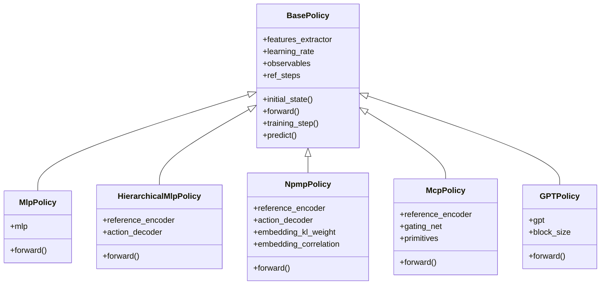
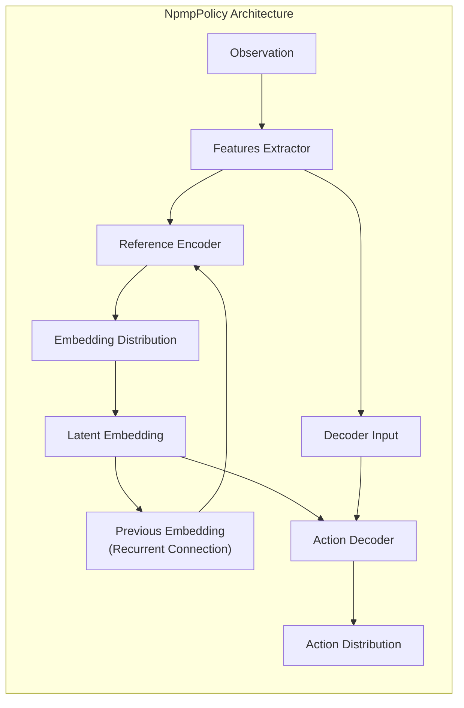
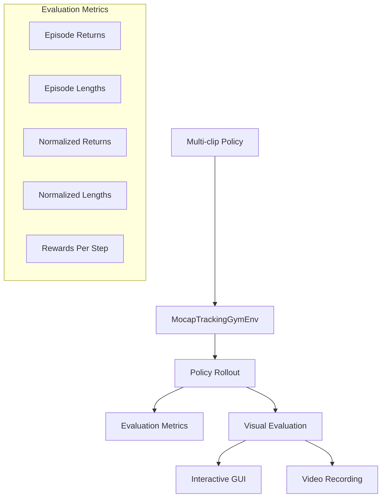

<!-- source: DeepWiki mcp.deepwiki.com · repo microsoft/MoCapAct · page 3.3 Policy Distillation · fetched 2026-10-26 -->

# Policy Distillation

<details>
<summary>Relevant source files</summary>

The following files were used as context for generating this wiki page:

- [README.md](README.md)
- [mocapact/distillation/config.py](mocapact/distillation/config.py)
- [mocapact/distillation/evaluate.py](mocapact/distillation/evaluate.py)
- [mocapact/distillation/model.py](mocapact/distillation/model.py)
- [mocapact/distillation/train.py](mocapact/distillation/train.py)
- [mocapact/download_dataset.py](mocapact/download_dataset.py)

</details>


Policy distillation in MoCapAct is the process of training a general multi-clip policy from a dataset of expert rollouts. This page explains the policy distillation process, available policy models, and how to train and evaluate distilled policies.

For information on generating the expert rollout dataset, see [Dataset Generation and Management](#3.2).
For information on using the distilled policies for transfer learning, see [Transfer Learning](#3.4).

## Process Overview

Policy distillation transforms many specialized clip snippet experts into a single versatile policy that can track multiple motion capture clips. This allows the system to generalize across different movement patterns.

```mermaid
flowchart TD
    subgraph "Expert Data Generation"
        ClipExperts["Clip Snippet Experts"] --> ExpertRollouts["Expert Rollouts Dataset"]
    end
    
    subgraph "Policy Distillation"
        ExpertRollouts --> ExpertDataset["ExpertDataset Class"]
        ExpertDataset --> TrainingLoop["Training Loop"]
        
        subgraph "Model Selection"
            MLP["MlpPolicy"]
            HMLP["HierarchicalMlpPolicy"]
            NPMP["NpmpPolicy"]
            MCP["McpPolicy"]
            GPT["GPTPolicy"]
        end
        
        subgraph "Weighting Schemes"
            AWR["Advantage-Weighted Regression"]
            RWR["Return-Weighted Regression"]
            BC["Behavioral Cloning"]
            CWR["Clip-based Weighting"]
        end
        
        Model Selection --> TrainingLoop
        Weighting Schemes --> TrainingLoop
    end
    
    TrainingLoop --> MultiClipPolicy["Multi-clip Policy"]
    MultiClipPolicy --> Evaluation["Policy Evaluation"]
    MultiClipPolicy --> TransferLearning["Transfer Learning"]
    MultiClipPolicy --> MotionCompletion["Motion Completion"]
```

Sources: [mocapact/distillation/train.py:1-256](), [README.md:227-245]()

## Policy Models

MoCapAct provides several policy model architectures for distillation, all inheriting from the `BasePolicy` class:



Sources: [mocapact/distillation/model.py:39-166](), [mocapact/distillation/model.py:226-1289]()

### MlpPolicy

A simple feedforward network policy that maps observations directly to actions.

- **Description**: Consists of multiple fully connected layers with configurable size and activation functions
- **Input**: Flattened observations
- **Output**: Action distribution (mean and standard deviation)
- **Use case**: Simple motion tasks, baseline model

Sources: [mocapact/distillation/model.py:226-303](), [mocapact/distillation/config.py:12-31]()

### NpmpPolicy (Neural Probabilistic Motor Primitives)

The default model for multi-clip policies in MoCapAct, based on the architecture from the NPMP paper.



- **Architecture**: Recurrent stochastic encoder and feedforward decoder
- **Features**:
  - Learns a latent embedding space of motion primitives
  - Recurrent state tracking via the embedding
  - KL regularization between consecutive embeddings
  - Configurable embedding size and network architecture
- **Use case**: General-purpose humanoid control across multiple clips

Sources: [mocapact/distillation/model.py:472-680](), [mocapact/distillation/config.py:46-62]()

### Other Policy Models

- **HierarchicalMlpPolicy**: Encoder-decoder architecture with a non-recurrent encoder
- **McpPolicy (Multiplicative Compositional Policy)**: Uses a gating mechanism to select between multiple primitives
- **GPTPolicy**: Transformer-based architecture primarily used for motion completion tasks

Sources: [mocapact/distillation/model.py:304-417](), [mocapact/distillation/model.py:734-927](), [mocapact/distillation/model.py:1131-1289]()

## Training Configuration

The training process is highly configurable through command-line flags:

| Parameter | Description | Default Value |
|-----------|-------------|---------------|
| `model` | Policy model architecture | `mlp_time_index` |
| `learning_rate` | Learning rate | `1e-4` |
| `batch_size` | Batch size for training | `64` |
| `n_workers` | Number of data loading workers | `8` |
| `clip_weighted` | Use clip-based weighting | `False` |
| `advantage_weights` | Use advantage weighting (AWR) | `True` |
| `normalize_obs` | Normalize observations | `False` |
| `eval_mode` | Evaluation modes to use | `[]` |

For model-specific configurations:

```python
# Example NPMP configuration
npmp_config = {
    'embed_size': 60,
    'ref_encoder_n_layers': 2,
    'ref_encoder_layer_size': 1024,
    'decoder_n_layers': 3,
    'decoder_layer_size': 1024,
    'layer_norm': True,
    'embedding_kl_weight': 0.1,
    'embedding_correlation': 0.95,
    'seq_steps': 30,
    'activation_fn': 'torch.nn.Tanh',
    'squash_output': True,
    'observables': observables.HIERARCHICAL_OBSERVABLES
}
```

Sources: [mocapact/distillation/train.py:20-77](), [mocapact/distillation/config.py:11-87]()

## Training Process

The training process uses PyTorch Lightning for efficient training with support for multi-GPU setups.

```mermaid
flowchart TD
    subgraph "Data Preparation"
        ExpertDataset["ExpertDataset"] --> DataLoader["PyTorch DataLoader"]
    end
    
    subgraph "Training Components"
        Policy["Policy Model"]
        Optimizer["Optimizer"]
        LossFunction["Loss Function"]
    end
    
    subgraph "Training Loop"
        ForwardPass["Forward Pass"]
        LossCalc["Loss Calculation"]
        Backprop["Backpropagation"]
        OptStep["Optimizer Step"]
    end
    
    subgraph "Callbacks"
        CheckpointCallback["Model Checkpoint"]
        EvalCallback["Policy Evaluation"]
        LoggerCallback["Logging (CSV/TensorBoard)"]
    end
    
    DataLoader --> ForwardPass
    Policy --> ForwardPass
    ForwardPass --> LossCalc
    LossFunction --> LossCalc
    LossCalc --> Backprop
    Backprop --> OptStep
    Optimizer --> OptStep
    OptStep --> ForwardPass
    
    Training Loop --> CheckpointCallback
    Training Loop --> EvalCallback
    Training Loop --> LoggerCallback
    
    CheckpointCallback --> SavedModel["Saved Model Checkpoint"]
    EvalCallback --> EvalMetrics["Evaluation Metrics"]
    LoggerCallback --> Logs["Training Logs"]
```

The training script handles:

1. **Dataset Loading**: Creates an `ExpertDataset` from the expert rollout HDF5 files
2. **Model Creation**: Initializes the policy model based on configuration
3. **Training Setup**: Configures PyTorch Lightning trainer and callbacks
4. **Training Execution**: Runs the training loop with periodic evaluation

Sources: [mocapact/distillation/train.py:83-256]()

## Weighting Schemes

Policy distillation supports different weighting schemes for prioritizing expert demonstrations:

1. **Advantage-Weighted Regression (AWR)**: Weights transitions by their advantage values, focusing on actions that performed better than expected
2. **Return-Weighted Regression (RWR)**: Weights transitions by their total return, emphasizing successful trajectories
3. **Clip-Weighted Regression (CWR)**: Applies weights based on clip length to balance between different clips
4. **Behavioral Cloning (BC)**: Applies equal weights to all transitions

Weighting schemes are controlled by flags like `--advantage_weights` and `--clip_weighted`.

Sources: [README.md:233-257](), [mocapact/distillation/train.py:52-55]()

## Evaluation

Policies are evaluated during and after training on various subsets of clips:



Evaluation modes include:
- `train_start`: Training clips, initialized at the start of clips
- `train_rsi`: Training clips, initialized at random points
- `val_start`: Validation clips, initialized at the start of clips
- `val_rsi`: Validation clips, initialized at random points
- `clips_start`: Specific test clips, initialized at the start
- `clips_rsi`: Specific test clips, initialized at random points

The evaluation metrics provide quantitative measures of the policy's ability to track the reference motion.

Sources: [mocapact/distillation/evaluate.py:1-132](), [mocapact/distillation/train.py:183-230]()

## Example Usage

### Training a Multi-clip Policy

```bash
source scripts/get_all_clips.sh [PATH_TO_DATASET]
python -m mocapact.distillation.train \
  --train_dataset_paths $train \
  --val_dataset_paths $val \
  --dataset_metrics_path $metrics \
  --extra_clips $clips \
  --output_root multi_clip/all \
  --gpus 0 \
  --model.config.embed_size 60 \
  --eval.n_workers 16
```

### Evaluating a Trained Policy

```bash
source scripts/get_all_clips.sh [PATH_TO_DATASET]
python -m mocapact.distillation.evaluate \
  --policy_path multi_clip/all/eval/train_rsi/best_model.ckpt \
  --clip_snippets $snippets \
  --n_workers 8 \
  --device cuda \
  --n_eval_episodes 1000
```

### Using a Trained Policy in Code

```python
from mocapact.distillation import model
policy = model.NpmpPolicy.load_from_checkpoint(
    "multi_clip/all/eval/train_rsi/best_model.ckpt", 
    map_location="cpu"
)

from mocapact.envs import tracking
from dm_control.locomotion.tasks.reference_pose import cmu_subsets
dataset = cmu_subsets.ALL
ref_steps = (1, 2, 3, 4, 5)
env = tracking.MocapTrackingGymEnv(dataset, ref_steps)
obs, done = env.reset(), False
embed = policy.initial_state(deterministic=False)
while not done:
    action, embed = policy.predict(obs, state=embed, deterministic=False)
    obs, rew, done, _ = env.step(action)
```

Sources: [README.md:245-292]()

## Key Insights

- Policy distillation creates a general policy that can perform across a variety of motion clips
- The NPMP architecture is particularly suited for humanoid control tasks requiring generalization
- Advantage-weighted regression typically produces better results by focusing on high-quality demonstrations
- The distilled multi-clip policy can be used for downstream tasks like transfer learning and motion completion
- Evaluation during training helps track the policy's performance across different subsets of clips

Sources: [README.md:227-245](), [mocapact/distillation/model.py:472-680]()

---

