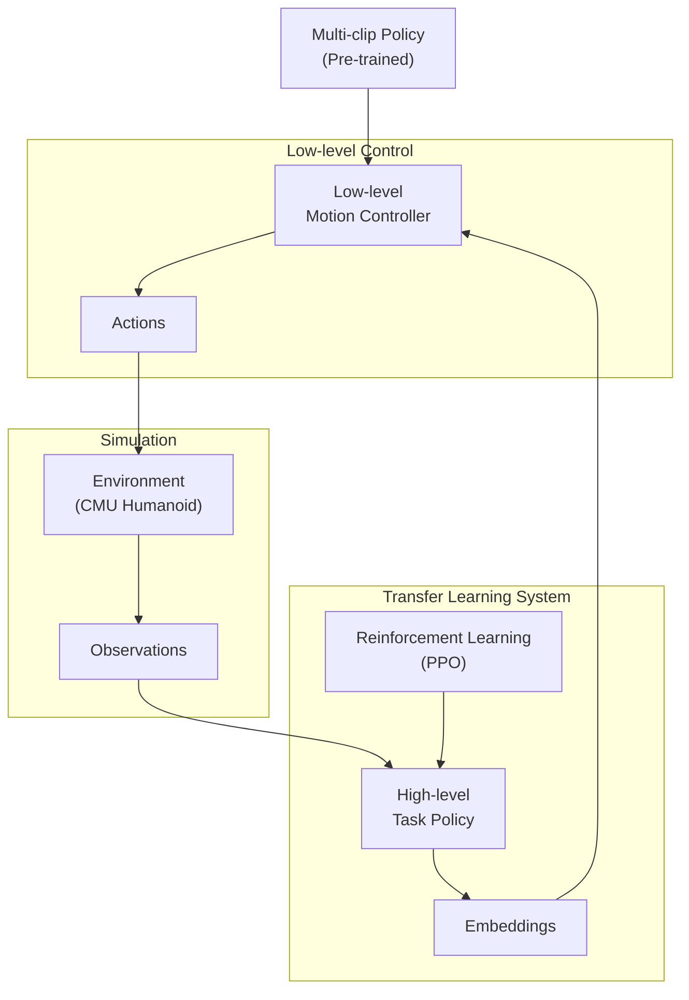
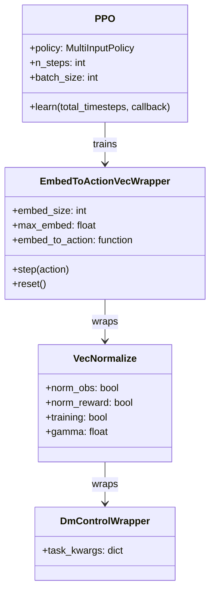
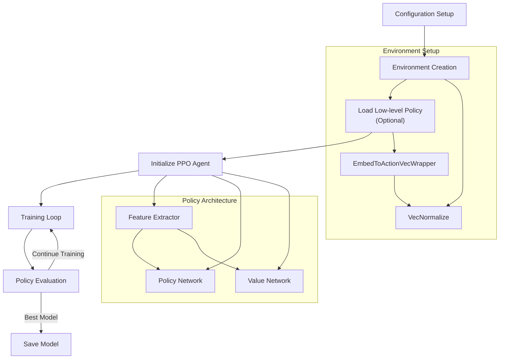
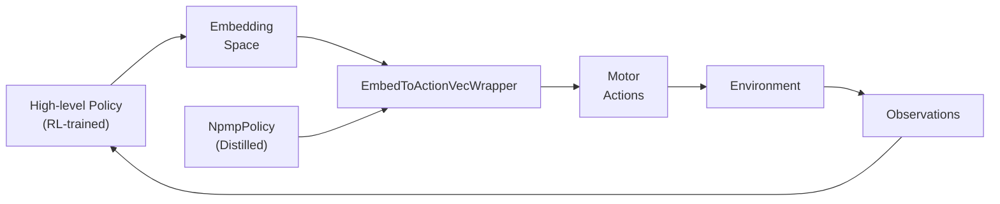

<!-- source: DeepWiki mcp.deepwiki.com · repo microsoft/MoCapAct · page 3.4 Transfer Learning · fetched 2026-10-26 -->

# Transfer Learning

<details>
<summary>Relevant source files</summary>

The following files were used as context for generating this wiki page:

- [README.md](README.md)
- [mocapact/download_dataset.py](mocapact/download_dataset.py)
- [mocapact/transfer/train.py](mocapact/transfer/train.py)

</details>


## Purpose and Scope

This document describes the Transfer Learning component of MoCapAct, which enables the use of pre-trained policies for downstream reinforcement learning tasks. Transfer Learning allows humanoid agents to learn specific goal-directed behaviors by leveraging motion skills captured in the multi-clip policy. 

For information about training the multi-clip policy through distillation, see [Policy Distillation](#3.3).

## System Overview

Transfer Learning in MoCapAct builds upon the learned motion capabilities of the multi-clip policy to enable task-specific behaviors. The system trains new policies using Proximal Policy Optimization (PPO) to accomplish tasks like target reaching and velocity control.



**Diagram: Transfer Learning Architecture**

Sources: [mocapact/transfer/train.py:98-108]()

## Hierarchical Control

MoCapAct's transfer learning implementation uses a hierarchical control approach, where:

1. A high-level policy learns to generate embeddings (latent space representations)
2. These embeddings are translated to physical actions by a pre-trained low-level policy
3. The actions are executed in the environment to accomplish task goals

This approach allows the agent to leverage the motion skills learned by the multi-clip policy while adapting them to new tasks.



**Diagram: Hierarchical Control Architecture**

Sources: [mocapact/transfer/train.py:98-112]()

## Task Configuration

The Transfer Learning component supports various downstream tasks. Each task is defined by a configuration in `mocapact/transfer/config.py`. The main supported tasks are:

| Task | Description | Key Parameters |
|------|-------------|----------------|
| Go-to-target | The humanoid must navigate to specific target positions | Target distance, reward scaling |
| Velocity control | The humanoid must achieve and maintain specific velocities | Target velocity, reward scaling |

Sources: [mocapact/transfer/train.py:33-34]()

## Training Process

The training process leverages Stable-Baselines3's PPO implementation with vectorized environments for parallel data collection.



**Diagram: Transfer Learning Training Process**

Sources: [mocapact/transfer/train.py:80-112](), [mocapact/transfer/train.py:166-180]()

## Environment Configuration

The training environment is configured based on the selected task, with specific parameters for the physics simulation and control:

```python
task_kwargs = dict(
    physics_timestep=tracking.DEFAULT_PHYSICS_TIMESTEP,
    control_timestep=0.03,
    **FLAGS.task.config
)
```

Multiple environments run in parallel using SubprocVecEnv for efficient data collection, and observations and rewards are normalized using VecNormalize.

Sources: [mocapact/transfer/train.py:80-112]()

## Low-level Policy Integration

If a low-level policy path is provided, the system loads a pre-trained NpmpPolicy and uses it to transform high-level embeddings into motor actions:



**Diagram: Low-level Policy Integration**

Sources: [mocapact/transfer/train.py:98-108]()

## Network Architecture

The high-level policy uses a customizable multi-layer perceptron architecture:

| Component | Configuration |
|-----------|---------------|
| Network type | MLP (Multi-Layer Perceptron) |
| Number of layers | Configurable (default: 3) |
| Layer size | Configurable (default: 1024) |
| Activation function | Configurable (default: Tanh) |
| Feature extractor | CmuHumanoidFeaturesExtractor |

Sources: [mocapact/transfer/train.py:166-173]()

## Usage Examples

### Training a Policy

To train a policy for a transfer task:

```bash
python -m mocapact.transfer.train \
  --log_root transfer/go_to_target \
  --low_level_policy_path multi_clip/all/eval/train_rsi/best_model.ckpt \
  --n_workers 16 \
  --total_timesteps 1000000
```

### Evaluating a Policy

To evaluate a trained transfer task policy:

```bash
python -m mocapact.transfer.evaluate \
  --model_root transfer/go_to_target/0/eval/model \
  --task mocapact/transfer/config.py:go_to_target
```

Sources: [README.md:297-310]()

## Callbacks and Evaluation

The training process includes evaluation callbacks that periodically assess the policy's performance and save the best model based on evaluation rewards. The evaluation environment uses a different random seed than the training environment to ensure generalization.

Sources: [mocapact/transfer/train.py:155-164]()

---

