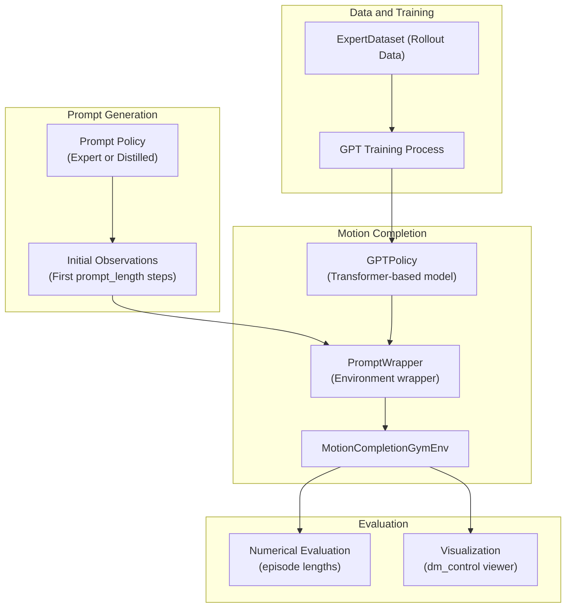
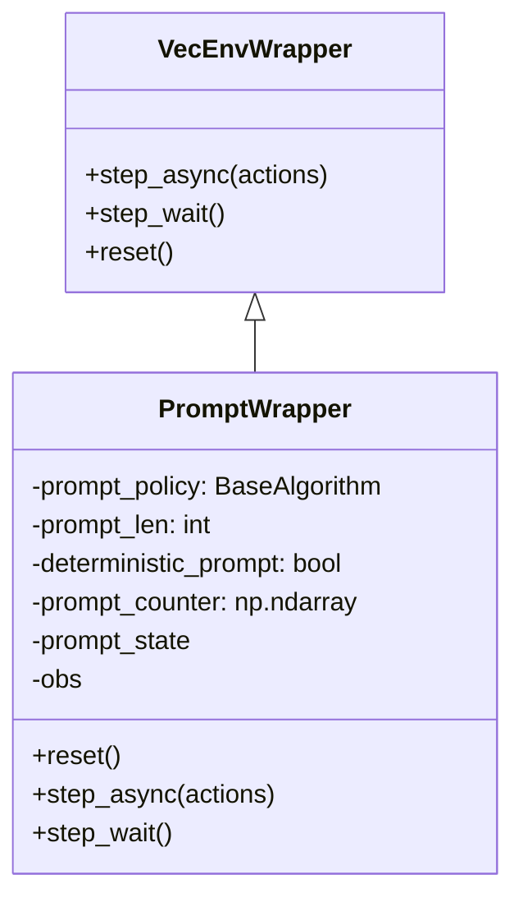
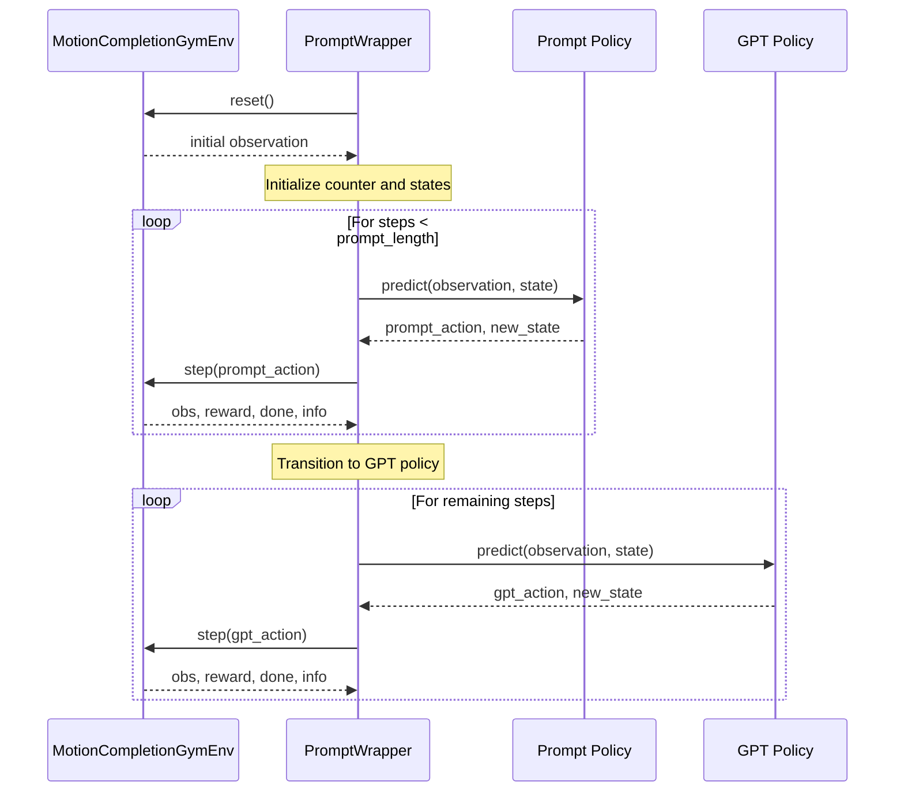

<!-- source: DeepWiki mcp.deepwiki.com · repo microsoft/MoCapAct · page 3.5 Motion Completion · fetched 2026-10-26 -->

# Motion Completion

<details>
<summary>Relevant source files</summary>

The following files were used as context for generating this wiki page:

- [README.md](README.md)
- [mocapact/distillation/motion_completion.py](mocapact/distillation/motion_completion.py)
- [mocapact/download_dataset.py](mocapact/download_dataset.py)

</details>


## Purpose and Scope

Motion completion is a functionality within MoCapAct that enables a trained policy to continue a humanoid's motion after being provided with an initial sequence of movements. This page covers the implementation details of the motion completion system, including the GPT policy model, the environment wrapper for transitioning from prompt to completion, and evaluation methods. For information about policy distillation used to train the base policies, see [Policy Distillation](#3.3).

Sources: [README.md:18](), [README.md:313-340]()

## Architecture Overview

Motion completion involves starting with a small sequence of initial motion (the "prompt") executed by a high-quality expert policy, then smoothly transitioning to a GPT (Generative Pre-trained Transformer) policy that continues the motion in a natural and contextually appropriate manner.



Sources: [mocapact/distillation/motion_completion.py:55-96](), [README.md:313-340]()

## Core Components

### PromptWrapper

The `PromptWrapper` class is a key component that manages the transition from the prompt policy (which provides initial motion) to the GPT policy (which completes the motion). It's implemented as a vectorized environment wrapper that:

1. Uses the prompt policy for the first `prompt_length` steps
2. Switches to the GPT policy for subsequent steps
3. Maintains state for both policies as needed



The workflow of the `PromptWrapper` involves:
1. On reset: Initialize prompt counter and state
2. During step_async: For steps before `prompt_length`, use actions from prompt policy
3. During step_wait: Process observations and track prompt counters

Sources: [mocapact/distillation/motion_completion.py:55-96]()

### Motion Completion Environment

The `MotionCompletionGymEnv` is a specialized Gym environment that extends the tracking environment but with modifications specific to motion completion tasks. It includes features like:

- Visual indicators that show when the transition from prompt to completion occurs
- Configurable termination conditions based on error thresholds
- Support for evaluating the quality of the completed motion

Sources: [mocapact/distillation/motion_completion.py:148-153]()

## Implementation Details

### GPT Policy

The GPT policy is a transformer-based model that predicts future actions based on a sequence of previous observations and actions. It's trained on the expert rollout dataset using PyTorch Lightning.

Key characteristics:
- Takes sequence of observations as input
- Maintains internal state between prediction steps
- Uses a transformer architecture for sequence modeling
- Trained using standard policy distillation techniques

Sources: [mocapact/distillation/motion_completion.py:119-127]()

### Execution Flow

The motion completion process involves a specific sequence of operations:



Sources: [mocapact/distillation/motion_completion.py:78-95](), [mocapact/distillation/motion_completion.py:194-209]()

## Usage

### Training a GPT Policy

To train a GPT policy for motion completion:

```bash
source scripts/get_all_clips.sh [PATH_TO_DATASET]
python -m mocapact.distillation.train \
  --train_dataset_paths $train \
  --val_dataset_paths $val \
  --dataset_metrics_path $metrics \
  --output_root motion_completion \
  $(cat cfg/motion_completion/train.txt)
```

The configuration in `cfg/motion_completion/train.txt` specifies parameters appropriate for training a GPT model for motion completion.

Sources: [README.md:317-325]()

### Performing Motion Completion

To perform motion completion with a trained GPT policy:

```bash
python -m mocapact.distillation.motion_completion \
  --policy_path [POLICY_PATH]  # Path to trained GPT policy
  --expert_root [EXPERT_ROOT]  # Path to expert policies for prompts
  --clip_snippet [CLIP_SNIPPET]  # Specific clip to complete
  --n_workers [N_CPU]  # Number of parallel evaluation environments
  --device [DEVICE]  # Device to run on
  --n_eval_episodes 100  # Set to 0 to only visualize
  --prompt_length 16  # Number of steps for initial prompt
  $(cat cfg/motion_completion/evaluate.txt)
```

Configuration options include:
- **policy_path**: Path to the trained GPT policy
- **expert_root**: Path to expert policies used for prompting
- **prompt_length**: Number of steps to use the prompt policy before switching to the GPT policy
- **n_eval_episodes**: Number of episodes for numerical evaluation (set to 0 for visualization only)

Sources: [README.md:327-337](), [mocapact/distillation/motion_completion.py:27-49]()

## Evaluation Methods

Motion completion can be evaluated in two ways:

1. **Numerical Evaluation**: Calculates statistics on episode lengths to measure how well the GPT policy completes motions without early termination.

2. **Visual Evaluation**: Uses dm_control's visualization tools to render the humanoid performing the completed motion, with visual indicators showing when the transition from prompt to completion occurs.

Sources: [mocapact/distillation/motion_completion.py:155-187](), [mocapact/distillation/motion_completion.py:189-212]()

## Practical Considerations

- The quality of the initial prompt is crucial - using specialized clip snippet experts typically produces higher-quality prompts than using a distilled multi-clip policy.
- Prompt length affects performance - longer prompts provide more context for the GPT policy but leave less room for actual completion.
- Transformer models are sensitive to the quality and quantity of training data - best results come from training on the full dataset.

Sources: [README.md:338-340](), [mocapact/distillation/motion_completion.py:48]()

---

