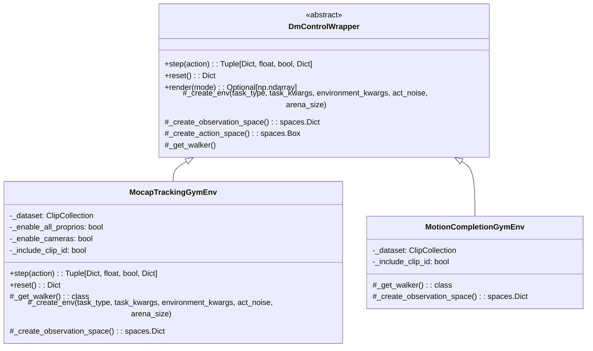
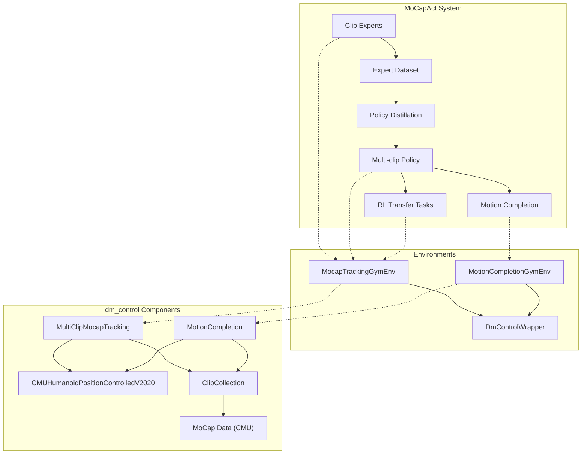
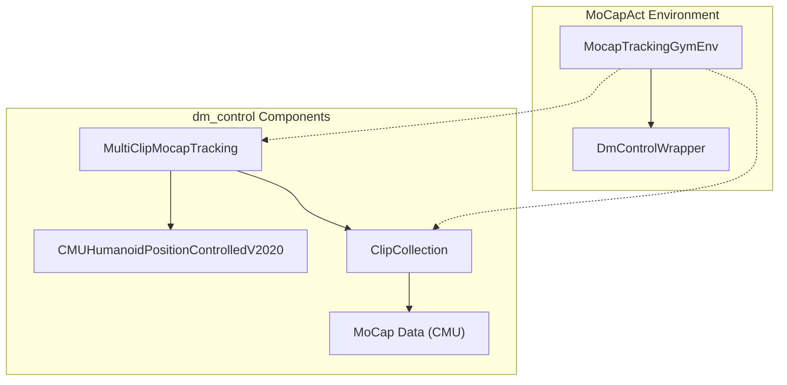
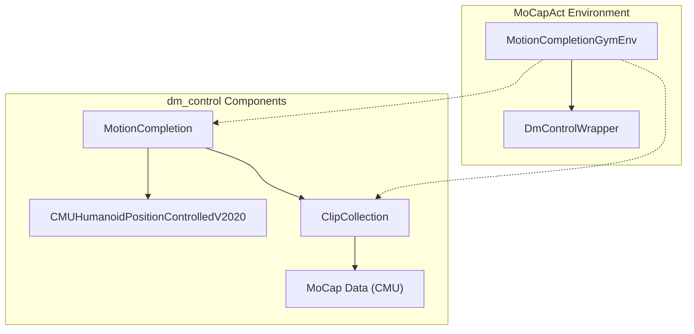

<!-- source: DeepWiki mcp.deepwiki.com · repo microsoft/MoCapAct · page 4 Environments · fetched 2026-10-26 -->

# Environments

<details>
<summary>Relevant source files</summary>

The following files were used as context for generating this wiki page:

- [README.md](README.md)
- [mocapact/download_dataset.py](mocapact/download_dataset.py)
- [mocapact/envs/__init__.py](mocapact/envs/__init__.py)
- [mocapact/envs/motion_completion.py](mocapact/envs/motion_completion.py)
- [mocapact/envs/tracking.py](mocapact/envs/tracking.py)

</details>


## Purpose and Overview

The environments package in MoCapAct provides Gym-compatible interfaces to dm_control environments, enabling reinforcement learning and motion control for the CMU Humanoid model. This document describes the two primary environments used in MoCapAct:

1. **MocapTrackingGymEnv**: Used for training policies to follow specific motion capture (MoCap) clips
2. **MotionCompletionGymEnv**: Used for training policies to complete partial motion sequences

These environments form the foundation for the key capabilities in MoCapAct, including clip expert training, policy distillation, reinforcement learning on downstream tasks, and motion completion. For information about training clip experts or distilled policies that use these environments, see [Clip Experts](#3.1) and [Policy Distillation](#3.3).

Sources: [mocapact/envs/__init__.py](), [README.md:10-18]()

## Environment Architecture

The environment system in MoCapAct consists of two main environment classes that inherit from a base `DmControlWrapper` class. This wrapper provides the common functionality needed to bridge between dm_control environments and the OpenAI Gym interface.



Sources: [mocapact/envs/tracking.py](), [mocapact/envs/motion_completion.py]()

## System Integration

The environment system integrates with the rest of the MoCapAct system as shown in this diagram:



Sources: [README.md:11-18]()

## MocapTrackingGymEnv

The `MocapTrackingGymEnv` class wraps the `MultiClipMocapTracking` environment from dm_control to create a Gym-compatible environment for tracking motion capture clips.



### Key Parameters

| Parameter | Type | Default | Description |
|-----------|------|---------|-------------|
| `dataset` | `ClipCollection` | `types.ClipCollection(ids=['CMU_016_22'])` | Motion capture clips to track |
| `ref_steps` | `Tuple[int]` | `(0,)` | Reference steps to use for tracking |
| `mocap_path` | `Optional[Union[str, Path]]` | `None` | Path to motion capture data (defaults to built-in CMU data) |
| `task_kwargs` | `Optional[Dict[str, Any]]` | `None` | Additional arguments for the tracking task |
| `environment_kwargs` | `Optional[Dict[str, Any]]` | `None` | Additional arguments for the environment |
| `act_noise` | `float` | `0.` | Amount of action noise to add |
| `enable_all_proprios` | `bool` | `False` | Whether to enable all proprioceptive observations |
| `enable_cameras` | `bool` | `False` | Whether to enable camera observations |
| `include_clip_id` | `bool` | `False` | Whether to include clip ID in observations |

### Methods

- `_get_walker()`: Returns the `CMUHumanoidPositionControlledV2020` walker class
- `_create_env()`: Creates and configures the dm_control environment
- `_create_observation_space()`: Constructs the Gym observation space dictionary
- `step(action)`: Executes an action in the environment and returns the result
- `reset()`: Resets the environment to an initial state

Sources: [mocapact/envs/tracking.py:1-114]()

## MotionCompletionGymEnv

The `MotionCompletionGymEnv` class wraps a custom `MotionCompletion` task for training policies to complete partial motion sequences.



### Key Parameters

| Parameter | Type | Default | Description |
|-----------|------|---------|-------------|
| `dataset` | `ClipCollection` | *(required)* | Motion capture clips to use |
| `ref_steps` | `Tuple[int]` | `(0,)` | Reference steps to use |
| `mocap_path` | `Optional[Union[str, Path]]` | `None` | Path to motion capture data (defaults to built-in CMU data) |
| `task_kwargs` | `Optional[Dict[str, Any]]` | `None` | Additional arguments for the motion completion task |
| `environment_kwargs` | `Optional[Dict[str, Any]]` | `None` | Additional arguments for the environment |
| `include_clip_id` | `bool` | `False` | Whether to include clip ID in observations |

### Methods

- `_get_walker()`: Returns the `CMUHumanoidPositionControlledV2020` walker class
- `_create_observation_space()`: Constructs the Gym observation space dictionary

Sources: [mocapact/envs/motion_completion.py:1-62]()

## Observation and Action Spaces

### Observation Space

Both environments expose a dictionary observation space with components for:

- `walker/...`: Proprioceptive observations from the humanoid (joint angles, joint velocities, etc.)
- `reference/...`: Reference observations from the motion capture clips
- `walker/clip_id`: Clip ID (if `include_clip_id=True`)

The exact observations depend on which features are enabled in the environment.

### Action Space

The action space corresponds to the joint positions of the CMU Humanoid model, represented as a 56-dimensional vector of target joint positions.

Sources: [mocapact/envs/tracking.py:79-99](), [mocapact/envs/motion_completion.py:48-60]()

## Using the Environments

### MocapTrackingGymEnv Example

```python
from mocapact.envs import tracking
from dm_control.locomotion.tasks.reference_pose import types

# Create a ClipCollection
dataset = types.ClipCollection(ids=['CMU_016_22'])

# Create the environment
env = tracking.MocapTrackingGymEnv(dataset)

# Reset the environment
obs = env.reset()

# Step through the environment with actions from an expert policy
while True:
    action, _ = expert.predict(obs, deterministic=True)
    obs, reward, done, info = env.step(action)
    if done:
        break
```

### MotionCompletionGymEnv Example

```python
from mocapact.envs import motion_completion
from dm_control.locomotion.tasks.reference_pose import types

# Create a ClipCollection
dataset = types.ClipCollection(ids=['CMU_016_22'])

# Create the environment
env = motion_completion.MotionCompletionGymEnv(dataset)

# Reset the environment
obs = env.reset()

# Step through the environment with actions from a policy
while True:
    action, _ = policy.predict(obs)
    obs, reward, done, info = env.step(action)
    if done:
        break
```

Sources: [README.md:187-202](), [README.md:326-339]()

---

