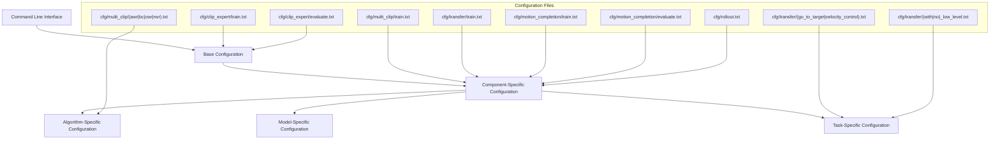
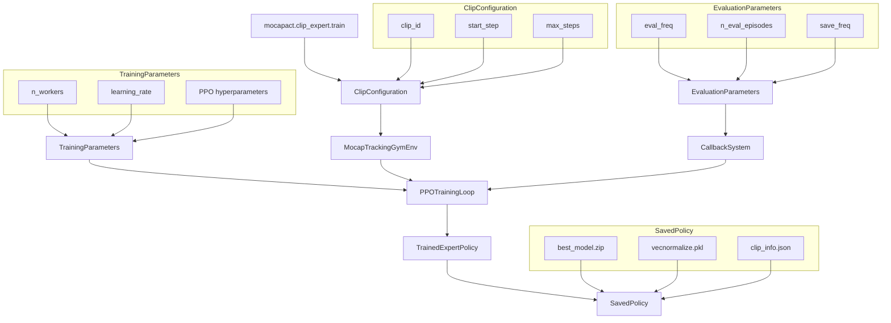
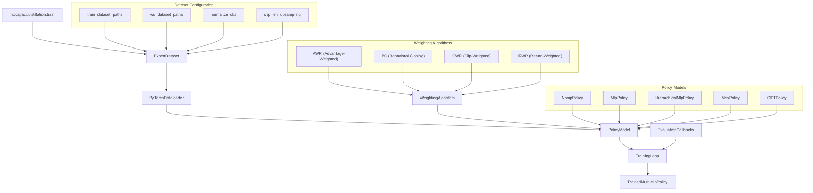
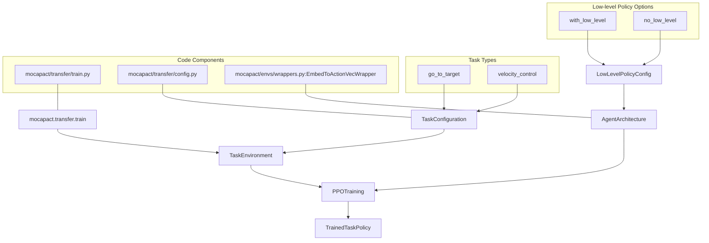
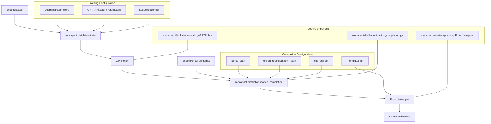

<!-- source: DeepWiki mcp.deepwiki.com · repo microsoft/MoCapAct · page 5 Configuration Options · fetched 2026-10-26 -->

# Configuration Options

<details>
<summary>Relevant source files</summary>

The following files were used as context for generating this wiki page:

- [README.md](README.md)
- [cfg/multi_clip/awr.txt](cfg/multi_clip/awr.txt)
- [cfg/multi_clip/bc.txt](cfg/multi_clip/bc.txt)
- [cfg/multi_clip/cwr.txt](cfg/multi_clip/cwr.txt)
- [cfg/multi_clip/rwr.txt](cfg/multi_clip/rwr.txt)
- [cfg/multi_clip/train.txt](cfg/multi_clip/train.txt)
- [mocapact/download_dataset.py](mocapact/download_dataset.py)

</details>


This page documents the configuration options available in MoCapAct for training, evaluating, and using its various components. These configurations control everything from training hyperparameters to environment settings and model architectures.

For information about specific components, see [Core Components](#3) and for environment configuration details, see [Environments](#4).

## Configuration System Overview

MoCapAct uses a combination of command-line arguments and configuration files (stored in the `cfg/` directory) to provide a flexible and composable configuration system. This approach allows you to reuse common parameter sets across different runs.

Configuration Hierarchy Diagram:



Usage pattern in command line:

```bash
python -m [module.script] [specific_args] $(cat cfg/component/config1.txt) $(cat cfg/component/config2.txt)
```

Sources: [README.md:163-372]()

## General Configuration Options

These options are common across different MoCapAct components:

| Option | Description | Example Values |
|--------|-------------|----------------|
| `--n_workers` | Number of worker processes for parallel execution | `8`, `16` |
| `--device` | Computing device to use | `cuda`, `cpu` |
| `--output_root` | Root directory for outputs | `experts`, `multi_clip/all` |
| `--log_root` | Root directory for logs | `logs`, `transfer/go_to_target` |

Sources: [cfg/multi_clip/train.txt:1](), [README.md:209-210]()

## Clip Expert Configuration

Configuration options for training and evaluating clip snippet experts that track specific motion capture segments.

Clip Expert Training Workflow:



### Training Configuration

| Option | Description | Example Values |
|--------|-------------|----------------|
| `--clip_id` | ID of the motion capture clip | `CMU_016_22` |
| `--start_step` | Starting step in the clip | `0`, `165` |
| `--max_steps` | Maximum number of steps for training | `210` |
| `--n_workers` | Number of workers for parallel training | `8` |
| `--log_root` | Root directory for logs | `experts` |

Source: [README.md:168-174]()

### Evaluation Configuration

| Option | Description | Example Values |
|--------|-------------|----------------|
| `--policy_root` | Path to the policy to evaluate | `experts/CMU_016-22-0-82/0/eval_rsi/model` |
| `--n_workers` | Number of workers for parallel evaluation | `8` |
| `--n_eval_episodes` | Number of episodes for evaluation | `1000` |

Source: [README.md:180-184]()

## Dataset Generation Configuration

Configuration options for generating datasets by rolling out experts:

| Option | Description | Example Values |
|--------|-------------|----------------|
| `--input_dirs` | Root directories containing experts | `experts` |
| `--n_workers` | Number of workers for parallel rollouts | `8` |
| `--device` | Computing device for rollouts | `cuda` |
| `--output_path` | Path for the output dataset | `dataset/file_name_ignored.hdf5` |
| `--log_all_proprios` | Flag to log all proprioceptive observations | |
| `--log_cameras` | Flag to log camera observations | |

Source: [README.md:210-215](), [README.md:146-147]()

## Policy Distillation Configuration

Policy distillation configuration controls how knowledge from multiple clip experts is combined into a single multi-clip policy.

Distillation System Components:



### General Training Options

These options apply to training multi-clip policies:

| Option | Description | Example Values |
|--------|-------------|----------------|
| `--train_dataset_paths` | Paths to training datasets | `$train` (shell variable with paths) |
| `--val_dataset_paths` | Paths to validation datasets | `$val` (shell variable with paths) |
| `--dataset_metrics_path` | Path to dataset metrics | `$metrics` (shell variable with path) |
| `--extra_clips` | Additional clips to use | `$clips` (shell variable with clips) |
| `--output_root` | Root directory for outputs | `multi_clip/all` |
| `--gpus` | GPU indices to use | `0`, `0,1,2,3` |
| `--n_workers` | Number of worker processes | `8` |
| `--learning_rate` | Learning rate for training | `0.0005` |
| `--n_steps` | Number of training steps | `100000` |
| `--max_grad_norm` | Maximum gradient norm for clipping | `1.0` |
| `--batch_size` | Batch size for training | `256` |
| `--clip_len_upsampling` | Flag to enable clip length upsampling | |
| `--normalize_obs` | Flag to normalize observations | |
| `--save_every_n_minutes` | Frequency of checkpointing in minutes | `60` |

Source: [cfg/multi_clip/train.txt:1-8](), [README.md:234-243]()

### Algorithm-Specific Options

MoCapAct supports several training algorithms for policy distillation:

#### Advantage-Weighted Regression (AWR)

| Option | Description | Example Values |
|--------|-------------|----------------|
| `--temperature` | Temperature parameter for AWR | `8` |
| `--advantage_weights` | Flag to use advantage weights | |

Source: [cfg/multi_clip/awr.txt:1-2]()

#### Behavioral Cloning (BC)

| Option | Description | Example Values |
|--------|-------------|----------------|
| `--noclip_weighted` | Flag to disable clip weighting | |

Source: [cfg/multi_clip/bc.txt:1]()

#### Clip-Weighted Regression (CWR)

| Option | Description | Example Values |
|--------|-------------|----------------|
| `--temperature` | Temperature parameter for CWR | `0.2` |
| `--clip_weighted` | Flag to enable clip weighting | |

Source: [cfg/multi_clip/cwr.txt:1-2]()

#### Return-Weighted Regression (RWR)

| Option | Description | Example Values |
|--------|-------------|----------------|
| `--temperature` | Temperature parameter for RWR | `4.0` |
| `--noadvantage_weights` | Flag to disable advantage weights | |

Source: [cfg/multi_clip/rwr.txt:1-2]()

### Model Configuration Options

Multi-clip policies have model-specific configurations:

| Option | Description | Example Values |
|--------|-------------|----------------|
| `--model` | Model configuration path | `mocapact/distillation/config.py:npmp` |
| `--model.config.activation_fn` | Activation function for the model | `torch.nn.ELU` |
| `--model.config.embed_size` | Embedding size | `60`, `20` |
| `--model.config.embedding_kl_weight` | Weight for KL divergence on embeddings | `0.1` |
| `--model.config.embedding_correlation` | Correlation parameter for embeddings | `0.0` |
| `--nomodel.config.squash_output` | Flag to disable output squashing | |

Source: [cfg/multi_clip/train.txt:19-23](), [README.md:242-243]()

### Evaluation Options

These options configure the evaluation during training:

| Option | Description | Example Values |
|--------|-------------|----------------|
| `--eval_mode` | Evaluation mode | `train_start`, `train_rsi`, `val_start`, `val_rsi`, `clips_start`, `clips_rsi` |
| `--validation_freq` | Frequency of validation | `10000` |
| `--val_start_rollouts` | Number of validation rollouts from start | `20` |
| `--val_rsi_rollouts` | Number of validation rollouts from random states | `20` |
| `--eval.freq` | Frequency of evaluation | `10000` |
| `--eval.n_episodes` | Number of episodes for evaluation | `1000` |
| `--eval.n_workers` | Number of workers for evaluation | `16` |

Source: [cfg/multi_clip/train.txt:9-17](), [cfg/multi_clip/train.txt:24-25](), [README.md:244]()

## Transfer Learning Configuration

Transfer learning configurations control how pre-trained policies are applied to downstream tasks:

Transfer Task Configuration System:



Configuration options for transfer learning:

| Option | Description | Example Values |
|--------|-------------|----------------|
| `--log_root` | Root directory for logs | `transfer/go_to_target` |
| `--task` | Task configuration path | `mocapact/transfer/config.py:go_to_target`, `mocapact/transfer/config.py:velocity_control` |

Source: [README.md:298-302]()

## Motion Completion Configuration

Options for training and evaluating GPT-based motion completion models:

Motion Completion System:



### Training Options

| Option | Description | Example Values |
|--------|-------------|----------------|
| `--train_dataset_paths` | Paths to training datasets | `$train` (shell variable with paths) |
| `--val_dataset_paths` | Paths to validation datasets | `$val` (shell variable with paths) |
| `--dataset_metrics_path` | Path to dataset metrics | `$metrics` (shell variable with path) |
| `--output_root` | Root directory for outputs | `motion_completion` |

Source: [README.md:317-324]()

### Evaluation and Completion Options

| Option | Description | Example Values |
|--------|-------------|----------------|
| `--policy_path` | Path to the trained policy | `motion_completion/model/last.ckpt` |
| `--expert_root` | Root directory for experts | `experts` |
| `--clip_snippet` | Clip snippet to complete | `CMU_016_22` |
| `--n_workers` | Number of workers for parallel evaluation | `8` |
| `--device` | Computing device for evaluation | `cuda` |
| `--n_eval_episodes` | Number of episodes for evaluation | `100` |
| `--distillation_path` | Path to a multi-clip policy (alternative to experts) | |

Source: [README.md:329-336](), [README.md:338-339]()

## Using Configuration Options in Code

When using MoCapAct programmatically, configuration options can be passed directly to the relevant classes:

```python
# Loading a clip expert policy
from mocapact import observables
from mocapact.sb3 import utils
expert_path = "experts/CMU_016_22-0-82/0/eval_rsi/model"
expert = utils.load_policy(expert_path, observables.TIME_INDEX_OBSERVABLES)

# Creating a tracking environment
from mocapact.envs import tracking
from dm_control.locomotion.tasks.reference_pose import types
dataset = types.ClipCollection(ids=['CMU_016_22'])
env = tracking.MocapTrackingGymEnv(dataset)

# Loading a multi-clip policy
from mocapact.distillation import model
model_path = "multi_clip/all/eval/train_rsi/best_model.ckpt"
policy = model.NpmpPolicy.load_from_checkpoint(model_path, map_location="cpu")
```

Source: [README.md:190-201](), [README.md:274-284]()

---

