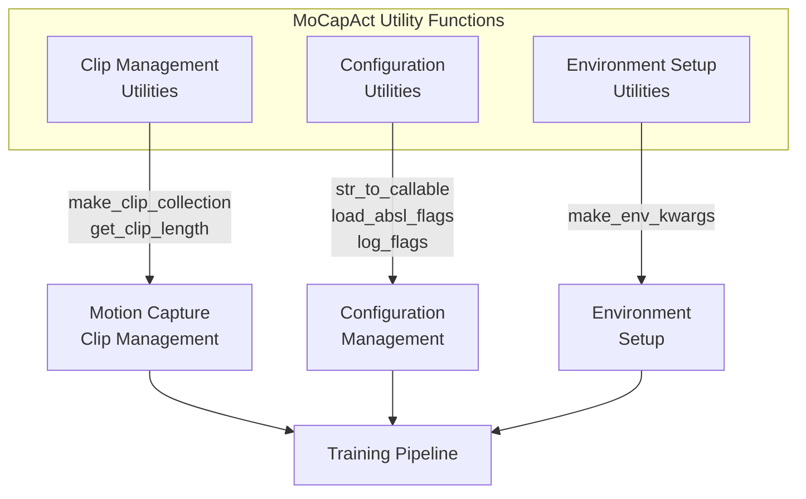
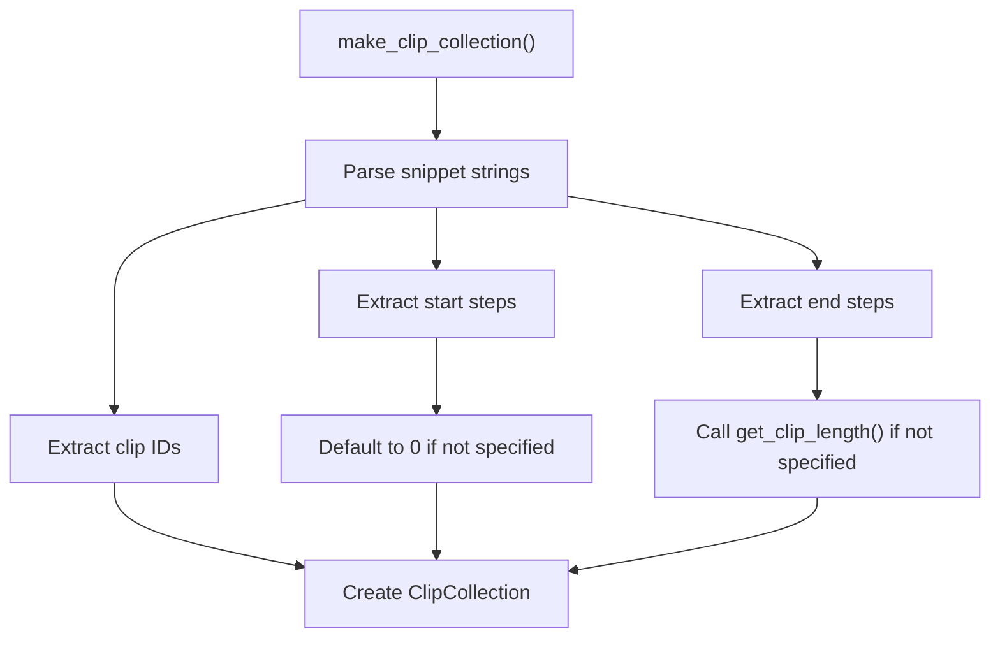
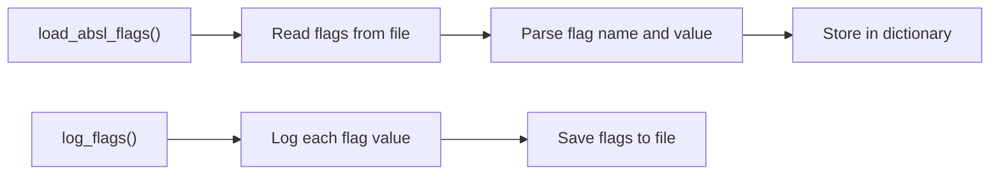
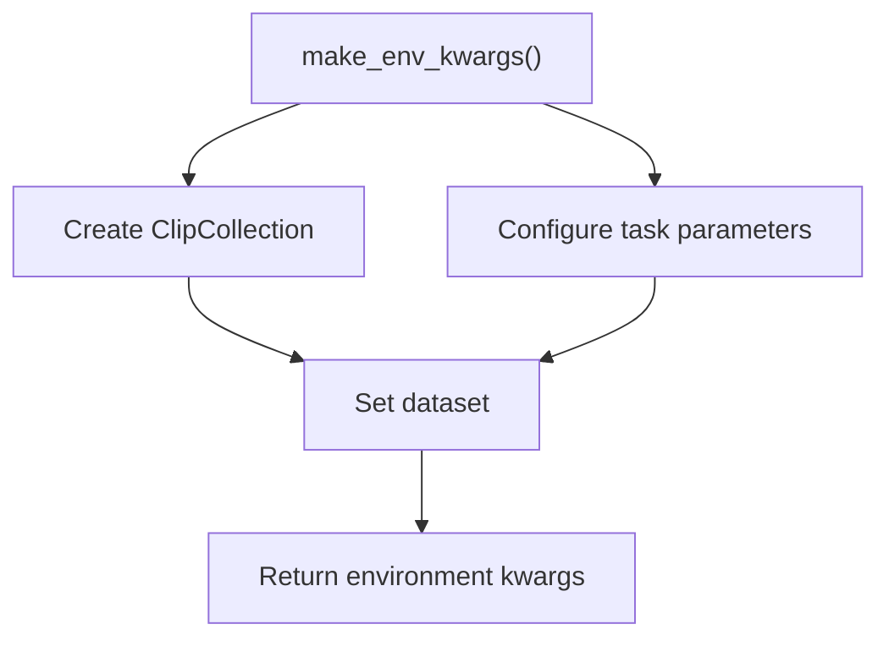
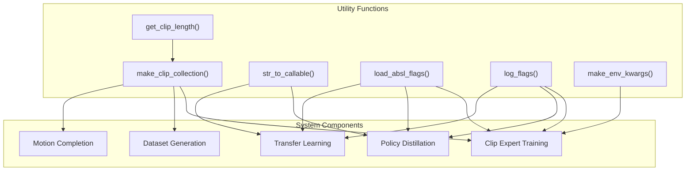
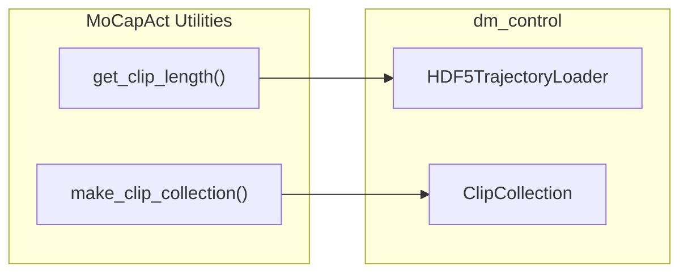

<!-- source: DeepWiki mcp.deepwiki.com · repo microsoft/MoCapAct · page 6 Utility Functions · fetched 2026-10-26 -->

# Utility Functions

<details>
<summary>Relevant source files</summary>

The following files were used as context for generating this wiki page:

- [mocapact/clip_expert/utils.py](mocapact/clip_expert/utils.py)
- [mocapact/utils.py](mocapact/utils.py)

</details>


## Introduction

This page documents the utility functions provided in the MoCapAct repository. These functions serve as helper tools for various tasks throughout the system, including motion capture clip management, configuration handling, and environment setup. They are designed to simplify common operations and provide a consistent interface for interacting with different components of the system.

For information about environment configuration options, see [Configuration Options](#5). For details on callback systems used during training, see [Callback Systems](#7).



Sources: [mocapact/utils.py:1-64](), [mocapact/clip_expert/utils.py:1-41]()

## Clip Management Utilities

MoCapAct provides utility functions for working with motion capture clips, which are fundamental to the system's functionality. These utilities help load, process, and manage clip data efficiently.

### Clip Length Retrieval

The `get_clip_length` function retrieves the length (number of frames) of a motion capture clip:

```python
def get_clip_length(clip_id, mocap_path=None):
    # Retrieves the length of a given clip
    # Returns the number of frames in the clip
```

This function uses the HDF5TrajectoryLoader from dm_control to load the clip and determine its length. If no mocap_path is provided, it uses the default CMU mocap data path.

### Clip Collection Creation

The `make_clip_collection` function creates a ClipCollection object from a list of snippet specifications:



Each snippet string can be in one of these formats:
- `clip_id`: Use the entire clip
- `clip_id-start`: Use the clip from the specified start step to the end
- `clip_id-start-end`: Use the clip from the specified start step to the end step

The function returns a ClipCollection object that can be used by the MoCapAct environments.

Sources: [mocapact/utils.py:41-64]()

## Configuration Utilities

MoCapAct includes utilities for handling configuration options, which are essential for setting up training runs and evaluations.

### String to Callable Conversion

The `str_to_callable` function converts a string representation of a callable (function or class) to the actual callable:

```python
def str_to_callable(callable_name):
    # Converts a string like "module.submodule.function"
    # to the actual function object
```

This is useful for configuration files where functions need to be specified as strings.

### Flag Management

MoCapAct provides utilities for working with Abseil flags, which are used for configuration:



The `load_absl_flags` function loads flags from a text file, while `log_flags` logs the values of flags and saves them to a file for future reference.

Sources: [mocapact/utils.py:14-39]()

## Environment Setup Utilities

MoCapAct provides utilities for setting up simulation environments, which are crucial for training and evaluation.

### Environment Configuration

The `make_env_kwargs` function in the clip_expert module creates the keyword arguments needed to construct a mocap tracking gym environment:



This function sets up parameters like:
- The clip to track
- Reference steps
- Task-specific parameters like reward type and termination conditions
- Noise settings

These environment kwargs are then used to create a MocapTrackingGymEnv for training clip experts.

Sources: [mocapact/clip_expert/utils.py:6-41]()

## Integration with System Components

The utility functions serve as building blocks for the major components of the MoCapAct system. Here's how they integrate with different parts of the system:



Sources: [mocapact/utils.py:1-64](), [mocapact/clip_expert/utils.py:1-41]()

## Usage Examples

Below are examples of how these utility functions are typically used in the MoCapAct workflow:

### Creating a Clip Collection for Training

```python
# Create a clip collection for clip 10_04 from steps 100 to 300
snippets = ["10_04-100-300"]
clip_collection = make_clip_collection(snippets)

# Create environment kwargs for training a clip expert
env_kwargs = make_env_kwargs(
    clip_id="10_04",
    start_step=100,
    end_step=300,
    min_steps=10,
    ghost_offset=1.0,
    termination_error_threshold=0.3
)
```

### Loading and Logging Configuration

```python
# Load flags from a file
flags = load_absl_flags("path/to/flags.txt")

# Log flags to a directory
log_flags(flags, "path/to/log_dir")

# Convert a string to a callable
model_class = str_to_callable("mocapact.models.MlpPolicy")
```

## Implementation Details

### Clip Management Implementation

The clip management utilities interact with dm_control's mocap data loading system:



The `get_clip_length` function uses HDF5TrajectoryLoader to access the clip data, while `make_clip_collection` creates a ClipCollection object that can be used by dm_control's reference pose tasks.

### Configuration Utility Implementation

The configuration utilities provide a simple interface for working with Abseil flags:

- `str_to_callable`: Uses Python's importlib to dynamically import modules and access attributes
- `load_absl_flags`: Parses a text file with flag definitions in the format `--flag=value`
- `log_flags`: Logs flag values and saves them to a file

### Environment Setup Implementation

The `make_env_kwargs` function creates a dictionary of keyword arguments for the MocapTrackingGymEnv constructor. It sets up:

1. A ClipCollection with the specified clip ID, start step, and end step
2. Task parameters like reward type, minimum steps, and termination conditions
3. Environment parameters like reference steps and action noise

This encapsulates the complex configuration required to create a tracking environment for a specific clip.

Sources: [mocapact/utils.py:1-64](), [mocapact/clip_expert/utils.py:1-41]()

---

