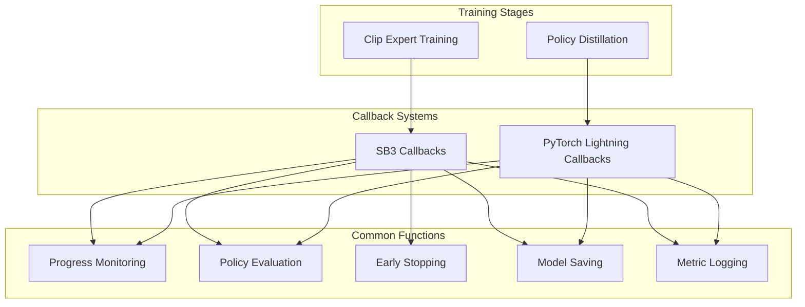
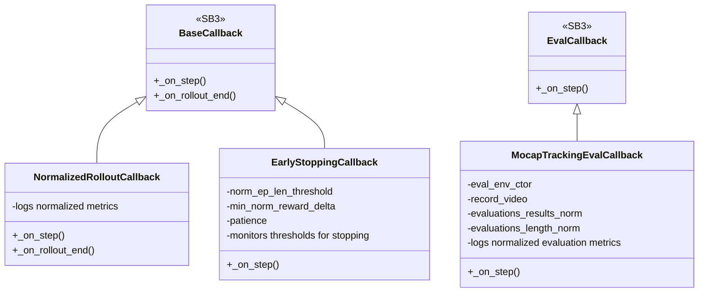
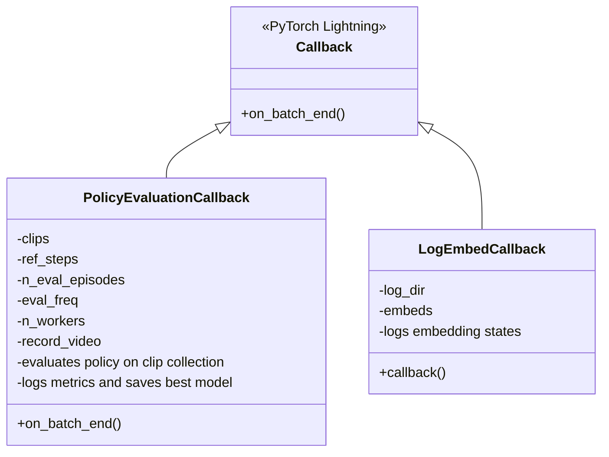
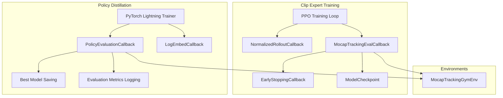

<!-- source: DeepWiki mcp.deepwiki.com · repo microsoft/MoCapAct · page 7 Callback Systems · fetched 2026-10-26 -->

# Callback Systems

<details>
<summary>Relevant source files</summary>

The following files were used as context for generating this wiki page:

- [mocapact/clip_expert/callbacks.py](mocapact/clip_expert/callbacks.py)
- [mocapact/distillation/callbacks.py](mocapact/distillation/callbacks.py)

</details>


This page documents the callback mechanisms used during training and evaluation in the MoCapAct codebase. Callbacks are used to monitor training progress, evaluate policies, implement early stopping, save models, and log metrics. MoCapAct implements two separate callback systems - one for training clip experts (based on Stable-Baselines3) and another for policy distillation (based on PyTorch Lightning).

For information about configuration options used with these callbacks, see [Configuration Options](#5).

## Overview of Callback Systems

MoCapAct uses callbacks to enhance the training and evaluation workflow at different stages of the motion control pipeline:



Sources: [mocapact/clip_expert/callbacks.py:1-204](), [mocapact/distillation/callbacks.py:1-154]()

## Stable-Baselines3 Callbacks

The clip expert training process uses callbacks that extend Stable-Baselines3's callback system. These are used during the initial training of expert policies for specific motion capture clips.



Sources: [mocapact/clip_expert/callbacks.py:11-203]()

### NormalizedRolloutCallback

This callback logs the rollout episode reward and length normalized by the mocap clip length. It extends the functionality of the base callback by adding additional metrics specific to motion tracking.

Key methods:
- `_on_rollout_end()`: Calculates and logs normalized metrics

```python
# Example logged metrics
"rollout/ep_rew_mean_norm": Mean normalized episode reward
"rollout/ep_len_mean_norm": Mean normalized episode length
```

Sources: [mocapact/clip_expert/callbacks.py:17-35]()

### EarlyStoppingCallback

This callback stops the training if the evaluation episode length is "large enough" and the episode return has not improved significantly for a specified period.

Key parameters:
- `norm_ep_len_threshold`: Minimum normalized episode length required to consider stopping
- `min_norm_reward_delta`: Minimum improvement in normalized reward to reset patience
- `patience`: Number of evaluations to wait for improvement before stopping

The callback maintains an internal counter (`wait`) that increases when no significant improvement is detected and triggers early stopping when it exceeds the patience value.

Sources: [mocapact/clip_expert/callbacks.py:37-75]()

### MocapTrackingEvalCallback

This callback extends the standard `EvalCallback` from Stable-Baselines3 to:
1. Log normalized episode rewards and lengths
2. Take an environment constructor rather than a fixed environment
3. Support video recording of the best policy rollouts

Key features:
- Creates a new evaluation environment for each evaluation
- Logs both standard and normalized metrics
- Can save videos of the best policy executions
- Saves the best model based on mean reward

```python
# Example logged metrics
"{name}/mean_reward": Mean episode reward
"{name}/mean_ep_length": Mean episode length
"{name}/mean_reward_norm": Mean normalized episode reward
"{name}/mean_ep_length_norm": Mean normalized episode length
```

Sources: [mocapact/clip_expert/callbacks.py:77-203]()

## PyTorch Lightning Callbacks

The policy distillation process uses callbacks based on PyTorch Lightning's callback system. These are used during the training of policies that distill knowledge from multiple expert policies.



Sources: [mocapact/distillation/callbacks.py:10-154]()

### PolicyEvaluationCallback

This callback evaluates the policy on a clip collection at specified intervals during training. It performs functions similar to the `MocapTrackingEvalCallback` but is integrated with PyTorch Lightning's training loop.

Key features:
- Creates environments for evaluation using clip collections
- Supports parallel evaluation with multiple workers
- Logs normalized metrics and rewards per step
- Saves the best model based on normalized rewards
- Can record videos of the best policy execution

Key parameters:
- `clips`: Collection of motion capture clips
- `ref_steps`: Reference steps for the clips
- `n_eval_episodes`: Number of episodes to evaluate
- `eval_freq`: Frequency of evaluation in training steps
- `n_workers`: Number of parallel workers for evaluation
- `record_video`: Whether to record videos of the best rollouts

```python
# Example logged metrics
"eval/{prefix}norm_rew": Mean normalized episode reward
"eval/{prefix}norm_len": Mean normalized episode length
"eval/{prefix}rew_per_step": Mean reward per step
```

Sources: [mocapact/distillation/callbacks.py:20-138]()

### LogEmbedCallback

This callback logs embedding states during training. It maintains a list of embeddings for each worker and saves them when episodes are completed.

Key methods:
- `callback()`: Collects embedding states and saves them to files

Sources: [mocapact/distillation/callbacks.py:139-154]()

## Callback Integration with MoCapAct Systems

The following diagram shows how callbacks are integrated within the broader MoCapAct training processes:



Sources: [mocapact/clip_expert/callbacks.py:77-203](), [mocapact/distillation/callbacks.py:20-138]()

## Key Evaluation Metrics

The callbacks in MoCapAct track several metrics that are important for evaluating the performance of motion tracking policies:

| Metric | Description | Use Case |
|--------|-------------|----------|
| Normalized Episode Reward | Episode reward divided by maximum possible reward | Measures how well the policy matches the reference motion |
| Normalized Episode Length | Episode length divided by reference clip length | Measures how long the policy can successfully track before failure |
| Reward per Step | Average reward obtained per simulation step | Measures efficiency of the policy actions |

Sources: [mocapact/clip_expert/callbacks.py:32-35](), [mocapact/clip_expert/callbacks.py:177-179](), [mocapact/distillation/callbacks.py:112-116]()

## Callback Configuration

When configuring callbacks, several parameters can be adjusted to control the training and evaluation processes:

### Clip Expert Callbacks Configuration

- **Evaluation frequency**: How often policy evaluation occurs (in timesteps)
- **Early stopping parameters**: Thresholds and patience for stopping training
- **Video recording**: Whether to record videos of the best policy execution

### Policy Distillation Callbacks Configuration

- **Evaluation frequency**: How often policy evaluation occurs (in batch updates)
- **Number of workers**: Parallelization level for evaluation
- **Clip collection**: Which motion clips to use for evaluation

Sources: [mocapact/clip_expert/callbacks.py:77-104](), [mocapact/distillation/callbacks.py:24-60]()

## Summary

The callback systems in MoCapAct provide crucial functionality for monitoring, evaluating, and controlling the training process. They are tailored to the specific needs of motion capture tracking, with specialized metrics and evaluation methods. The two callback systems (Stable-Baselines3 and PyTorch Lightning) are used at different stages of the training pipeline but serve similar purposes.

Key callbacks to understand:
1. `MocapTrackingEvalCallback`: For evaluating clip expert policies
2. `EarlyStoppingCallback`: For stopping clip expert training when performance criteria are met
3. `PolicyEvaluationCallback`: For evaluating distilled policies on multiple clips

For information on how to configure these callbacks, see [Configuration Options](#5).

---

