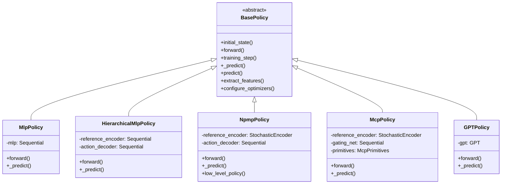
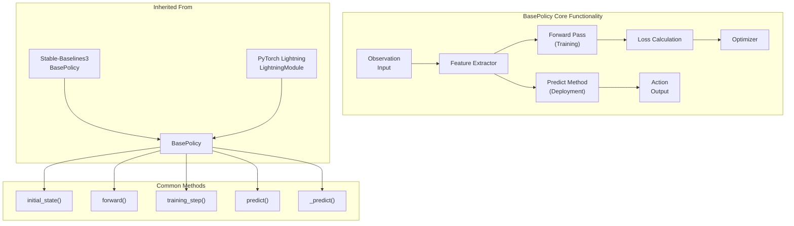
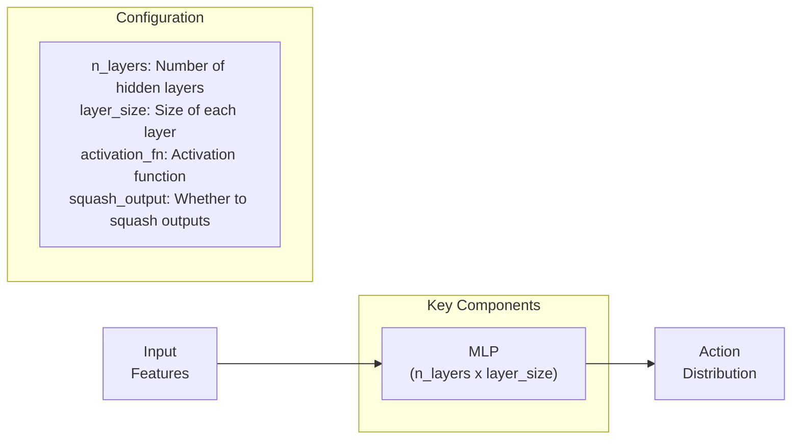
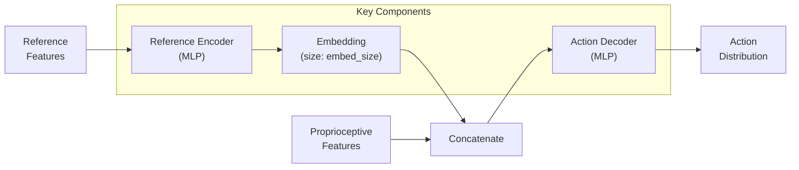
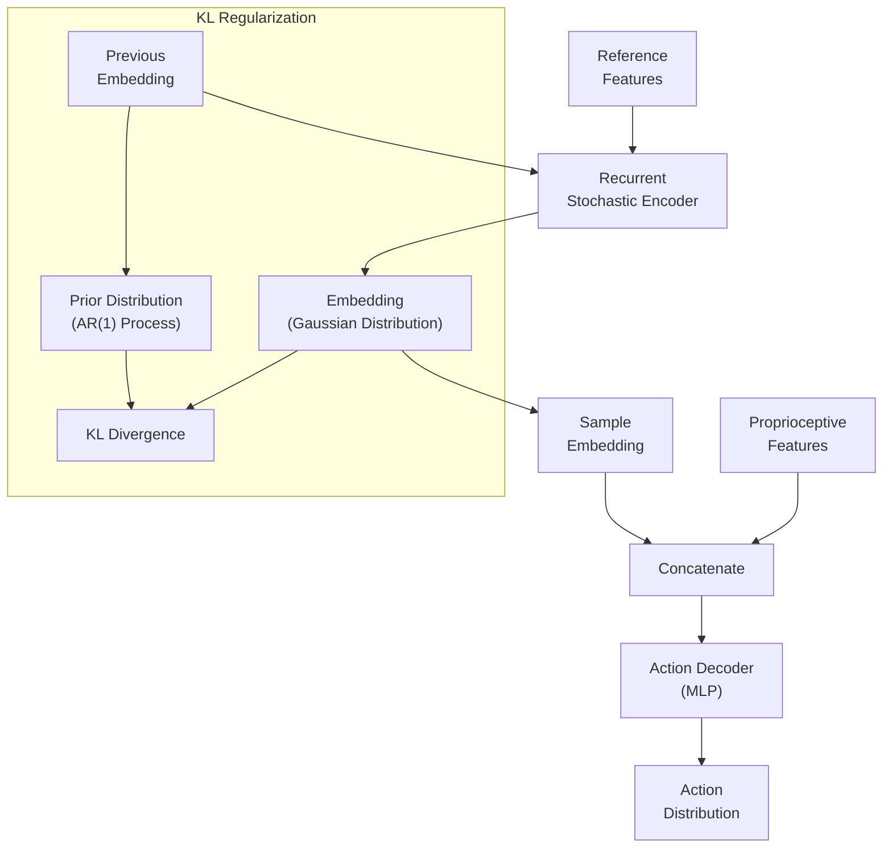
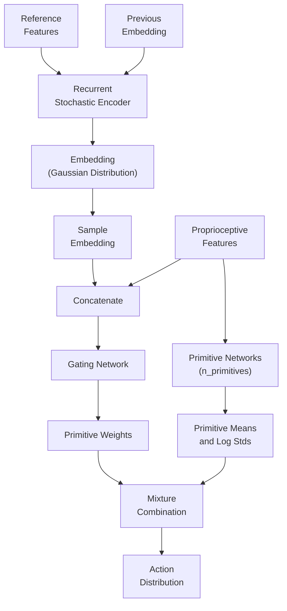
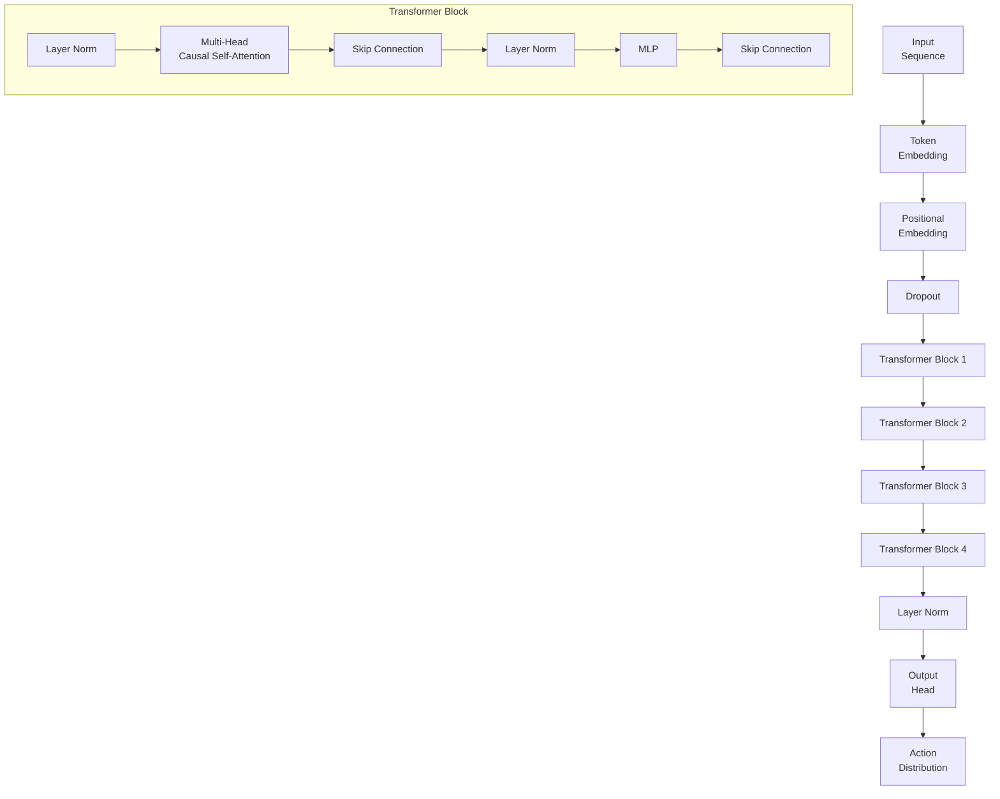
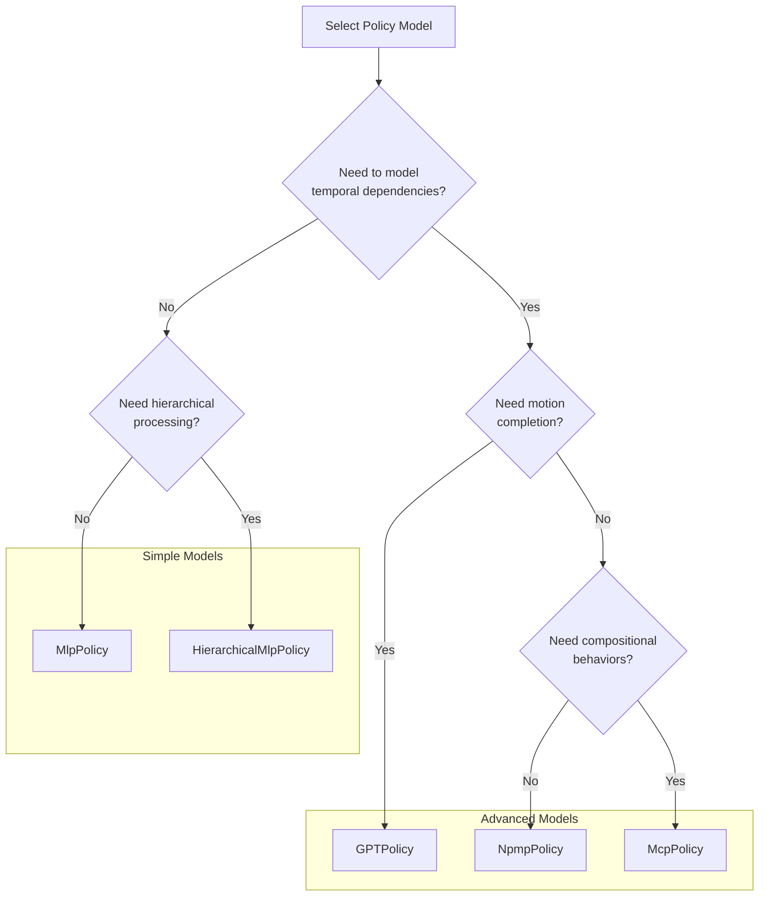
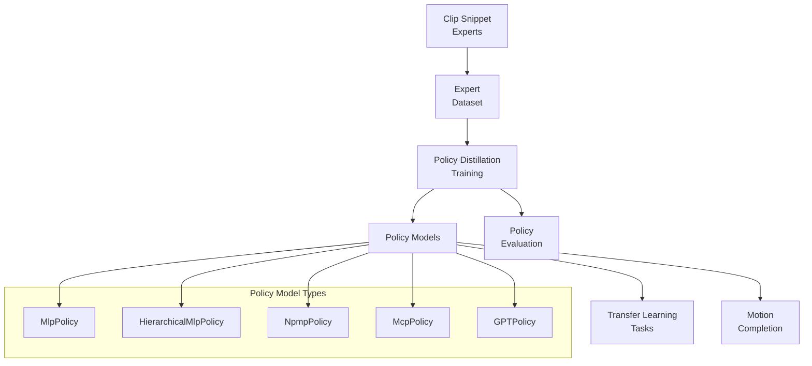

<!-- source: DeepWiki mcp.deepwiki.com · repo microsoft/MoCapAct · page 8 Policy Models · fetched 2026-10-26 -->

# Policy Models

<details>
<summary>Relevant source files</summary>

The following files were used as context for generating this wiki page:

- [mocapact/distillation/config.py](mocapact/distillation/config.py)
- [mocapact/distillation/model.py](mocapact/distillation/model.py)

</details>


This document provides a detailed explanation of the policy model architectures available in MoCapAct. These models are primarily used for policy distillation, where knowledge from clip snippet experts is distilled into a more versatile multi-clip policy. For information about training and evaluating these policies, see [Policy Distillation](#3.3).

## Overview

MoCapAct implements several policy architectures of varying complexity, all inheriting from a common base class. These policies are designed to leverage both PyTorch Lightning's training capabilities and Stable-Baselines3's deployment functionality.



**Diagram Title: Policy Class Hierarchy**

Sources: [mocapact/distillation/model.py:39-1288]()

## Base Policy Architecture

All policy models inherit from the `BasePolicy` class, which combines functionalities from Stable-Baselines3's `BasePolicy` and PyTorch Lightning's `LightningModule`. This dual inheritance provides:

1. **Training Capabilities**: PyTorch Lightning for efficient training with expert data
2. **Deployment Functionality**: Stable-Baselines integration for policy rollout and evaluation

The `BasePolicy` class handles common operations such as:
- Feature extraction from observations
- Action prediction and scaling
- Optimization configuration
- Interaction with the environment



**Diagram Title: BasePolicy Functionality and Inheritance**

Sources: [mocapact/distillation/model.py:39-224]()

## Policy Types

### MlpPolicy

The simplest policy architecture, implementing a straightforward feedforward neural network that maps observations to actions.

#### Architecture



**Diagram Title: MlpPolicy Architecture**

#### Implementation Details

- Uses a multi-layer perceptron created with `torch_layers.create_mlp`
- Outputs a Gaussian distribution over actions
- Simple to train and deploy, but less expressive than hierarchical models

Sources: [mocapact/distillation/model.py:226-302](), [mocapact/distillation/config.py:12-31]()

### HierarchicalMlpPolicy

An encoder-decoder architecture that processes reference motion data separately from proprioceptive data.

#### Architecture



**Diagram Title: HierarchicalMlpPolicy Architecture**

#### Implementation Details

- **Reference Encoder**: Transforms motion reference features into an embedding space
- **Action Decoder**: Combines the embedding with proprioceptive features to produce actions
- **Regularization**: Uses KL divergence to a spherical Gaussian to regularize the embedding space
- More expressive than MlpPolicy, with the ability to capture motion semantics

Sources: [mocapact/distillation/model.py:304-416](), [mocapact/distillation/config.py:32-45]()

### NpmpPolicy (Neural Probabilistic Motor Primitives)

A more advanced architecture originally proposed in research for humanoid control, featuring a recurrent stochastic encoder and feedforward decoder.

#### Architecture



**Diagram Title: NpmpPolicy Architecture**

#### Implementation Details

- **Stochastic Encoder**: Produces a probabilistic embedding of reference motion
- **Recurrent Processing**: Maintains temporal coherence through an autoregressive prior
- **Temporal Regularization**: Uses a temporally correlated prior distribution for regularization
- **Sequence Processing**: Designed to process sequences of observations and produce coherent action sequences
- Well-suited for learning complex, temporally-extended motion patterns

Sources: [mocapact/distillation/model.py:418-680](), [mocapact/distillation/config.py:46-62]()

### McpPolicy (Multiplicative Compositional Policy)

An architecture that combines a recurrent stochastic encoder with a multiplicative compositional structure for action generation.

#### Architecture



**Diagram Title: McpPolicy Architecture**

#### Implementation Details

- **Stochastic Encoder**: Similar to NpmpPolicy, produces a probabilistic embedding
- **Primitive Networks**: Multiple neural networks that each generate different action distributions
- **Gating Network**: Determines the weighting of each primitive based on the current state and embedding
- **Mixture Model**: Combines the primitive outputs with the gating weights
- Designed for learning compositional skills that can be recombined for diverse behaviors

Sources: [mocapact/distillation/model.py:681-939](), [mocapact/distillation/config.py:63-70]()

### GPTPolicy (Transformer-based Policy)

A transformer-based architecture designed specifically for motion completion tasks, using a GPT-style causal attention mechanism.

#### Architecture



**Diagram Title: GPTPolicy Architecture**

#### Implementation Details

- **Token Embedding**: Transforms input features into an embedding space
- **Positional Embedding**: Adds position information to the embedded tokens
- **Self-Attention Blocks**: Process the sequence with causal attention (only attending to past tokens)
- **Context Management**: Maintains a context window of recent observations
- **Sequence Modeling**: Designed to predict continuations of motion sequences
- Particularly effective for motion completion tasks where future actions need to be inferred from partial sequences

Sources: [mocapact/distillation/model.py:941-1288](), [mocapact/distillation/config.py:71-84]()

## Policy Configuration

MoCapAct provides pre-defined configurations for each policy type through the `config.py` module. These configurations specify architecture parameters, activation functions, and observation spaces.

| Policy Type | Constructor | Key Configuration Parameters |
|-------------|-------------|------------------------------|
| MlpPolicy (time index) | `MlpPolicy` | - n_layers: 3<br>- layer_size: 1024<br>- activation_fn: Tanh<br>- observables: TIME_INDEX_OBSERVABLES |
| MlpPolicy (reference) | `MlpPolicy` | - n_layers: 3<br>- layer_size: 1024<br>- activation_fn: Tanh<br>- observables: HIGH_LEVEL_OBSERVABLES |
| HierarchicalMlpPolicy | `HierarchicalMlpPolicy` | - embed_size: 20<br>- ref_encoder_n_layers: 2<br>- decoder_n_layers: 3<br>- embedding_kl_weight: 0.1<br>- observables: HIERARCHICAL_OBSERVABLES |
| NpmpPolicy | `NpmpPolicy` | - embed_size: 60<br>- ref_encoder_n_layers: 2<br>- embedding_kl_weight: 0.1<br>- embedding_correlation: 0.95<br>- seq_steps: 30<br>- observables: HIERARCHICAL_OBSERVABLES |
| McpPolicy | `McpPolicy` | - seq_steps: 30<br>- embedding_kl_weight: 0.1<br>- observables: HIERARCHICAL_OBSERVABLES |
| GPTPolicy | `GPTPolicy` | - block_size: 16<br>- n_layer: 4<br>- n_head: 4<br>- n_embd: 768<br>- observables: HIGH_LEVEL_OBSERVABLES_SANS_REFERENCE |

Sources: [mocapact/distillation/config.py:1-87]()

## Choosing a Policy Model

The selection of a policy model depends on the specific requirements of your task:

1. **MlpPolicy**: Best for simple tasks or when computational efficiency is crucial
2. **HierarchicalMlpPolicy**: Good for tasks that benefit from separating reference motion processing from proprioception
3. **NpmpPolicy**: Recommended for most motion imitation tasks, as it balances complexity and performance
4. **McpPolicy**: Suitable for tasks requiring compositional behaviors or when primitive behaviors need to be combined
5. **GPTPolicy**: Specialized for motion completion tasks or when future prediction is important



**Diagram Title: Policy Model Selection Guide**

Sources: [mocapact/distillation/model.py:39-1288](), [mocapact/distillation/config.py:1-87]()

## Usage Examples

Each policy model follows the same interface for training and deployment:

### Training a Policy

```python
# Example of configuring and training an NpmpPolicy
from mocapact.distillation import config, model
import pytorch_lightning as pl

# Get the configuration
npmp_config = config.get_config('npmp')

# Create the model
policy = eval(npmp_config.constructor)(
    observation_space=env.observation_space,
    action_space=env.action_space,
    ref_steps=ref_steps,
    learning_rate=learning_rate,
    **npmp_config.config
)

# Train the model with PyTorch Lightning
trainer = pl.Trainer(max_epochs=100)
trainer.fit(policy, train_dataloader, val_dataloader)
```

### Deploying a Policy

```python
# Example of using a trained policy for rollouts
from stable_baselines3.common.evaluation import evaluate_policy

# Load a trained policy
policy = NpmpPolicy.load("path/to/model.zip")

# Use the policy for evaluation or rollouts
mean_reward, std_reward = evaluate_policy(policy, env, n_eval_episodes=10)
```

Sources: [mocapact/distillation/model.py:39-1288]()

## Integration with Other Components

Policy models are central to the MoCapAct system and interact with several other components:



**Diagram Title: Policy Models in MoCapAct System**

Sources: [mocapact/distillation/model.py:39-1288]()

---

