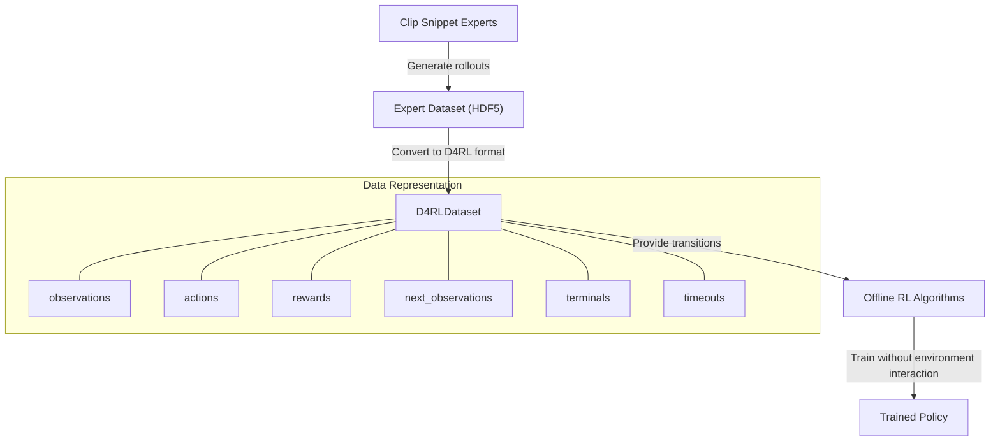
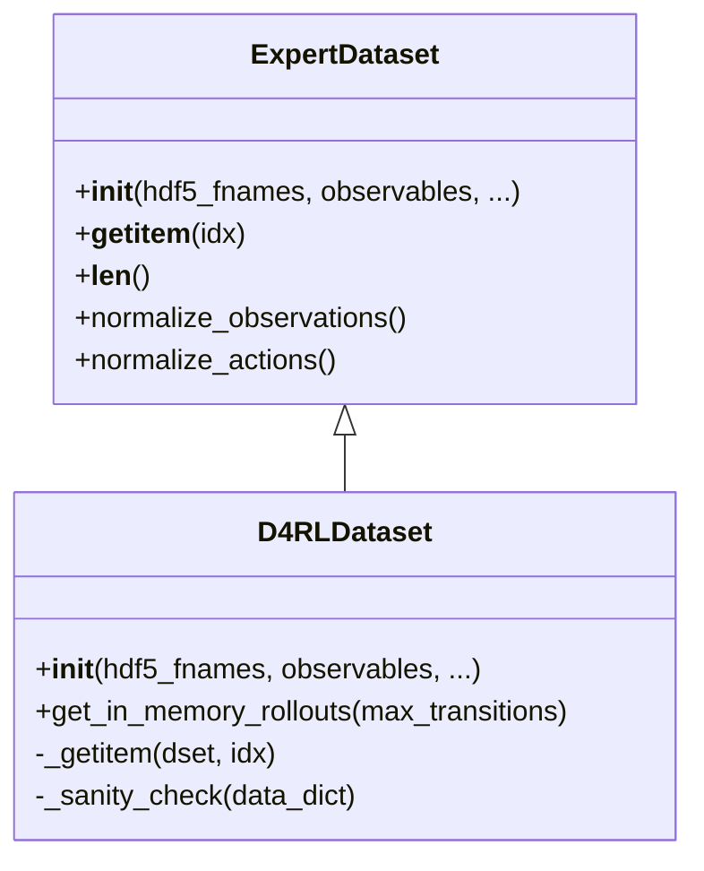
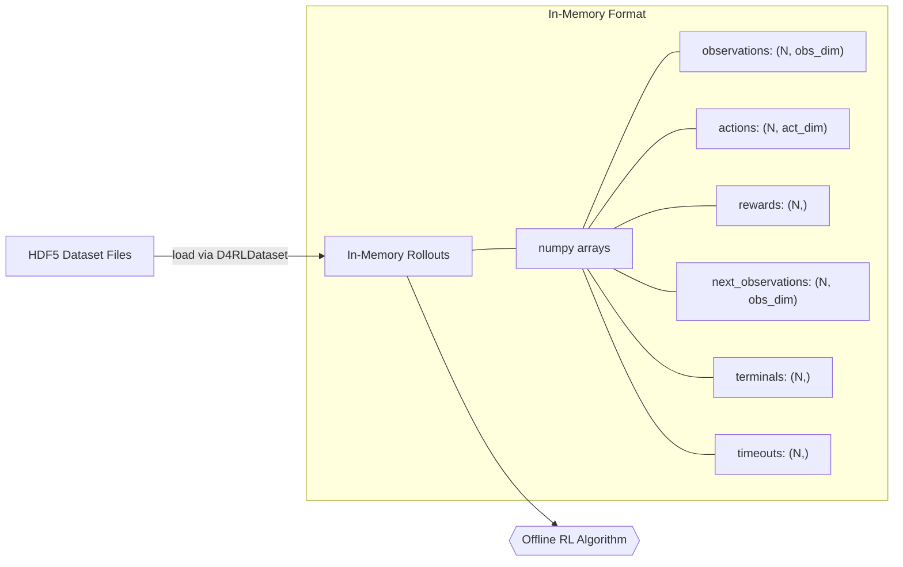
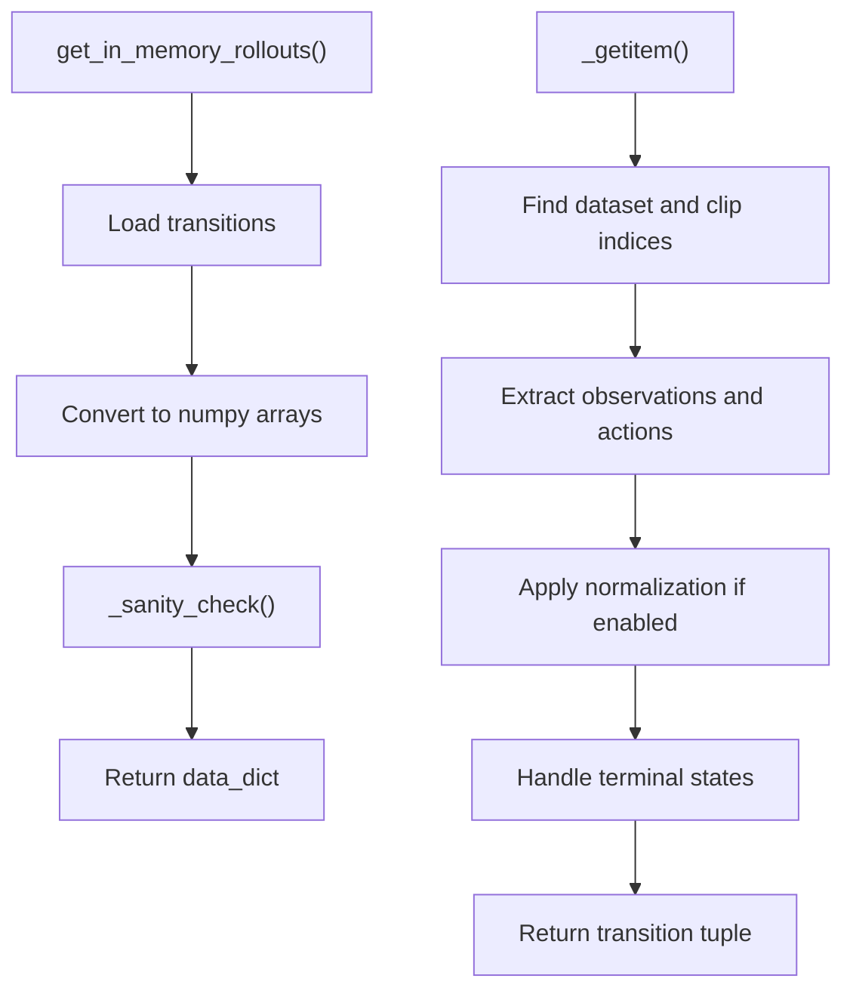
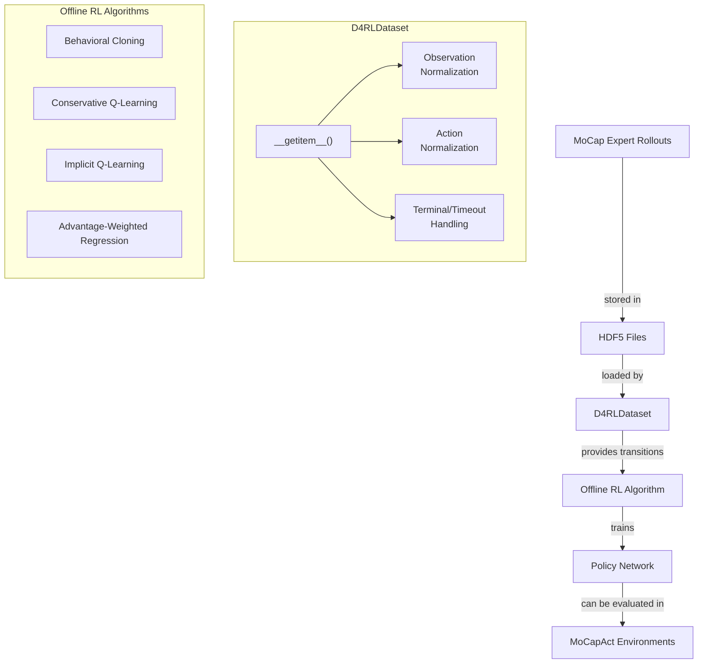

<!-- source: DeepWiki mcp.deepwiki.com · repo microsoft/MoCapAct · page 9 Offline Reinforcement Learning · fetched 2026-10-26 -->

# Offline Reinforcement Learning

Relevant source files

The following files were used as context for generating this wiki page:

- [mocapact/offline_rl/__init__.py](mocapact/offline_rl/__init__.py)
- [mocapact/offline_rl/d4rl_dataset.py](mocapact/offline_rl/d4rl_dataset.py)

## Purpose and Scope

This page documents MoCapAct's support for offline reinforcement learning - a paradigm where policies are trained using pre-collected datasets of transitions without additional environment interaction. MoCapAct implements support for offline RL through integration with the D4RL (Datasets for Data-Driven Deep Reinforcement Learning) format, enabling the use of expert rollouts for offline policy learning.

For information about generating and managing the expert dataset used in offline RL, see [Dataset Generation and Management](#3.2).

## Overview of Offline RL in MoCapAct

Offline reinforcement learning in MoCapAct allows for training policies using the expert demonstrations collected from the clip snippet experts, without requiring additional environment interactions. This approach leverages the high-quality motion data to learn policies that can reproduce or extend motion capture behaviors.

Sources: [mocapact/offline_rl/d4rl_dataset.py:7-106]()

## D4RL Dataset Integration

MoCapAct implements the `D4RLDataset` class which extends the `ExpertDataset` class to provide compatibility with offline RL libraries that expect the D4RL format. This allows seamless integration with popular offline RL implementations.

The `D4RLDataset` class specializes the generic `ExpertDataset` by:

1. Restricting sequence steps to 1 (single transitions)
2. Providing a D4RL-compatible interface
3. Ensuring proper handling of terminal states and timeouts
4. Supporting observation and action normalization

Sources: [mocapact/offline_rl/d4rl_dataset.py:7-49]()

## Dataset Structure and Access

The offline RL dataset follows a specific structure to enable efficient training of offline RL algorithms:

| Component | Description |
|-----------|-------------|
| observations | Agent state at time t |
| actions | Actions taken at time t |
| rewards | Rewards received at time t |
| next_observations | Agent state at time t+1 |
| terminals | Boolean flags indicating episode termination due to failure |
| timeouts | Boolean flags indicating episode termination due to time limit |

The dataset can be loaded into memory for efficient access during training:

Sources: [mocapact/offline_rl/d4rl_dataset.py:51-81]()

## Data Processing and Validation

The `D4RLDataset` implements several key processing steps:

1. **Data Loading**: Iteratively loads transitions from HDF5 files into numpy arrays
2. **Normalization**: Optionally normalizes observations and actions (mean 0, std 1)
3. **Validation**: Performs sanity checks on the loaded data to ensure compatibility
4. **Extraction**: Handles proper extraction of observables from the dataset

Sources: [mocapact/offline_rl/d4rl_dataset.py:51-154]()

## Using the D4RL Dataset

The `D4RLDataset` class provides a straightforward interface for offline RL:

1. **Initialization**: Create an instance with HDF5 filenames and configuration options
2. **Data Access**: Access transitions via indexing or iteration
3. **Memory Loading**: Load all transitions into memory with `get_in_memory_rollouts()`

The dataset supports several configuration options:

| Option | Description |
|--------|-------------|
| `normalize_obs` | Normalize observations to mean 0, std 1 |
| `normalize_act` | Normalize actions to mean 0, std 1 |
| `return_mean_act` | Use mean actions instead of sampled actions |
| `max_transitions` | Maximum number of transitions to load into memory |
| `clip_ids` | Specific clip IDs to include in the dataset |

Sources: [mocapact/offline_rl/d4rl_dataset.py:13-49]()

## Integration with Offline RL Algorithms

MoCapAct's `D4RLDataset` is designed to be compatible with popular offline RL implementations like those found in the D4RL benchmark. This enables training policies using algorithms such as:

- Behavioral Cloning (BC)
- Conservative Q-Learning (CQL)
- Implicit Q-Learning (IQL)
- Advantage-Weighted Regression (AWR)
- Return-Weighted Regression (RWR)

The following diagram illustrates how the `D4RLDataset` integrates with offline RL algorithms:

Sources: [mocapact/offline_rl/d4rl_dataset.py:7-154]()

## Summary

MoCapAct provides a robust implementation for offline reinforcement learning through its `D4RLDataset` class, which adapts the expert rollout data to a format compatible with standard offline RL algorithms. This enables:

1. Training policies from expert demonstrations without environment interaction
2. Compatibility with existing offline RL implementations
3. Efficient data loading and preprocessing
4. Proper handling of terminal states and episode boundaries
5. Normalization of observations and actions

These capabilities allow researchers to explore offline learning techniques with the high-quality motion capture data supported by MoCapAct.

Sources: [mocapact/offline_rl/d4rl_dataset.py:7-154]()

---

