# Page: Overview

# Overview

<details>
<summary>Relevant source files</summary>

The following files were used as context for generating this wiki page:

- [README.md](README.md)
- [mocapact/download_dataset.py](mocapact/download_dataset.py)

</details>


## Purpose and Scope

MoCapAct is a comprehensive framework for learning low-level motor skills for the CMU Humanoid model using motion capture (MoCap) data. This document provides an introduction to the MoCapAct repository, explaining its key components and workflow. The framework enables users to train humanoid controllers that can accurately reproduce human movements and adapt these skills to new tasks.

This overview covers the high-level architecture, core components, and typical workflows within MoCapAct. For detailed information about specific components, see the dedicated pages in this wiki: [Installation and Setup](#2), [Clip Experts](#3.1), [Policy Distillation](#3.3), [Transfer Learning](#3.4), and [Motion Completion](#3.5).

Sources: [README.md:11-18]()

## High-Level Architecture

MoCapAct consists of five main components organized in a pipeline that transforms raw motion capture data into trained policies for humanoid control.

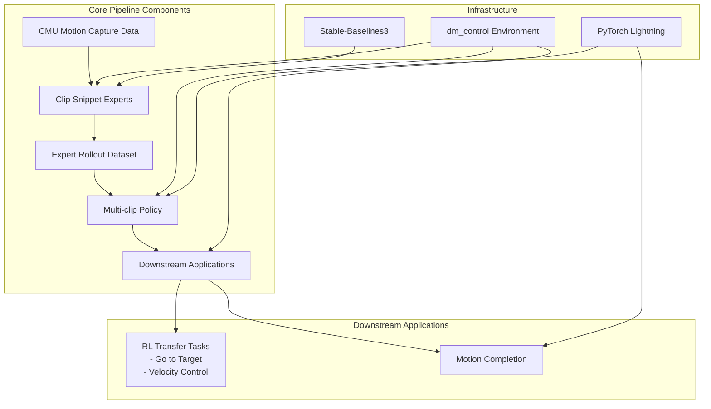

**Diagram: MoCapAct Architecture Overview**

Sources: [README.md:11-20]()

## Core Components

### 1. Clip Snippet Experts

Clip snippet experts are specialized policies trained to accurately track specific segments of motion capture clips. Each expert is specialized in reproducing a particular motion snippet from the CMU MoCap database.

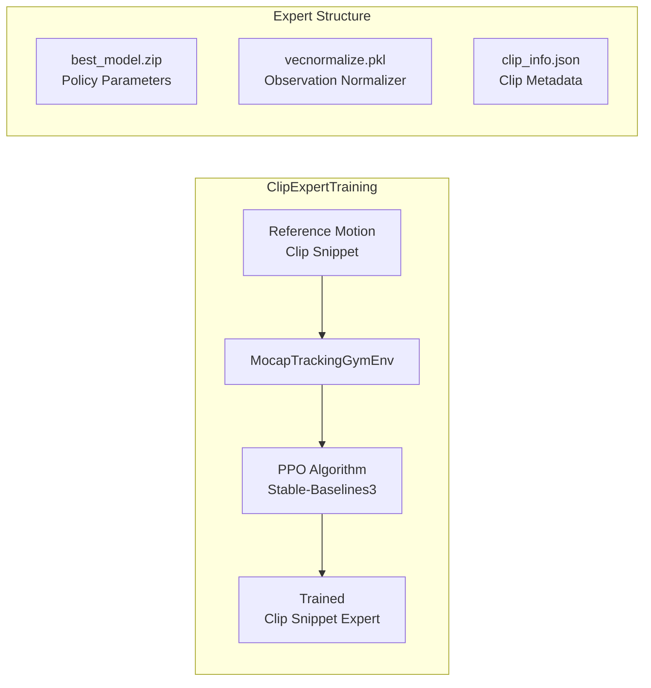

**Diagram: Clip Snippet Expert Training and Structure**

The experts are trained using Proximal Policy Optimization (PPO) from Stable-Baselines3, which receives observations from the MocapTrackingGymEnv environment and learns to match the reference motion.

Sources: [README.md:50-80]()

### 2. Expert Dataset Generation

The expert dataset consists of rollouts collected from the trained clip snippet experts. These rollouts contain observations, actions, rewards, and other data useful for training downstream policies.

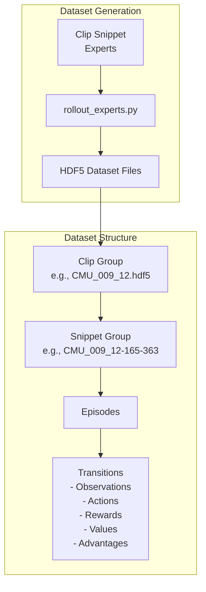

**Diagram: Expert Dataset Generation and Structure**

The dataset is organized hierarchically in HDF5 files, with each file containing rollouts for a specific clip, which in turn contains multiple snippets and episodes.

Sources: [README.md:83-156]()

### 3. Policy Distillation

Policy distillation trains a general multi-clip policy from the expert dataset, creating a model that can perform across a variety of motion clips.

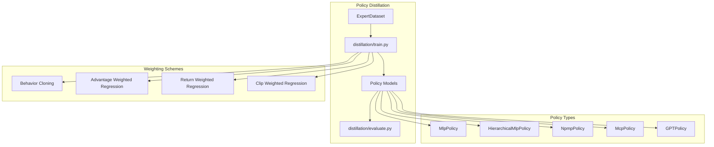

**Diagram: Policy Distillation Process and Model Types**

PyTorch Lightning is used for efficient training, and multiple policy architectures are available, from simple MLPs to more complex models like Neural Probabilistic Motor Primitives (NPMP) and transformer-based GPT policies.

Sources: [README.md:159-191](), [README.md:226-291]()

### 4. Reinforcement Learning Transfer Tasks

The multi-clip policy can be used as a base for reinforcement learning on downstream tasks, such as goal-directed movement or velocity control.

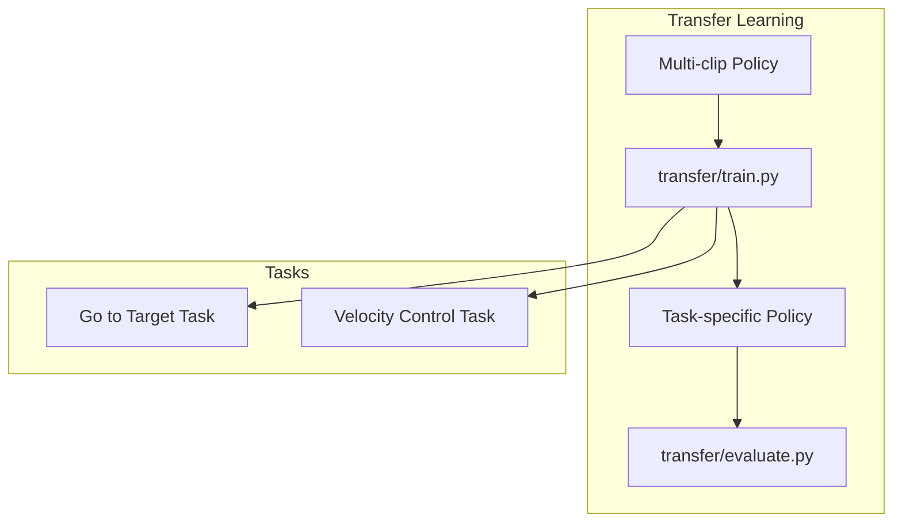

**Diagram: Reinforcement Learning Transfer Process**

The transfer tasks use Proximal Policy Optimization (PPO) to train policies for specific tasks, optionally using a pre-trained low-level policy as a foundation.

Sources: [README.md:192-210](), [README.md:295-310]()

### 5. Motion Completion

Motion completion involves training a GPT policy to complete partial motion sequences, given an initial prompt of motion.

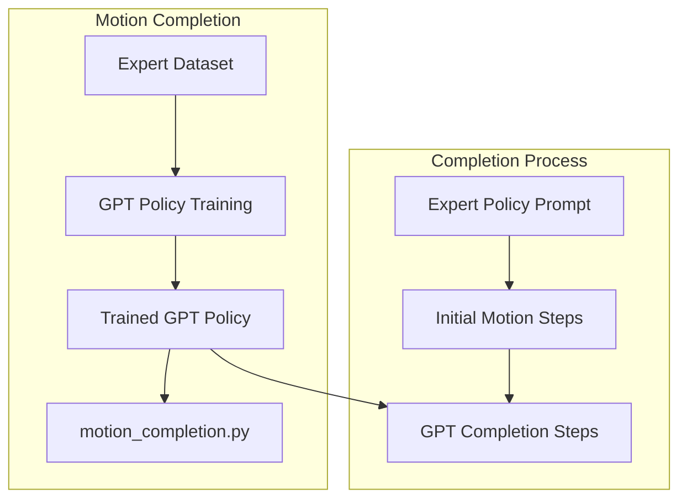

**Diagram: Motion Completion Process**

The GPT policy is trained to predict the next motion steps given a sequence of previous steps, enabling it to complete motions in a coherent and realistic manner.

Sources: [README.md:211-240](), [README.md:313-339]()

## Key Components Table

| Component | Purpose | Key Files | Dependencies |
|-----------|---------|-----------|-------------|
| Clip Snippet Experts | Train policies that track specific motion clip segments | `mocapact/clip_expert/train.py`, `mocapact/clip_expert/evaluate.py` | Stable-Baselines3, dm_control |
| Expert Dataset | Store and manage expert rollouts | `mocapact/distillation/rollout_experts.py`, `mocapact/distillation/dataset.py` | HDF5, PyTorch |
| Policy Distillation | Train multi-clip policies from expert data | `mocapact/distillation/train.py`, `mocapact/distillation/model.py` | PyTorch Lightning |
| RL Transfer | Adapt policies to new tasks | `mocapact/transfer/train.py`, `mocapact/transfer/evaluate.py` | Stable-Baselines3 |
| Motion Completion | Complete partial motion sequences | `mocapact/distillation/motion_completion.py` | PyTorch Lightning |

Sources: [README.md:11-20](), [README.md:160-339]()

## System Requirements and Dependencies

MoCapAct requires:
- Python 3.7+
- Core dependencies:
  - dm_control: Provides the CMU Humanoid model and simulation environment
  - Stable-Baselines3: Implements reinforcement learning algorithms
  - PyTorch Lightning: Facilitates training of neural network models
  - HDF5: Stores expert rollouts and dataset information

A virtual environment is recommended for installation, as detailed in the [Installation and Setup](#2) guide.

Sources: [README.md:27-41]()

## Workflow

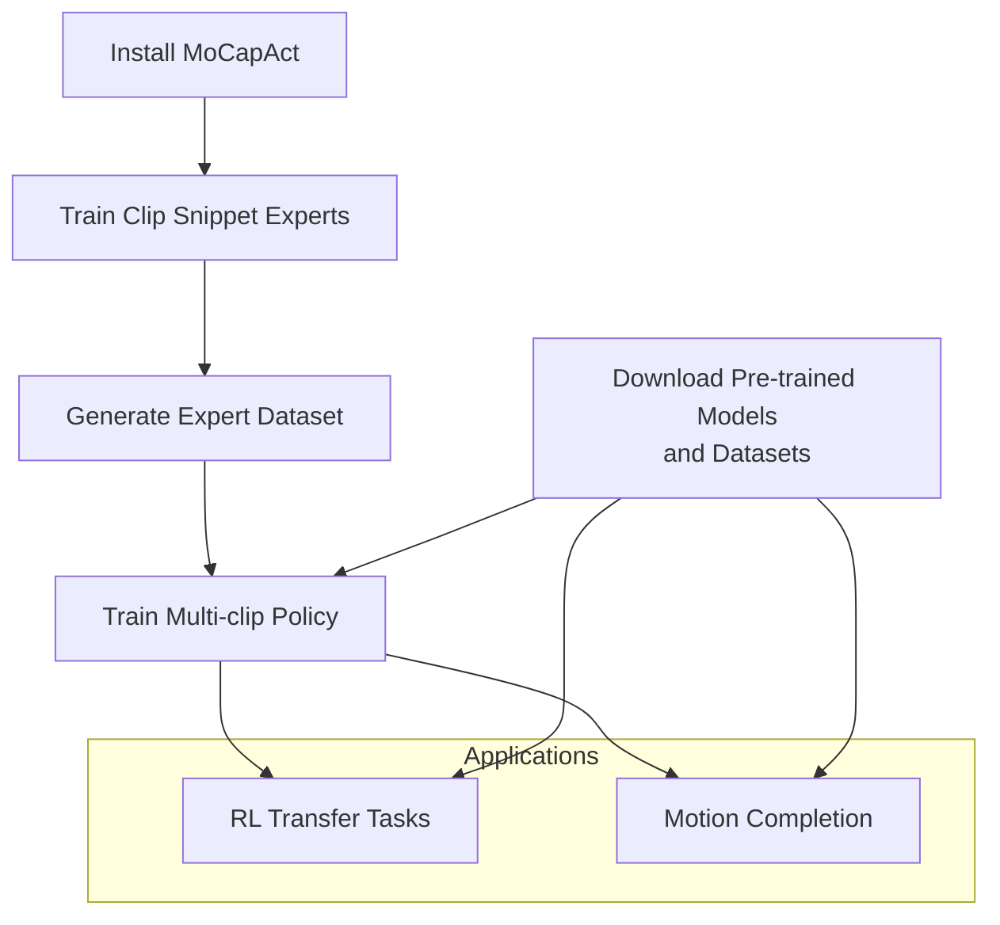

**Diagram: Typical MoCapAct Workflow**

The workflow typically starts with installing MoCapAct, then either downloading pre-trained models and datasets or training them from scratch. The trained policies can then be used for downstream applications like transfer learning or motion completion.

Sources: [README.md:160-339]()

## Dataset Interface

MoCapAct provides two main dataset interfaces:
1. `ExpertDataset`: Used for imitation learning to train multi-clip tracking policies or GPT policies for motion completion
2. `D4RLDataset`: Used for offline reinforcement learning

For smaller datasets that fit in memory, users can use `D4RLDataset.get_in_memory_rollouts()`. For larger datasets, iterators can be used via PyTorch's `Dataset` interface.

Sources: [README.md:342-347]()

## Applications and Extensions

MoCapAct has been used as a foundation for several research projects, including:
- H-GAP: Humanoid Control with a Generalist Planner
- Leveraging Demonstrations with Latent Space Priors
- Hierarchical World Models as Visual Whole-Body Humanoid Controllers
- Body Transformer: Leveraging Robot Embodiment for Policy Learning

These projects demonstrate the extensibility and utility of the MoCapAct framework for advanced humanoid control research.

Sources: [README.md:349-353]()

---

# Page: Installation and Setup

# Installation and Setup

<details>
<summary>Relevant source files</summary>

The following files were used as context for generating this wiki page:

- [README.md](README.md)
- [mocapact/download_dataset.py](mocapact/download_dataset.py)
- [requirements.txt](requirements.txt)
- [setup.py](setup.py)

</details>


This page documents the installation and setup process for the MoCapAct framework. It covers system requirements, package installation, and instructions for accessing the dataset of motion capture experts and rollouts. For information about training clip snippet experts or creating your own dataset, see [Clip Experts](#3.1) and [Dataset Generation and Management](#3.2).

## System Requirements

MoCapAct requires the following system components to function properly:

- Python 3.7 or higher
- MuJoCo physics engine (included as a dependency)
- GPU recommended for training models but not required for inference
- Sufficient storage space for datasets (approximately 50GB for small dataset, 600GB for full dataset)

The package has been tested on Linux and macOS platforms. Windows users may need additional configuration steps for MuJoCo.

Sources: [README.md:27-28](), [setup.py:11-23]()

## Installation Process

The installation workflow consists of setting up a virtual environment and installing the MoCapAct package and its dependencies.

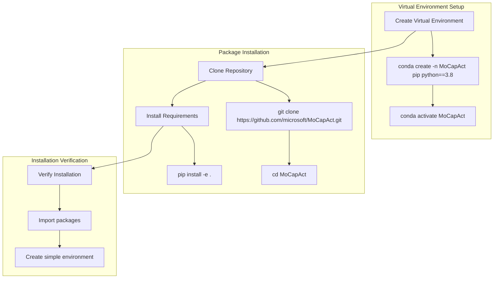

### Setting up a Virtual Environment

It's recommended to use a virtual environment to avoid dependency conflicts. You can create one using conda or venv:

```bash
# Using conda
conda create -n MoCapAct pip python==3.8
conda activate MoCapAct

# OR using venv (Python's built-in virtual environment)
python -m venv mocapact-env
source mocapact-env/bin/activate  # On Windows: mocapact-env\Scripts\activate
```

### Installing MoCapAct

Clone the repository and install the package:

```bash
git clone https://github.com/microsoft/MoCapAct.git
cd MoCapAct
pip install -e .
```

The `-e` flag installs the package in "editable" mode, allowing you to modify the source code if needed.

Sources: [README.md:27-41](), [setup.py:4-24]()

### Dependencies

MoCapAct has several key dependencies that will be automatically installed:

| Dependency | Version | Purpose |
|------------|---------|---------|
| dm_control | >=1.0.7 | Physics simulation environment for the CMU Humanoid |
| mujoco | >=2.2.2 | Physics engine powering the simulation |
| pytorch-lightning | <1.7 | Machine learning framework for training policies |
| stable-baselines3 | >=1.5.0 | Reinforcement learning algorithms |
| gym | <0.24 | Interface standard for reinforcement learning environments |
| h5py | - | Library for working with HDF5 dataset files |

For reproducibility, you can install the exact versions used in the paper by running:

```bash
pip install -r requirements.txt
```

Sources: [setup.py:11-23](), [requirements.txt:1-6]()

## Dataset Access

The MoCapAct dataset consists of trained clip snippet experts and their rollouts. This section explains how to access and use this data.

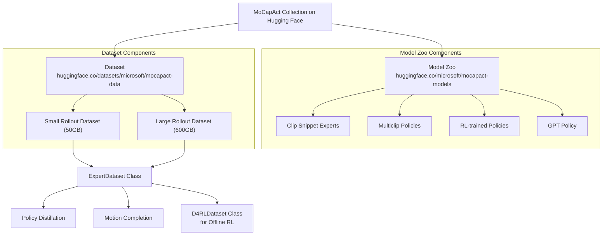

### Downloading the Dataset

The dataset is hosted on Hugging Face and is organized into two main components:

1. **Model Zoo**: Contains trained models including clip snippet experts, multiclip policies, RL-trained policies, and the GPT policy.
   - Available at: huggingface.co/microsoft/mocapact-models

2. **Dataset**: Contains expert rollouts in two sizes:
   - Small dataset (50GB): 10 rollouts per snippet
   - Large dataset (600GB): 100 rollouts per snippet
   - Available at: huggingface.co/datasets/microsoft/mocapact-data

To download the dataset, follow the instructions on the Hugging Face collection page. The older download script referenced in the source code is no longer functional.

Sources: [README.md:43-48](), [mocapact/download_dataset.py:1-10]()

### Dataset Structure

The dataset is organized as a collection of HDF5 files, with one file per clip. Each file contains rollouts for all snippets within that clip.

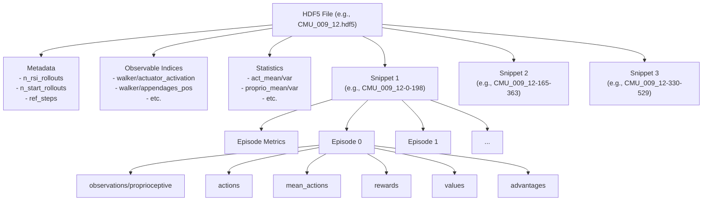

The dataset can be loaded and used in Python using the `ExpertDataset` class for imitation learning or the `D4RLDataset` class for offline reinforcement learning.

Sources: [README.md:82-156](), [README.md:342-347]()

### Sample Dataset Usage

Here's a simple example of loading the dataset:

```python
import h5py

# Load a specific clip file
dset = h5py.File("path/to/dataset/CMU_009_12.hdf5", "r")

# Access actions from a specific snippet and episode
actions = dset["CMU_009_12-165-363/0/actions"][...]

# Close the file when done
dset.close()
```

For more advanced usage, MoCapAct provides dedicated dataset interfaces:

```python
# For imitation learning (e.g., policy distillation)
from mocapact.distillation.dataset import ExpertDataset

# For offline reinforcement learning
from mocapact.offline_rl.d4rl_dataset import D4RLDataset
```

Sources: [README.md:146-153](), [README.md:342-347]()

## System Verification

After installation, you can verify that everything is working correctly by loading an expert policy and running a simple simulation:

```python
from mocapact import observables
from mocapact.sb3 import utils
from mocapact.envs import tracking
from dm_control.locomotion.tasks.reference_pose import types

# Load a clip snippet expert
expert_path = "path/to/experts/CMU_009_12-165-363/eval_rsi/model"
expert = utils.load_policy(expert_path, observables.TIME_INDEX_OBSERVABLES)

# Create an environment
dataset = types.ClipCollection(ids=['CMU_009_12'], start_steps=[165], end_steps=[363])
env = tracking.MocapTrackingGymEnv(dataset)

# Run a simple loop
obs, done = env.reset(), False
while not done:
    action, _ = expert.predict(obs, deterministic=True)
    obs, rew, done, _ = env.step(action)
    print(rew)
```

This should load an expert policy and run it in the environment, printing the reward at each step.

Sources: [README.md:64-80]()

## System Integration

After installation, the MoCapAct system components integrate as follows:

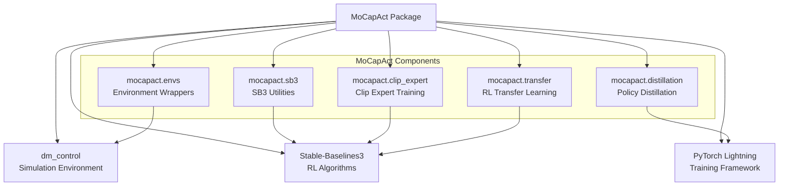

Now you have successfully installed and set up MoCapAct. You can proceed to training clip snippet experts ([Clip Experts](#3.1)), generating datasets ([Dataset Generation and Management](#3.2)), or training multi-clip policies ([Policy Distillation](#3.3)).

Sources: [README.md:11-18](), [setup.py:11-23]()

---

# Page: Core Components

# Core Components

<details>
<summary>Relevant source files</summary>

The following files were used as context for generating this wiki page:

- [README.md](README.md)
- [mocapact/download_dataset.py](mocapact/download_dataset.py)

</details>


This document provides an overview of the main components of the MoCapAct system and their interactions. It serves as a central reference for understanding the system architecture and how different parts work together to train humanoid controllers using motion capture data.

For specific implementation details about individual components, see their dedicated pages:
- [Clip Experts](#3.1)
- [Dataset Generation and Management](#3.2)
- [Policy Distillation](#3.3)
- [Transfer Learning](#3.4)
- [Motion Completion](#3.5)

## System Architecture Overview

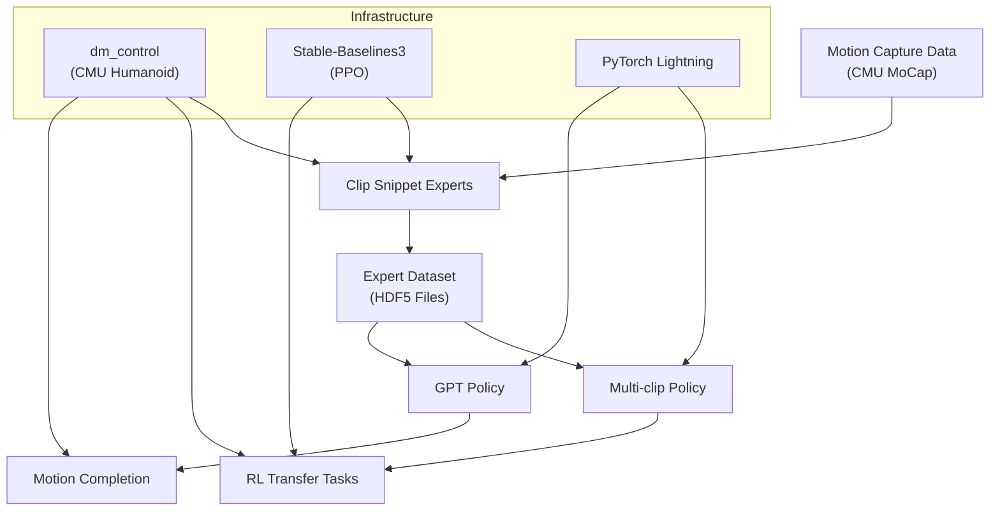

Sources: [README.md:9-20]()

The MoCapAct system consists of five core components working together to train and utilize humanoid controllers based on motion capture data. The system pipeline begins with training expert policies for specific motion clip snippets, then collecting rollouts from these experts to create a dataset. This dataset is used to train either a multi-clip policy (for general motion tracking) or a GPT policy (for motion completion). The multi-clip policy can be further refined for downstream tasks through reinforcement learning.

## 1. Clip Snippet Experts

Clip snippet experts are specialized policies trained to track specific segments (snippets) of motion capture clips.

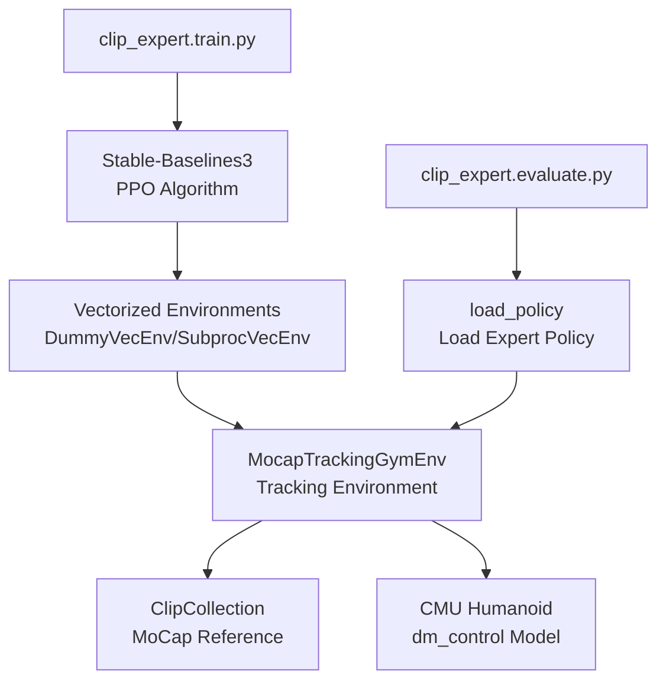

Sources: [README.md:163-202]()

Each clip snippet expert focuses on accurately reproducing a single segment of motion. These experts are the foundation of the MoCapAct system, as they generate the data used in subsequent components.

| Component | Description | Source File |
|-----------|-------------|-------------|
| Trainer | Trains clip snippet experts using PPO | `mocapact/clip_expert/train.py` |
| Evaluator | Evaluates expert performance | `mocapact/clip_expert/evaluate.py` |
| Environment | MoCap tracking Gym environment | `mocapact/envs/tracking.py` |
| Utilities | Helper functions for setup | `mocapact/clip_expert/utils.py` |
| Callbacks | Training callbacks | `mocapact/clip_expert/callbacks.py` |

Technical details:
- Uses Proximal Policy Optimization (PPO) from Stable-Baselines3
- Employs vectorized environments for parallel training
- Includes evaluation callbacks with early stopping
- CMU Humanoid model from dm_control serves as the physical agent
- Stores both policy parameters and observation normalizers

## 2. Expert Dataset Generation

The expert dataset consists of rollouts collected from trained clip snippet experts, providing the foundation for policy distillation.

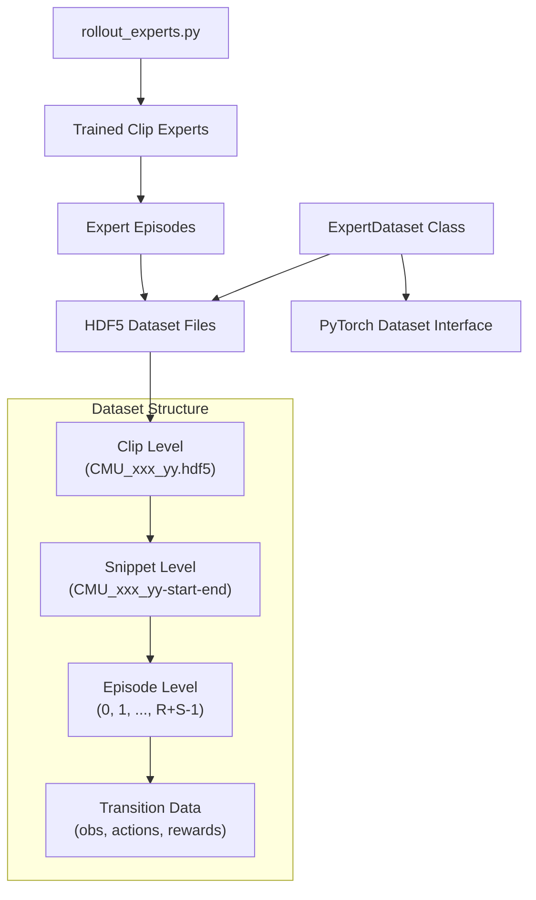

Sources: [README.md:205-224](), [README.md:81-144]()

The dataset maintains a hierarchical structure in HDF5 format, organizing data by clips, snippets, and episodes. This organization facilitates efficient storage and retrieval of expert demonstrations.

| Component | Description | Source File |
|-----------|-------------|-------------|
| Rollout Generator | Collects expert rollouts | `mocapact/distillation/rollout_experts.py` |
| Dataset Class | Manages dataset access | `mocapact/distillation/dataset.py` |
| D4RL Dataset | Interface for offline RL | `mocapact/offline_rl/d4rl_dataset.py` |

Dataset structure details:
- HDF5 files organized by clip, snippet, and episode
- Contains proprioceptive observations, actions, rewards, values, advantages
- Includes episodes starting from beginning of snippets and random points
- Stores statistics (means, variances) for observation and action normalization
- Accessible through `ExpertDataset` and `D4RLDataset` classes

## 3. Policy Distillation

Policy distillation trains a general multi-clip policy using the expert dataset, creating a model that can perform across various motion clips.

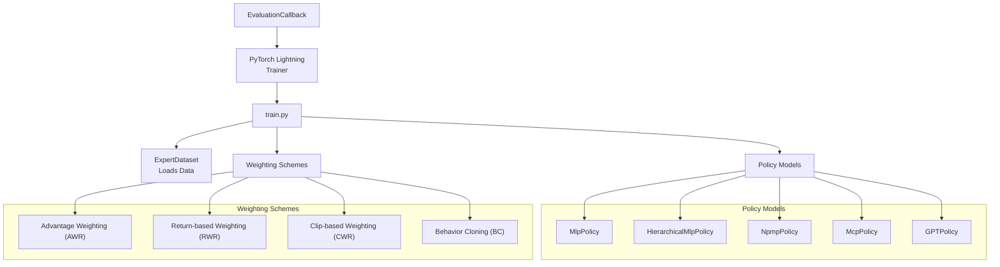

Sources: [README.md:227-290]()

Policy distillation is the process of transferring knowledge from multiple specialized experts into a single, versatile policy. MoCapAct offers several policy architectures and weighting schemes to optimize this process.

| Model | Description | Use Case |
|-------|-------------|----------|
| MlpPolicy | Basic feedforward network | Simple tracking |
| HierarchicalMlpPolicy | Encoder-decoder architecture | Better generalization |
| NpmpPolicy | Neural Probabilistic Motor Primitives | Complex motion tracking |
| McpPolicy | Multiplicative Compositional Policy | Compositional control |
| GPTPolicy | Transformer-based model | Motion completion |

Key features:
- PyTorch Lightning framework for efficient training
- Multiple policy architectures with different capabilities
- Various weighting schemes (AWR, RWR, CWR, BC) for training optimization
- Regular evaluation during training with multiple metrics
- Checkpoint saving and training resumption

## 4. Transfer Learning

The multi-clip policy serves as a foundation for reinforcement learning on downstream tasks, such as goal-directed movement or velocity control.

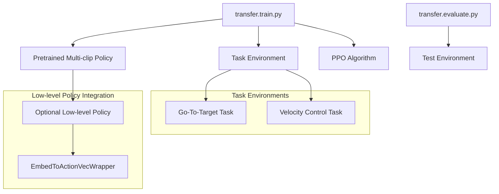

Sources: [README.md:293-310]()

Transfer learning enables the application of learned motion skills to practical tasks. MoCapAct supports two primary transfer tasks: go-to-target (navigation) and velocity control (speed management).

| Component | Description | Source File |
|-----------|-------------|-------------|
| Trainer | Trains policies for transfer tasks | `mocapact/transfer/train.py` |
| Evaluator | Evaluates transfer task performance | `mocapact/transfer/evaluate.py` |
| Task Configurations | Task definitions | `mocapact/transfer/config.py` |

Technical details:
- Uses Proximal Policy Optimization (PPO) for transfer learning
- Supports optional integration with a pre-trained low-level policy
- Implements action embedding for more effective control
- Includes regular evaluation during training with model saving
- Supports go-to-target and velocity control tasks

## 5. Motion Completion

Motion completion uses a GPT-based policy to complete partial motion sequences, enabling the generation of continued movements from an initial prompt.

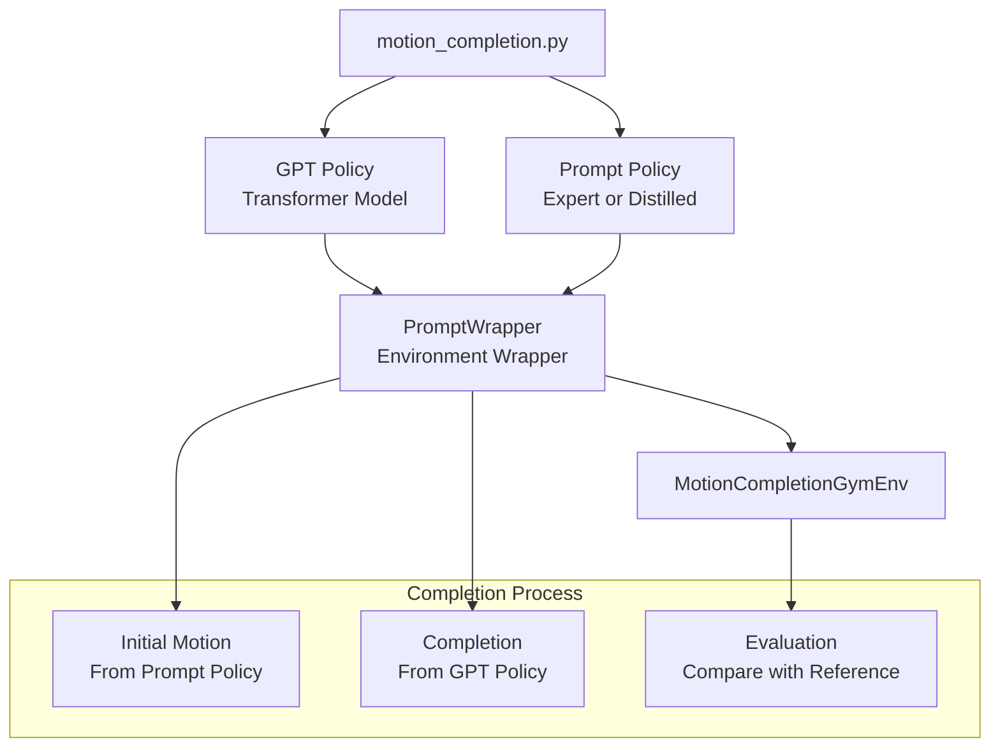

Sources: [README.md:313-340]()

Motion completion represents a more advanced application of the system, where a transformer-based model learns to predict and generate continuation motions based on initial movement patterns.

| Component | Description | Source File |
|-----------|-------------|-------------|
| Completion Runner | Executes motion completion | `mocapact/distillation/motion_completion.py` |
| GPT Policy | Transformer model for completion | `mocapact/distillation/model.py` |
| Completion Environment | Environment for completion | `mocapact/envs/motion_completion.py` |
| Prompt Wrapper | Handles transition from prompt to completion | `mocapact/envs/wrappers.py` |

Technical details:
- GPT-based transformer model for sequence completion
- Prompt-based approach using an initial expert policy
- PromptWrapper environment to handle the transition from prompt to completion
- Supports both numerical evaluation and visualization

## Integration and Data Flow

The complete system integrates these components through a data flow pipeline:

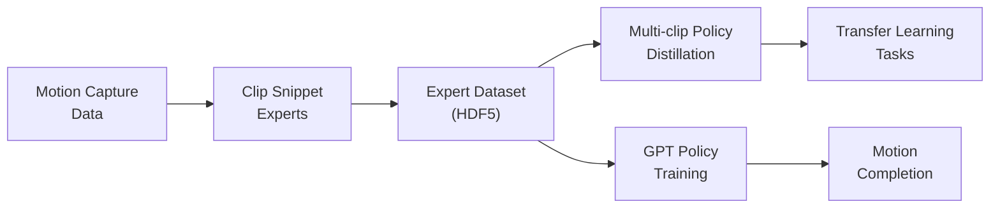

Sources: [README.md:11-20]()

This flow represents the full life cycle from raw motion capture data to practical applications:

1. Motion capture data is used to train specialized expert policies
2. These experts generate a dataset of demonstrations
3. The dataset trains either general policies (multi-clip) or specialized ones (GPT)
4. The trained policies enable downstream applications like task-specific control or motion completion

## Infrastructure Dependencies

MoCapAct relies on several key external libraries that provide the foundation for its functionality:

| Dependency | Usage | Integration Point |
|------------|-------|-------------------|
| dm_control | Provides the CMU Humanoid model and physics simulation | `mocapact/envs/tracking.py` |
| Stable-Baselines3 | Reinforcement learning algorithms (PPO) | `mocapact/clip_expert/train.py`, `mocapact/transfer/train.py` |
| PyTorch Lightning | Training framework for distilled policies | `mocapact/distillation/train.py` |
| HDF5 | Storage format for expert rollouts | `mocapact/distillation/dataset.py` |

Sources: [README.md:21-25](), [README.md:27-41]()

These dependencies provide the infrastructure necessary for simulation, reinforcement learning, neural network training, and efficient data storage.

---

# Page: Clip Experts

# Clip Experts

<details>
<summary>Relevant source files</summary>

The following files were used as context for generating this wiki page:

- [README.md](README.md)
- [mocapact/clip_expert/evaluate.py](mocapact/clip_expert/evaluate.py)
- [mocapact/clip_expert/train.py](mocapact/clip_expert/train.py)
- [mocapact/clip_expert/utils.py](mocapact/clip_expert/utils.py)
- [mocapact/download_dataset.py](mocapact/download_dataset.py)

</details>


## Purpose and Scope

Clip Experts are fundamental components in the MoCapAct system that serve as specialized policies trained to accurately track specific segments (snippets) of motion capture clips. This document explains how to train, evaluate, and use these clip snippet experts, which form the foundation for downstream capabilities such as expert dataset generation, policy distillation, and transfer learning.

For information about converting these experts into a dataset of rollouts, see [Dataset Generation and Management](#3.2). For information on distilling knowledge from multiple experts into a single policy, see [Policy Distillation](#3.3).

## Overview

Clip Experts are policies trained using reinforcement learning (specifically PPO) to mimic specific segments of motion capture data with the CMU Humanoid model. Each expert specializes in tracking a single clip snippet, which is defined by a clip ID, start step, and end step.

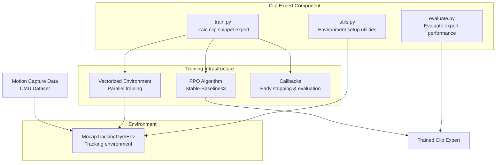

Sources: [README.md:11-14](), [mocapact/clip_expert/train.py:1-17](), [mocapact/clip_expert/evaluate.py:1-4]()

## Clip Expert Structure

A clip expert model is saved with the following structure:

```
CMU_XXX_YY-start-end/
├── clip_info.json         # Contains clip ID, start step, and end step
└── eval_rsi/model/
    ├── best_model.zip     # Contains policy parameters and hyperparameters
    └── vecnormalize.pkl   # Used to get normalizer for observation and reward
```

Each expert is trained to track a specific segment of a motion capture clip, denoted by:
- **Clip ID**: The identifier for the MoCap clip (e.g., "CMU_009_12")
- **Start Step**: The first frame in the segment
- **End Step**: The last frame in the segment

Sources: [README.md:51-62]()

## Training Clip Experts

Training a clip expert involves using reinforcement learning to teach the CMU Humanoid model to track a specific motion capture clip segment.

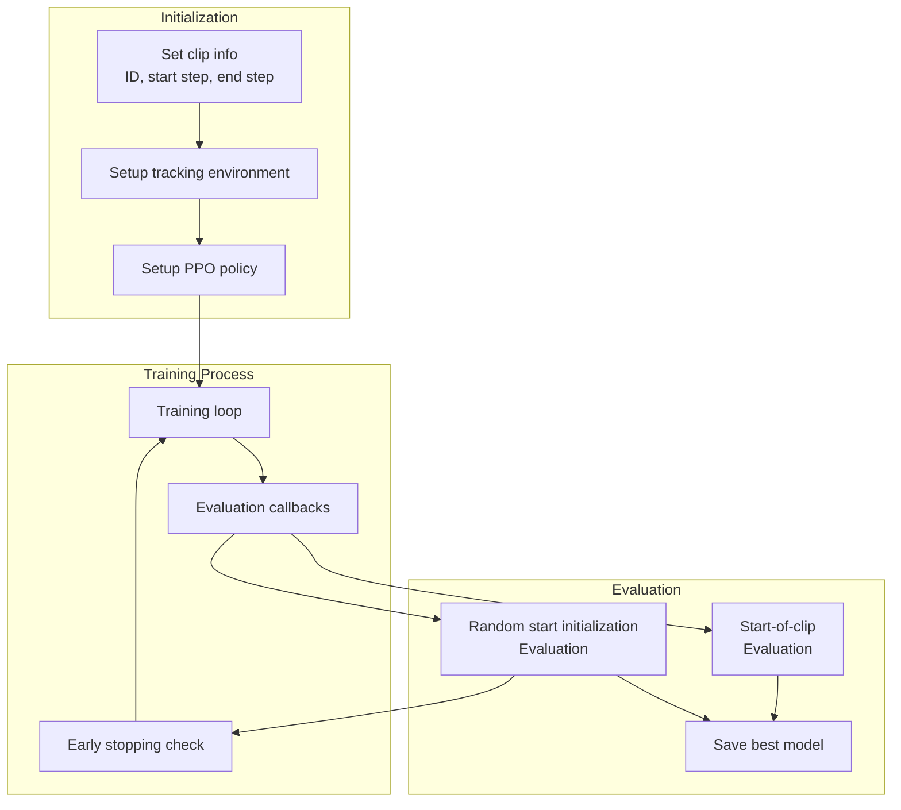

### Training Script

To train a clip expert, use the `mocapact.clip_expert.train` script with the following key parameters:

| Parameter | Description |
|-----------|-------------|
| `--clip_id` | Identifier for the clip (e.g., "CMU_016_22") |
| `--start_step` | Starting frame in the clip |
| `--max_steps` | Maximum number of steps from start |
| `--log_root` | Directory to store results |
| `--n_workers` | Number of parallel environments |
| `--total_timesteps` | Total environment steps for training |

Example command:
```
python -m mocapact.clip_expert.train \
  --clip_id CMU_016_22 \
  --start_step 0 \
  --max_steps 210 \
  --n_workers 8 \
  --log_root experts \
  [additional parameters]
```

Sources: [mocapact/clip_expert/train.py:1-41](), [README.md:162-175]()

### Training Pipeline

1. **Environment Setup**: The function `make_env` in [mocapact/clip_expert/train.py:92-115]() creates vectorized tracking environments.
2. **Evaluation Environments**: Two environments are created:
   - RSI (Random State Initialization): Starts from random points in the clip
   - Start: Always starts from the beginning of the clip
3. **Policy Definition**: A PPO policy with specified neural network architecture is created using Stable-Baselines3.
4. **Training Loop**: The policy is trained with periodic evaluation and early stopping.

The training uses a combination of callbacks:
- `MocapTrackingEvalCallback`: Regular policy evaluation
- `EarlyStoppingCallback`: Terminates training when performance plateaus
- `SaveVecNormalizeCallback`: Saves observation/reward normalizers
- `NormalizedRolloutCallback`: Logs normalized performance metrics

Sources: [mocapact/clip_expert/train.py:117-278]()

### Advanced Configuration

The training script supports various hyperparameters:

- **Network Architecture**:
  - `--n_layers`: Number of hidden layers (default: 3)
  - `--layer_size`: Neurons per hidden layer (default: 1024)
  - `--activation_fn`: Activation function (default: Tanh)

- **PPO Parameters**:
  - `--n_steps`: Steps per policy update (default: 4096)
  - `--n_epochs`: Epochs for updating PPO (default: 10)
  - `--batch_size`: Minibatch size (default: 256)
  - `--clip_range`: PPO clipping parameter (default: 0.2)

- **Learning Rate**:
  - `--learning_rate.start_val`: Initial learning rate
  - `--learning_rate.decay`: Decay rate

Sources: [mocapact/clip_expert/train.py:44-86]()

## Evaluating Clip Experts

Once trained, clip experts can be evaluated to measure their performance in tracking the motion capture clip segment.

```mermaid
flowchart TD
    subgraph "Evaluation Setup"
        loadExpert["Load trained expert"]
        createEnv["Create tracking environment"]
    end
    
    subgraph "Evaluation Types"
        numerical["Numerical Evaluation\nEpisode rewards, lengths"]
        visual["Visual Evaluation\nInteractive visualization"]
    end
    
    subgraph "Outputs"
        metrics["Performance metrics"]
        videos["Generated videos"]
    end
    
    loadExpert --> numerical
    loadExpert --> visual
    createEnv --> numerical
    createEnv --> visual
    numerical --> metrics
    numerical --> videos
    visual --> interactive["Interactive viewer"]
```

### Evaluation Script

To evaluate a clip expert, use the `mocapact.clip_expert.evaluate` script:

| Parameter | Description |
|-----------|-------------|
| `--policy_root` | Path to the expert policy |
| `--n_eval_episodes` | Number of episodes for numerical evaluation |
| `--n_workers` | Number of parallel workers |
| `--visualize` | Whether to show interactive visualization |
| `--eval_save_path` | Path to save evaluation results |
| `--video_save_path` | Path to save videos |

Example command:
```
python -m mocapact.clip_expert.evaluate \
  --policy_root experts/CMU_016-22-0-82/0/eval_rsi/model \
  --n_workers 8 \
  --n_eval_episodes 1000 \
  [additional parameters]
```

Sources: [mocapact/clip_expert/evaluate.py:1-124](), [README.md:177-184]()

### Evaluation Metrics

The evaluation reports several key metrics:
- Mean episode return (total reward)
- Mean episode length
- Mean normalized return
- Mean normalized episode length
- Mean reward per step

These metrics are logged and can be saved to a file for further analysis.

Sources: [mocapact/clip_expert/evaluate.py:82-105]()

### Visualization

The evaluation script can also create an interactive visualization using the dm_control viewer:
- Shows the humanoid controlled by the expert
- Optionally displays a "ghost" of the reference motion
- Helps visually assess tracking performance

Sources: [mocapact/clip_expert/evaluate.py:111-121]()

## Using Clip Experts

Clip experts can be loaded programmatically to control the humanoid in Python:

```python
from mocapact import observables
from mocapact.sb3 import utils
expert_path = "experts/CMU_016_22-0-82/0/eval_rsi/model"
expert = utils.load_policy(expert_path, observables.TIME_INDEX_OBSERVABLES)

from mocapact.envs import tracking
from dm_control.locomotion.tasks.reference_pose import types
dataset = types.ClipCollection(ids=['CMU_016_22'])
env = tracking.MocapTrackingGymEnv(dataset)
obs, done = env.reset(), False
while not done:
    action, _ = expert.predict(obs, deterministic=True)
    obs, rew, done, _ = env.step(action)
```

This allows for the integration of clip experts into larger systems, such as:
- Creating datasets of expert rollouts for policy distillation
- Transferring skills to new tasks
- Analyzing expert behavior

Sources: [README.md:185-201]()

## Implementation Details

### Environment Configuration

The function `make_env_kwargs` in [mocapact/clip_expert/utils.py:6-41]() sets up the environment for clip experts:

```mermaid
classDiagram
    class MocapTrackingGymEnv {
        +reset()
        +step()
        +get_observation()
    }
    
    class EnvironmentConfig {
        +clip_id
        +start_step
        +end_step
        +min_steps
        +ghost_offset
        +always_init_at_clip_start
        +termination_error_threshold
        +act_noise
    }
    
    class ClipCollection {
        +ids
        +start_steps
        +end_steps
    }
    
    EnvironmentConfig --> ClipCollection: creates
    EnvironmentConfig --> MocapTrackingGymEnv: configures
```

Key environment parameters include:
- `clip_id`: Identifier for the motion capture clip
- `start_step`/`end_step`: Define the segment of the clip to track
- `min_steps`: Minimum number of steps in an episode
- `ghost_offset`: Offset for the reference ghost
- `always_init_at_clip_start`: Whether to always start at the beginning of the clip
- `termination_error_threshold`: Error threshold for early termination
- `act_noise`: Action noise for the humanoid

Sources: [mocapact/clip_expert/utils.py:6-41]()

### Neural Network Architecture

Clip experts use a neural network policy with the following structure:

- Input: Proprioceptive observations from the humanoid and reference motion
- Hidden layers: Multiple fully-connected layers with a configurable size and activation function
- Output: Action distribution parameters (mean and standard deviation)

The features extractor (`CmuHumanoidFeaturesExtractor`) processes the multi-modal input observations and provides a consolidated feature vector to the policy network.

Sources: [mocapact/clip_expert/train.py:251-258]()

## Common Issues and Troubleshooting

- **Early Termination**: If the expert consistently terminates early, consider increasing the `termination_error_threshold` parameter.
- **Poor Performance**: Try increasing the neural network size or training duration.
- **Unstable Training**: Adjust PPO hyperparameters like learning rate or clip range.
- **Slow Training**: Increase the number of workers for parallel training.

## Next Steps

Once clip experts are trained, they can be:
1. Evaluated individually
2. Used to generate datasets of expert rollouts
3. Used as building blocks for multi-clip policies through distillation

For dataset generation, see [Dataset Generation and Management](#3.2).

---

# Page: Dataset Generation and Management

# Dataset Generation and Management

<details>
<summary>Relevant source files</summary>

The following files were used as context for generating this wiki page:

- [README.md](README.md)
- [mocapact/distillation/dataset.py](mocapact/distillation/dataset.py)
- [mocapact/download_dataset.py](mocapact/download_dataset.py)
- [mocapact/offline_rl/d4rl_dataset.py](mocapact/offline_rl/d4rl_dataset.py)
- [mocapact/utils.py](mocapact/utils.py)

</details>


This page documents the process of generating, loading, and managing expert rollout datasets in MoCapAct. It covers how to create datasets from trained clip snippet experts and the data structures used to efficiently access and manipulate this data. For information about training the clip snippet experts themselves, see [Clip Experts](#3.1).

## Overview

The MoCapAct dataset consists of rollouts from clip snippet experts—policies trained to mimic specific segments of motion capture data. These rollouts are stored in a hierarchical structure that enables efficient access for training multi-clip policies, offline reinforcement learning, and motion completion tasks.

```mermaid
flowchart TD
    A["Clip Snippet Experts"] --> B["rollout_experts.py"]
    B --> C["HDF5 Dataset Files"]
    C --> D["Dataset Classes"]
    
    D --> E["ExpertDataset"]
    D --> F["D4RLDataset"]
    
    E --> G["Policy Distillation"]
    E --> H["Motion Completion"]
    F --> I["Offline RL"]
    
    subgraph "Data Generation"
        A
        B
    end
    
    subgraph "Storage"
        C
    end
    
    subgraph "Management"
        D
        E
        F
    end
    
    subgraph "Applications"
        G
        H
        I
    end
```

Sources: [README.md:42-157](), [mocapact/distillation/dataset.py:1-25]()

## Dataset Structure

The MoCapAct dataset is stored as a collection of HDF5 files, with one file per motion capture clip. Each file contains rollouts for all snippets within that clip, along with metadata and statistics.

```mermaid
flowchart TD
    A["HDF5 File\n(e.g., CMU_009_12.hdf5)"] --> B["Metadata"]
    A --> C["Snippet Rollouts"]
    
    B --> D["n_rsi_rollouts"]
    B --> E["n_start_rollouts"]
    B --> F["ref_steps"]
    B --> G["observable_indices"]
    B --> H["stats"]
    
    G --> G1["walker/actuator_activation"]
    G --> G2["walker/appendages_pos"]
    G --> G3["...other observables..."]
    
    H --> H1["act_mean"]
    H --> H2["act_var"]
    H --> H3["proprio_mean"]
    H --> H4["proprio_var"]
    H --> H5["count"]
    
    C --> I["CMU_009_12-0-198"]
    C --> J["CMU_009_12-165-363"]
    C --> K["CMU_009_12-330-529"]
    
    J --> L["early_termination"]
    J --> M["metrics"]
    J --> N["episodes"]
    
    M --> M1["episode_returns"]
    M --> M2["episode_lengths"]
    M --> M3["norm_episode_returns"]
    
    N --> O["episode_0"]
    N --> P["episode_1"]
    N --> Q["...more episodes..."]
    
    O --> R["observations"]
    O --> S["actions"]
    O --> T["mean_actions"]
    O --> U["rewards"]
    O --> V["values"]
    O --> W["advantages"]
    
    R --> R1["proprioceptive"]
    R --> R2["walker/body_camera (not included)"]
    R --> R3["walker/egocentric_camera (not included)"]
```

Sources: [README.md:80-157]()

### Key Components

| Component | Description |
|-----------|-------------|
| Metadata | Contains information about the dataset, such as number of rollouts and reference steps |
| Observable Indices | Maps observable names to their indices in the proprioceptive observation array |
| Statistics | Precomputed means and variances for observations and actions across the dataset |
| Snippets | Individual segments of motion capture clips (e.g., `CMU_009_12-165-363`) |
| Episodes | Individual rollout trajectories for each snippet, including observations, actions, and rewards |
| Metrics | Performance metrics for each snippet, such as episode returns and lengths |

Sources: [README.md:80-157](), [mocapact/distillation/dataset.py:97-107]()

## Dataset Generation

The dataset is generated by running trained clip snippet experts and collecting their rollouts. This process is handled by the `rollout_experts.py` script.

```mermaid
flowchart LR
    A["Trained Clip\nSnippet Experts"] --> B["rollout_experts.py"]
    
    subgraph "Configuration"
        C["Number of Episodes"]
        D["Random vs. Start Init"]
        E["Observation Types"]
        F["Device (CPU/GPU)"]
    end
    
    C --> B
    D --> B
    E --> B
    F --> B
    
    B --> G["HDF5 Files\n(One per Clip)"]
    
    G --> H["Start Episodes\n(Begin at snippet start)"]
    G --> I["RSI Episodes\n(Random start index)"]
```

Sources: [README.md:205-225]()

### Generation Process

1. For each clip snippet expert, the script runs multiple episodes from:
   - The start of the snippet (`start_rollouts`)
   - Random points within the snippet (`rsi_rollouts` - Random Start Index)

2. For each episode, it collects:
   - Proprioceptive observations (joint angles, velocities, etc.)
   - Actions taken by the expert
   - Mean actions (for deterministic policies)
   - Rewards from the environment
   - Value function estimates
   - Advantage estimates (for weighting in policy distillation)

3. The data is organized hierarchically and saved to HDF5 files.

### Command Line Usage

```bash
python -m mocapact.distillation.rollout_experts \
  --input_dirs [EXPERT_ROOT] \
  --n_workers [N_CPU] \
  --device [DEVICE] \
  --output_path dataset/file_name_ignored.hdf5 \
  $(cat cfg/rollout.txt)
```

Sources: [README.md:205-225]()

## Dataset Management with ExpertDataset

The `ExpertDataset` class provides a PyTorch-compatible interface for loading and managing the expert rollout data. It supports various features for efficient training, including observation normalization, action normalization, and different weighting schemes.

```mermaid
classDiagram
    class ExpertDataset {
        +__init__(hdf5_fnames, observables, metrics_path, ...)
        +property clip_snippets_flat
        +property is_sequential
        +property observation_space
        +property action_space
        +property ref_steps
        +property proprio_mean
        +property proprio_var
        +property act_mean
        +property act_var
        +__len__()
        +__getitem__(idx)
        -_getitem(dset, idx)
        -_extract_observations(all_obs, observable_keys)
        -_set_spaces()
        -_set_stats()
        -_create_offsets()
        -_compute_offset(array)
    }
```

Sources: [mocapact/distillation/dataset.py:24-387]()

### Key Features

#### 1. Data Loading and Access

The `ExpertDataset` loads data from multiple HDF5 files and provides a unified interface for accessing observations, actions, and weights:

```python
dataset = ExpertDataset(
    hdf5_fnames=["dataset/CMU_009_12.hdf5", "dataset/CMU_016_22.hdf5"],
    observables=["walker/joints_pos", "walker/joints_vel", "walker/actuator_activation"],
    metrics_path="dataset/metrics.npz"
)

# Access a sample
obs, act, weight = dataset[100]
```

Sources: [mocapact/distillation/dataset.py:315-386]()

#### 2. Observation and Action Normalization

The dataset can normalize observations and actions using precomputed statistics:

```python
dataset = ExpertDataset(
    # ...
    normalize_obs=True,   # Normalize observations
    normalize_act=True,   # Normalize actions
    # ...
)
```

Sources: [mocapact/distillation/dataset.py:350-353]()

#### 3. Weighting Schemes

The dataset supports different weighting schemes for sampling or prioritizing data:

| Scheme | Description | Parameter |
|--------|-------------|-----------|
| Advantage Weighting | Weights data by the advantage function (AWR) | `advantage_weights=True` |
| Return Weighting | Weights data by the episode return (RWR) | `clip_weighted=True` |
| Clip-based Weighting | Weights data by clip length | `clip_len_upsampling=True` |
| Uniform Weighting | Equal weights for all data points | `temperature=None` |

Sources: [mocapact/distillation/dataset.py:368-385]()

#### 4. Sequential vs. Single-step Data

The dataset can return either single transitions or sequences of transitions, useful for training different types of models:

```python
# Single-step transitions (for MLPs)
dataset = ExpertDataset(min_seq_steps=1, max_seq_steps=1, ...)

# Sequential transitions (for RNNs, Transformers)
dataset = ExpertDataset(min_seq_steps=10, max_seq_steps=50, ...)
```

Sources: [mocapact/distillation/dataset.py:342-348]()

## Offline Reinforcement Learning with D4RLDataset

The `D4RLDataset` extends `ExpertDataset` to provide compatibility with the D4RL interface for offline reinforcement learning.

```mermaid
classDiagram
    ExpertDataset <|-- D4RLDataset
    
    class ExpertDataset {
        +__init__(hdf5_fnames, observables, ...)
        +__len__()
        +__getitem__(idx)
    }
    
    class D4RLDataset {
        +__init__(hdf5_fnames, observables, ...)
        +get_in_memory_rollouts(max_transitions)
        -_sanity_check(data_dict)
        -_getitem(dset, idx)
    }
```

Sources: [mocapact/offline_rl/d4rl_dataset.py:7-154]()

### Key Features

#### 1. D4RL Compatibility

The `D4RLDataset` provides a standard interface that works with offline RL algorithms:

```python
d4rl_dataset = D4RLDataset(
    hdf5_fnames=["dataset/CMU_009_12.hdf5"],
    observables=["walker/joints_pos", "walker/joints_vel"],
    metrics_path="dataset/metrics.npz"
)

# Returns observations, actions, rewards, next_observations, terminals, timeouts
obs, act, rew, next_obs, terminal, timeout = d4rl_dataset[100]
```

Sources: [mocapact/offline_rl/d4rl_dataset.py:107-154]()

#### 2. In-Memory Rollouts

For smaller datasets, the entire dataset can be loaded into memory for faster access:

```python
# Load up to 2 million transitions into memory
rollouts = d4rl_dataset.get_in_memory_rollouts(max_transitions=2000000)

# Access components
observations = rollouts['observations']
actions = rollouts['actions']
rewards = rollouts['rewards']
next_observations = rollouts['next_observations']
terminals = rollouts['terminals']
timeouts = rollouts['timeouts']
```

Sources: [mocapact/offline_rl/d4rl_dataset.py:51-80]()

## Dataset Availability

MoCapAct provides two pre-generated datasets:

1. **Large Dataset**: 600 GB, with 100 start rollouts and 100 RSI rollouts per snippet
2. **Small Dataset**: 50 GB, with 10 start rollouts and 10 RSI rollouts per snippet

These datasets can be downloaded from the [MoCapAct Hugging Face collection](https://huggingface.co/datasets/microsoft/mocapact-data).

Sources: [README.md:43-49](), [README.md:156-157]()

## Usage Examples

### Loading and Exploring Dataset

```python
import h5py

# Open a dataset file
dset = h5py.File("dataset/CMU_009_12.hdf5", "r")

# View expert actions from the first rollout episode of the second snippet
print(dset["CMU_009_12-165-363/0/actions"][...])

# View metadata
print("Number of start rollouts:", dset["n_start_rollouts"][...])
print("Number of RSI rollouts:", dset["n_rsi_rollouts"][...])
```

Sources: [README.md:147-154]()

### Creating a Dataset for Policy Distillation

```python
from mocapact.distillation.dataset import ExpertDataset

# Create dataset for policy distillation
dataset = ExpertDataset(
    hdf5_fnames=["dataset/CMU_009_12.hdf5", "dataset/CMU_016_22.hdf5"],
    observables=["walker/joints_pos", "walker/joints_vel", "walker/actuator_activation"],
    metrics_path="dataset/metrics.npz",
    normalize_obs=True,
    normalize_act=True,
    advantage_weights=True,
    temperature=0.1
)

# Use with PyTorch DataLoader
from torch.utils.data import DataLoader
dataloader = DataLoader(dataset, batch_size=64, shuffle=True, num_workers=4)

for obs, act, weight in dataloader:
    # Training loop...
    pass
```

Sources: [mocapact/distillation/dataset.py:24-387](), [README.md:340-348]()

### Creating a Dataset for Offline RL

```python
from mocapact.offline_rl.d4rl_dataset import D4RLDataset

# Create dataset for offline RL
d4rl_dataset = D4RLDataset(
    hdf5_fnames=["dataset/CMU_009_12.hdf5"],
    observables=["walker/joints_pos", "walker/joints_vel", "walker/world_zaxis"],
    metrics_path="dataset/metrics.npz",
    normalize_obs=True,
    normalize_act=True
)

# Load data into memory for offline RL algorithm
in_memory_data = d4rl_dataset.get_in_memory_rollouts(max_transitions=1000000)
```

Sources: [mocapact/offline_rl/d4rl_dataset.py:7-80]()

---

# Page: Policy Distillation

# Policy Distillation

<details>
<summary>Relevant source files</summary>

The following files were used as context for generating this wiki page:

- [README.md](README.md)
- [mocapact/distillation/config.py](mocapact/distillation/config.py)
- [mocapact/distillation/evaluate.py](mocapact/distillation/evaluate.py)
- [mocapact/distillation/model.py](mocapact/distillation/model.py)
- [mocapact/distillation/train.py](mocapact/distillation/train.py)
- [mocapact/download_dataset.py](mocapact/download_dataset.py)

</details>


Policy distillation in MoCapAct is the process of training a general multi-clip policy from a dataset of expert rollouts. This page explains the policy distillation process, available policy models, and how to train and evaluate distilled policies.

For information on generating the expert rollout dataset, see [Dataset Generation and Management](#3.2).
For information on using the distilled policies for transfer learning, see [Transfer Learning](#3.4).

## Process Overview

Policy distillation transforms many specialized clip snippet experts into a single versatile policy that can track multiple motion capture clips. This allows the system to generalize across different movement patterns.

```mermaid
flowchart TD
    subgraph "Expert Data Generation"
        ClipExperts["Clip Snippet Experts"] --> ExpertRollouts["Expert Rollouts Dataset"]
    end
    
    subgraph "Policy Distillation"
        ExpertRollouts --> ExpertDataset["ExpertDataset Class"]
        ExpertDataset --> TrainingLoop["Training Loop"]
        
        subgraph "Model Selection"
            MLP["MlpPolicy"]
            HMLP["HierarchicalMlpPolicy"]
            NPMP["NpmpPolicy"]
            MCP["McpPolicy"]
            GPT["GPTPolicy"]
        end
        
        subgraph "Weighting Schemes"
            AWR["Advantage-Weighted Regression"]
            RWR["Return-Weighted Regression"]
            BC["Behavioral Cloning"]
            CWR["Clip-based Weighting"]
        end
        
        Model Selection --> TrainingLoop
        Weighting Schemes --> TrainingLoop
    end
    
    TrainingLoop --> MultiClipPolicy["Multi-clip Policy"]
    MultiClipPolicy --> Evaluation["Policy Evaluation"]
    MultiClipPolicy --> TransferLearning["Transfer Learning"]
    MultiClipPolicy --> MotionCompletion["Motion Completion"]
```

Sources: [mocapact/distillation/train.py:1-256](), [README.md:227-245]()

## Policy Models

MoCapAct provides several policy model architectures for distillation, all inheriting from the `BasePolicy` class:

```mermaid
classDiagram
    BasePolicy <|-- MlpPolicy
    BasePolicy <|-- HierarchicalMlpPolicy
    BasePolicy <|-- NpmpPolicy
    BasePolicy <|-- McpPolicy
    BasePolicy <|-- GPTPolicy
    
    class BasePolicy {
        +features_extractor
        +learning_rate
        +observables
        +ref_steps
        +initial_state()
        +forward()
        +training_step()
        +predict()
    }
    
    class MlpPolicy {
        +mlp
        +forward()
    }
    
    class HierarchicalMlpPolicy {
        +reference_encoder
        +action_decoder
        +forward()
    }
    
    class NpmpPolicy {
        +reference_encoder
        +action_decoder
        +embedding_kl_weight
        +embedding_correlation
        +forward()
    }
    
    class McpPolicy {
        +reference_encoder
        +gating_net
        +primitives
        +forward()
    }
    
    class GPTPolicy {
        +gpt
        +block_size
        +forward()
    }
```

Sources: [mocapact/distillation/model.py:39-166](), [mocapact/distillation/model.py:226-1289]()

### MlpPolicy

A simple feedforward network policy that maps observations directly to actions.

- **Description**: Consists of multiple fully connected layers with configurable size and activation functions
- **Input**: Flattened observations
- **Output**: Action distribution (mean and standard deviation)
- **Use case**: Simple motion tasks, baseline model

Sources: [mocapact/distillation/model.py:226-303](), [mocapact/distillation/config.py:12-31]()

### NpmpPolicy (Neural Probabilistic Motor Primitives)

The default model for multi-clip policies in MoCapAct, based on the architecture from the NPMP paper.

```mermaid
flowchart LR
    subgraph "NpmpPolicy Architecture"
        Obs["Observation"] --> FeatExt["Features Extractor"]
        FeatExt --> RefEnc["Reference Encoder"]
        FeatExt --> DecInput["Decoder Input"]
        
        RefEnc --> EmbDist["Embedding Distribution"]
        EmbDist --> Embed["Latent Embedding"]
        
        Embed --> PrevEmbed["Previous Embedding\n(Recurrent Connection)"]
        PrevEmbed --> RefEnc
        
        Embed --> ActionDec["Action Decoder"]
        DecInput --> ActionDec
        
        ActionDec --> ActionDist["Action Distribution"]
    end
```

- **Architecture**: Recurrent stochastic encoder and feedforward decoder
- **Features**:
  - Learns a latent embedding space of motion primitives
  - Recurrent state tracking via the embedding
  - KL regularization between consecutive embeddings
  - Configurable embedding size and network architecture
- **Use case**: General-purpose humanoid control across multiple clips

Sources: [mocapact/distillation/model.py:472-680](), [mocapact/distillation/config.py:46-62]()

### Other Policy Models

- **HierarchicalMlpPolicy**: Encoder-decoder architecture with a non-recurrent encoder
- **McpPolicy (Multiplicative Compositional Policy)**: Uses a gating mechanism to select between multiple primitives
- **GPTPolicy**: Transformer-based architecture primarily used for motion completion tasks

Sources: [mocapact/distillation/model.py:304-417](), [mocapact/distillation/model.py:734-927](), [mocapact/distillation/model.py:1131-1289]()

## Training Configuration

The training process is highly configurable through command-line flags:

| Parameter | Description | Default Value |
|-----------|-------------|---------------|
| `model` | Policy model architecture | `mlp_time_index` |
| `learning_rate` | Learning rate | `1e-4` |
| `batch_size` | Batch size for training | `64` |
| `n_workers` | Number of data loading workers | `8` |
| `clip_weighted` | Use clip-based weighting | `False` |
| `advantage_weights` | Use advantage weighting (AWR) | `True` |
| `normalize_obs` | Normalize observations | `False` |
| `eval_mode` | Evaluation modes to use | `[]` |

For model-specific configurations:

```python
# Example NPMP configuration
npmp_config = {
    'embed_size': 60,
    'ref_encoder_n_layers': 2,
    'ref_encoder_layer_size': 1024,
    'decoder_n_layers': 3,
    'decoder_layer_size': 1024,
    'layer_norm': True,
    'embedding_kl_weight': 0.1,
    'embedding_correlation': 0.95,
    'seq_steps': 30,
    'activation_fn': 'torch.nn.Tanh',
    'squash_output': True,
    'observables': observables.HIERARCHICAL_OBSERVABLES
}
```

Sources: [mocapact/distillation/train.py:20-77](), [mocapact/distillation/config.py:11-87]()

## Training Process

The training process uses PyTorch Lightning for efficient training with support for multi-GPU setups.

```mermaid
flowchart TD
    subgraph "Data Preparation"
        ExpertDataset["ExpertDataset"] --> DataLoader["PyTorch DataLoader"]
    end
    
    subgraph "Training Components"
        Policy["Policy Model"]
        Optimizer["Optimizer"]
        LossFunction["Loss Function"]
    end
    
    subgraph "Training Loop"
        ForwardPass["Forward Pass"]
        LossCalc["Loss Calculation"]
        Backprop["Backpropagation"]
        OptStep["Optimizer Step"]
    end
    
    subgraph "Callbacks"
        CheckpointCallback["Model Checkpoint"]
        EvalCallback["Policy Evaluation"]
        LoggerCallback["Logging (CSV/TensorBoard)"]
    end
    
    DataLoader --> ForwardPass
    Policy --> ForwardPass
    ForwardPass --> LossCalc
    LossFunction --> LossCalc
    LossCalc --> Backprop
    Backprop --> OptStep
    Optimizer --> OptStep
    OptStep --> ForwardPass
    
    Training Loop --> CheckpointCallback
    Training Loop --> EvalCallback
    Training Loop --> LoggerCallback
    
    CheckpointCallback --> SavedModel["Saved Model Checkpoint"]
    EvalCallback --> EvalMetrics["Evaluation Metrics"]
    LoggerCallback --> Logs["Training Logs"]
```

The training script handles:

1. **Dataset Loading**: Creates an `ExpertDataset` from the expert rollout HDF5 files
2. **Model Creation**: Initializes the policy model based on configuration
3. **Training Setup**: Configures PyTorch Lightning trainer and callbacks
4. **Training Execution**: Runs the training loop with periodic evaluation

Sources: [mocapact/distillation/train.py:83-256]()

## Weighting Schemes

Policy distillation supports different weighting schemes for prioritizing expert demonstrations:

1. **Advantage-Weighted Regression (AWR)**: Weights transitions by their advantage values, focusing on actions that performed better than expected
2. **Return-Weighted Regression (RWR)**: Weights transitions by their total return, emphasizing successful trajectories
3. **Clip-Weighted Regression (CWR)**: Applies weights based on clip length to balance between different clips
4. **Behavioral Cloning (BC)**: Applies equal weights to all transitions

Weighting schemes are controlled by flags like `--advantage_weights` and `--clip_weighted`.

Sources: [README.md:233-257](), [mocapact/distillation/train.py:52-55]()

## Evaluation

Policies are evaluated during and after training on various subsets of clips:

```mermaid
flowchart TD
    MultiClipPolicy["Multi-clip Policy"] --> EvalEnv["MocapTrackingGymEnv"]
    EvalEnv --> Rollout["Policy Rollout"]
    Rollout --> Metrics["Evaluation Metrics"]
    
    subgraph "Evaluation Metrics"
        Returns["Episode Returns"]
        EpisodeLengths["Episode Lengths"]
        NormReturns["Normalized Returns"]
        NormLengths["Normalized Lengths"]
        RewardsPerStep["Rewards Per Step"]
    end
    
    Rollout --> Visualization["Visual Evaluation"]
    Visualization --> GUI["Interactive GUI"]
    Visualization --> Video["Video Recording"]
```

Evaluation modes include:
- `train_start`: Training clips, initialized at the start of clips
- `train_rsi`: Training clips, initialized at random points
- `val_start`: Validation clips, initialized at the start of clips
- `val_rsi`: Validation clips, initialized at random points
- `clips_start`: Specific test clips, initialized at the start
- `clips_rsi`: Specific test clips, initialized at random points

The evaluation metrics provide quantitative measures of the policy's ability to track the reference motion.

Sources: [mocapact/distillation/evaluate.py:1-132](), [mocapact/distillation/train.py:183-230]()

## Example Usage

### Training a Multi-clip Policy

```bash
source scripts/get_all_clips.sh [PATH_TO_DATASET]
python -m mocapact.distillation.train \
  --train_dataset_paths $train \
  --val_dataset_paths $val \
  --dataset_metrics_path $metrics \
  --extra_clips $clips \
  --output_root multi_clip/all \
  --gpus 0 \
  --model.config.embed_size 60 \
  --eval.n_workers 16
```

### Evaluating a Trained Policy

```bash
source scripts/get_all_clips.sh [PATH_TO_DATASET]
python -m mocapact.distillation.evaluate \
  --policy_path multi_clip/all/eval/train_rsi/best_model.ckpt \
  --clip_snippets $snippets \
  --n_workers 8 \
  --device cuda \
  --n_eval_episodes 1000
```

### Using a Trained Policy in Code

```python
from mocapact.distillation import model
policy = model.NpmpPolicy.load_from_checkpoint(
    "multi_clip/all/eval/train_rsi/best_model.ckpt", 
    map_location="cpu"
)

from mocapact.envs import tracking
from dm_control.locomotion.tasks.reference_pose import cmu_subsets
dataset = cmu_subsets.ALL
ref_steps = (1, 2, 3, 4, 5)
env = tracking.MocapTrackingGymEnv(dataset, ref_steps)
obs, done = env.reset(), False
embed = policy.initial_state(deterministic=False)
while not done:
    action, embed = policy.predict(obs, state=embed, deterministic=False)
    obs, rew, done, _ = env.step(action)
```

Sources: [README.md:245-292]()

## Key Insights

- Policy distillation creates a general policy that can perform across a variety of motion clips
- The NPMP architecture is particularly suited for humanoid control tasks requiring generalization
- Advantage-weighted regression typically produces better results by focusing on high-quality demonstrations
- The distilled multi-clip policy can be used for downstream tasks like transfer learning and motion completion
- Evaluation during training helps track the policy's performance across different subsets of clips

Sources: [README.md:227-245](), [mocapact/distillation/model.py:472-680]()

---

# Page: Transfer Learning

# Transfer Learning

<details>
<summary>Relevant source files</summary>

The following files were used as context for generating this wiki page:

- [README.md](README.md)
- [mocapact/download_dataset.py](mocapact/download_dataset.py)
- [mocapact/transfer/train.py](mocapact/transfer/train.py)

</details>


## Purpose and Scope

This document describes the Transfer Learning component of MoCapAct, which enables the use of pre-trained policies for downstream reinforcement learning tasks. Transfer Learning allows humanoid agents to learn specific goal-directed behaviors by leveraging motion skills captured in the multi-clip policy. 

For information about training the multi-clip policy through distillation, see [Policy Distillation](#3.3).

## System Overview

Transfer Learning in MoCapAct builds upon the learned motion capabilities of the multi-clip policy to enable task-specific behaviors. The system trains new policies using Proximal Policy Optimization (PPO) to accomplish tasks like target reaching and velocity control.

```mermaid
flowchart TD
    A["Multi-clip Policy<br>(Pre-trained)"] --> B["Low-level<br>Motion Controller"]
    C["Reinforcement Learning<br>(PPO)"] --> D["High-level<br>Task Policy"]
    D --> E["Embeddings"]
    E --> B
    B --> F["Actions"]
    F --> G["Environment<br>(CMU Humanoid)"]
    G --> H["Observations"]
    H --> D
    
    subgraph "Transfer Learning System"
        C
        D
        E
    end
    
    subgraph "Low-level Control"
        B
        F
    end
    
    subgraph "Simulation"
        G
        H
    end
```

**Diagram: Transfer Learning Architecture**

Sources: [mocapact/transfer/train.py:98-108]()

## Hierarchical Control

MoCapAct's transfer learning implementation uses a hierarchical control approach, where:

1. A high-level policy learns to generate embeddings (latent space representations)
2. These embeddings are translated to physical actions by a pre-trained low-level policy
3. The actions are executed in the environment to accomplish task goals

This approach allows the agent to leverage the motion skills learned by the multi-clip policy while adapting them to new tasks.

```mermaid
classDiagram
    class EmbedToActionVecWrapper {
        +embed_size: int
        +max_embed: float
        +embed_to_action: function
        +step(action)
        +reset()
    }
    
    class VecNormalize {
        +norm_obs: bool
        +norm_reward: bool
        +training: bool
        +gamma: float
    }
    
    class PPO {
        +policy: MultiInputPolicy
        +n_steps: int
        +batch_size: int
        +learn(total_timesteps, callback)
    }
    
    class DmControlWrapper {
        +task_kwargs: dict
    }
    
    PPO --> EmbedToActionVecWrapper: trains
    EmbedToActionVecWrapper --> VecNormalize: wraps
    VecNormalize --> DmControlWrapper: wraps
```

**Diagram: Hierarchical Control Architecture**

Sources: [mocapact/transfer/train.py:98-112]()

## Task Configuration

The Transfer Learning component supports various downstream tasks. Each task is defined by a configuration in `mocapact/transfer/config.py`. The main supported tasks are:

| Task | Description | Key Parameters |
|------|-------------|----------------|
| Go-to-target | The humanoid must navigate to specific target positions | Target distance, reward scaling |
| Velocity control | The humanoid must achieve and maintain specific velocities | Target velocity, reward scaling |

Sources: [mocapact/transfer/train.py:33-34]()

## Training Process

The training process leverages Stable-Baselines3's PPO implementation with vectorized environments for parallel data collection.

```mermaid
flowchart TD
    A["Configuration Setup"] --> B["Environment Creation"]
    B --> C["Load Low-level Policy<br>(Optional)"]
    C --> D["Initialize PPO Agent"]
    D --> E["Training Loop"]
    E --> F["Policy Evaluation"]
    F --> |"Best Model"| G["Save Model"]
    F --> |"Continue Training"| E
    
    subgraph "Environment Setup"
        B
        C
        H["VecNormalize"]
        I["EmbedToActionVecWrapper"]
        B --> H
        C --> I
        I --> H
    end
    
    subgraph "Policy Architecture"
        J["Feature Extractor"]
        K["Policy Network"]
        L["Value Network"]
        J --> K
        J --> L
    end
    
    D --> J
    D --> K
    D --> L
```

**Diagram: Transfer Learning Training Process**

Sources: [mocapact/transfer/train.py:80-112](), [mocapact/transfer/train.py:166-180]()

## Environment Configuration

The training environment is configured based on the selected task, with specific parameters for the physics simulation and control:

```python
task_kwargs = dict(
    physics_timestep=tracking.DEFAULT_PHYSICS_TIMESTEP,
    control_timestep=0.03,
    **FLAGS.task.config
)
```

Multiple environments run in parallel using SubprocVecEnv for efficient data collection, and observations and rewards are normalized using VecNormalize.

Sources: [mocapact/transfer/train.py:80-112]()

## Low-level Policy Integration

If a low-level policy path is provided, the system loads a pre-trained NpmpPolicy and uses it to transform high-level embeddings into motor actions:

```mermaid
flowchart LR
    A["High-level Policy<br>(RL-trained)"] --> B["Embedding<br>Space"]
    B --> C["EmbedToActionVecWrapper"]
    D["NpmpPolicy<br>(Distilled)"] --> C
    C --> E["Motor<br>Actions"]
    E --> F["Environment"]
    F --> G["Observations"]
    G --> A
```

**Diagram: Low-level Policy Integration**

Sources: [mocapact/transfer/train.py:98-108]()

## Network Architecture

The high-level policy uses a customizable multi-layer perceptron architecture:

| Component | Configuration |
|-----------|---------------|
| Network type | MLP (Multi-Layer Perceptron) |
| Number of layers | Configurable (default: 3) |
| Layer size | Configurable (default: 1024) |
| Activation function | Configurable (default: Tanh) |
| Feature extractor | CmuHumanoidFeaturesExtractor |

Sources: [mocapact/transfer/train.py:166-173]()

## Usage Examples

### Training a Policy

To train a policy for a transfer task:

```bash
python -m mocapact.transfer.train \
  --log_root transfer/go_to_target \
  --low_level_policy_path multi_clip/all/eval/train_rsi/best_model.ckpt \
  --n_workers 16 \
  --total_timesteps 1000000
```

### Evaluating a Policy

To evaluate a trained transfer task policy:

```bash
python -m mocapact.transfer.evaluate \
  --model_root transfer/go_to_target/0/eval/model \
  --task mocapact/transfer/config.py:go_to_target
```

Sources: [README.md:297-310]()

## Callbacks and Evaluation

The training process includes evaluation callbacks that periodically assess the policy's performance and save the best model based on evaluation rewards. The evaluation environment uses a different random seed than the training environment to ensure generalization.

Sources: [mocapact/transfer/train.py:155-164]()

---

# Page: Motion Completion

# Motion Completion

<details>
<summary>Relevant source files</summary>

The following files were used as context for generating this wiki page:

- [README.md](README.md)
- [mocapact/distillation/motion_completion.py](mocapact/distillation/motion_completion.py)
- [mocapact/download_dataset.py](mocapact/download_dataset.py)

</details>


## Purpose and Scope

Motion completion is a functionality within MoCapAct that enables a trained policy to continue a humanoid's motion after being provided with an initial sequence of movements. This page covers the implementation details of the motion completion system, including the GPT policy model, the environment wrapper for transitioning from prompt to completion, and evaluation methods. For information about policy distillation used to train the base policies, see [Policy Distillation](#3.3).

Sources: [README.md:18](), [README.md:313-340]()

## Architecture Overview

Motion completion involves starting with a small sequence of initial motion (the "prompt") executed by a high-quality expert policy, then smoothly transitioning to a GPT (Generative Pre-trained Transformer) policy that continues the motion in a natural and contextually appropriate manner.

```mermaid
flowchart TD
    subgraph "Data and Training"
        ExpertDataset["ExpertDataset (Rollout Data)"]
        TrainingProcess["GPT Training Process"]
    end

    subgraph "Prompt Generation"
        PromptPolicy["Prompt Policy\n(Expert or Distilled)"]
        InitialObs["Initial Observations\n(First prompt_length steps)"]
    end

    subgraph "Motion Completion"
        GPTPolicy["GPTPolicy\n(Transformer-based model)"]
        PromptWrapper["PromptWrapper\n(Environment wrapper)"]
        MotionCompEnv["MotionCompletionGymEnv"]
    end

    subgraph "Evaluation"
        NumericalEval["Numerical Evaluation\n(episode lengths)"]
        Visualization["Visualization\n(dm_control viewer)"]
    end

    ExpertDataset --> TrainingProcess
    TrainingProcess --> GPTPolicy
    
    PromptPolicy --> InitialObs
    InitialObs --> PromptWrapper
    
    GPTPolicy --> PromptWrapper
    PromptWrapper --> MotionCompEnv
    MotionCompEnv --> NumericalEval
    MotionCompEnv --> Visualization
```

Sources: [mocapact/distillation/motion_completion.py:55-96](), [README.md:313-340]()

## Core Components

### PromptWrapper

The `PromptWrapper` class is a key component that manages the transition from the prompt policy (which provides initial motion) to the GPT policy (which completes the motion). It's implemented as a vectorized environment wrapper that:

1. Uses the prompt policy for the first `prompt_length` steps
2. Switches to the GPT policy for subsequent steps
3. Maintains state for both policies as needed

```mermaid
classDiagram
    class VecEnvWrapper {
        +step_async(actions)
        +step_wait()
        +reset()
    }
    
    class PromptWrapper {
        -prompt_policy: BaseAlgorithm
        -prompt_len: int
        -deterministic_prompt: bool
        -prompt_counter: np.ndarray
        -prompt_state
        -obs
        +reset()
        +step_async(actions)
        +step_wait()
    }
    
    VecEnvWrapper <|-- PromptWrapper
```

The workflow of the `PromptWrapper` involves:
1. On reset: Initialize prompt counter and state
2. During step_async: For steps before `prompt_length`, use actions from prompt policy
3. During step_wait: Process observations and track prompt counters

Sources: [mocapact/distillation/motion_completion.py:55-96]()

### Motion Completion Environment

The `MotionCompletionGymEnv` is a specialized Gym environment that extends the tracking environment but with modifications specific to motion completion tasks. It includes features like:

- Visual indicators that show when the transition from prompt to completion occurs
- Configurable termination conditions based on error thresholds
- Support for evaluating the quality of the completed motion

Sources: [mocapact/distillation/motion_completion.py:148-153]()

## Implementation Details

### GPT Policy

The GPT policy is a transformer-based model that predicts future actions based on a sequence of previous observations and actions. It's trained on the expert rollout dataset using PyTorch Lightning.

Key characteristics:
- Takes sequence of observations as input
- Maintains internal state between prediction steps
- Uses a transformer architecture for sequence modeling
- Trained using standard policy distillation techniques

Sources: [mocapact/distillation/motion_completion.py:119-127]()

### Execution Flow

The motion completion process involves a specific sequence of operations:

```mermaid
sequenceDiagram
    participant Env as MotionCompletionGymEnv
    participant Wrapper as PromptWrapper
    participant Prompt as Prompt Policy
    participant GPT as GPT Policy
    
    Wrapper->>Env: reset()
    Env-->>Wrapper: initial observation
    
    Note over Wrapper: Initialize counter and states
    
    loop For steps < prompt_length
        Wrapper->>Prompt: predict(observation, state)
        Prompt-->>Wrapper: prompt_action, new_state
        Wrapper->>Env: step(prompt_action)
        Env-->>Wrapper: obs, reward, done, info
    end
    
    Note over Wrapper: Transition to GPT policy
    
    loop For remaining steps
        Wrapper->>GPT: predict(observation, state)
        GPT-->>Wrapper: gpt_action, new_state
        Wrapper->>Env: step(gpt_action)
        Env-->>Wrapper: obs, reward, done, info
    end
```

Sources: [mocapact/distillation/motion_completion.py:78-95](), [mocapact/distillation/motion_completion.py:194-209]()

## Usage

### Training a GPT Policy

To train a GPT policy for motion completion:

```bash
source scripts/get_all_clips.sh [PATH_TO_DATASET]
python -m mocapact.distillation.train \
  --train_dataset_paths $train \
  --val_dataset_paths $val \
  --dataset_metrics_path $metrics \
  --output_root motion_completion \
  $(cat cfg/motion_completion/train.txt)
```

The configuration in `cfg/motion_completion/train.txt` specifies parameters appropriate for training a GPT model for motion completion.

Sources: [README.md:317-325]()

### Performing Motion Completion

To perform motion completion with a trained GPT policy:

```bash
python -m mocapact.distillation.motion_completion \
  --policy_path [POLICY_PATH]  # Path to trained GPT policy
  --expert_root [EXPERT_ROOT]  # Path to expert policies for prompts
  --clip_snippet [CLIP_SNIPPET]  # Specific clip to complete
  --n_workers [N_CPU]  # Number of parallel evaluation environments
  --device [DEVICE]  # Device to run on
  --n_eval_episodes 100  # Set to 0 to only visualize
  --prompt_length 16  # Number of steps for initial prompt
  $(cat cfg/motion_completion/evaluate.txt)
```

Configuration options include:
- **policy_path**: Path to the trained GPT policy
- **expert_root**: Path to expert policies used for prompting
- **prompt_length**: Number of steps to use the prompt policy before switching to the GPT policy
- **n_eval_episodes**: Number of episodes for numerical evaluation (set to 0 for visualization only)

Sources: [README.md:327-337](), [mocapact/distillation/motion_completion.py:27-49]()

## Evaluation Methods

Motion completion can be evaluated in two ways:

1. **Numerical Evaluation**: Calculates statistics on episode lengths to measure how well the GPT policy completes motions without early termination.

2. **Visual Evaluation**: Uses dm_control's visualization tools to render the humanoid performing the completed motion, with visual indicators showing when the transition from prompt to completion occurs.

Sources: [mocapact/distillation/motion_completion.py:155-187](), [mocapact/distillation/motion_completion.py:189-212]()

## Practical Considerations

- The quality of the initial prompt is crucial - using specialized clip snippet experts typically produces higher-quality prompts than using a distilled multi-clip policy.
- Prompt length affects performance - longer prompts provide more context for the GPT policy but leave less room for actual completion.
- Transformer models are sensitive to the quality and quantity of training data - best results come from training on the full dataset.

Sources: [README.md:338-340](), [mocapact/distillation/motion_completion.py:48]()

---

# Page: Environments

# Environments

<details>
<summary>Relevant source files</summary>

The following files were used as context for generating this wiki page:

- [README.md](README.md)
- [mocapact/download_dataset.py](mocapact/download_dataset.py)
- [mocapact/envs/__init__.py](mocapact/envs/__init__.py)
- [mocapact/envs/motion_completion.py](mocapact/envs/motion_completion.py)
- [mocapact/envs/tracking.py](mocapact/envs/tracking.py)

</details>


## Purpose and Overview

The environments package in MoCapAct provides Gym-compatible interfaces to dm_control environments, enabling reinforcement learning and motion control for the CMU Humanoid model. This document describes the two primary environments used in MoCapAct:

1. **MocapTrackingGymEnv**: Used for training policies to follow specific motion capture (MoCap) clips
2. **MotionCompletionGymEnv**: Used for training policies to complete partial motion sequences

These environments form the foundation for the key capabilities in MoCapAct, including clip expert training, policy distillation, reinforcement learning on downstream tasks, and motion completion. For information about training clip experts or distilled policies that use these environments, see [Clip Experts](#3.1) and [Policy Distillation](#3.3).

Sources: [mocapact/envs/__init__.py](), [README.md:10-18]()

## Environment Architecture

The environment system in MoCapAct consists of two main environment classes that inherit from a base `DmControlWrapper` class. This wrapper provides the common functionality needed to bridge between dm_control environments and the OpenAI Gym interface.

```mermaid
classDiagram
    class DmControlWrapper {
        <<abstract>>
        +step(action): Tuple[Dict, float, bool, Dict]
        +reset(): Dict
        +render(mode): Optional[np.ndarray]
        #_create_env(task_type, task_kwargs, environment_kwargs, act_noise, arena_size)
        #_create_observation_space(): spaces.Dict
        #_create_action_space(): spaces.Box
        #_get_walker()
    }
    
    class MocapTrackingGymEnv {
        -_dataset: ClipCollection
        -_enable_all_proprios: bool
        -_enable_cameras: bool
        -_include_clip_id: bool
        +step(action): Tuple[Dict, float, bool, Dict]
        +reset(): Dict
        #_get_walker(): class
        #_create_env(task_type, task_kwargs, environment_kwargs, act_noise, arena_size)
        #_create_observation_space(): spaces.Dict
    }
    
    class MotionCompletionGymEnv {
        -_dataset: ClipCollection
        -_include_clip_id: bool
        #_get_walker(): class
        #_create_observation_space(): spaces.Dict
    }
    
    DmControlWrapper <|-- MocapTrackingGymEnv
    DmControlWrapper <|-- MotionCompletionGymEnv
```

Sources: [mocapact/envs/tracking.py](), [mocapact/envs/motion_completion.py]()

## System Integration

The environment system integrates with the rest of the MoCapAct system as shown in this diagram:

```mermaid
flowchart TD
    subgraph "MoCapAct System"
        A["Clip Experts"] --> B["Expert Dataset"]
        B --> C["Policy Distillation"]
        C --> D["Multi-clip Policy"]
        D --> E["RL Transfer Tasks"]
        D --> F["Motion Completion"]
    end
    
    subgraph "Environments"
        G["MocapTrackingGymEnv"] --> H["DmControlWrapper"]
        I["MotionCompletionGymEnv"] --> H
    end
    
    subgraph "dm_control Components"
        J["MultiClipMocapTracking"] --> K["CMUHumanoidPositionControlledV2020"]
        L["MotionCompletion"] --> K
        J --> M["ClipCollection"]
        L --> M
        M --> N["MoCap Data (CMU)"]
    end
    
    A -.-> G
    D -.-> G
    E -.-> G
    F -.-> I
    G -.-> J
    I -.-> L
```

Sources: [README.md:11-18]()

## MocapTrackingGymEnv

The `MocapTrackingGymEnv` class wraps the `MultiClipMocapTracking` environment from dm_control to create a Gym-compatible environment for tracking motion capture clips.

```mermaid
flowchart TD
    subgraph "MoCapAct Environment"
        A["MocapTrackingGymEnv"] --> B["DmControlWrapper"]
    end
    
    subgraph "dm_control Components"
        C["MultiClipMocapTracking"] --> D["CMUHumanoidPositionControlledV2020"]
        C --> E["ClipCollection"]
        E --> F["MoCap Data (CMU)"]
    end
    
    A -.-> C
    A -.-> E
```

### Key Parameters

| Parameter | Type | Default | Description |
|-----------|------|---------|-------------|
| `dataset` | `ClipCollection` | `types.ClipCollection(ids=['CMU_016_22'])` | Motion capture clips to track |
| `ref_steps` | `Tuple[int]` | `(0,)` | Reference steps to use for tracking |
| `mocap_path` | `Optional[Union[str, Path]]` | `None` | Path to motion capture data (defaults to built-in CMU data) |
| `task_kwargs` | `Optional[Dict[str, Any]]` | `None` | Additional arguments for the tracking task |
| `environment_kwargs` | `Optional[Dict[str, Any]]` | `None` | Additional arguments for the environment |
| `act_noise` | `float` | `0.` | Amount of action noise to add |
| `enable_all_proprios` | `bool` | `False` | Whether to enable all proprioceptive observations |
| `enable_cameras` | `bool` | `False` | Whether to enable camera observations |
| `include_clip_id` | `bool` | `False` | Whether to include clip ID in observations |

### Methods

- `_get_walker()`: Returns the `CMUHumanoidPositionControlledV2020` walker class
- `_create_env()`: Creates and configures the dm_control environment
- `_create_observation_space()`: Constructs the Gym observation space dictionary
- `step(action)`: Executes an action in the environment and returns the result
- `reset()`: Resets the environment to an initial state

Sources: [mocapact/envs/tracking.py:1-114]()

## MotionCompletionGymEnv

The `MotionCompletionGymEnv` class wraps a custom `MotionCompletion` task for training policies to complete partial motion sequences.

```mermaid
flowchart TD
    subgraph "MoCapAct Environment"
        A["MotionCompletionGymEnv"] --> B["DmControlWrapper"]
    end
    
    subgraph "dm_control Components"
        C["MotionCompletion"] --> D["CMUHumanoidPositionControlledV2020"]
        C --> E["ClipCollection"]
        E --> F["MoCap Data (CMU)"]
    end
    
    A -.-> C
    A -.-> E
```

### Key Parameters

| Parameter | Type | Default | Description |
|-----------|------|---------|-------------|
| `dataset` | `ClipCollection` | *(required)* | Motion capture clips to use |
| `ref_steps` | `Tuple[int]` | `(0,)` | Reference steps to use |
| `mocap_path` | `Optional[Union[str, Path]]` | `None` | Path to motion capture data (defaults to built-in CMU data) |
| `task_kwargs` | `Optional[Dict[str, Any]]` | `None` | Additional arguments for the motion completion task |
| `environment_kwargs` | `Optional[Dict[str, Any]]` | `None` | Additional arguments for the environment |
| `include_clip_id` | `bool` | `False` | Whether to include clip ID in observations |

### Methods

- `_get_walker()`: Returns the `CMUHumanoidPositionControlledV2020` walker class
- `_create_observation_space()`: Constructs the Gym observation space dictionary

Sources: [mocapact/envs/motion_completion.py:1-62]()

## Observation and Action Spaces

### Observation Space

Both environments expose a dictionary observation space with components for:

- `walker/...`: Proprioceptive observations from the humanoid (joint angles, joint velocities, etc.)
- `reference/...`: Reference observations from the motion capture clips
- `walker/clip_id`: Clip ID (if `include_clip_id=True`)

The exact observations depend on which features are enabled in the environment.

### Action Space

The action space corresponds to the joint positions of the CMU Humanoid model, represented as a 56-dimensional vector of target joint positions.

Sources: [mocapact/envs/tracking.py:79-99](), [mocapact/envs/motion_completion.py:48-60]()

## Using the Environments

### MocapTrackingGymEnv Example

```python
from mocapact.envs import tracking
from dm_control.locomotion.tasks.reference_pose import types

# Create a ClipCollection
dataset = types.ClipCollection(ids=['CMU_016_22'])

# Create the environment
env = tracking.MocapTrackingGymEnv(dataset)

# Reset the environment
obs = env.reset()

# Step through the environment with actions from an expert policy
while True:
    action, _ = expert.predict(obs, deterministic=True)
    obs, reward, done, info = env.step(action)
    if done:
        break
```

### MotionCompletionGymEnv Example

```python
from mocapact.envs import motion_completion
from dm_control.locomotion.tasks.reference_pose import types

# Create a ClipCollection
dataset = types.ClipCollection(ids=['CMU_016_22'])

# Create the environment
env = motion_completion.MotionCompletionGymEnv(dataset)

# Reset the environment
obs = env.reset()

# Step through the environment with actions from a policy
while True:
    action, _ = policy.predict(obs)
    obs, reward, done, info = env.step(action)
    if done:
        break
```

Sources: [README.md:187-202](), [README.md:326-339]()

---

# Page: Configuration Options

# Configuration Options

<details>
<summary>Relevant source files</summary>

The following files were used as context for generating this wiki page:

- [README.md](README.md)
- [cfg/multi_clip/awr.txt](cfg/multi_clip/awr.txt)
- [cfg/multi_clip/bc.txt](cfg/multi_clip/bc.txt)
- [cfg/multi_clip/cwr.txt](cfg/multi_clip/cwr.txt)
- [cfg/multi_clip/rwr.txt](cfg/multi_clip/rwr.txt)
- [cfg/multi_clip/train.txt](cfg/multi_clip/train.txt)
- [mocapact/download_dataset.py](mocapact/download_dataset.py)

</details>


This page documents the configuration options available in MoCapAct for training, evaluating, and using its various components. These configurations control everything from training hyperparameters to environment settings and model architectures.

For information about specific components, see [Core Components](#3) and for environment configuration details, see [Environments](#4).

## Configuration System Overview

MoCapAct uses a combination of command-line arguments and configuration files (stored in the `cfg/` directory) to provide a flexible and composable configuration system. This approach allows you to reuse common parameter sets across different runs.

Configuration Hierarchy Diagram:

```mermaid
flowchart TD
    A["Command Line Interface"] --> B["Base Configuration"]
    B --> C["Component-Specific Configuration"]
    C --> D["Algorithm-Specific Configuration"]
    C --> E["Model-Specific Configuration"]
    C --> F["Task-Specific Configuration"]
    
    subgraph "Configuration Files"
        G["cfg/clip_expert/train.txt"]
        H["cfg/clip_expert/evaluate.txt"]
        I["cfg/multi_clip/train.txt"]
        J["cfg/multi_clip/(awr|bc|cwr|rwr).txt"]
        K["cfg/transfer/train.txt"]
        L["cfg/transfer/(go_to_target|velocity_control).txt"]
        M["cfg/transfer/(with|no)_low_level.txt"]
        N["cfg/motion_completion/train.txt"]
        O["cfg/motion_completion/evaluate.txt"]
        P["cfg/rollout.txt"]
    end
    
    G --> B
    H --> B
    I --> C
    J --> D
    K --> C
    L --> F
    M --> F
    N --> C
    O --> C
    P --> C
```

Usage pattern in command line:

```bash
python -m [module.script] [specific_args] $(cat cfg/component/config1.txt) $(cat cfg/component/config2.txt)
```

Sources: [README.md:163-372]()

## General Configuration Options

These options are common across different MoCapAct components:

| Option | Description | Example Values |
|--------|-------------|----------------|
| `--n_workers` | Number of worker processes for parallel execution | `8`, `16` |
| `--device` | Computing device to use | `cuda`, `cpu` |
| `--output_root` | Root directory for outputs | `experts`, `multi_clip/all` |
| `--log_root` | Root directory for logs | `logs`, `transfer/go_to_target` |

Sources: [cfg/multi_clip/train.txt:1](), [README.md:209-210]()

## Clip Expert Configuration

Configuration options for training and evaluating clip snippet experts that track specific motion capture segments.

Clip Expert Training Workflow:

```mermaid
flowchart TD
    A["mocapact.clip_expert.train"] --> B["ClipConfiguration"]
    B --> C["MocapTrackingGymEnv"]
    D["TrainingParameters"] --> E["PPOTrainingLoop"]
    C --> E
    E --> F["TrainedExpertPolicy"]
    G["EvaluationParameters"] --> H["CallbackSystem"]
    H --> E
    F --> I["SavedPolicy"]
    
    subgraph "ClipConfiguration"
        J["clip_id"]
        K["start_step"]
        L["max_steps"]
    end
    
    subgraph "TrainingParameters"
        M["n_workers"]
        N["learning_rate"]
        O["PPO hyperparameters"]
    end
    
    subgraph "EvaluationParameters"
        P["eval_freq"]
        Q["n_eval_episodes"]
        R["save_freq"]
    end
    
    subgraph "SavedPolicy"
        S["best_model.zip"]
        T["vecnormalize.pkl"]
        U["clip_info.json"]
    end
    
    J --> B
    K --> B
    L --> B
    M --> D
    N --> D
    O --> D
    P --> G
    Q --> G
    R --> G
    S --> I
    T --> I
    U --> I
```

### Training Configuration

| Option | Description | Example Values |
|--------|-------------|----------------|
| `--clip_id` | ID of the motion capture clip | `CMU_016_22` |
| `--start_step` | Starting step in the clip | `0`, `165` |
| `--max_steps` | Maximum number of steps for training | `210` |
| `--n_workers` | Number of workers for parallel training | `8` |
| `--log_root` | Root directory for logs | `experts` |

Source: [README.md:168-174]()

### Evaluation Configuration

| Option | Description | Example Values |
|--------|-------------|----------------|
| `--policy_root` | Path to the policy to evaluate | `experts/CMU_016-22-0-82/0/eval_rsi/model` |
| `--n_workers` | Number of workers for parallel evaluation | `8` |
| `--n_eval_episodes` | Number of episodes for evaluation | `1000` |

Source: [README.md:180-184]()

## Dataset Generation Configuration

Configuration options for generating datasets by rolling out experts:

| Option | Description | Example Values |
|--------|-------------|----------------|
| `--input_dirs` | Root directories containing experts | `experts` |
| `--n_workers` | Number of workers for parallel rollouts | `8` |
| `--device` | Computing device for rollouts | `cuda` |
| `--output_path` | Path for the output dataset | `dataset/file_name_ignored.hdf5` |
| `--log_all_proprios` | Flag to log all proprioceptive observations | |
| `--log_cameras` | Flag to log camera observations | |

Source: [README.md:210-215](), [README.md:146-147]()

## Policy Distillation Configuration

Policy distillation configuration controls how knowledge from multiple clip experts is combined into a single multi-clip policy.

Distillation System Components:

```mermaid
flowchart TD
    A["mocapact.distillation.train"] --> B["ExpertDataset"]
    B --> C["PyTorchDataloader"]
    C --> D["PolicyModel"]
    E["WeightingAlgorithm"] --> D
    D --> F["TrainingLoop"]
    G["EvaluationCallbacks"] --> F
    F --> H["TrainedMulti-clipPolicy"]
    
    subgraph "Dataset Configuration"
        I["train_dataset_paths"]
        J["val_dataset_paths"]
        K["normalize_obs"]
        L["clip_len_upsampling"]
    end
    
    subgraph "Policy Models"
        M["NpmpPolicy"]
        N["MlpPolicy"]
        O["HierarchicalMlpPolicy"]
        P["McpPolicy"]
        Q["GPTPolicy"]
    end
    
    subgraph "Weighting Algorithms"
        R["AWR (Advantage-Weighted)"]
        S["BC (Behavioral Cloning)"]
        T["CWR (Clip-Weighted)"]
        U["RWR (Return-Weighted)"]
    end
    
    I --> B
    J --> B
    K --> B
    L --> B
    M --> D
    N --> D
    O --> D
    P --> D
    Q --> D
    R --> E
    S --> E
    T --> E
    U --> E
```

### General Training Options

These options apply to training multi-clip policies:

| Option | Description | Example Values |
|--------|-------------|----------------|
| `--train_dataset_paths` | Paths to training datasets | `$train` (shell variable with paths) |
| `--val_dataset_paths` | Paths to validation datasets | `$val` (shell variable with paths) |
| `--dataset_metrics_path` | Path to dataset metrics | `$metrics` (shell variable with path) |
| `--extra_clips` | Additional clips to use | `$clips` (shell variable with clips) |
| `--output_root` | Root directory for outputs | `multi_clip/all` |
| `--gpus` | GPU indices to use | `0`, `0,1,2,3` |
| `--n_workers` | Number of worker processes | `8` |
| `--learning_rate` | Learning rate for training | `0.0005` |
| `--n_steps` | Number of training steps | `100000` |
| `--max_grad_norm` | Maximum gradient norm for clipping | `1.0` |
| `--batch_size` | Batch size for training | `256` |
| `--clip_len_upsampling` | Flag to enable clip length upsampling | |
| `--normalize_obs` | Flag to normalize observations | |
| `--save_every_n_minutes` | Frequency of checkpointing in minutes | `60` |

Source: [cfg/multi_clip/train.txt:1-8](), [README.md:234-243]()

### Algorithm-Specific Options

MoCapAct supports several training algorithms for policy distillation:

#### Advantage-Weighted Regression (AWR)

| Option | Description | Example Values |
|--------|-------------|----------------|
| `--temperature` | Temperature parameter for AWR | `8` |
| `--advantage_weights` | Flag to use advantage weights | |

Source: [cfg/multi_clip/awr.txt:1-2]()

#### Behavioral Cloning (BC)

| Option | Description | Example Values |
|--------|-------------|----------------|
| `--noclip_weighted` | Flag to disable clip weighting | |

Source: [cfg/multi_clip/bc.txt:1]()

#### Clip-Weighted Regression (CWR)

| Option | Description | Example Values |
|--------|-------------|----------------|
| `--temperature` | Temperature parameter for CWR | `0.2` |
| `--clip_weighted` | Flag to enable clip weighting | |

Source: [cfg/multi_clip/cwr.txt:1-2]()

#### Return-Weighted Regression (RWR)

| Option | Description | Example Values |
|--------|-------------|----------------|
| `--temperature` | Temperature parameter for RWR | `4.0` |
| `--noadvantage_weights` | Flag to disable advantage weights | |

Source: [cfg/multi_clip/rwr.txt:1-2]()

### Model Configuration Options

Multi-clip policies have model-specific configurations:

| Option | Description | Example Values |
|--------|-------------|----------------|
| `--model` | Model configuration path | `mocapact/distillation/config.py:npmp` |
| `--model.config.activation_fn` | Activation function for the model | `torch.nn.ELU` |
| `--model.config.embed_size` | Embedding size | `60`, `20` |
| `--model.config.embedding_kl_weight` | Weight for KL divergence on embeddings | `0.1` |
| `--model.config.embedding_correlation` | Correlation parameter for embeddings | `0.0` |
| `--nomodel.config.squash_output` | Flag to disable output squashing | |

Source: [cfg/multi_clip/train.txt:19-23](), [README.md:242-243]()

### Evaluation Options

These options configure the evaluation during training:

| Option | Description | Example Values |
|--------|-------------|----------------|
| `--eval_mode` | Evaluation mode | `train_start`, `train_rsi`, `val_start`, `val_rsi`, `clips_start`, `clips_rsi` |
| `--validation_freq` | Frequency of validation | `10000` |
| `--val_start_rollouts` | Number of validation rollouts from start | `20` |
| `--val_rsi_rollouts` | Number of validation rollouts from random states | `20` |
| `--eval.freq` | Frequency of evaluation | `10000` |
| `--eval.n_episodes` | Number of episodes for evaluation | `1000` |
| `--eval.n_workers` | Number of workers for evaluation | `16` |

Source: [cfg/multi_clip/train.txt:9-17](), [cfg/multi_clip/train.txt:24-25](), [README.md:244]()

## Transfer Learning Configuration

Transfer learning configurations control how pre-trained policies are applied to downstream tasks:

Transfer Task Configuration System:

```mermaid
flowchart TD
    A["mocapact.transfer.train"] --> B["TaskEnvironment"]
    C["TaskConfiguration"] --> B
    D["LowLevelPolicyConfig"] --> E["AgentArchitecture"]
    B --> F["PPOTraining"]
    E --> F
    F --> G["TrainedTaskPolicy"]
    
    subgraph "Task Types"
        H["go_to_target"]
        I["velocity_control"]
    end
    
    subgraph "Low-level Policy Options"
        J["with_low_level"]
        K["no_low_level"]
    end
    
    subgraph "Code Components"
        L["mocapact/transfer/train.py"]
        M["mocapact/transfer/config.py"]
        N["mocapact/envs/wrappers.py:EmbedToActionVecWrapper"]
    end
    
    H --> C
    I --> C
    J --> D
    K --> D
    L --- A
    M --- C
    N --- E
```

Configuration options for transfer learning:

| Option | Description | Example Values |
|--------|-------------|----------------|
| `--log_root` | Root directory for logs | `transfer/go_to_target` |
| `--task` | Task configuration path | `mocapact/transfer/config.py:go_to_target`, `mocapact/transfer/config.py:velocity_control` |

Source: [README.md:298-302]()

## Motion Completion Configuration

Options for training and evaluating GPT-based motion completion models:

Motion Completion System:

```mermaid
flowchart TD
    A["mocapact.distillation.train"] --> B["GPTPolicy"]
    C["ExpertDataset"] --> A
    B --> D["mocapact.distillation.motion_completion"]
    E["ExpertPolicyForPrompt"] --> D
    D --> F["PromptWrapper"]
    F --> G["CompletedMotion"]
    
    subgraph "Training Configuration"
        H["LearningParameters"]
        I["GPTArchitectureParameters"]
        J["SequenceLength"]
    end
    
    subgraph "Completion Configuration"
        K["policy_path"]
        L["expert_root/distillation_path"]
        M["clip_snippet"]
        N["PromptLength"]
    end
    
    subgraph "Code Components"
        O["mocapact/distillation/model.py:GPTPolicy"]
        P["mocapact/distillation/motion_completion.py"]
        Q["mocapact/envs/wrappers.py:PromptWrapper"]
    end
    
    H --> A
    I --> A
    J --> A
    K --> D
    L --> D
    M --> D
    N --> F
    O --- B
    P --- D
    Q --- F
```

### Training Options

| Option | Description | Example Values |
|--------|-------------|----------------|
| `--train_dataset_paths` | Paths to training datasets | `$train` (shell variable with paths) |
| `--val_dataset_paths` | Paths to validation datasets | `$val` (shell variable with paths) |
| `--dataset_metrics_path` | Path to dataset metrics | `$metrics` (shell variable with path) |
| `--output_root` | Root directory for outputs | `motion_completion` |

Source: [README.md:317-324]()

### Evaluation and Completion Options

| Option | Description | Example Values |
|--------|-------------|----------------|
| `--policy_path` | Path to the trained policy | `motion_completion/model/last.ckpt` |
| `--expert_root` | Root directory for experts | `experts` |
| `--clip_snippet` | Clip snippet to complete | `CMU_016_22` |
| `--n_workers` | Number of workers for parallel evaluation | `8` |
| `--device` | Computing device for evaluation | `cuda` |
| `--n_eval_episodes` | Number of episodes for evaluation | `100` |
| `--distillation_path` | Path to a multi-clip policy (alternative to experts) | |

Source: [README.md:329-336](), [README.md:338-339]()

## Using Configuration Options in Code

When using MoCapAct programmatically, configuration options can be passed directly to the relevant classes:

```python
# Loading a clip expert policy
from mocapact import observables
from mocapact.sb3 import utils
expert_path = "experts/CMU_016_22-0-82/0/eval_rsi/model"
expert = utils.load_policy(expert_path, observables.TIME_INDEX_OBSERVABLES)

# Creating a tracking environment
from mocapact.envs import tracking
from dm_control.locomotion.tasks.reference_pose import types
dataset = types.ClipCollection(ids=['CMU_016_22'])
env = tracking.MocapTrackingGymEnv(dataset)

# Loading a multi-clip policy
from mocapact.distillation import model
model_path = "multi_clip/all/eval/train_rsi/best_model.ckpt"
policy = model.NpmpPolicy.load_from_checkpoint(model_path, map_location="cpu")
```

Source: [README.md:190-201](), [README.md:274-284]()

---

# Page: Utility Functions

# Utility Functions

<details>
<summary>Relevant source files</summary>

The following files were used as context for generating this wiki page:

- [mocapact/clip_expert/utils.py](mocapact/clip_expert/utils.py)
- [mocapact/utils.py](mocapact/utils.py)

</details>


## Introduction

This page documents the utility functions provided in the MoCapAct repository. These functions serve as helper tools for various tasks throughout the system, including motion capture clip management, configuration handling, and environment setup. They are designed to simplify common operations and provide a consistent interface for interacting with different components of the system.

For information about environment configuration options, see [Configuration Options](#5). For details on callback systems used during training, see [Callback Systems](#7).

```mermaid
flowchart TD
    subgraph "MoCapAct Utility Functions"
        clipUtils["Clip Management\nUtilities"]
        configUtils["Configuration\nUtilities"]
        envUtils["Environment Setup\nUtilities"]
    end

    clipUtils --> |"make_clip_collection\nget_clip_length"| clipManagement["Motion Capture\nClip Management"]
    configUtils --> |"str_to_callable\nload_absl_flags\nlog_flags"| configManagement["Configuration\nManagement"]
    envUtils --> |"make_env_kwargs"| envSetup["Environment\nSetup"]

    clipManagement --> training["Training Pipeline"]
    configManagement --> training
    envSetup --> training
```

Sources: [mocapact/utils.py:1-64](), [mocapact/clip_expert/utils.py:1-41]()

## Clip Management Utilities

MoCapAct provides utility functions for working with motion capture clips, which are fundamental to the system's functionality. These utilities help load, process, and manage clip data efficiently.

### Clip Length Retrieval

The `get_clip_length` function retrieves the length (number of frames) of a motion capture clip:

```python
def get_clip_length(clip_id, mocap_path=None):
    # Retrieves the length of a given clip
    # Returns the number of frames in the clip
```

This function uses the HDF5TrajectoryLoader from dm_control to load the clip and determine its length. If no mocap_path is provided, it uses the default CMU mocap data path.

### Clip Collection Creation

The `make_clip_collection` function creates a ClipCollection object from a list of snippet specifications:

```mermaid
flowchart TD
    A["make_clip_collection()"] --> B["Parse snippet strings"]
    B --> C["Extract clip IDs"]
    B --> D["Extract start steps"]
    B --> E["Extract end steps"]
    D --> F["Default to 0 if not specified"]
    E --> G["Call get_clip_length() if not specified"]
    C --> H["Create ClipCollection"]
    F --> H
    G --> H
```

Each snippet string can be in one of these formats:
- `clip_id`: Use the entire clip
- `clip_id-start`: Use the clip from the specified start step to the end
- `clip_id-start-end`: Use the clip from the specified start step to the end step

The function returns a ClipCollection object that can be used by the MoCapAct environments.

Sources: [mocapact/utils.py:41-64]()

## Configuration Utilities

MoCapAct includes utilities for handling configuration options, which are essential for setting up training runs and evaluations.

### String to Callable Conversion

The `str_to_callable` function converts a string representation of a callable (function or class) to the actual callable:

```python
def str_to_callable(callable_name):
    # Converts a string like "module.submodule.function"
    # to the actual function object
```

This is useful for configuration files where functions need to be specified as strings.

### Flag Management

MoCapAct provides utilities for working with Abseil flags, which are used for configuration:

```mermaid
flowchart LR
    A["load_absl_flags()"] --> B["Read flags from file"]
    B --> C["Parse flag name and value"]
    C --> D["Store in dictionary"]

    E["log_flags()"] --> F["Log each flag value"]
    F --> G["Save flags to file"]
```

The `load_absl_flags` function loads flags from a text file, while `log_flags` logs the values of flags and saves them to a file for future reference.

Sources: [mocapact/utils.py:14-39]()

## Environment Setup Utilities

MoCapAct provides utilities for setting up simulation environments, which are crucial for training and evaluation.

### Environment Configuration

The `make_env_kwargs` function in the clip_expert module creates the keyword arguments needed to construct a mocap tracking gym environment:

```mermaid
flowchart TD
    A["make_env_kwargs()"] --> B["Create ClipCollection"]
    A --> C["Configure task parameters"]
    B --> D["Set dataset"]
    C --> D
    D --> E["Return environment kwargs"]
```

This function sets up parameters like:
- The clip to track
- Reference steps
- Task-specific parameters like reward type and termination conditions
- Noise settings

These environment kwargs are then used to create a MocapTrackingGymEnv for training clip experts.

Sources: [mocapact/clip_expert/utils.py:6-41]()

## Integration with System Components

The utility functions serve as building blocks for the major components of the MoCapAct system. Here's how they integrate with different parts of the system:

```mermaid
flowchart TD
    subgraph "Utility Functions"
        getClipLength["get_clip_length()"]
        makeClipCollection["make_clip_collection()"]
        strToCallable["str_to_callable()"]
        loadFlags["load_absl_flags()"]
        logFlags["log_flags()"]
        makeEnvKwargs["make_env_kwargs()"]
    end

    subgraph "System Components"
        clipExpert["Clip Expert Training"]
        datasetGen["Dataset Generation"]
        policyDist["Policy Distillation"]
        motionComp["Motion Completion"]
        transfer["Transfer Learning"]
    end

    makeClipCollection --> clipExpert
    makeClipCollection --> datasetGen
    makeClipCollection --> motionComp
    
    getClipLength --> makeClipCollection
    
    makeEnvKwargs --> clipExpert
    
    strToCallable --> policyDist
    strToCallable --> transfer
    
    loadFlags --> clipExpert
    loadFlags --> policyDist
    loadFlags --> transfer
    
    logFlags --> clipExpert
    logFlags --> policyDist
    logFlags --> transfer
```

Sources: [mocapact/utils.py:1-64](), [mocapact/clip_expert/utils.py:1-41]()

## Usage Examples

Below are examples of how these utility functions are typically used in the MoCapAct workflow:

### Creating a Clip Collection for Training

```python
# Create a clip collection for clip 10_04 from steps 100 to 300
snippets = ["10_04-100-300"]
clip_collection = make_clip_collection(snippets)

# Create environment kwargs for training a clip expert
env_kwargs = make_env_kwargs(
    clip_id="10_04",
    start_step=100,
    end_step=300,
    min_steps=10,
    ghost_offset=1.0,
    termination_error_threshold=0.3
)
```

### Loading and Logging Configuration

```python
# Load flags from a file
flags = load_absl_flags("path/to/flags.txt")

# Log flags to a directory
log_flags(flags, "path/to/log_dir")

# Convert a string to a callable
model_class = str_to_callable("mocapact.models.MlpPolicy")
```

## Implementation Details

### Clip Management Implementation

The clip management utilities interact with dm_control's mocap data loading system:

```mermaid
flowchart LR
    subgraph "MoCapAct Utilities"
        getClipLength["get_clip_length()"]
        makeClipCollection["make_clip_collection()"]
    end

    subgraph "dm_control"
        hdf5Loader["HDF5TrajectoryLoader"]
        clipCollection["ClipCollection"]
    end

    getClipLength --> hdf5Loader
    makeClipCollection --> clipCollection
```

The `get_clip_length` function uses HDF5TrajectoryLoader to access the clip data, while `make_clip_collection` creates a ClipCollection object that can be used by dm_control's reference pose tasks.

### Configuration Utility Implementation

The configuration utilities provide a simple interface for working with Abseil flags:

- `str_to_callable`: Uses Python's importlib to dynamically import modules and access attributes
- `load_absl_flags`: Parses a text file with flag definitions in the format `--flag=value`
- `log_flags`: Logs flag values and saves them to a file

### Environment Setup Implementation

The `make_env_kwargs` function creates a dictionary of keyword arguments for the MocapTrackingGymEnv constructor. It sets up:

1. A ClipCollection with the specified clip ID, start step, and end step
2. Task parameters like reward type, minimum steps, and termination conditions
3. Environment parameters like reference steps and action noise

This encapsulates the complex configuration required to create a tracking environment for a specific clip.

Sources: [mocapact/utils.py:1-64](), [mocapact/clip_expert/utils.py:1-41]()

---

# Page: Callback Systems

# Callback Systems

<details>
<summary>Relevant source files</summary>

The following files were used as context for generating this wiki page:

- [mocapact/clip_expert/callbacks.py](mocapact/clip_expert/callbacks.py)
- [mocapact/distillation/callbacks.py](mocapact/distillation/callbacks.py)

</details>


This page documents the callback mechanisms used during training and evaluation in the MoCapAct codebase. Callbacks are used to monitor training progress, evaluate policies, implement early stopping, save models, and log metrics. MoCapAct implements two separate callback systems - one for training clip experts (based on Stable-Baselines3) and another for policy distillation (based on PyTorch Lightning).

For information about configuration options used with these callbacks, see [Configuration Options](#5).

## Overview of Callback Systems

MoCapAct uses callbacks to enhance the training and evaluation workflow at different stages of the motion control pipeline:

```mermaid
flowchart TD
    subgraph "Training Stages"
        A["Clip Expert Training"]
        B["Policy Distillation"]
    end
    
    subgraph "Callback Systems"
        C["SB3 Callbacks"]
        D["PyTorch Lightning Callbacks"]
    end
    
    subgraph "Common Functions"
        E["Progress Monitoring"]
        F["Policy Evaluation"]
        G["Early Stopping"]
        H["Model Saving"]
        I["Metric Logging"]
    end
    
    A --> C
    B --> D
    C --> E & F & G & H & I
    D --> E & F & H & I
```

Sources: [mocapact/clip_expert/callbacks.py:1-204](), [mocapact/distillation/callbacks.py:1-154]()

## Stable-Baselines3 Callbacks

The clip expert training process uses callbacks that extend Stable-Baselines3's callback system. These are used during the initial training of expert policies for specific motion capture clips.

```mermaid
classDiagram
    class BaseCallback {
        <<SB3>>
        +_on_step()
        +_on_rollout_end()
    }
    
    class EvalCallback {
        <<SB3>>
        +_on_step()
    }
    
    class NormalizedRolloutCallback {
        +_on_step()
        +_on_rollout_end()
        -logs normalized metrics
    }
    
    class EarlyStoppingCallback {
        -norm_ep_len_threshold
        -min_norm_reward_delta
        -patience
        +_on_step()
        -monitors thresholds for stopping
    }
    
    class MocapTrackingEvalCallback {
        -eval_env_ctor
        -record_video
        -evaluations_results_norm
        -evaluations_length_norm
        +_on_step()
        -logs normalized evaluation metrics
    }
    
    BaseCallback <|-- NormalizedRolloutCallback
    BaseCallback <|-- EarlyStoppingCallback
    EvalCallback <|-- MocapTrackingEvalCallback
```

Sources: [mocapact/clip_expert/callbacks.py:11-203]()

### NormalizedRolloutCallback

This callback logs the rollout episode reward and length normalized by the mocap clip length. It extends the functionality of the base callback by adding additional metrics specific to motion tracking.

Key methods:
- `_on_rollout_end()`: Calculates and logs normalized metrics

```python
# Example logged metrics
"rollout/ep_rew_mean_norm": Mean normalized episode reward
"rollout/ep_len_mean_norm": Mean normalized episode length
```

Sources: [mocapact/clip_expert/callbacks.py:17-35]()

### EarlyStoppingCallback

This callback stops the training if the evaluation episode length is "large enough" and the episode return has not improved significantly for a specified period.

Key parameters:
- `norm_ep_len_threshold`: Minimum normalized episode length required to consider stopping
- `min_norm_reward_delta`: Minimum improvement in normalized reward to reset patience
- `patience`: Number of evaluations to wait for improvement before stopping

The callback maintains an internal counter (`wait`) that increases when no significant improvement is detected and triggers early stopping when it exceeds the patience value.

Sources: [mocapact/clip_expert/callbacks.py:37-75]()

### MocapTrackingEvalCallback

This callback extends the standard `EvalCallback` from Stable-Baselines3 to:
1. Log normalized episode rewards and lengths
2. Take an environment constructor rather than a fixed environment
3. Support video recording of the best policy rollouts

Key features:
- Creates a new evaluation environment for each evaluation
- Logs both standard and normalized metrics
- Can save videos of the best policy executions
- Saves the best model based on mean reward

```python
# Example logged metrics
"{name}/mean_reward": Mean episode reward
"{name}/mean_ep_length": Mean episode length
"{name}/mean_reward_norm": Mean normalized episode reward
"{name}/mean_ep_length_norm": Mean normalized episode length
```

Sources: [mocapact/clip_expert/callbacks.py:77-203]()

## PyTorch Lightning Callbacks

The policy distillation process uses callbacks based on PyTorch Lightning's callback system. These are used during the training of policies that distill knowledge from multiple expert policies.

```mermaid
classDiagram
    class Callback {
        <<PyTorch Lightning>>
        +on_batch_end()
    }
    
    class PolicyEvaluationCallback {
        -clips
        -ref_steps
        -n_eval_episodes
        -eval_freq
        -n_workers
        -record_video
        +on_batch_end()
        -evaluates policy on clip collection
        -logs metrics and saves best model
    }
    
    class LogEmbedCallback {
        -log_dir
        -embeds
        +callback()
        -logs embedding states
    }
    
    Callback <|-- PolicyEvaluationCallback
    Callback <|-- LogEmbedCallback
```

Sources: [mocapact/distillation/callbacks.py:10-154]()

### PolicyEvaluationCallback

This callback evaluates the policy on a clip collection at specified intervals during training. It performs functions similar to the `MocapTrackingEvalCallback` but is integrated with PyTorch Lightning's training loop.

Key features:
- Creates environments for evaluation using clip collections
- Supports parallel evaluation with multiple workers
- Logs normalized metrics and rewards per step
- Saves the best model based on normalized rewards
- Can record videos of the best policy execution

Key parameters:
- `clips`: Collection of motion capture clips
- `ref_steps`: Reference steps for the clips
- `n_eval_episodes`: Number of episodes to evaluate
- `eval_freq`: Frequency of evaluation in training steps
- `n_workers`: Number of parallel workers for evaluation
- `record_video`: Whether to record videos of the best rollouts

```python
# Example logged metrics
"eval/{prefix}norm_rew": Mean normalized episode reward
"eval/{prefix}norm_len": Mean normalized episode length
"eval/{prefix}rew_per_step": Mean reward per step
```

Sources: [mocapact/distillation/callbacks.py:20-138]()

### LogEmbedCallback

This callback logs embedding states during training. It maintains a list of embeddings for each worker and saves them when episodes are completed.

Key methods:
- `callback()`: Collects embedding states and saves them to files

Sources: [mocapact/distillation/callbacks.py:139-154]()

## Callback Integration with MoCapAct Systems

The following diagram shows how callbacks are integrated within the broader MoCapAct training processes:

```mermaid
flowchart TD
    subgraph "Clip Expert Training"
        A["PPO Training Loop"] --> B["NormalizedRolloutCallback"]
        A --> C["MocapTrackingEvalCallback"]
        C --> D["EarlyStoppingCallback"]
        C --> E["ModelCheckpoint"]
    end
    
    subgraph "Policy Distillation"
        F["PyTorch Lightning Trainer"] --> G["PolicyEvaluationCallback"]
        F --> H["LogEmbedCallback"]
        G --> I["Best Model Saving"]
        G --> J["Evaluation Metrics Logging"]
    end
    
    subgraph "Environments"
        K["MocapTrackingGymEnv"]
    end
    
    C --> K
    G --> K
```

Sources: [mocapact/clip_expert/callbacks.py:77-203](), [mocapact/distillation/callbacks.py:20-138]()

## Key Evaluation Metrics

The callbacks in MoCapAct track several metrics that are important for evaluating the performance of motion tracking policies:

| Metric | Description | Use Case |
|--------|-------------|----------|
| Normalized Episode Reward | Episode reward divided by maximum possible reward | Measures how well the policy matches the reference motion |
| Normalized Episode Length | Episode length divided by reference clip length | Measures how long the policy can successfully track before failure |
| Reward per Step | Average reward obtained per simulation step | Measures efficiency of the policy actions |

Sources: [mocapact/clip_expert/callbacks.py:32-35](), [mocapact/clip_expert/callbacks.py:177-179](), [mocapact/distillation/callbacks.py:112-116]()

## Callback Configuration

When configuring callbacks, several parameters can be adjusted to control the training and evaluation processes:

### Clip Expert Callbacks Configuration

- **Evaluation frequency**: How often policy evaluation occurs (in timesteps)
- **Early stopping parameters**: Thresholds and patience for stopping training
- **Video recording**: Whether to record videos of the best policy execution

### Policy Distillation Callbacks Configuration

- **Evaluation frequency**: How often policy evaluation occurs (in batch updates)
- **Number of workers**: Parallelization level for evaluation
- **Clip collection**: Which motion clips to use for evaluation

Sources: [mocapact/clip_expert/callbacks.py:77-104](), [mocapact/distillation/callbacks.py:24-60]()

## Summary

The callback systems in MoCapAct provide crucial functionality for monitoring, evaluating, and controlling the training process. They are tailored to the specific needs of motion capture tracking, with specialized metrics and evaluation methods. The two callback systems (Stable-Baselines3 and PyTorch Lightning) are used at different stages of the training pipeline but serve similar purposes.

Key callbacks to understand:
1. `MocapTrackingEvalCallback`: For evaluating clip expert policies
2. `EarlyStoppingCallback`: For stopping clip expert training when performance criteria are met
3. `PolicyEvaluationCallback`: For evaluating distilled policies on multiple clips

For information on how to configure these callbacks, see [Configuration Options](#5).

---

# Page: Policy Models

# Policy Models

<details>
<summary>Relevant source files</summary>

The following files were used as context for generating this wiki page:

- [mocapact/distillation/config.py](mocapact/distillation/config.py)
- [mocapact/distillation/model.py](mocapact/distillation/model.py)

</details>


This document provides a detailed explanation of the policy model architectures available in MoCapAct. These models are primarily used for policy distillation, where knowledge from clip snippet experts is distilled into a more versatile multi-clip policy. For information about training and evaluating these policies, see [Policy Distillation](#3.3).

## Overview

MoCapAct implements several policy architectures of varying complexity, all inheriting from a common base class. These policies are designed to leverage both PyTorch Lightning's training capabilities and Stable-Baselines3's deployment functionality.

```mermaid
classDiagram
    class BasePolicy {
        <<abstract>>
        +initial_state()
        +forward()
        +training_step()
        +_predict()
        +predict()
        +extract_features()
        +configure_optimizers()
    }
    
    BasePolicy <|-- MlpPolicy
    BasePolicy <|-- HierarchicalMlpPolicy
    BasePolicy <|-- NpmpPolicy
    BasePolicy <|-- McpPolicy
    BasePolicy <|-- GPTPolicy
    
    class MlpPolicy {
        -mlp: Sequential
        +forward()
        +_predict()
    }
    
    class HierarchicalMlpPolicy {
        -reference_encoder: Sequential
        -action_decoder: Sequential
        +forward()
        +_predict()
    }
    
    class NpmpPolicy {
        -reference_encoder: StochasticEncoder
        -action_decoder: Sequential
        +forward()
        +_predict()
        +low_level_policy()
    }
    
    class McpPolicy {
        -reference_encoder: StochasticEncoder
        -gating_net: Sequential
        -primitives: McpPrimitives
        +forward()
        +_predict()
    }
    
    class GPTPolicy {
        -gpt: GPT
        +forward()
        +_predict()
    }
```

**Diagram Title: Policy Class Hierarchy**

Sources: [mocapact/distillation/model.py:39-1288]()

## Base Policy Architecture

All policy models inherit from the `BasePolicy` class, which combines functionalities from Stable-Baselines3's `BasePolicy` and PyTorch Lightning's `LightningModule`. This dual inheritance provides:

1. **Training Capabilities**: PyTorch Lightning for efficient training with expert data
2. **Deployment Functionality**: Stable-Baselines integration for policy rollout and evaluation

The `BasePolicy` class handles common operations such as:
- Feature extraction from observations
- Action prediction and scaling
- Optimization configuration
- Interaction with the environment

```mermaid
flowchart TD
    subgraph "BasePolicy Core Functionality"
        obs["Observation\nInput"] --> fe["Feature Extractor"]
        fe --> fwd["Forward Pass\n(Training)"]
        fe --> pred["Predict Method\n(Deployment)"]
        fwd --> loss["Loss Calculation"]
        loss --> opt["Optimizer"]
        pred --> act["Action\nOutput"]
    end
    
    subgraph "Inherited From"
        sb3["Stable-Baselines3\nBasePolicy"] --> bp["BasePolicy"]
        pl["PyTorch Lightning\nLightningModule"] --> bp
    end
    
    subgraph "Common Methods"
        bp --> init["initial_state()"]
        bp --> forward["forward()"]
        bp --> ts["training_step()"]
        bp --> predict["predict()"]
        bp --> _predict["_predict()"]
    end
```

**Diagram Title: BasePolicy Functionality and Inheritance**

Sources: [mocapact/distillation/model.py:39-224]()

## Policy Types

### MlpPolicy

The simplest policy architecture, implementing a straightforward feedforward neural network that maps observations to actions.

#### Architecture

```mermaid
flowchart LR
    in["Input\nFeatures"] --> mlp["MLP\n(n_layers x layer_size)"] --> out["Action\nDistribution"]
    
    subgraph "Key Components"
        mlp
    end
    
    subgraph "Configuration"
        conf["n_layers: Number of hidden layers\nlayer_size: Size of each layer\nactivation_fn: Activation function\nsquash_output: Whether to squash outputs"]
    end
```

**Diagram Title: MlpPolicy Architecture**

#### Implementation Details

- Uses a multi-layer perceptron created with `torch_layers.create_mlp`
- Outputs a Gaussian distribution over actions
- Simple to train and deploy, but less expressive than hierarchical models

Sources: [mocapact/distillation/model.py:226-302](), [mocapact/distillation/config.py:12-31]()

### HierarchicalMlpPolicy

An encoder-decoder architecture that processes reference motion data separately from proprioceptive data.

#### Architecture

```mermaid
flowchart LR
    ref["Reference\nFeatures"] --> ref_enc["Reference Encoder\n(MLP)"] --> embed["Embedding\n(size: embed_size)"]
    prop["Proprioceptive\nFeatures"] --> concat["Concatenate"]
    embed --> concat
    concat --> dec["Action Decoder\n(MLP)"] --> out["Action\nDistribution"]
    
    subgraph "Key Components"
        ref_enc
        embed
        dec
    end
```

**Diagram Title: HierarchicalMlpPolicy Architecture**

#### Implementation Details

- **Reference Encoder**: Transforms motion reference features into an embedding space
- **Action Decoder**: Combines the embedding with proprioceptive features to produce actions
- **Regularization**: Uses KL divergence to a spherical Gaussian to regularize the embedding space
- More expressive than MlpPolicy, with the ability to capture motion semantics

Sources: [mocapact/distillation/model.py:304-416](), [mocapact/distillation/config.py:32-45]()

### NpmpPolicy (Neural Probabilistic Motor Primitives)

A more advanced architecture originally proposed in research for humanoid control, featuring a recurrent stochastic encoder and feedforward decoder.

#### Architecture

```mermaid
flowchart TB
    ref["Reference\nFeatures"] --> rec_enc["Recurrent\nStochastic Encoder"]
    prev_embed["Previous\nEmbedding"] --> rec_enc
    rec_enc --> embed["Embedding\n(Gaussian Distribution)"]
    embed --> sample["Sample\nEmbedding"]
    
    prop["Proprioceptive\nFeatures"] --> concat["Concatenate"]
    sample --> concat
    concat --> dec["Action Decoder\n(MLP)"] --> out["Action\nDistribution"]
    
    subgraph "KL Regularization"
        embed --> kl["KL Divergence"]
        prev_embed --> prior["Prior Distribution\n(AR(1) Process)"]
        prior --> kl
    end
```

**Diagram Title: NpmpPolicy Architecture**

#### Implementation Details

- **Stochastic Encoder**: Produces a probabilistic embedding of reference motion
- **Recurrent Processing**: Maintains temporal coherence through an autoregressive prior
- **Temporal Regularization**: Uses a temporally correlated prior distribution for regularization
- **Sequence Processing**: Designed to process sequences of observations and produce coherent action sequences
- Well-suited for learning complex, temporally-extended motion patterns

Sources: [mocapact/distillation/model.py:418-680](), [mocapact/distillation/config.py:46-62]()

### McpPolicy (Multiplicative Compositional Policy)

An architecture that combines a recurrent stochastic encoder with a multiplicative compositional structure for action generation.

#### Architecture

```mermaid
flowchart TB
    ref["Reference\nFeatures"] --> rec_enc["Recurrent\nStochastic Encoder"]
    prev_embed["Previous\nEmbedding"] --> rec_enc
    rec_enc --> embed["Embedding\n(Gaussian Distribution)"]
    embed --> sample["Sample\nEmbedding"]
    
    prop["Proprioceptive\nFeatures"] --> concat["Concatenate"]
    sample --> concat
    concat --> gate["Gating Network"] --> weights["Primitive Weights"]
    
    prop --> prim["Primitive Networks\n(n_primitives)"] --> means["Primitive Means\nand Log Stds"]
    
    weights --> mix["Mixture\nCombination"] 
    means --> mix
    mix --> out["Action\nDistribution"]
```

**Diagram Title: McpPolicy Architecture**

#### Implementation Details

- **Stochastic Encoder**: Similar to NpmpPolicy, produces a probabilistic embedding
- **Primitive Networks**: Multiple neural networks that each generate different action distributions
- **Gating Network**: Determines the weighting of each primitive based on the current state and embedding
- **Mixture Model**: Combines the primitive outputs with the gating weights
- Designed for learning compositional skills that can be recombined for diverse behaviors

Sources: [mocapact/distillation/model.py:681-939](), [mocapact/distillation/config.py:63-70]()

### GPTPolicy (Transformer-based Policy)

A transformer-based architecture designed specifically for motion completion tasks, using a GPT-style causal attention mechanism.

#### Architecture

```mermaid
flowchart TB
    in["Input\nSequence"] --> emb["Token\nEmbedding"] --> pos["Positional\nEmbedding"] --> drop["Dropout"]
    
    drop --> b1["Transformer Block 1"]
    b1 --> b2["Transformer Block 2"]
    b2 --> b3["Transformer Block 3"]
    b3 --> b4["Transformer Block 4"]
    
    b4 --> ln["Layer Norm"] --> head["Output\nHead"] --> out["Action\nDistribution"]
    
    subgraph "Transformer Block"
        ln1["Layer Norm"] --> attn["Multi-Head\nCausal Self-Attention"] --> skip1["Skip Connection"]
        skip1 --> ln2["Layer Norm"] --> mlp["MLP"] --> skip2["Skip Connection"]
    end
```

**Diagram Title: GPTPolicy Architecture**

#### Implementation Details

- **Token Embedding**: Transforms input features into an embedding space
- **Positional Embedding**: Adds position information to the embedded tokens
- **Self-Attention Blocks**: Process the sequence with causal attention (only attending to past tokens)
- **Context Management**: Maintains a context window of recent observations
- **Sequence Modeling**: Designed to predict continuations of motion sequences
- Particularly effective for motion completion tasks where future actions need to be inferred from partial sequences

Sources: [mocapact/distillation/model.py:941-1288](), [mocapact/distillation/config.py:71-84]()

## Policy Configuration

MoCapAct provides pre-defined configurations for each policy type through the `config.py` module. These configurations specify architecture parameters, activation functions, and observation spaces.

| Policy Type | Constructor | Key Configuration Parameters |
|-------------|-------------|------------------------------|
| MlpPolicy (time index) | `MlpPolicy` | - n_layers: 3<br>- layer_size: 1024<br>- activation_fn: Tanh<br>- observables: TIME_INDEX_OBSERVABLES |
| MlpPolicy (reference) | `MlpPolicy` | - n_layers: 3<br>- layer_size: 1024<br>- activation_fn: Tanh<br>- observables: HIGH_LEVEL_OBSERVABLES |
| HierarchicalMlpPolicy | `HierarchicalMlpPolicy` | - embed_size: 20<br>- ref_encoder_n_layers: 2<br>- decoder_n_layers: 3<br>- embedding_kl_weight: 0.1<br>- observables: HIERARCHICAL_OBSERVABLES |
| NpmpPolicy | `NpmpPolicy` | - embed_size: 60<br>- ref_encoder_n_layers: 2<br>- embedding_kl_weight: 0.1<br>- embedding_correlation: 0.95<br>- seq_steps: 30<br>- observables: HIERARCHICAL_OBSERVABLES |
| McpPolicy | `McpPolicy` | - seq_steps: 30<br>- embedding_kl_weight: 0.1<br>- observables: HIERARCHICAL_OBSERVABLES |
| GPTPolicy | `GPTPolicy` | - block_size: 16<br>- n_layer: 4<br>- n_head: 4<br>- n_embd: 768<br>- observables: HIGH_LEVEL_OBSERVABLES_SANS_REFERENCE |

Sources: [mocapact/distillation/config.py:1-87]()

## Choosing a Policy Model

The selection of a policy model depends on the specific requirements of your task:

1. **MlpPolicy**: Best for simple tasks or when computational efficiency is crucial
2. **HierarchicalMlpPolicy**: Good for tasks that benefit from separating reference motion processing from proprioception
3. **NpmpPolicy**: Recommended for most motion imitation tasks, as it balances complexity and performance
4. **McpPolicy**: Suitable for tasks requiring compositional behaviors or when primitive behaviors need to be combined
5. **GPTPolicy**: Specialized for motion completion tasks or when future prediction is important

```mermaid
flowchart TD
    start["Select Policy Model"] --> q1{"Need to model\ntemporal dependencies?"}
    q1 -- "No" --> q2{"Need hierarchical\nprocessing?"}
    q1 -- "Yes" --> q3{"Need motion\ncompletion?"}
    
    q2 -- "No" --> mlp["MlpPolicy"]
    q2 -- "Yes" --> hmlp["HierarchicalMlpPolicy"]
    
    q3 -- "No" --> q4{"Need compositional\nbehaviors?"}
    q3 -- "Yes" --> gpt["GPTPolicy"]
    
    q4 -- "No" --> npmp["NpmpPolicy"]
    q4 -- "Yes" --> mcp["McpPolicy"]
    
    subgraph "Simple Models"
        mlp
        hmlp
    end
    
    subgraph "Advanced Models"
        npmp
        mcp
        gpt
    end
```

**Diagram Title: Policy Model Selection Guide**

Sources: [mocapact/distillation/model.py:39-1288](), [mocapact/distillation/config.py:1-87]()

## Usage Examples

Each policy model follows the same interface for training and deployment:

### Training a Policy

```python
# Example of configuring and training an NpmpPolicy
from mocapact.distillation import config, model
import pytorch_lightning as pl

# Get the configuration
npmp_config = config.get_config('npmp')

# Create the model
policy = eval(npmp_config.constructor)(
    observation_space=env.observation_space,
    action_space=env.action_space,
    ref_steps=ref_steps,
    learning_rate=learning_rate,
    **npmp_config.config
)

# Train the model with PyTorch Lightning
trainer = pl.Trainer(max_epochs=100)
trainer.fit(policy, train_dataloader, val_dataloader)
```

### Deploying a Policy

```python
# Example of using a trained policy for rollouts
from stable_baselines3.common.evaluation import evaluate_policy

# Load a trained policy
policy = NpmpPolicy.load("path/to/model.zip")

# Use the policy for evaluation or rollouts
mean_reward, std_reward = evaluate_policy(policy, env, n_eval_episodes=10)
```

Sources: [mocapact/distillation/model.py:39-1288]()

## Integration with Other Components

Policy models are central to the MoCapAct system and interact with several other components:

```mermaid
flowchart TD
    expert["Clip Snippet\nExperts"] --> dataset["Expert\nDataset"]
    dataset --> train["Policy Distillation\nTraining"]
    
    train --> policy["Policy Models"]
    train --> eval["Policy\nEvaluation"]
    
    policy --> transfer["Transfer Learning\nTasks"]
    policy --> motion["Motion\nCompletion"]
    
    subgraph "Policy Model Types"
        mlp["MlpPolicy"]
        hmlp["HierarchicalMlpPolicy"]
        npmp["NpmpPolicy"]
        mcp["McpPolicy"]
        gpt["GPTPolicy"]
    end
    
    policy --> mlp & hmlp & npmp & mcp & gpt
```

**Diagram Title: Policy Models in MoCapAct System**

Sources: [mocapact/distillation/model.py:39-1288]()

---

# Page: Offline Reinforcement Learning

# Offline Reinforcement Learning

<details>
<summary>Relevant source files</summary>

The following files were used as context for generating this wiki page:

- [mocapact/offline_rl/__init__.py](mocapact/offline_rl/__init__.py)
- [mocapact/offline_rl/d4rl_dataset.py](mocapact/offline_rl/d4rl_dataset.py)

</details>


## Purpose and Scope

This page documents MoCapAct's support for offline reinforcement learning - a paradigm where policies are trained using pre-collected datasets of transitions without additional environment interaction. MoCapAct implements support for offline RL through integration with the D4RL (Datasets for Data-Driven Deep Reinforcement Learning) format, enabling the use of expert rollouts for offline policy learning.

For information about generating and managing the expert dataset used in offline RL, see [Dataset Generation and Management](#3.2).

## Overview of Offline RL in MoCapAct

Offline reinforcement learning in MoCapAct allows for training policies using the expert demonstrations collected from the clip snippet experts, without requiring additional environment interactions. This approach leverages the high-quality motion data to learn policies that can reproduce or extend motion capture behaviors.

```mermaid
flowchart TD
    A["Clip Snippet Experts"] -->|"Generate rollouts"| B["Expert Dataset (HDF5)"]
    B -->|"Convert to D4RL format"| C["D4RLDataset"]
    C -->|"Provide transitions"| D["Offline RL Algorithms"]
    D -->|"Train without environment interaction"| E["Trained Policy"]
    
    subgraph "Data Representation"
        C --- F["observations"]
        C --- G["actions"]
        C --- H["rewards"]
        C --- I["next_observations"]
        C --- J["terminals"]
        C --- K["timeouts"]
    end
```

Sources: [mocapact/offline_rl/d4rl_dataset.py:7-106]()

## D4RL Dataset Integration

MoCapAct implements the `D4RLDataset` class which extends the `ExpertDataset` class to provide compatibility with offline RL libraries that expect the D4RL format. This allows seamless integration with popular offline RL implementations.

```mermaid
classDiagram
    class ExpertDataset {
        +__init__(hdf5_fnames, observables, ...)
        +__getitem__(idx)
        +__len__()
        +normalize_observations()
        +normalize_actions()
    }
    
    class D4RLDataset {
        +__init__(hdf5_fnames, observables, ...)
        +get_in_memory_rollouts(max_transitions)
        -_getitem(dset, idx)
        -_sanity_check(data_dict)
    }
    
    ExpertDataset <|-- D4RLDataset
```

The `D4RLDataset` class specializes the generic `ExpertDataset` by:

1. Restricting sequence steps to 1 (single transitions)
2. Providing a D4RL-compatible interface
3. Ensuring proper handling of terminal states and timeouts
4. Supporting observation and action normalization

Sources: [mocapact/offline_rl/d4rl_dataset.py:7-49]()

## Dataset Structure and Access

The offline RL dataset follows a specific structure to enable efficient training of offline RL algorithms:

| Component | Description |
|-----------|-------------|
| observations | Agent state at time t |
| actions | Actions taken at time t |
| rewards | Rewards received at time t |
| next_observations | Agent state at time t+1 |
| terminals | Boolean flags indicating episode termination due to failure |
| timeouts | Boolean flags indicating episode termination due to time limit |

The dataset can be loaded into memory for efficient access during training:

```mermaid
flowchart LR
    A["HDF5 Dataset Files"] -->|"load via D4RLDataset"| B["In-Memory Rollouts"]
    B --> C{{"Offline RL Algorithm"}}
    
    subgraph "In-Memory Format"
        B --- D["numpy arrays"]
        D --- E["observations: (N, obs_dim)"]
        D --- F["actions: (N, act_dim)"]
        D --- G["rewards: (N,)"]
        D --- H["next_observations: (N, obs_dim)"]
        D --- I["terminals: (N,)"]
        D --- J["timeouts: (N,)"]
    end
```

Sources: [mocapact/offline_rl/d4rl_dataset.py:51-81]()

## Data Processing and Validation

The `D4RLDataset` implements several key processing steps:

1. **Data Loading**: Iteratively loads transitions from HDF5 files into numpy arrays
2. **Normalization**: Optionally normalizes observations and actions (mean 0, std 1)
3. **Validation**: Performs sanity checks on the loaded data to ensure compatibility
4. **Extraction**: Handles proper extraction of observables from the dataset

```mermaid
flowchart TD
    A["get_in_memory_rollouts()"] --> B["Load transitions"]
    B --> C["Convert to numpy arrays"]
    C --> D["_sanity_check()"]
    D --> E["Return data_dict"]
    
    F["_getitem()"] --> G["Find dataset and clip indices"]
    G --> H["Extract observations and actions"]
    H --> I["Apply normalization if enabled"]
    I --> J["Handle terminal states"]
    J --> K["Return transition tuple"]
```

Sources: [mocapact/offline_rl/d4rl_dataset.py:51-154]()

## Using the D4RL Dataset

The `D4RLDataset` class provides a straightforward interface for offline RL:

1. **Initialization**: Create an instance with HDF5 filenames and configuration options
2. **Data Access**: Access transitions via indexing or iteration
3. **Memory Loading**: Load all transitions into memory with `get_in_memory_rollouts()`

The dataset supports several configuration options:

| Option | Description |
|--------|-------------|
| `normalize_obs` | Normalize observations to mean 0, std 1 |
| `normalize_act` | Normalize actions to mean 0, std 1 |
| `return_mean_act` | Use mean actions instead of sampled actions |
| `max_transitions` | Maximum number of transitions to load into memory |
| `clip_ids` | Specific clip IDs to include in the dataset |

Sources: [mocapact/offline_rl/d4rl_dataset.py:13-49]()

## Integration with Offline RL Algorithms

MoCapAct's `D4RLDataset` is designed to be compatible with popular offline RL implementations like those found in the D4RL benchmark. This enables training policies using algorithms such as:

- Behavioral Cloning (BC)
- Conservative Q-Learning (CQL)
- Implicit Q-Learning (IQL)
- Advantage-Weighted Regression (AWR)
- Return-Weighted Regression (RWR)

The following diagram illustrates how the `D4RLDataset` integrates with offline RL algorithms:

```mermaid
flowchart TD
    A["MoCap Expert Rollouts"] -->|"stored in"| B["HDF5 Files"]
    B -->|"loaded by"| C["D4RLDataset"]
    C -->|"provides transitions"| D["Offline RL Algorithm"]
    D -->|"trains"| E["Policy Network"]
    E -->|"can be evaluated in"| F["MoCapAct Environments"]
    
    subgraph "D4RLDataset"
        C1["__getitem__()"] --> C2["Observation\nNormalization"]
        C1 --> C3["Action\nNormalization"]
        C1 --> C4["Terminal/Timeout\nHandling"]
    end
    
    subgraph "Offline RL Algorithms"
        D1["Behavioral Cloning"]
        D2["Conservative Q-Learning"]
        D3["Implicit Q-Learning"]
        D4["Advantage-Weighted Regression"]
    end
```

Sources: [mocapact/offline_rl/d4rl_dataset.py:7-154]()

## Summary

MoCapAct provides a robust implementation for offline reinforcement learning through its `D4RLDataset` class, which adapts the expert rollout data to a format compatible with standard offline RL algorithms. This enables:

1. Training policies from expert demonstrations without environment interaction
2. Compatibility with existing offline RL implementations
3. Efficient data loading and preprocessing
4. Proper handling of terminal states and episode boundaries
5. Normalization of observations and actions

These capabilities allow researchers to explore offline learning techniques with the high-quality motion capture data supported by MoCapAct.

Sources: [mocapact/offline_rl/d4rl_dataset.py:7-154]()

---

# Page: Contributing and Security

# Contributing and Security

<details>
<summary>Relevant source files</summary>

The following files were used as context for generating this wiki page:

- [.gitignore](.gitignore)
- [LICENSE](LICENSE)
- [SECURITY.md](SECURITY.md)

</details>


This document provides guidelines for contributing to the MoCapAct project and outlines the security policies. It covers the development workflow, code contribution standards, and procedures for reporting security vulnerabilities. For information about installation and setup, see [Installation and Setup](#2).

## Contributing to MoCapAct

MoCapAct is an open-source project under the MIT License. Contributions from the community are welcome to help improve the framework's functionality, documentation, and usability.

### Contribution Workflow

The following diagram illustrates the general workflow for contributing to the MoCapAct repository:

```mermaid
flowchart TD
    A["Fork Repository"] --> B["Setup Local Environment"]
    B --> C["Create Feature Branch"]
    C --> D["Make Changes"]
    D --> E["Run Tests"]
    E -->|"Tests Pass"| F["Commit Changes"]
    E -->|"Tests Fail"| D
    F --> G["Push to Fork"]
    G --> H["Create Pull Request"]
    H --> I["Code Review"]
    I -->|"Changes Requested"| D
    I -->|"Approved"| J["Merge to Main"]
```

Sources: [LICENSE](). [.gitignore]().

### Setting Up Development Environment

To set up your development environment for contributing to MoCapAct:

1. Fork the repository at https://github.com/microsoft/MoCapAct
2. Clone your fork to your local machine
3. Install dependencies as described in the [Installation and Setup](#2) page
4. Create a new branch for your feature or fix

### Coding Standards

When contributing code to MoCapAct, please follow these guidelines:

- Follow the existing code style in the repository
- Write comprehensive docstrings for all new functions and classes
- Add appropriate unit tests for new functionality
- Update documentation as needed
- Keep commits focused and with clear messages

### Pull Request Process

```mermaid
sequenceDiagram
    participant C as "Contributor"
    participant R as "Repository Maintainers"
    
    C->>C: Fork repository
    C->>C: Create branch
    C->>C: Make changes
    C->>C: Run tests
    C->>C: Commit changes
    C->>R: Submit Pull Request
    Note over C,R: PR review process begins
    R->>C: Request changes (if needed)
    C->>R: Address feedback
    R->>R: Approve PR
    R->>R: Merge changes
    R->>C: Notify of merge
```

Sources: [LICENSE]().

1. Ensure your code passes all tests
2. Submit a pull request with a clear description of:
   - What changes were made
   - Why the changes are necessary
   - Any potential impacts on existing functionality
3. Address any feedback from code reviewers
4. Once approved, your contribution will be merged

## Security Policy

MoCapAct follows Microsoft's security reporting and handling practices as outlined in the SECURITY.md file.

### Reporting Security Vulnerabilities

The following diagram illustrates the process for reporting and handling security vulnerabilities:

```mermaid
flowchart TD
    A["Discover Security Issue"] --> B["DO NOT Report via GitHub Issues"]
    B --> C["Report to Microsoft Security Response Center"]
    C --> D["Submit via MSRC Portal or Email"]
    D --> E["Provide Required Information"]
    E --> F["Microsoft Triages Report"]
    F --> G["Response within 24 Hours"]
    G --> H["Collaborative Resolution Process"]
    H --> I["Coordinated Vulnerability Disclosure"]
```

Sources: [SECURITY.md:9-29]().

**Important:** Do not report security vulnerabilities through public GitHub issues.

Instead:
1. Report to the Microsoft Security Response Center (MSRC) through:
   - MSRC Portal: https://msrc.microsoft.com/create-report
   - Email: secure@microsoft.com

2. When reporting, include as much of the following information as possible:
   - Type of issue
   - Relevant source file paths
   - Location of affected code
   - Configuration required to reproduce
   - Step-by-step reproduction instructions
   - Proof-of-concept code
   - Potential impact and exploitation methods

Microsoft follows the [Coordinated Vulnerability Disclosure](https://aka.ms/opensource/security/cvd) principle for handling security issues.

### Security Best Practices for Contributors

When contributing to MoCapAct, follow these security best practices:

1. Do not commit sensitive information such as:
   - API keys
   - Passwords
   - Private configuration
   - Personal data

2. Be mindful of importing dependencies that might introduce security vulnerabilities

3. Follow secure coding practices, especially when handling user input or external data

## License Information

MoCapAct is released under the MIT License, which is a permissive open-source license.

```
MIT License

Copyright (c) 2022 Microsoft Corporation

Permission is hereby granted, free of charge, to any person obtaining a copy
of this software and associated documentation files (the "Software"), to deal
in the Software without restriction, including without limitation the rights
to use, copy, modify, merge, publish, distribute, sublicense, and/or sell
copies of the Software, and to permit persons to whom the Software is
furnished to do so, subject to the following conditions:

The above copyright notice and this permission notice shall be included in all
copies or substantial portions of the Software.
```

Sources: [LICENSE:1-21]().

The MIT License allows you to:
- Use, copy, modify, merge, publish, distribute, sublicense, and/or sell copies of the software
- Use the software for private, commercial, or open-source projects

With the requirement that:
- The original copyright notice and permission notice must be included in all copies or substantial portions of the software

## Code of Conduct

Contributors to MoCapAct are expected to adhere to a respectful and inclusive approach when interacting with other contributors through issues, pull requests, or discussions.

## Repository Structure for Contributors

The following diagram shows the key areas of the repository that contributors might need to modify:

```mermaid
flowchart TD
    subgraph "MoCapAct Repository"
        A["mocapact/"]
        B["tests/"]
        C["examples/"]
        D["docs/"]
        E["scripts/"]
    end
    
    A --> A1["clip_expert/"]
    A --> A2["distillation/"]
    A --> A3["envs/"]
    A --> A4["transfer/"]
    A --> A5["motion_completion/"]
    
    B --> B1["Test Modules"]
    
    C --> C1["Example Scripts"]
    
    D --> D1["Documentation"]
    
    E --> E1["Utility Scripts"]
    
    subgraph "File Types"
        F1["Python Source (.py)"]
        F2["Configuration (.yaml)"]
        F3["Documentation (.md)"]
        F4["Data Files (not committed)"]
    end
```

Sources: [.gitignore:1-132]().

Note that certain files and directories should not be committed to the repository as specified in the `.gitignore` file, including:
- Python bytecode files (`__pycache__/`, `*.pyc`, etc.)
- Build and distribution directories (`build/`, `dist/`, etc.)
- Environment directories (`.env`, `.venv`, etc.)
- Data directories (`data/`)