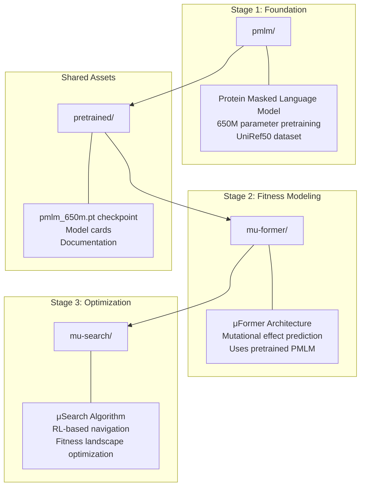
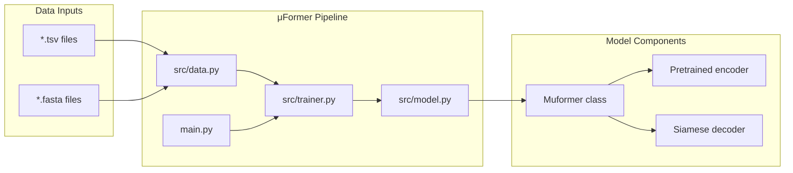
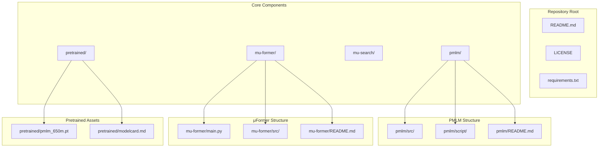

<!-- source: DeepWiki mcp.deepwiki.com · repo microsoft/Mu-Protein · page 1 Overview · fetched 2026-10-26 -->

# Overview

Relevant source files

The following files were used as context for generating this wiki page:

- [README.md](README.md)

This document provides an introduction to the μProtein framework, summarizing its architecture, core components, and purpose for accelerating protein engineering through machine learning. The framework consists of three main systems: PMLM (Protein Masked Language Model), μFormer (fitness landscape modeling), and μSearch (reinforcement learning optimization).

For detailed component documentation, see [System Architecture](#2). For installation and usage instructions, see [Getting Started](#3). For API documentation of specific classes and functions, see [API Reference](#5).

## Framework Purpose

μProtein is a general framework designed to accelerate protein engineering by integrating deep learning models for accurate mutational effect prediction with reinforcement learning algorithms for efficient navigation of protein fitness landscapes. The framework addresses the challenge of protein optimization by providing a systematic three-stage approach: foundation modeling, fitness prediction, and guided optimization.

**Sources:** [README.md:7-8]()

## Three-Stage Architecture

The μProtein framework implements a sequential three-stage pipeline where each component builds upon the previous stage's outputs:

**Sources:** [README.md:12-17]()

## Component Overview

### PMLM Pretraining System

The `pmlm/` directory contains the Protein Masked Language Model pretraining infrastructure. This system creates the foundational understanding of protein sequences through self-supervised learning on large-scale protein databases.

| Component | Purpose | Key Files |
|-----------|---------|-----------|
| Training Scripts | PMLM model pretraining | `pmlm/src/` |
| Data Processing | UniRef50 preprocessing | `pmlm/script/pretrain.sh` |
| Model Output | 650M parameter checkpoint | `pretrained/pmlm_650m.pt` |

### μFormer Fitness Modeling

The `mu-former/` directory implements the μFormer architecture for predicting mutational effects on protein fitness. This component transforms the pretrained language model into a specialized oracle for fitness landscape modeling.

### μSearch Optimization Engine

The `mu-search/` directory contains the reinforcement learning system for navigating fitness landscapes constructed by μFormer. This component performs the actual protein optimization by efficiently exploring the sequence space.

**Sources:** [README.md:14-16](), [README.md:19-23]()

## Repository Structure

The codebase follows a modular architecture with clear separation between the three main components:

**Sources:** [README.md:12-17]()

## Integration Workflow

The three components integrate through a data flow pipeline where outputs from each stage serve as inputs to the next:

| Stage | Input | Process | Output |
|-------|-------|---------|--------|
| PMLM | UniRef50 protein sequences | Self-supervised pretraining | `pmlm_650m.pt` checkpoint |
| μFormer | Pretrained model + mutation data | Fine-tuning for fitness prediction | Trained fitness oracle |
| μSearch | Fitness oracle + target protein | RL-based optimization | Optimized protein variants |

The framework design enables independent development and improvement of each component while maintaining clean interfaces through the checkpoint and model loading mechanisms.

**Sources:** [README.md:7-8](), [README.md:14-17]()

## Getting Started

To begin using the μProtein framework:

1. **Installation**: See [Installation & Setup](#3.1) for environment configuration and dependency management
2. **Pretrained Models**: See [Using Pretrained Models](#3.2) for loading the 650M parameter PMLM checkpoint  
3. **Training**: See [Training & Development](#4) for custom model training procedures
4. **API Usage**: See [API Reference](#5) for detailed class and function documentation

The framework requires PyTorch, Fairseq, and protein-specific libraries as detailed in the installation guide.

**Sources:** [README.md:19-23]()

---

