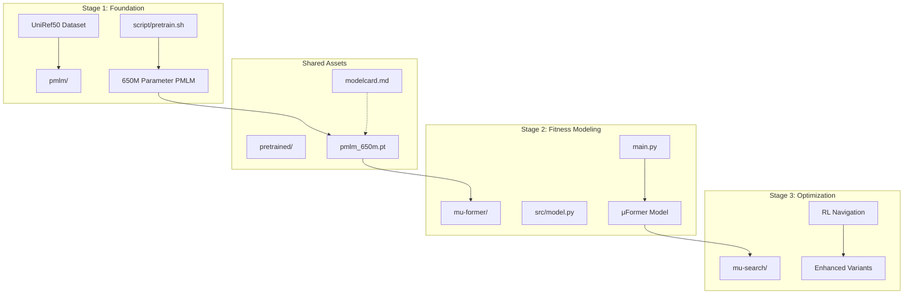
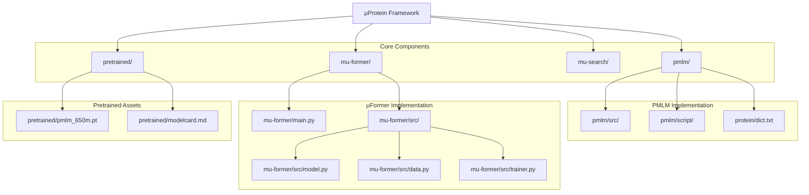
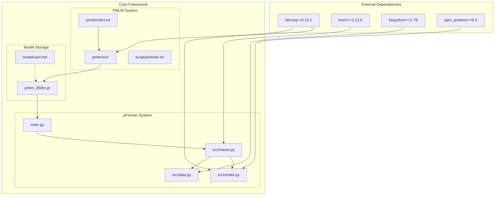

<!-- source: DeepWiki mcp.deepwiki.com · repo microsoft/Mu-Protein · page 2 System Architecture · fetched 2026-10-26 -->

# System Architecture

Relevant source files

The following files were used as context for generating this wiki page:

- [README.md](README.md)

This document provides a comprehensive overview of the μProtein framework's system architecture, including its three-stage pipeline design, component interactions, and implementation structure. The μProtein framework is designed to accelerate protein engineering through the integration of deep learning-based mutational effect prediction with reinforcement learning-based fitness landscape navigation.

For implementation details of specific components, see [PMLM Pretraining](#2.1), [μFormer Architecture](#2.2), and [μSearch System](#2.3). For setup and usage information, see [Getting Started](#3).

## Framework Overview

The μProtein framework implements a three-stage pipeline architecture where each stage builds upon the previous one to enable efficient protein engineering:

### Three-Stage Pipeline Architecture

**Sources:** [README.md:14-17]()

### Component Directory Structure

**Sources:** [README.md:12-17](), [README.md:19-23]()

## Data Flow and Processing Pipeline

The μProtein framework implements a sophisticated data flow that transforms raw protein sequences into optimized variants through multiple processing stages:

### End-to-End Data Flow

```mermaid
flowchart LR
    subgraph "Input Data"
        UNIREF["UniRef50 Sequences"]
        TARGET_PROTEINS["Target Protein Sequences"]
        MUTATION_DATA["Mutation TSV Files"]
    end
    
    subgraph "Stage 1: PMLM Training"
        FAIRSEQ_PREPROCESS["fairseq-preprocess"]
        PRETRAIN_SH["script/pretrain.sh"]
        PMLM_TRAINING["PMLM Training Loop"]
    end
    
    subgraph "Stage 2: μFormer Training"
        LOAD_PMLM["Load pmlm_650m.pt"]
        MUFORMER_MAIN["mu-former/main.py"]
        PAIRED_DATASET["PairedDataset"]
        SIAMESE_DECODER["Siamese Decoder"]
    end
    
    subgraph "Stage 3: μSearch Optimization"
        FITNESS_ORACLE["μFormer Fitness Oracle"]
        RL_NAVIGATOR["μSearch RL Navigator"]
        PROTEIN_VARIANTS["Optimized Variants"]
    end
    
    UNIREF --> FAIRSEQ_PREPROCESS
    FAIRSEQ_PREPROCESS --> PRETRAIN_SH
    PRETRAIN_SH --> PMLM_TRAINING
    PMLM_TRAINING --> LOAD_PMLM
    
    TARGET_PROTEINS --> PAIRED_DATASET
    MUTATION_DATA --> PAIRED_DATASET
    LOAD_PMLM --> MUFORMER_MAIN
    PAIRED_DATASET --> MUFORMER_MAIN
    MUFORMER_MAIN --> SIAMESE_DECODER
    
    SIAMESE_DECODER --> FITNESS_ORACLE
    FITNESS_ORACLE --> RL_NAVIGATOR
    RL_NAVIGATOR --> PROTEIN_VARIANTS
    
    RL_NAVIGATOR -.->|"queries"| FITNESS_ORACLE
```

**Sources:** [README.md:8](), [README.md:14-16]()

## Component Integration Architecture

The μProtein framework integrates multiple specialized components through well-defined interfaces:

| Component | Primary Function | Key Outputs | Integration Points |
|-----------|-----------------|-------------|-------------------|
| **PMLM** | Protein language modeling | `pmlm_650m.pt` checkpoint | Provides encoder for μFormer |
| **μFormer** | Mutational effect prediction | Fitness scores, trained model | Serves as oracle for μSearch |
| **μSearch** | RL-based optimization | Enhanced protein variants | Queries μFormer for fitness |
| **Pretrained** | Model distribution | Model files, documentation | Shared across all components |

### System Dependencies and Interfaces

**Sources:** [README.md:14-17]()

## Implementation Structure

The μProtein framework follows a modular design that separates concerns across three distinct but integrated systems:

### Core System Responsibilities

| System | Directory | Key Components | Responsibilities |
|--------|-----------|---------------|-----------------|
| **Protein Language Model** | `pmlm/` | Training scripts, model definitions | Pre-training on UniRef50, generating protein representations |
| **Mutational Effect Predictor** | `mu-former/` | `main.py`, `src/model.py`, `src/trainer.py` | Fine-tuning PMLM, predicting fitness effects |
| **Reinforcement Learning Navigator** | `mu-search/` | RL algorithms, search strategies | Navigating fitness landscapes, generating variants |
| **Pretrained Assets** | `pretrained/` | `pmlm_650m.pt`, `modelcard.md` | Distributing trained models, documentation |

### Framework Integration Points

The system architecture enables loose coupling between components while maintaining clear data flow:

1. **PMLM → μFormer**: The pretrained checkpoint `pmlm_650m.pt` serves as the encoder foundation for mutational effect prediction
2. **μFormer → μSearch**: The trained μFormer model provides a differentiable fitness oracle for reinforcement learning
3. **Shared Resources**: The `pretrained/` directory provides centralized model distribution with Git LFS support

This architecture allows each component to be developed, tested, and deployed independently while ensuring seamless integration for end-to-end protein engineering workflows.

**Sources:** [README.md:12-17](), [README.md:21-23]()

---

