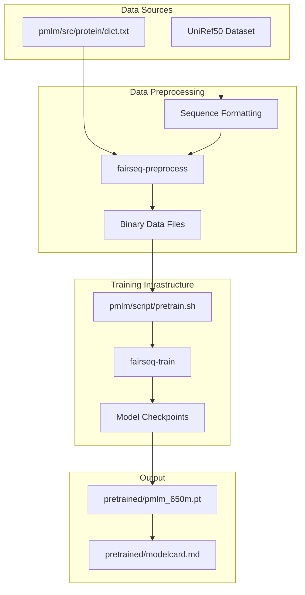
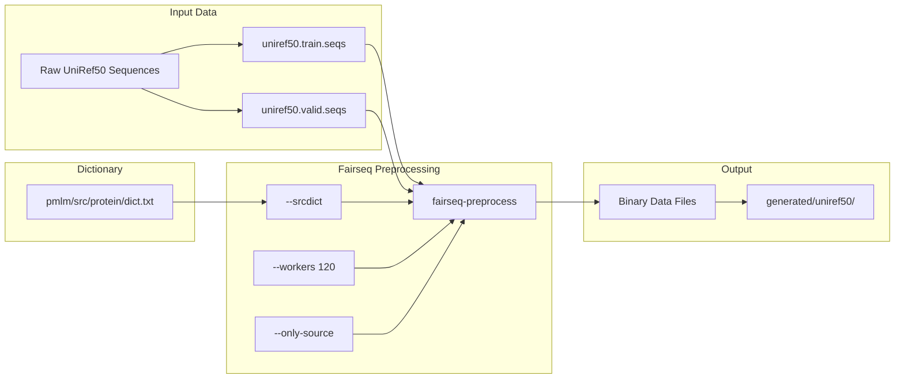
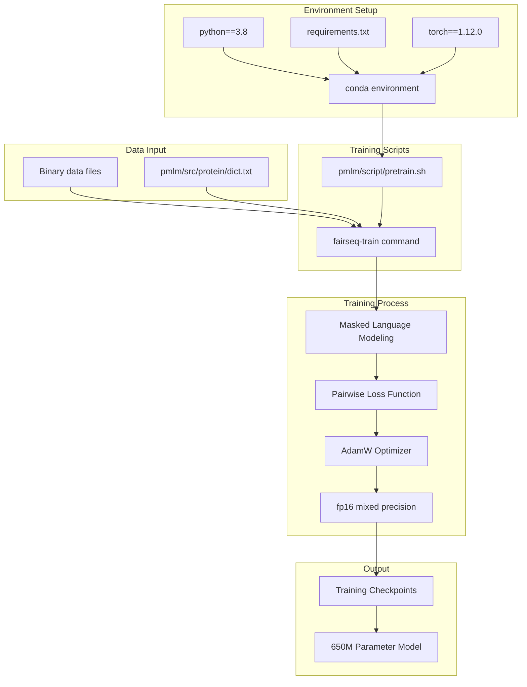
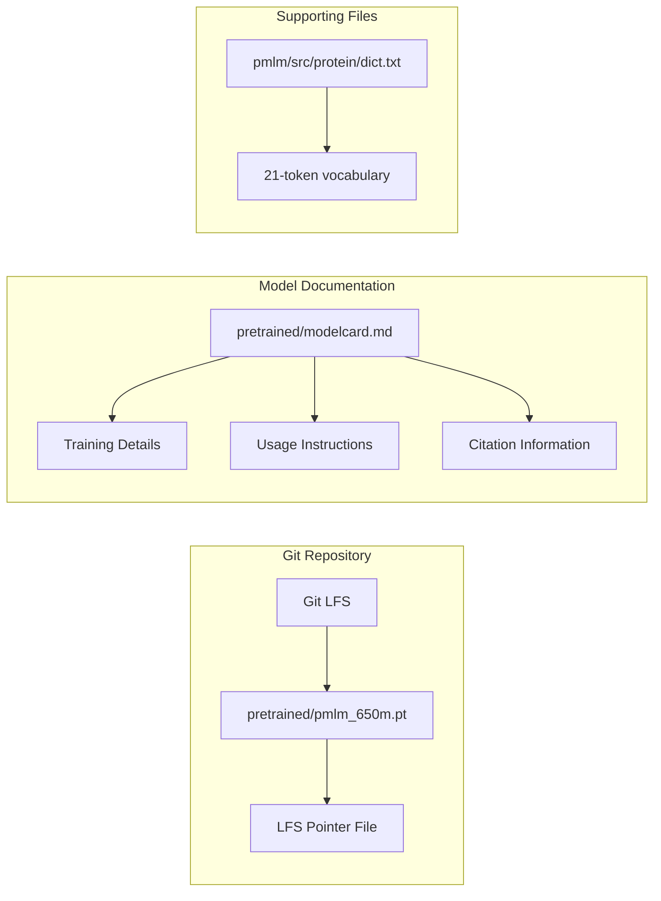

<!-- source: DeepWiki mcp.deepwiki.com · repo microsoft/Mu-Protein · page 2.1 PMLM Pretraining · fetched 2026-10-26 -->

# PMLM Pretraining

<details>
<summary>Relevant source files</summary>

The following files were used as context for generating this wiki page:

- [pmlm/README.md](pmlm/README.md)
- [pretrained/modelcard.md](pretrained/modelcard.md)
- [pretrained/pmlm_650m.pt](pretrained/pmlm_650m.pt)

</details>


This document covers the Protein Masked Language Model (PMLM) pretraining system, the foundational component of the μProtein framework. PMLM is a 650M parameter transformer encoder that learns contextual protein sequence representations through masked language modeling on UniRef50 data. This system generates the pretrained protein language model that serves as the backbone encoder for downstream tasks in μFormer and μSearch.

For information about using the pretrained PMLM model, see [Using Pretrained Models](#3.2). For training μFormer models that use PMLM as a backbone, see [μFormer Training](#4.1).

## Overview

PMLM implements a BERT-style masked language modeling objective specifically designed for protein sequences. The model learns to predict randomly masked amino acids from their context, building rich representations that capture protein sequence patterns and evolutionary relationships.

### PMLM Training Pipeline



Sources: [pretrained/modelcard.md:1-146](), [pmlm/README.md:1-59]()

## Architecture and Training Objective

PMLM uses a transformer encoder architecture with masked language modeling (MLM) objective inspired by BERT. The model processes protein sequences up to 512 amino acids in length and uses a fixed 21-token amino acid vocabulary.

### Model Specifications

| Component | Specification |
|-----------|--------------|
| Architecture | Transformer Encoder |
| Parameters | ~650M |
| Max Sequence Length | 512 amino acids |
| Vocabulary Size | 21 tokens (20 amino acids + special tokens) |
| Training Objective | Pairwise Masked Language Modeling |
| Precision | Mixed precision (fp16) |

### Training Configuration

| Parameter | Value |
|-----------|-------|
| Optimizer | AdamW |
| Learning Rate | 1e-5 |
| Batch Size | Dynamic |
| Training Data | UniRef50 (50% identity deduplicated) |
| Training Time | ~100 days on 48 V100 GPUs |
| Compute | ~7 million PFLOPs |

Sources: [pretrained/modelcard.md:64-76](), [pretrained/modelcard.md:113-115]()

## Data Preparation Pipeline

The PMLM pretraining process requires careful data preparation to convert raw protein sequences into the format expected by Fairseq.

### Data Format Requirements

Protein sequences must be formatted with specific conventions:
- Written in uppercase letters
- Spaces inserted between residues
- One sequence per line

Example format:
```
C A S E F W S A W F ... C A D
```

### Preprocessing Workflow



The preprocessing command structure follows this pattern:
```bash
fairseq-preprocess \
  --only-source \
  --trainpref <path_to_sequence_file>/uniref50.train.seqs \
  --validpref <path_to_sequence_file>/uniref50.valid.seqs \
  --destdir <path_to_output_folder>/generated/uniref50 \
  --workers 120 \
  --srcdict pmlm/src/protein/dict.txt
```

Sources: [pmlm/README.md:26-47]()

## Training Infrastructure

The pretraining process is orchestrated through a shell script that configures and launches the Fairseq training pipeline.

### Training Execution

The training process is initiated through the main pretraining script:

```bash
cd pmlm
bash script/pretrain.sh
```

### Infrastructure Requirements

| Resource | Specification |
|----------|--------------|
| GPUs | 48 x NVIDIA V100 (32GB) |
| Framework | PyTorch + Fairseq |
| Cloud Provider | Microsoft Azure |
| Region | East US |
| Total GPU Hours | ~100,000 |
| Carbon Footprint | ~1,100 kg CO2e |

### Training Components



Sources: [pmlm/README.md:6-21](), [pmlm/README.md:49-54](), [pretrained/modelcard.md:104-125]()

## Pretrained Model Details

The training process produces a 650M parameter model stored as a PyTorch checkpoint file managed through Git LFS due to its large size.

### Model Artifacts

| Artifact | Description | Size |
|----------|-------------|------|
| `pretrained/pmlm_650m.pt` | Main model checkpoint | 2.7GB |
| `pretrained/modelcard.md` | Model documentation | - |
| `pmlm/src/protein/dict.txt` | Amino acid vocabulary | - |

### Model File Structure



The model checkpoint contains:
- Complete transformer encoder weights
- Optimizer state
- Training metadata
- Vocabulary mappings

Sources: [pretrained/pmlm_650m.pt:1-4](), [pretrained/modelcard.md:1-146]()

## Environment Setup

Setting up the PMLM pretraining environment requires careful configuration of Python dependencies and PyTorch installation.

### Conda Environment Creation

```bash
conda create -n mutation python==3.8  
conda activate mutation  
pip install -r requirements.txt  
```

### PyTorch Installation

The PyTorch version depends on your GPU driver:

For CUDA 11.3:
```bash
pip install torch==1.12.0+cu113 torchvision==0.13.0+cu113 torchaudio==0.12.0 --extra-index-url https://download.pytorch.org/whl/cu113
```

For CPU-only:
```bash
pip install torch==1.12.0+cpu torchvision==0.13.0+cpu torchaudio==0.12.0 --extra-index-url https://download.pytorch.org/whl/cpu
```

### Key Dependencies

- **Fairseq 0.10.2**: Sequence modeling framework
- **PyTorch 1.12.0**: Deep learning framework  
- **Python 3.8**: Runtime environment
- **CUDA 11.3**: GPU acceleration (optional)

Sources: [pmlm/README.md:6-21]()

## Usage and Integration

The pretrained PMLM model serves as the foundation for downstream protein engineering tasks within the μProtein framework. The model provides contextual protein sequence embeddings that can be fine-tuned for specific tasks.

### Direct Applications

- Protein sequence embedding generation
- Transfer learning backbone for protein tasks
- Feature extraction for mutation effect prediction
- Input encoder for μFormer architecture

### Integration Points

The PMLM model integrates with other μProtein components through:
- **μFormer**: Uses PMLM as the pretrained encoder backbone
- **Fairseq ecosystem**: Leverages Fairseq model loading and inference
- **PyTorch models**: Standard PyTorch checkpoint format for compatibility

Sources: [pretrained/modelcard.md:24-37](), [pmlm/README.md:56-58]()

---

