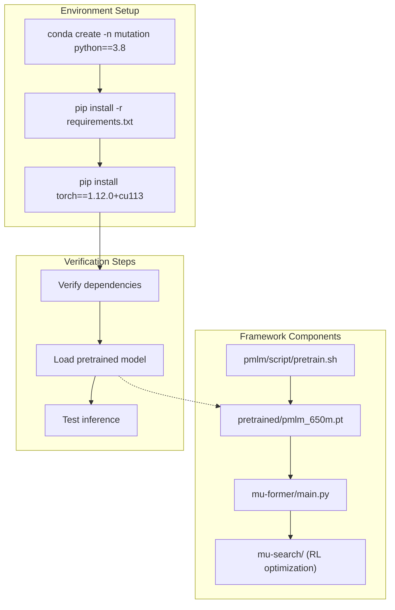
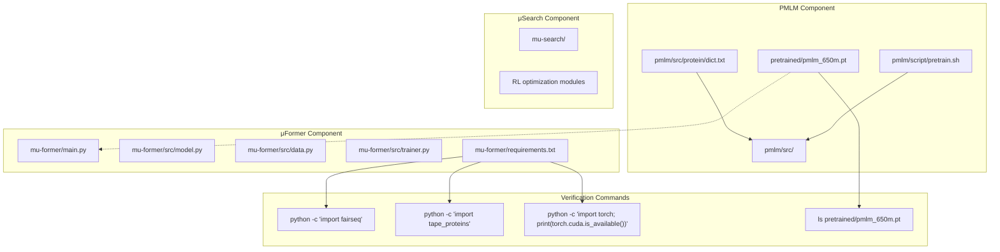
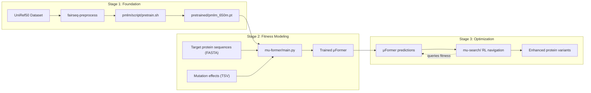

<!-- source: DeepWiki mcp.deepwiki.com · repo microsoft/Mu-Protein · page 3 Getting Started · fetched 2026-10-26 -->

# Getting Started

<details>
<summary>Relevant source files</summary>

The following files were used as context for generating this wiki page:

- [mu-former/requirements.txt](mu-former/requirements.txt)
- [pmlm/README.md](pmlm/README.md)

</details>


This page provides a comprehensive guide to getting started with the μProtein framework. It covers environment setup, dependency installation, and initial verification of the three main components: PMLM (Protein Masked Language Model), μFormer (mutational effect prediction), and μSearch (reinforcement learning optimization). 

For detailed installation instructions, see [Installation & Setup](#3.1). For working with pretrained models, see [Using Pretrained Models](#3.2). For comprehensive training guides, see [Training & Development](#4).

## Quick Start Overview

The μProtein framework follows a three-stage workflow where each component builds upon the previous one:



**Quick Start Workflow**

Sources: [pmlm/README.md:7-21](), [mu-former/requirements.txt:1-21]()

## Prerequisites and Dependencies

The μProtein framework requires Python 3.8 and specific versions of key dependencies to ensure compatibility across all components.

### Core Requirements

| Category | Package | Version | Purpose |
|----------|---------|---------|---------|
| ML Framework | `torch` | 1.12.0 | Core neural network training |
| Sequence Modeling | `fairseq` | 0.10.2 | Transformer architectures |
| Protein Tools | `tape_proteins` | ≥0.4 | Protein-specific utilities |
| Protein Models | `fair-esm` | latest | Evolutionary scale modeling |
| Scientific Computing | `numpy` | 1.22.0 | Numerical operations |
| Data Processing | `pandas` | latest | Data manipulation |
| Bioinformatics | `biopython` | ≥1.78 | Sequence analysis |

### Environment Setup Commands

```bash
# Create conda environment
conda create -n mutation python==3.8
conda activate mutation

# Install μFormer dependencies
pip install -r mu-former/requirements.txt

# Install PyTorch (GPU version)
pip install torch==1.12.0+cu113 torchvision==0.13.0+cu113 torchaudio==0.12.0 \
    --extra-index-url https://download.pytorch.org/whl/cu113

# Or CPU-only version
pip install torch==1.12.0+cpu torchvision==0.13.0+cpu torchaudio==0.12.0 \
    --extra-index-url https://download.pytorch.org/whl/cpu
```

Sources: [pmlm/README.md:8-21](), [mu-former/requirements.txt:1-21]()

## Component Architecture Verification

After installation, verify that all three main components are accessible and properly configured:



**Component Structure and Verification**

### Verification Checklist

| Component | File/Directory | Verification Command |
|-----------|----------------|---------------------|
| PMLM Source | `pmlm/src/` | `ls pmlm/src/protein/dict.txt` |
| Pretrained Model | `pretrained/pmlm_650m.pt` | `ls -lh pretrained/pmlm_650m.pt` |
| μFormer Main | `mu-former/main.py` | `python mu-former/main.py --help` |
| Fairseq Integration | `fairseq` | `python -c "import fairseq; print(fairseq.__version__)"` |
| GPU Support | `torch.cuda` | `python -c "import torch; print(torch.cuda.is_available())"` |

Sources: [pmlm/README.md:46-47](), [mu-former/requirements.txt:11]()

## Framework Workflow Overview

The μProtein framework operates through a sequential pipeline where each stage consumes outputs from the previous stage:



**μProtein Pipeline Workflow**

Sources: [pmlm/README.md:26-54]()

## Initial Setup Steps

### 1. Clone and Navigate Repository
```bash
git clone https://github.com/microsoft/Mu-Protein.git
cd Mu-Protein
```

### 2. Verify Large File Support
The pretrained models use Git LFS for storage management:
```bash
# Ensure Git LFS is installed
git lfs version
# Pull large files if needed
git lfs pull
```

### 3. Test Component Access
```bash
# Verify PMLM components
ls pmlm/src/protein/dict.txt
ls pmlm/script/pretrain.sh

# Verify μFormer components  
python -c "from mu-former.src.model import Muformer; print('μFormer available')"

# Check pretrained model availability
ls -lh pretrained/pmlm_650m.pt
```

### 4. Validate Environment
```bash
# Test core dependencies
python -c "import fairseq, tape_proteins, torch; print('Core dependencies OK')"

# Test protein-specific tools
python -c "import fair_esm, Bio; print('Protein tools OK')"

# Check GPU availability (if using CUDA)
python -c "import torch; print(f'CUDA available: {torch.cuda.is_available()}')"
```

Sources: [mu-former/requirements.txt:11,20](), [pmlm/README.md:46-47]()

## Next Steps

Once the environment is properly configured and verified:

1. **For using pretrained models**: See [Using Pretrained Models](#3.2) to learn how to load and perform inference with the 650M parameter PMLM model.

2. **For training μFormer models**: See [μFormer Training](#4.1) for detailed guidance on preparing training data and configuring training runs.

3. **For PMLM pretraining**: See [PMLM Training](#4.2) if you need to pretrain models from scratch on custom protein datasets.

4. **For understanding the architecture**: See [System Architecture](#2) for detailed explanations of how the components interact and the underlying model architectures.

The framework is designed with modular components, so you can start with any stage depending on your specific use case and available computational resources.

Sources: [pmlm/README.md:57-58]()

---

