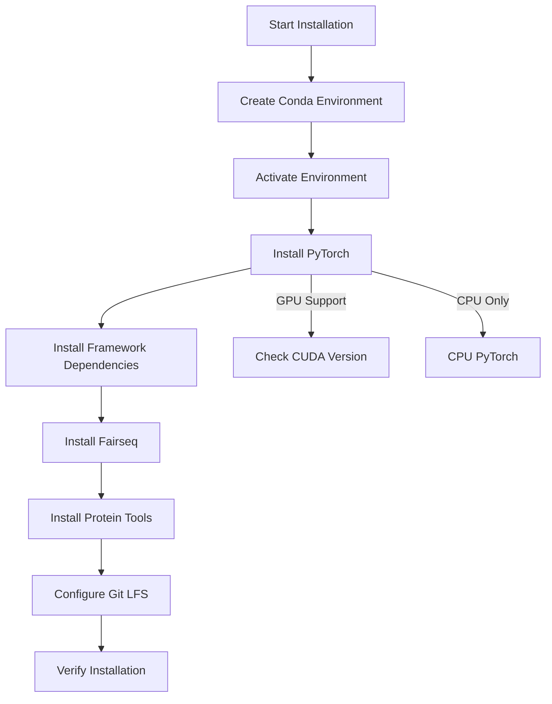
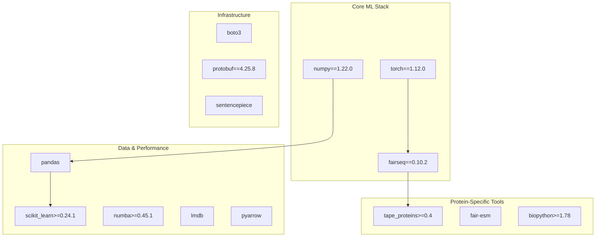
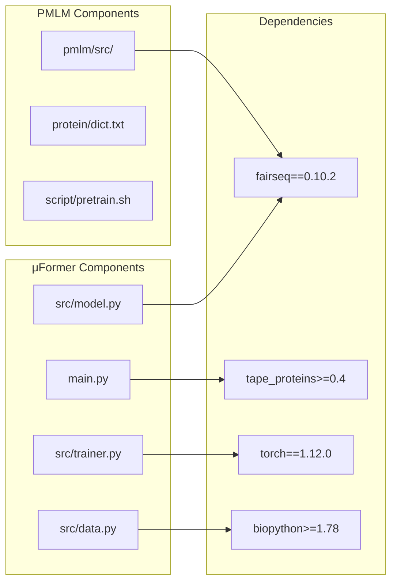

<!-- source: DeepWiki mcp.deepwiki.com · repo microsoft/Mu-Protein · page 3.1 Installation & Setup · fetched 2026-10-26 -->

# Installation & Setup

<details>
<summary>Relevant source files</summary>

The following files were used as context for generating this wiki page:

- [mu-former/requirements.txt](mu-former/requirements.txt)
- [pmlm/README.md](pmlm/README.md)

</details>


This page provides comprehensive installation instructions for the μProtein framework, covering environment setup, dependency management, and configuration for all three main components (PMLM, μFormer, μSearch). This guide focuses on getting a complete development and runtime environment configured.

For information about using pretrained models after installation, see [Using Pretrained Models](#3.2). For training-specific setup procedures, see [μFormer Training](#4.1) and [PMLM Training](#4.2).

## Prerequisites

The μProtein framework requires Python 3.8 and supports both CPU and GPU environments. GPU support is recommended for training and inference with large protein language models.

### System Requirements

| Component | Minimum | Recommended |
|-----------|---------|-------------|
| Python | 3.8 | 3.8 |
| Memory | 8GB RAM | 32GB+ RAM |
| Storage | 10GB | 50GB+ (with datasets) |
| GPU | None (CPU fallback) | CUDA-compatible GPU with 8GB+ VRAM |

Sources: [pmlm/README.md:9-21]()

## Environment Setup

### Installation Flow Overview



Sources: [pmlm/README.md:8-21]()

### Base Environment Creation

Create and activate a dedicated conda environment:

```bash
conda create -n mutation python==3.8
conda activate mutation
```

### PyTorch Installation

PyTorch installation depends on your hardware configuration. Choose the appropriate version:

**For CUDA 11.3 GPU support:**
```bash
pip install torch==1.12.0+cu113 torchvision==0.13.0+cu113 torchaudio==0.12.0 --extra-index-url https://download.pytorch.org/whl/cu113
```

**For CPU-only environments:**
```bash
pip install torch==1.12.0+cpu torchvision==0.13.0+cpu torchaudio==0.12.0 --extra-index-url https://download.pytorch.org/whl/cpu
```

Sources: [pmlm/README.md:14-21]()

## Core Dependencies

### Framework Dependencies Overview



Sources: [mu-former/requirements.txt:1-21]()

### Primary Dependencies Installation

Install the core framework dependencies:

```bash
pip install -r mu-former/requirements.txt
```

### Key Dependency Versions

| Package | Version | Purpose |
|---------|---------|---------|
| `fairseq` | 0.10.2 | Sequence modeling framework |
| `numpy` | 1.22.0 | Numerical computing |
| `tape_proteins` | ≥0.4 | Protein engineering toolkit |
| `biopython` | ≥1.78 | Biological sequence analysis |
| `scikit_learn` | ≥0.24.1 | Machine learning utilities |
| `protobuf` | 4.25.8 | Model serialization |

Sources: [mu-former/requirements.txt:1-21]()

## Component-Specific Setup

### Dependency Resolution and Component Mapping



Sources: [mu-former/requirements.txt:1-21](), [pmlm/README.md:1-59]()

### Fairseq Integration

The framework relies heavily on Fairseq for sequence modeling. Ensure proper installation:

```bash
pip install fairseq==0.10.2
```

Verify Fairseq preprocessing tools are available:
```bash
fairseq-preprocess --help
```

### Protein-Specific Tools

Install specialized protein analysis libraries:

```bash
pip install tape_proteins>=0.4
pip install fair-esm
pip install biopython>=1.78
```

These provide:
- `tape_proteins`: Pre-trained protein models and evaluation frameworks
- `fair-esm`: Evolutionary Scale Modeling for proteins  
- `biopython`: FASTA/PDB file parsing and sequence manipulation

Sources: [mu-former/requirements.txt:3](), [mu-former/requirements.txt:6](), [mu-former/requirements.txt:20]()

## Large File Management

### Git LFS Configuration

The repository uses Git LFS for managing large model files, particularly the pretrained PMLM models:

```bash
git lfs install
git lfs track "*.pt"
```

Model files managed by Git LFS include:
- `pretrained/pmlm_650m.pt` (2.7GB pretrained model)
- Other checkpoint files with `.pt` extension

Sources: Repository configuration (implied from model architecture)

## Installation Verification

### Component Verification Checklist

| Component | Verification Command | Expected Outcome |
|-----------|---------------------|------------------|
| Python Environment | `python --version` | Python 3.8.x |
| PyTorch | `python -c "import torch; print(torch.__version__)"` | 1.12.0+... |
| Fairseq | `python -c "import fairseq; print(fairseq.__version__)"` | 0.10.2 |
| TAPE Proteins | `python -c "import tape"` | No import errors |
| Biopython | `python -c "from Bio import SeqIO"` | No import errors |

### Environment Validation

Create a simple validation script to test core functionality:

```python
# Basic import verification
import torch
import fairseq
import numpy as np
import pandas as pd
from Bio import SeqIO
import tape

print("✓ All core dependencies imported successfully")
print(f"PyTorch version: {torch.__version__}")
print(f"CUDA available: {torch.cuda.is_available()}")
```

## Troubleshooting Common Issues

### Dependency Conflicts

If encountering version conflicts, particularly with `numpy` or `protobuf`:

1. Create a fresh conda environment
2. Install PyTorch first
3. Install requirements.txt dependencies
4. Check for conflicting package versions: `pip list | grep -E "(numpy|protobuf|torch)"`

### CUDA Compatibility

For GPU environments, ensure CUDA toolkit compatibility:
- Check CUDA version: `nvidia-smi`
- Match PyTorch CUDA version to system CUDA version
- Test GPU availability: `python -c "import torch; print(torch.cuda.is_available())"`

### Fairseq Installation Issues

If Fairseq installation fails:
1. Ensure Cython is installed first: `pip install cython`
2. Install build dependencies: `conda install gcc_linux-64 gxx_linux-64`
3. Retry Fairseq installation

Sources: [mu-former/requirements.txt:14](), [pmlm/README.md:8-21]()

---

