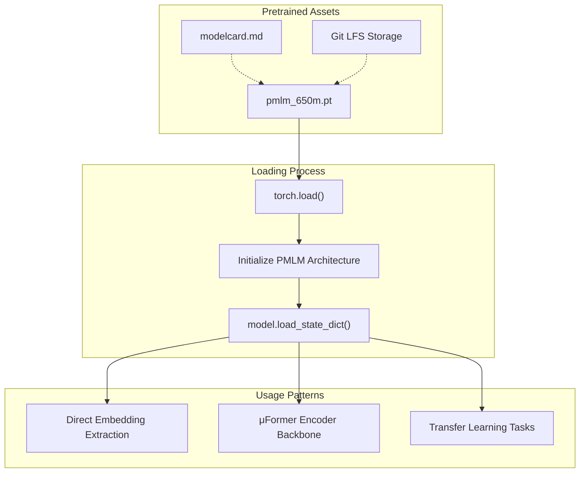
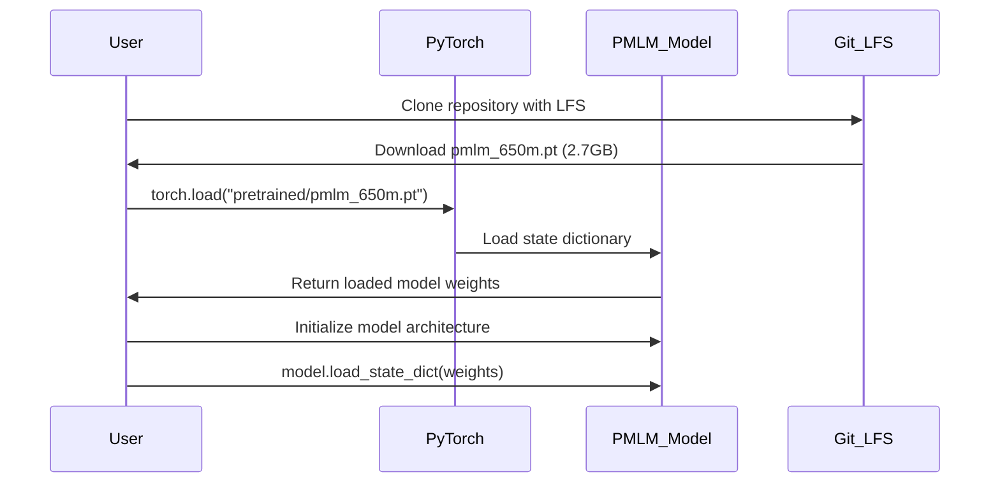
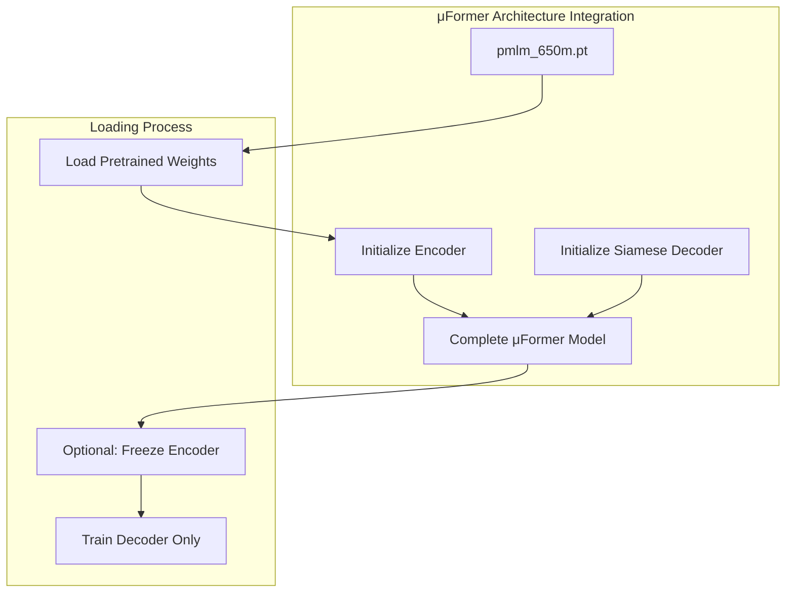
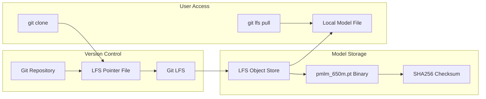

<!-- source: DeepWiki mcp.deepwiki.com · repo microsoft/Mu-Protein · page 3.2 Using Pretrained Models · fetched 2026-10-26 -->

# Using Pretrained Models

<details>
<summary>Relevant source files</summary>

The following files were used as context for generating this wiki page:

- [pretrained/modelcard.md](pretrained/modelcard.md)
- [pretrained/pmlm_650m.pt](pretrained/pmlm_650m.pt)

</details>


This document provides a comprehensive guide to loading and using the pretrained PMLM (Pairwise Masked Language Model) in the μProtein framework. The pretrained models serve as the foundation for downstream protein engineering tasks and can be used for direct sequence embedding extraction or as the backbone for μFormer training.

For information about training your own PMLM models from scratch, see [PMLM Training](#4.2). For details about fine-tuning μFormer models using these pretrained weights, see [μFormer Training](#4.1).

## Pretrained Model Overview

The μProtein framework provides a 650M parameter PMLM model pretrained on the UniRef50 dataset. This model serves as the foundation encoder for all downstream protein engineering tasks in the framework.

### Model Architecture and Loading Flow



Sources: [pretrained/modelcard.md:1-146](), [pretrained/pmlm_650m.pt:1-4]()

## Model Card and Specifications

The pretrained PMLM model is documented through a comprehensive model card that provides essential information for users.

### Model Details

| **Attribute** | **Value** |
|---------------|-----------|
| **Model Type** | Protein sequence encoder |
| **Parameters** | ~650M |
| **Architecture** | Transformer encoder with MLM objective |
| **Training Data** | UniRef50 (50% identity deduplication) |
| **Sequence Length** | Up to 512 amino acids |
| **Training Time** | ~100 days on 48 V100 GPUs |
| **Model Size** | 2.7GB |

### Training Configuration

| **Hyperparameter** | **Value** |
|-------------------|-----------|
| **Optimizer** | AdamW |
| **Learning Rate** | 1e-5 |
| **Precision** | Mixed precision (fp16) |
| **Batch Size** | Dynamic |
| **Vocabulary** | 21-token amino acid vocabulary |

Sources: [pretrained/modelcard.md:64-76](), [pretrained/modelcard.md:113-115]()

## Model Loading and Initialization

### Direct Model Loading

The pretrained PMLM model can be loaded directly using PyTorch's standard loading mechanisms. The model file is stored using Git LFS due to its 2.7GB size.



Sources: [pretrained/pmlm_650m.pt:1-4]()

### Integration with μFormer

The pretrained PMLM serves as the encoder backbone for μFormer models in the mutation effect prediction pipeline.



Sources: [pretrained/modelcard.md:30-32]()

## Use Cases and Applications

### Direct Use Cases

The pretrained PMLM model supports several direct use cases as outlined in the model card:

| **Use Case** | **Description** | **Implementation** |
|--------------|-----------------|-------------------|
| **Sequence Embedding** | Extract contextual protein representations | Load model, pass sequences through encoder |
| **Transfer Learning** | Fine-tune for classification tasks | Use as backbone, add task-specific head |
| **Mutation Analysis** | Analyze sequence variants | Compare embeddings of wild-type vs mutant |

### Downstream Applications

| **Application** | **Description** | **Framework Component** |
|-----------------|-----------------|------------------------|
| **Fitness Prediction** | Predict mutation effects on protein fitness | μFormer backbone encoder |
| **Protein Optimization** | Search for improved protein variants | Fitness oracle for μSearch |
| **Function Prediction** | Classify protein functions | Transfer learning target |

Sources: [pretrained/modelcard.md:26-32]()

### Out-of-Scope Use Cases

The model card explicitly identifies limitations:

- **Structure Prediction**: PMLM is not designed for protein structure prediction tasks
- **Sequence Generation**: Not suitable for generating novel sequences without additional search mechanisms
- **Synthetic Proteins**: May underperform on engineered proteins that differ significantly from natural proteins

Sources: [pretrained/modelcard.md:34-37](), [pretrained/modelcard.md:40-41]()

## Model Performance and Validation

### Evaluation Metrics

The pretrained PMLM model is evaluated using several key metrics:

| **Metric** | **Purpose** | **Application** |
|------------|-------------|----------------|
| **Perplexity** | Language modeling performance | Pretraining validation |
| **Transfer Performance** | Downstream task effectiveness | μFormer training |
| **Zero-shot Fitness** | Mutation effect prediction | Direct application |

### Performance Characteristics

- **Sequence Length Sensitivity**: Performance varies with sequence length up to 512 amino acids
- **Domain Representation**: Best performance on protein families well-represented in UniRef50
- **Transfer Learning**: Enables significant improvements over baseline models in downstream tasks

Sources: [pretrained/modelcard.md:78-101]()

## Technical Infrastructure

### Storage and Distribution



### File Specifications

- **File Path**: `pretrained/pmlm_650m.pt`
- **File Size**: 2,723,505,310 bytes (2.7GB)
- **SHA256**: `41ec3830624151782d20d41c033bd22a4a268a065ccb2dc8276ecf5d7cd62caa`
- **Storage**: Git LFS (Large File Storage)

Sources: [pretrained/pmlm_650m.pt:1-4]()

## Environmental and Computational Context

### Training Infrastructure

The model card provides transparency about the computational resources and environmental impact:

| **Resource** | **Specification** |
|--------------|------------------|
| **Hardware** | 48 × NVIDIA V100 (32GB) |
| **Cloud Provider** | Microsoft Azure |
| **Compute Region** | East US |
| **Training Hours** | ~100,000 GPU hours |
| **Compute** | ~7 million PFLOPs |
| **Carbon Footprint** | ~1,100 kg CO2e |

Sources: [pretrained/modelcard.md:104-109](), [pretrained/modelcard.md:119-125]()

## Citation and Attribution

When using the pretrained PMLM model, proper citation should follow the format provided in the model card:

```bibtex
@article{he2023muprotein,
  title={Accelerating Protein Engineering with Fitness Landscape Modeling and Reinforcement Learning},
  author={Sun, Haoran and He, Liang and Deng, Pan and Liu, Guoqing and others},
  journal={bioRxiv},
  year={2023},
}
```

### Contact Information

For technical questions about the pretrained models, contact:
- Liang He (liang.he@microsoft.com)
- Pan Deng (pan.deng@microsoft.com) 
- Guoqing Liu (guoqingliu@microsoft.com)

Sources: [pretrained/modelcard.md:129-144]()

---

