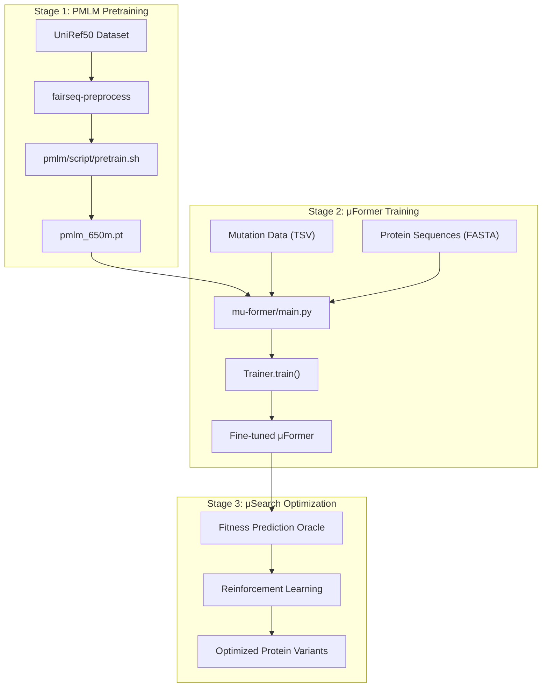
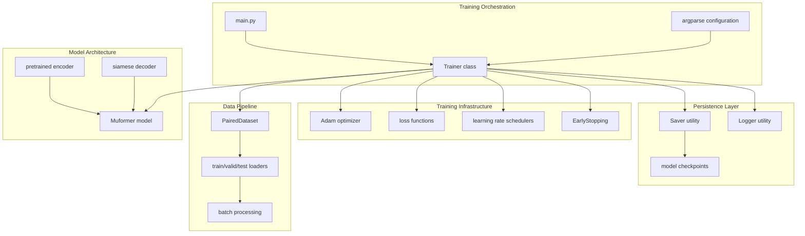
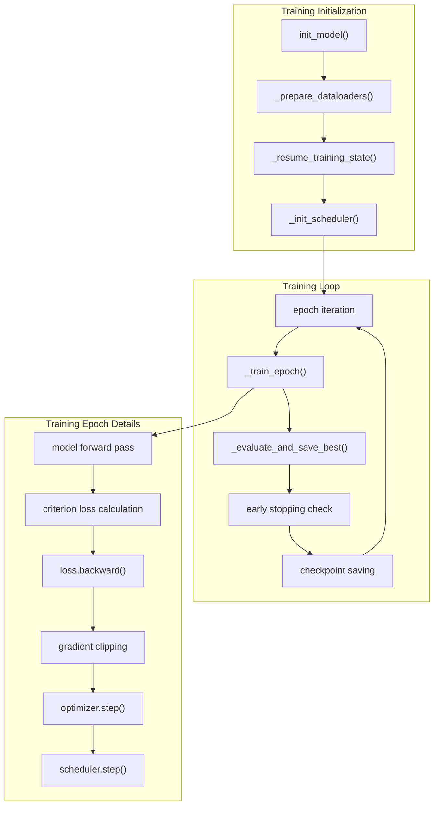
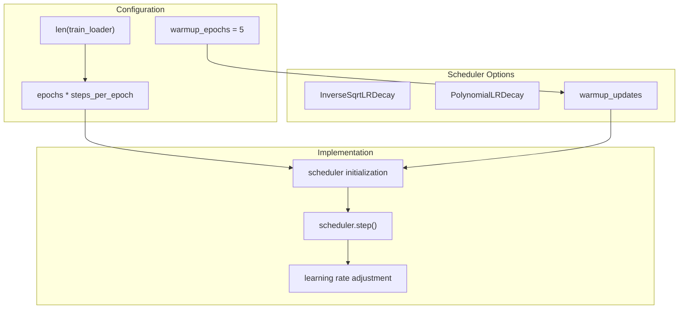
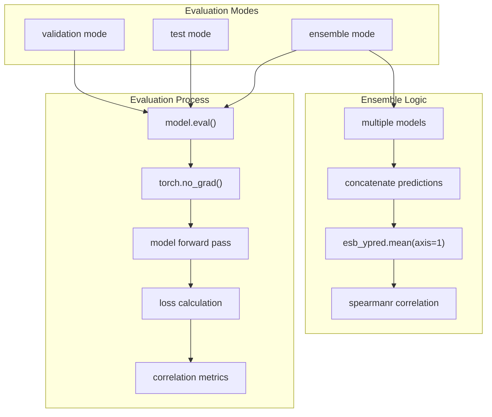

<!-- source: DeepWiki mcp.deepwiki.com · repo microsoft/Mu-Protein · page 4 Training & Development · fetched 2026-10-26 -->

# Training & Development

Relevant source files

The following files were used as context for generating this wiki page:

- [mu-former/main.py](mu-former/main.py)
- [mu-former/src/trainer.py](mu-former/src/trainer.py)
- [pmlm/README.md](pmlm/README.md)

This document provides a comprehensive guide for training models and developing with the μProtein framework. It covers the overall training pipeline, development workflow, and key components involved in training both PMLM and μFormer models.

For detailed step-by-step training procedures, see [μFormer Training](#4.1) and [PMLM Training](#4.2). For API reference of training utilities, see [Training Utilities](#5.3).

## Training Pipeline Overview

The μProtein framework implements a three-stage training pipeline where each stage builds upon the previous one:

**Sources:** [pmlm/README.md:1-59](), [mu-former/main.py:1-142]()

## Development Workflow

The typical development workflow involves setting up the environment, preparing data, and executing training scripts:

```mermaid
flowchart LR
    subgraph "Environment Setup"
        CONDA["conda create -n mutation python==3.8"]
        REQUIREMENTS["pip install -r requirements.txt"]
        PYTORCH["pip install torch==1.12.0+cu113"]
    end
    
    subgraph "Data Preparation"
        FORMAT["Format sequences with spaces"]
        FAIRSEQ_PREP["fairseq-preprocess"]
        BINARY_DATA["Binary format data"]
    end
    
    subgraph "Training Execution"
        PMLM_TRAIN["bash pmlm/script/pretrain.sh"]
        MUFORMER_TRAIN["python mu-former/main.py"]
        CHECKPOINTS["Model checkpoints"]
    end
    
    CONDA --> REQUIREMENTS
    REQUIREMENTS --> PYTORCH
    PYTORCH --> FORMAT
    FORMAT --> FAIRSEQ_PREP
    FAIRSEQ_PREP --> BINARY_DATA
    BINARY_DATA --> PMLM_TRAIN
    PMLM_TRAIN --> MUFORMER_TRAIN
    MUFORMER_TRAIN --> CHECKPOINTS
```

**Sources:** [pmlm/README.md:7-21](), [pmlm/README.md:25-47]()

## Core Training Components

The training system is built around several key components that handle different aspects of the training process:

**Sources:** [mu-former/main.py:16-42](), [mu-former/src/trainer.py:80-216]()

### Training Configuration

The training system uses extensive configuration through command-line arguments:

| Parameter Category | Key Arguments | Purpose |
|-------------------|---------------|---------|
| Data | `--train`, `--valid`, `--test`, `--fasta` | Input data files |
| Model | `--hidden-size`, `--dropout`, `--encoder-name` | Model architecture |
| Training | `--epochs`, `--batch-size`, `--lr`, `--patience` | Training hyperparameters |
| Infrastructure | `--num-workers`, `--local-rank`, `--output-dir` | System configuration |

**Sources:** [mu-former/main.py:73-135]()

## Training Loop Implementation

The core training logic is implemented in the `Trainer` class with a sophisticated training loop:

**Sources:** [mu-former/src/trainer.py:389-430](), [mu-former/src/trainer.py:467-499]()

### Distributed Training Support

The framework supports distributed training across multiple GPUs:

```mermaid
graph LR
    subgraph "Distributed Setup"
        ENV_VARS["RANK, WORLD_SIZE, LOCAL_RANK"]
        INIT_PROCESS["torch.distributed.init_process_group"]
        BARRIER["torch.distributed.barrier"]
    end
    
    subgraph "Model Wrapping"
        DDP["DistributedDataParallel"]
        DEVICE_MAPPING["device_ids=[local_rank]"]
        UNUSED_PARAMS["find_unused_parameters=True"]
    end
    
    subgraph "Data Distribution"
        SAMPLER["DistributedSampler"]
        SET_EPOCH["sampler.set_epoch()"]
        SYNC_BATCHES["synchronized batching"]
    end
    
    ENV_VARS --> INIT_PROCESS
    INIT_PROCESS --> BARRIER
    BARRIER --> DDP
    DDP --> DEVICE_MAPPING
    DEVICE_MAPPING --> UNUSED_PARAMS
    UNUSED_PARAMS --> SAMPLER
    SAMPLER --> SET_EPOCH
    SET_EPOCH --> SYNC_BATCHES
```

**Sources:** [mu-former/src/trainer.py:40-63](), [mu-former/src/trainer.py:147-151](), [mu-former/src/trainer.py:236-238]()

## Checkpoint Management

The framework provides comprehensive checkpoint management for model persistence and resumption:

| Operation | Method | Purpose |
|-----------|--------|---------|
| Save | `save_checkpoint()` | Save model and optimizer state |
| Load | `load_checkpoint()` | Load complete checkpoint |
| Load (stripped) | `load_checkpoint_strip()` | Load with module prefix handling |
| Resume | `_resume_training_state()` | Resume from specific epoch |

The checkpoint structure includes:
- `model_state_dict`: Model parameters
- `optimizer_state_dict`: Optimizer state  
- `log_info`: Training metadata (epoch, best score, etc.)

**Sources:** [mu-former/src/trainer.py:285-355](), [mu-former/src/trainer.py:384-387](), [mu-former/src/trainer.py:440-456]()

## Learning Rate Scheduling

The framework implements sophisticated learning rate scheduling:

**Sources:** [mu-former/src/trainer.py:462-465](), [mu-former/src/trainer.py:397-398]()

## Model Evaluation and Testing

The evaluation system supports multiple modes and ensemble prediction:

**Sources:** [mu-former/src/trainer.py:545-600](), [mu-former/src/trainer.py:584-588]()

---

