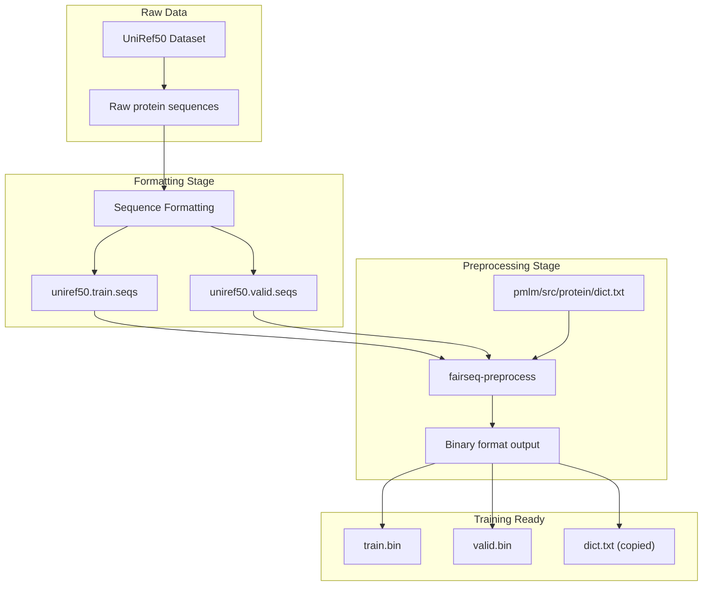
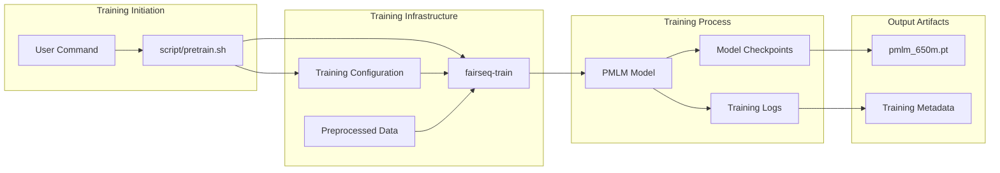
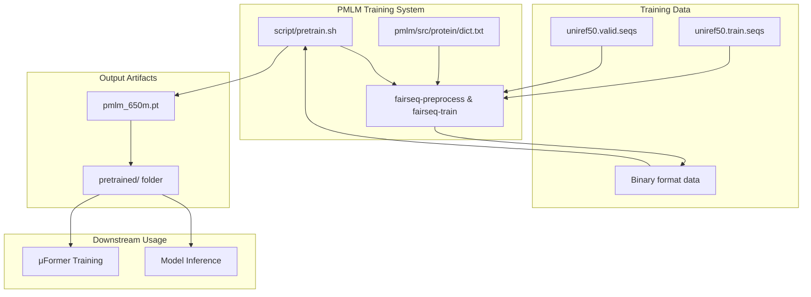

<!-- source: DeepWiki mcp.deepwiki.com · repo microsoft/Mu-Protein · page 4.2 PMLM Training · fetched 2026-10-26 -->

# PMLM Training

<details>
<summary>Relevant source files</summary>

The following files were used as context for generating this wiki page:

- [pmlm/README.md](pmlm/README.md)

</details>


This document covers the practical aspects of training Protein Masked Language Models (PMLM) from scratch, including environment setup, data preprocessing, and training procedures. This page focuses on the implementation details for pretraining new PMLM models.

For architectural details about the PMLM system, see [PMLM Pretraining](#2.1). For using existing pretrained models, see [Using Pretrained Models](#3.2).

## Environment Setup

The PMLM training environment requires Python 3.8 with specific PyTorch and Fairseq dependencies. The environment setup follows a conda-based approach with GPU support.

### Dependencies and Installation

| Component | Version | Purpose |
|-----------|---------|---------|
| Python | 3.8 | Base runtime environment |
| PyTorch | 1.12.0 | Deep learning framework |
| Fairseq | - | Sequence modeling toolkit |
| CUDA | 11.3 (optional) | GPU acceleration |

The installation process involves creating a conda environment and installing PyTorch with appropriate CUDA support:

```bash
conda create -n mutation python==3.8
conda activate mutation
pip install -r requirements.txt
```

For GPU training, install PyTorch with CUDA support, while CPU-only training uses a different PyTorch variant.

Sources: [pmlm/README.md:5-22]()

## Data Preprocessing Pipeline

The PMLM training process requires protein sequence data to be preprocessed into Fairseq binary format. This involves sequence formatting and vocabulary mapping.

### PMLM Data Processing Workflow



### Sequence Formatting Requirements

Protein sequences must be formatted with specific requirements before preprocessing:

- **Uppercase letters only**: All amino acid residues in uppercase
- **Space-separated residues**: Spaces inserted between each residue
- **One sequence per line**: Each protein sequence on a separate line

Example formatted sequence:
```
C A S E F W S A W F ... C A D
```

### Fairseq Preprocessing Command

The `fairseq-preprocess` command converts formatted text files into binary format suitable for training:

```bash
fairseq-preprocess \
  --only-source \
  --trainpref <path_to_sequence_file>/uniref50.train.seqs \
  --validpref <path_to_sequence_file>/uniref50.valid.seqs \
  --destdir <path_to_output_folder>/generated/uniref50 \
  --workers 120 \
  --srcdict pmlm/src/protein/dict.txt
```

The command uses the protein dictionary at `pmlm/src/protein/dict.txt` to map amino acid tokens to indices.

Sources: [pmlm/README.md:25-47]()

## Training Process

The PMLM training process is orchestrated through a shell script that configures and launches the Fairseq training pipeline.

### Training Execution Workflow



### Training Script Execution

To initiate PMLM pretraining, execute the training script from the PMLM directory:

```bash
cd pmlm
bash script/pretrain.sh
```

The `script/pretrain.sh` script contains the complete training configuration and launches the Fairseq training process with appropriate parameters for the 650M parameter PMLM model.

### Training Configuration

The training script configures several key aspects of the PMLM training process:

| Configuration Area | Description |
|-------------------|-------------|
| Model Architecture | 650M parameter transformer architecture |
| Data Loading | Binary format data from preprocessing |
| Optimization | Learning rate, batch size, and scheduler settings |
| Checkpointing | Model save intervals and checkpoint management |
| Hardware | GPU/CPU utilization and distributed training |

Sources: [pmlm/README.md:49-54]()

## Output and Model Artifacts

The PMLM training process generates a pretrained model that serves as the foundation for the μProtein framework's subsequent stages.

### Training Outputs

The training process produces several artifacts:

- **Pretrained Model**: A 650M parameter model saved as `pmlm_650m.pt`
- **Training Checkpoints**: Intermediate model states during training
- **Training Logs**: Performance metrics and training progress
- **Model Metadata**: Configuration and training statistics

### Pretrained Model Location

The completed pretrained model is made available in the `pretrained` folder for use by downstream components like μFormer.

Sources: [pmlm/README.md:56-58]()

## Integration with μProtein Framework

The PMLM training component serves as the foundation stage of the μProtein framework, providing the base protein language model that powers subsequent fitness modeling and optimization stages.

### PMLM Training Integration Points



The trained PMLM model provides protein sequence representations that enable effective fitness prediction in μFormer and subsequent protein optimization in μSearch.

Sources: [pmlm/README.md:1-58]()

---

