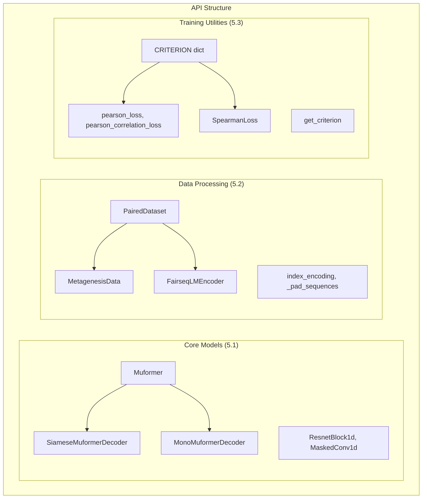
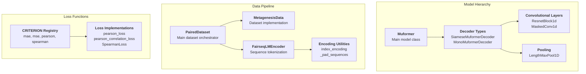
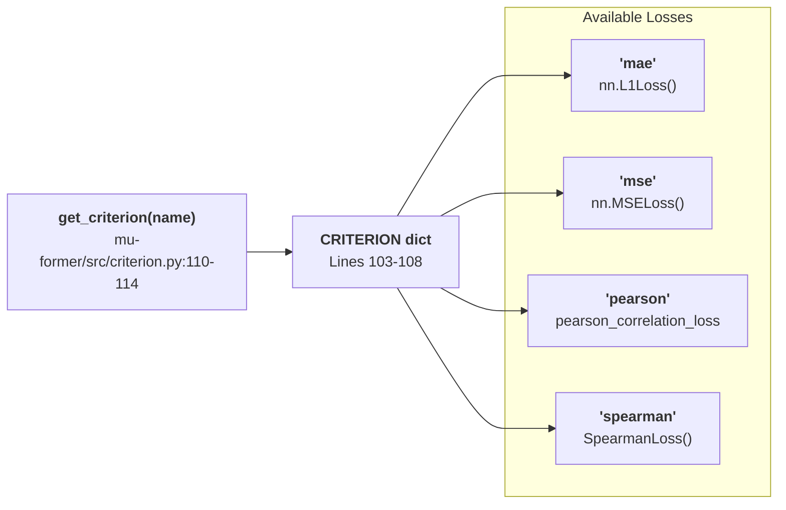

<!-- source: DeepWiki mcp.deepwiki.com · repo microsoft/Mu-Protein · page 5 API Reference · fetched 2026-10-26 -->

# API Reference

Relevant source files

The following files were used as context for generating this wiki page:

- [mu-former/src/criterion.py](mu-former/src/criterion.py)
- [mu-former/src/data.py](mu-former/src/data.py)
- [mu-former/src/model.py](mu-former/src/model.py)

This document provides comprehensive API documentation for the μProtein framework's key classes, functions, and modules. It covers the core interfaces for model architectures, data processing pipelines, and training utilities used across the three-stage μProtein system.

For detailed training procedures and workflows, see [Training & Development](#4). For configuration and setup of individual components, see [Configuration & Setup](#6).

## Overview

The μProtein API is organized into three primary modules that correspond to the framework's architectural components:

Sources: [mu-former/src/model.py:225-315](), [mu-former/src/data.py:139-453](), [mu-former/src/criterion.py:103-115]()

## Module Architecture

The API follows a hierarchical structure where higher-level classes compose lower-level utilities:

Sources: [mu-former/src/model.py:1-315](), [mu-former/src/data.py:1-453](), [mu-former/src/criterion.py:1-115]()

## Key Interface Patterns

### Model Construction Pattern

The framework uses a consistent pattern for model initialization:

| Component | Class | Key Parameters | Purpose |
|-----------|-------|----------------|---------|
| Main Model | `Muformer` | `encoder`, `decoder_name`, `freeze_lm` | Orchestrates encoder-decoder architecture |
| Decoders | `SiameseMuformerDecoder`, `MonoMuformerDecoder` | `encoder_dim`, `hidden_size`, `activate` | Processes encoded sequences |
| Convolution | `ResnetBlock1d`, `MaskedConv1d` | `kernel_size`, `hidden_size` | Feature extraction from sequences |

Sources: [mu-former/src/model.py:225-271](), [mu-former/src/model.py:93-159](), [mu-former/src/model.py:50-82]()

### Data Processing Pattern

The data pipeline follows a builder pattern with progressive refinement:

| Stage | Class/Function | Input | Output | Purpose |
|-------|----------------|-------|--------|---------|
| Dataset Setup | `PairedDataset.__init__` | TSV files, FASTA | Dataset object | Configure data sources |
| Sequence Encoding | `FairseqLMEncoder.encode` | Raw sequences | Tokenized tensors | Convert text to model input |
| Data Loading | `PairedDataset.get_dataloader` | Mode, batch_size | DataLoader | Batch preparation |
| Mutation Processing | `MetagenesisData.__getitem__` | Index | Sample pairs | Generate training pairs |

Sources: [mu-former/src/data.py:139-211](), [mu-former/src/data.py:48-84](), [mu-former/src/data.py:406-452](), [mu-former/src/data.py:116-137]()

### Loss Function Registry

The criterion system uses a dictionary registry pattern:

Sources: [mu-former/src/criterion.py:103-115]()

## Detailed API Documentation

For comprehensive documentation of specific API components:

- **[Core Models](#5.1)** - `Muformer`, decoder architectures, and neural network components
- **[Data Processing](#5.2)** - `PairedDataset`, `MetagenesisData`, and sequence encoding utilities  
- **[Training Utilities](#5.3)** - Loss functions, criterions, and training infrastructure

Each sub-section provides detailed parameter specifications, return types, and usage examples for the respective API components.

---

