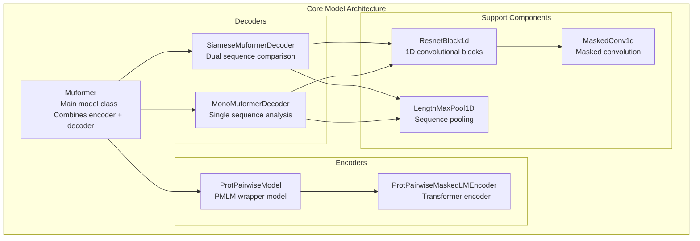
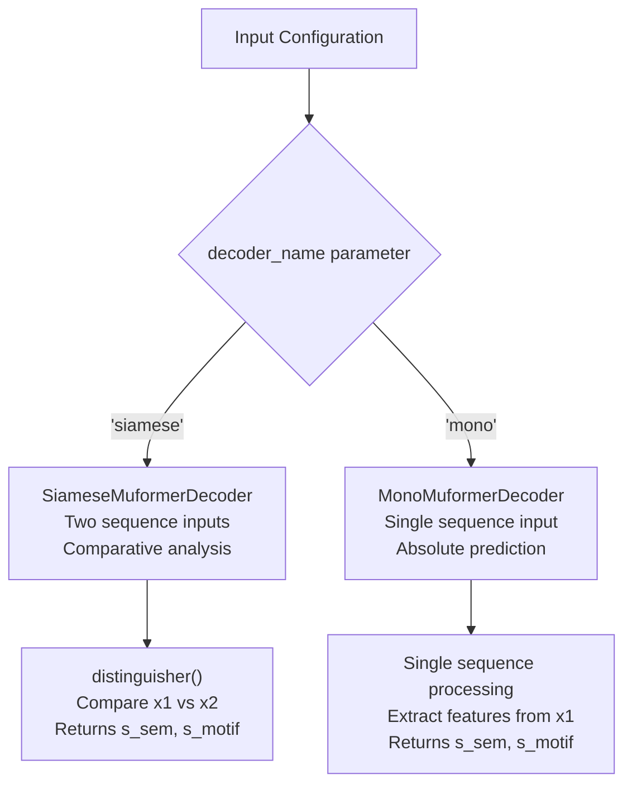
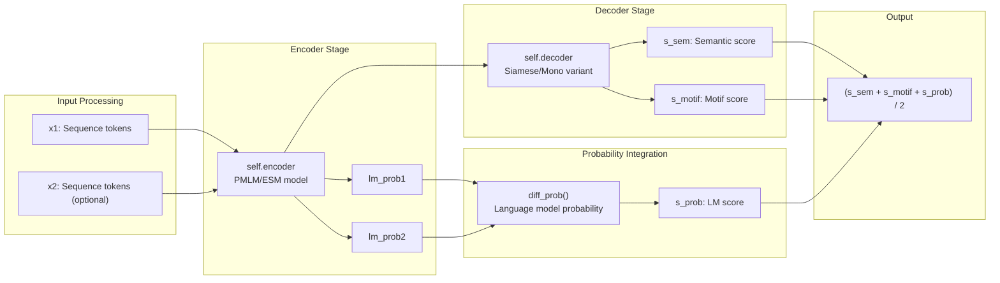

<!-- source: DeepWiki mcp.deepwiki.com · repo microsoft/Mu-Protein · page 5.1 Core Models · fetched 2026-10-26 -->

# Core Models

<details>
<summary>Relevant source files</summary>

The following files were used as context for generating this wiki page:

- [mu-former/src/model.py](mu-former/src/model.py)
- [mu-former/src/protein/models/pmlm.py](mu-former/src/protein/models/pmlm.py)

</details>


This document provides comprehensive API documentation for the core model components in the μProtein framework. It covers the main model architectures including the Muformer model, PMLM encoders, decoder variants, and supporting neural network components.

For information about data processing components, see [Data Processing](#5.2). For training infrastructure and utilities, see [Training Utilities](#5.3).

## Architecture Overview

The μProtein framework implements a two-stage architecture where pretrained protein language models serve as encoders for downstream mutation effect prediction tasks.

### Core Model Hierarchy



Sources: [mu-former/src/model.py:1-315](), [mu-former/src/protein/models/pmlm.py:1-241]()

## PMLM Encoder Models

The Protein Masked Language Model (PMLM) serves as the foundation encoder for all downstream tasks. It is built on the fairseq framework and provides contextual protein sequence representations.

### ProtPairwiseModel Class

| Component | Type | Description |
|-----------|------|-------------|
| `encoder` | `ProtPairwiseMaskedLMEncoder` | Main transformer encoder |
| `classification_heads` | `nn.ModuleDict` | Optional task-specific heads |
| `vocab_size` | `int` | Protein vocabulary size |

**Key Methods:**

- `forward(src_tokens, segment_labels=None, **kwargs)` - Main forward pass
- `prob(x)` - Generate probability distributions over vocabulary
- `build_model(cls, args, task)` - Factory method for model construction

```python
# Example usage pattern from codebase
model = ProtPairwiseModel(args, encoder)
x, extra = model.forward(src_tokens)
probabilities = model.prob(x)
```

Sources: [mu-former/src/protein/models/pmlm.py:24-93]()

### ProtPairwiseMaskedLMEncoder Class

The core transformer encoder that extends fairseq's `MaskedLMEncoder` with protein-specific functionality.

| Component | Type | Description |
|-----------|------|-------------|
| `sentence_encoder` | `TransformerSentenceEncoder` | Core transformer layers |
| `masked_lm_pooler` | `nn.Linear` | Pooling layer for masked positions |
| `lm_head_transform_weight` | `nn.Linear` | Language model head transformation |
| `pair_out` | `nn.Linear` | Pairwise interaction output layer |

**Key Methods:**

- `forward(src_tokens, pairwise=False)` - Encode protein sequences
- `prob(x)` - Compute token probabilities
- `pairwise_feature(x)` - Generate pairwise position features
- `freeze_lm_head()` - Freeze language model head parameters

Sources: [mu-former/src/protein/models/pmlm.py:95-208]()

## Decoder Architectures

The μFormer framework provides two decoder variants for different prediction scenarios: siamese for sequence comparison and mono for single sequence analysis.

### Decoder Selection Flow



Sources: [mu-former/src/model.py:263-268](), [mu-former/src/model.py:271]()

### SiameseMuformerDecoder Class

Compares two protein sequences to predict mutation effects through semantic and motif-based features.

| Component | Type | Description |
|-----------|------|-------------|
| `fc_reduce` | `nn.Linear` | Dimension reduction layer |
| `motif_net` | `nn.ModuleList` | ResNet blocks for motif extraction |
| `pooling` | `LengthMaxPool1D` | Sequence-level pooling |
| `dist_semantics` | `nn.Sequential` | Semantic distance predictor |
| `dist_motifs` | `nn.Sequential` | Motif distance predictor |

**Key Methods:**

- `distinguisher(x1, x2, input_mask1, input_mask2)` - Core comparison logic
- `motif_feat(x, input_mask)` - Extract motif features using ResNet blocks
- `forward(x1, x2, x1_rawseq, x2_rawseq, **unused)` - Main forward pass

Sources: [mu-former/src/model.py:93-159]()

### MonoMuformerDecoder Class

Analyzes single protein sequences for absolute fitness prediction.

| Component | Type | Description |
|-----------|------|-------------|
| `fc_reduce` | `nn.Linear` | Dimension reduction layer |
| `motif_net` | `nn.ModuleList` | ResNet blocks for motif extraction |
| `pooling` | `LengthMaxPool1D` | Sequence-level pooling |
| `dist_semantics` | `nn.Sequential` | Semantic feature predictor |
| `dist_motifs` | `nn.Sequential` | Motif feature predictor |

**Key Methods:**

- `motif_feat(x, input_mask)` - Extract motif features
- `forward(x1, x2, x1_rawseq, x2_rawseq, **unused)` - Process single sequence (x2 ignored)

Sources: [mu-former/src/model.py:160-224]()

## Core Muformer Model

The main `Muformer` class orchestrates the entire prediction pipeline by combining pretrained encoders with task-specific decoders.

### Muformer Architecture Flow



Sources: [mu-former/src/model.py:286-314]()

### Muformer Class Parameters

| Parameter | Type | Default | Description |
|-----------|------|---------|-------------|
| `encoder` | `nn.Module` | `None` | Pretrained encoder (PMLM/ESM) |
| `vocab_size` | `int` | `-1` | Protein vocabulary size |
| `encoder_dim` | `int` | `768` | Encoder hidden dimension |
| `hidden_size` | `int` | `256` | Decoder hidden dimension |
| `decoder_name` | `str` | `'mono'` | Decoder variant ('siamese'/'mono') |
| `freeze_lm` | `bool` | `False` | Whether to freeze encoder weights |
| `dropout` | `float` | `0.1` | Dropout probability |
| `activate` | `str` | `'tanh'` | Activation function |
| `kernel_size` | `int` | `3` | Convolution kernel size |
| `conv_layers` | `int` | `1` | Number of convolutional layers |

Sources: [mu-former/src/model.py:225-272]()

## Supporting Neural Network Components

### ResnetBlock1d Class

Implements 1D residual blocks for local motif pattern extraction from protein sequences.

```python
# Architecture pattern
identity = x
x = self.cnn1(x)  # MaskedConv1d
x = self.activate(x)
x = self.cnn2(x)  # MaskedConv1d  
x = identity + x  # Residual connection
x = self.activate(x)
```

| Component | Type | Description |
|-----------|------|-------------|
| `cnn1` | `MaskedConv1d` | First convolution layer |
| `cnn2` | `MaskedConv1d` | Second convolution layer |
| `activate` | `nn.Module` | Activation function |

Sources: [mu-former/src/model.py:63-81]()

### MaskedConv1d Class

Extends `nn.Conv1d` with input masking support for variable-length protein sequences.

**Key Features:**
- Automatic padding calculation: `padding = dilation * (kernel_size - 1) // 2`
- Input masking: `x = x * input_mask` before convolution
- Dimension handling: Transposes for proper convolution format

Sources: [mu-former/src/model.py:50-61]()

### LengthMaxPool1D Class

Performs max pooling across sequence length dimension after linear transformation.

```python
# Processing pattern
x = F.relu(self.layer(x))    # Linear + ReLU
x = torch.max(x, dim=1)[0]   # Max pool over length
```

Sources: [mu-former/src/model.py:83-91]()

### Utility Functions

| Function | Purpose | Location |
|----------|---------|----------|
| `freeze_module_params(m)` | Disable gradient computation for module | [mu-former/src/model.py:13-16]() |
| `get_activation(activate)` | Factory for activation functions | [mu-former/src/model.py:18-30]() |

Sources: [mu-former/src/model.py:13-30]()

---

