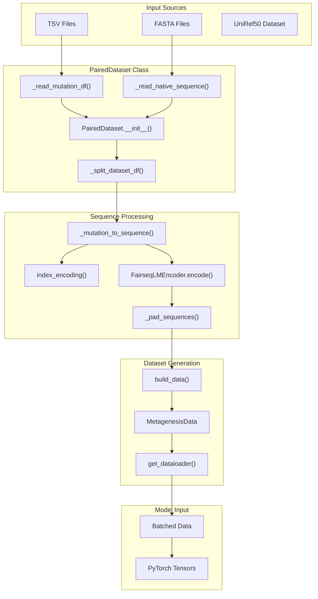
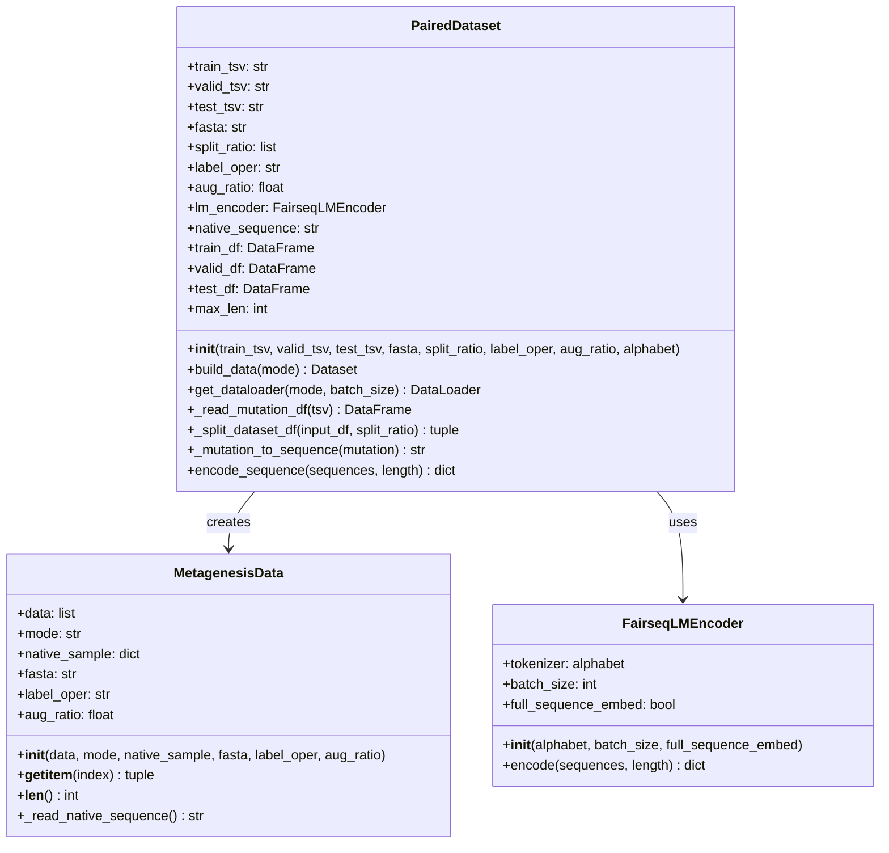
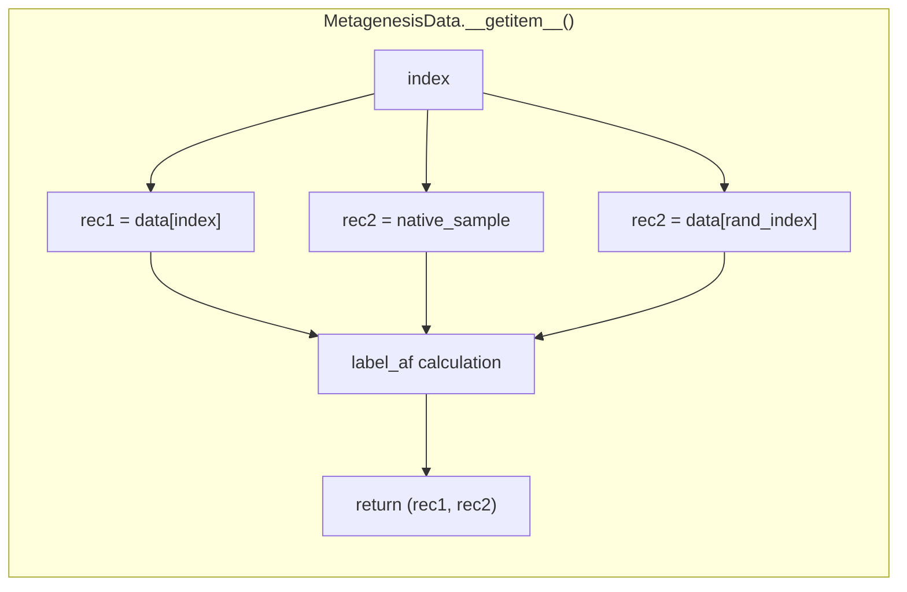
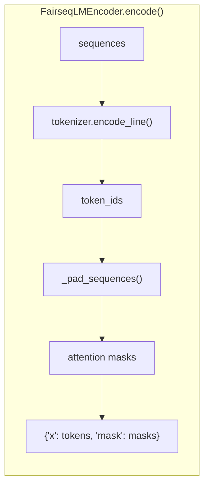
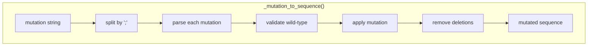

<!-- source: DeepWiki mcp.deepwiki.com · repo microsoft/Mu-Protein · page 5.2 Data Processing · fetched 2026-10-26 -->

# Data Processing

<details>
<summary>Relevant source files</summary>

The following files were used as context for generating this wiki page:

- [mu-former/src/data.py](mu-former/src/data.py)
- [mu-former/src/vocab.py](mu-former/src/vocab.py)

</details>


This document covers the data processing components of the μProtein framework, including dataset classes, sequence encoding utilities, and data loading infrastructure used primarily in the μFormer training pipeline. These components handle protein sequence data, mutation information, and the conversion between various data formats required for training and inference.

For information about training utilities and infrastructure, see [Training Utilities](#5.3). For core model architectures, see [Core Models](#5.1).

## Data Processing Pipeline

The μProtein data processing system follows a structured pipeline that transforms raw protein data into model-ready tensors:



**Sources:** [mu-former/src/data.py:139-454]()

## Core Dataset Classes

### PairedDataset

The `PairedDataset` class serves as the primary interface for loading and managing protein mutation datasets:



**Key Methods:**

| Method | Purpose | Returns |
|--------|---------|---------|
| `build_data(mode)` | Creates dataset for train/valid/test modes | `MetagenesisData` |
| `get_dataloader(mode, batch_size)` | Creates PyTorch DataLoader | `DataLoader` |
| `_mutation_to_sequence(mutation)` | Converts mutation notation to sequence | `str` |
| `encode_sequence(sequences, length)` | Encodes sequences using language model | `dict` |

**Sources:** [mu-former/src/data.py:139-205](), [mu-former/src/data.py:346-404](), [mu-former/src/data.py:406-453]()

### MetagenesisData

The `MetagenesisData` class implements PyTorch's `Dataset` interface for mutation effect prediction:



The class supports two label operations:
- **Divide mode**: `rec1['label_af'] = rec1['label'] / rec2['label']`
- **Minus mode**: `rec1['label_af'] = rec1['label'] - rec2['label']`

**Sources:** [mu-former/src/data.py:85-138]()

## Sequence Encoding Components

### FairseqLMEncoder

The `FairseqLMEncoder` class handles tokenization and encoding of protein sequences using Fairseq's tokenization framework:



**Key Features:**
- Prepends sequences with `<s>` token and spaces between amino acids
- Generates attention masks for padded sequences
- Returns dictionary with tokenized sequences and masks

**Sources:** [mu-former/src/data.py:48-84]()

### Amino Acid Vocabularies

The framework supports multiple amino acid encoding schemes defined in `vocab.py`:

| Vocabulary | Purpose | Size |
|------------|---------|------|
| `AMINO_ACID_INDEX` | Standard 20 amino acids + special tokens | 21 |
| `COMMON_AMINO_ACIDS_INDEX` | Common amino acids with gap character | 21 |
| `CCMPRED_AMINO_ACID_INDEX` | CCMPred-compatible encoding | 27 |
| `BLOSUM62_MATRIX` | BLOSUM62 substitution matrix | 21x21 |

**Sources:** [mu-former/src/vocab.py:9-79]()

## Data Loading and Preprocessing

### Mutation Format Processing

The system processes protein mutations in standard notation (e.g., "A123V" for alanine to valine at position 123):



**Supported Mutation Types:**
- Point mutations: `A123V` (alanine at position 123 to valine)
- Deletions: `A123del` (delete alanine at position 123)
- Multiple mutations: `A123V;G456D` (semicolon-separated)

**Sources:** [mu-former/src/data.py:267-287](), [mu-former/src/data.py:289-314]()

### Data Splitting and Validation

The `PairedDataset` class provides flexible data splitting capabilities:

| Split Configuration | Files Required | Split Ratio Format |
|---------------------|----------------|-------------------|
| Auto-split from single file | `train_tsv` only | `[train, valid, test]` |
| Train/valid split | `train_tsv`, `test_tsv` | `[train, valid]` |
| Pre-split datasets | All three TSV files | Not applicable |

**Sources:** [mu-former/src/data.py:179-204](), [mu-former/src/data.py:247-265]()

## Utility Functions

### Sequence Padding

The `_pad_sequences()` function handles variable-length sequence padding:

```python
# Pad sequences to maximum length or specified length
def _pad_sequences(sequences, constant_value=1, length=0):
    # Determine target shape and pad with constant_value
    # Returns padded numpy array
```

**Parameters:**
- `sequences`: List of variable-length sequences
- `constant_value`: Padding token (default: 1)
- `length`: Target length (default: max sequence length)

**Sources:** [mu-former/src/data.py:34-46]()

### Index Encoding

The `index_encoding()` function converts amino acid sequences to numerical indices:

```python
# Convert sequences to amino acid indices
def index_encoding(sequences):
    # Uses AMINO_ACID_INDEX mapping from vocab.py
    # Returns numpy array of shape (num_sequences, sequence_length)
```

**Sources:** [mu-former/src/data.py:17-32](), [mu-former/src/vocab.py:19-25]()

---

