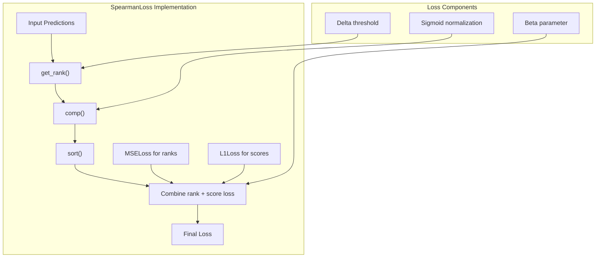
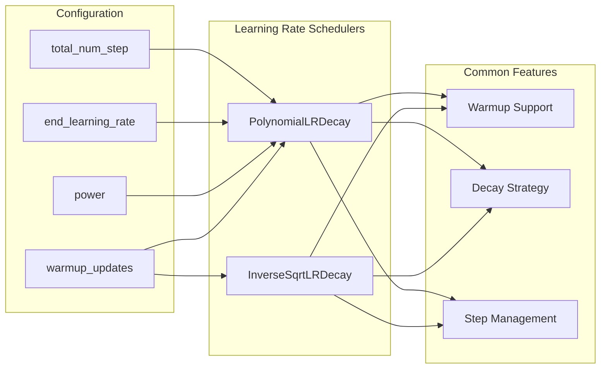
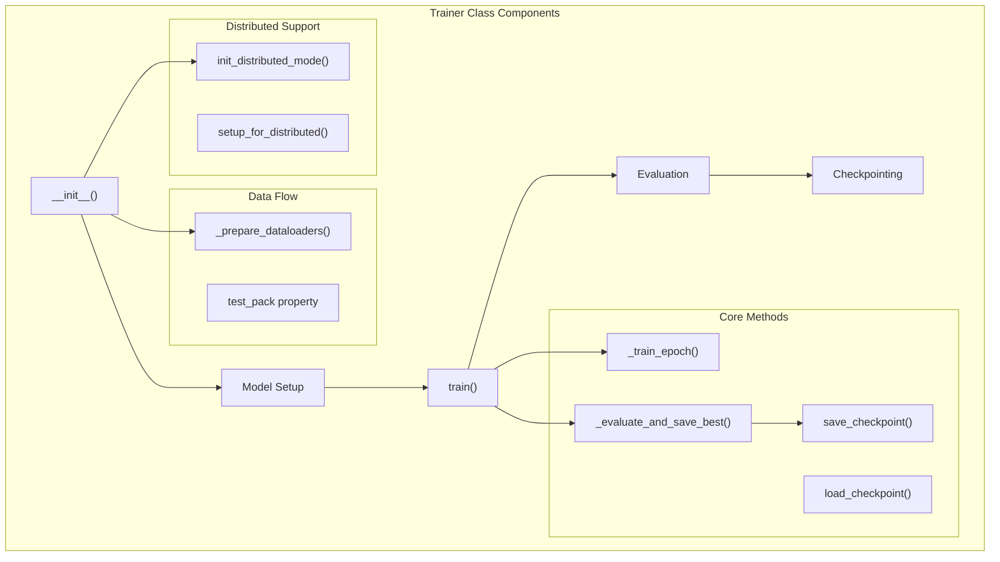
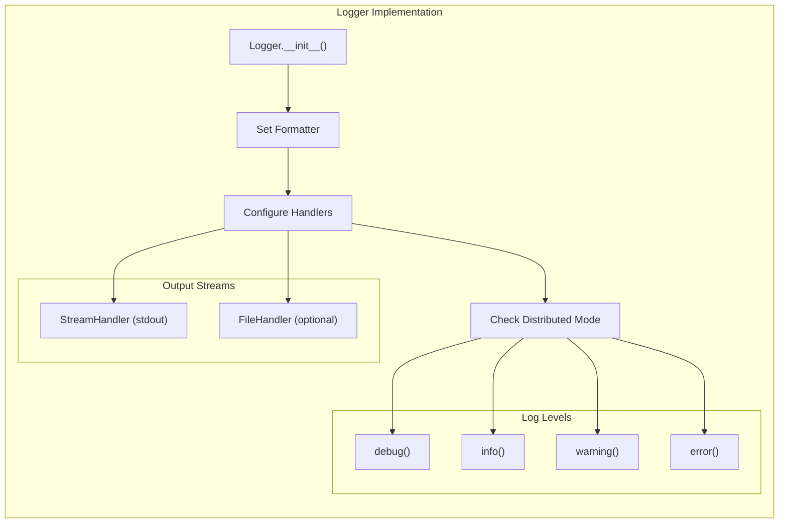
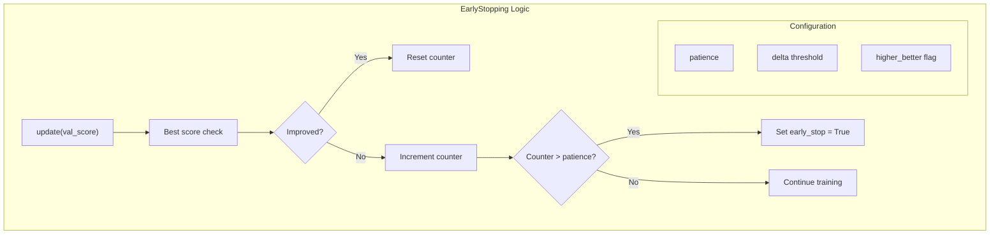
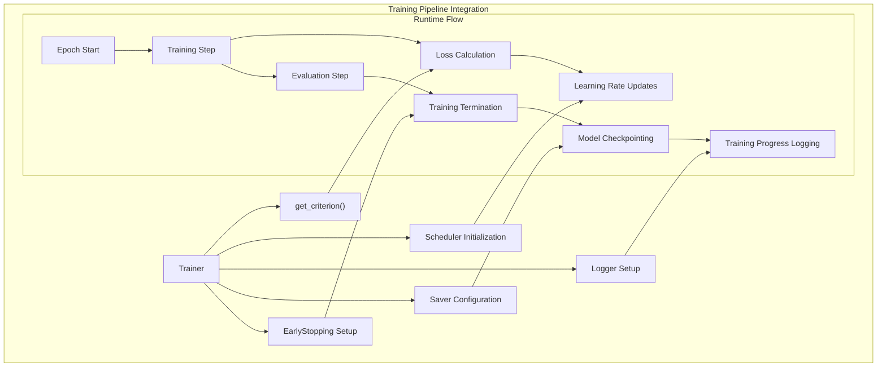

<!-- source: DeepWiki mcp.deepwiki.com · repo microsoft/Mu-Protein · page 5.3 Training Utilities · fetched 2026-10-26 -->

# Training Utilities

<details>
<summary>Relevant source files</summary>

The following files were used as context for generating this wiki page:

- [mu-former/src/criterion.py](mu-former/src/criterion.py)
- [mu-former/src/lr_scheduler.py](mu-former/src/lr_scheduler.py)
- [mu-former/src/trainer.py](mu-former/src/trainer.py)
- [mu-former/src/utils.py](mu-former/src/utils.py)

</details>


This page documents the training infrastructure and utilities used throughout the μProtein framework for model training, evaluation, and optimization. The training utilities provide loss functions, learning rate schedulers, training orchestration, and supporting infrastructure for distributed training.

For information about the core model architectures being trained, see [Core Models](#5.1). For data processing components used during training, see [Data Processing](#5.2).

## Loss Functions and Criteria

The μProtein framework provides specialized loss functions for protein fitness prediction tasks, including correlation-based losses that are particularly suited for biological data.

### Available Loss Functions

The framework implements several loss functions in [mu-former/src/criterion.py]():

| Loss Function | Class/Function | Purpose |
|---------------|----------------|---------|
| Mean Absolute Error | `nn.L1Loss()` | Standard regression loss |
| Mean Squared Error | `nn.MSELoss()` | Standard regression loss |
| Pearson Correlation | `pearson_correlation_loss` | Correlation-based fitness prediction |
| Spearman Correlation | `SpearmanLoss` | Rank-based correlation loss |

### Correlation-Based Losses

**Pearson Correlation Loss**

The framework provides two implementations of Pearson correlation loss:
- `pearson_loss`: Simple implementation for basic correlation calculation [mu-former/src/criterion.py:7-15]()
- `pearson_correlation_loss`: Advanced implementation with normalization support [mu-former/src/criterion.py:17-43]()

**Spearman Correlation Loss**

The `SpearmanLoss` class implements a sophisticated rank-based loss function:



Sources: [mu-former/src/criterion.py:46-101]()

### Loss Function Selection

The `get_criterion` function provides a unified interface for loss selection:

```python
CRITERION = {
    'mae': nn.L1Loss(),
    'mse': nn.MSELoss(), 
    'pearson': pearson_correlation_loss,
    'spearman': SpearmanLoss(),
}
```

Sources: [mu-former/src/criterion.py:103-114]()

## Learning Rate Schedulers

The framework implements custom learning rate schedulers optimized for protein language model fine-tuning.

### Scheduler Types



Sources: [mu-former/src/lr_scheduler.py]()

### PolynomialLRDecay

The `PolynomialLRDecay` scheduler implements polynomial learning rate decay with warmup:

- **Warmup Phase**: Linear increase during initial training steps [mu-former/src/lr_scheduler.py:32-34]()
- **Decay Phase**: Polynomial decay to end learning rate [mu-former/src/lr_scheduler.py:36-38]()
- **Parameters**: `total_num_step`, `end_learning_rate`, `power`, `warmup_updates`

### InverseSqrtLRDecay

The `InverseSqrtLRDecay` scheduler implements inverse square root decay commonly used in transformer training:

- **Formula**: `lr = base_lr * warmup_updates^0.5 * step^-0.5` [mu-former/src/lr_scheduler.py:77]()
- **Warmup**: Linear warmup similar to polynomial scheduler [mu-former/src/lr_scheduler.py:83-85]()

Sources: [mu-former/src/lr_scheduler.py:57-90]()

## Training Infrastructure

The `Trainer` class orchestrates the complete training pipeline for μFormer models, providing distributed training support, checkpointing, and evaluation.

### Trainer Architecture



Sources: [mu-former/src/trainer.py:80-600]()

### Training Loop Implementation

The training pipeline follows a structured approach:

1. **Initialization**: Model setup, optimizer configuration, scheduler initialization [mu-former/src/trainer.py:216-244]()
2. **Epoch Training**: Forward pass, loss computation, backpropagation [mu-former/src/trainer.py:467-499]()
3. **Evaluation**: Model evaluation and best model tracking [mu-former/src/trainer.py:501-515]()
4. **Checkpointing**: Save/load model states [mu-former/src/trainer.py:384-387]()

### Distributed Training Support

The framework supports distributed training with:

- **Initialization**: Automatic distributed setup detection [mu-former/src/trainer.py:40-63]()
- **Model Wrapping**: `DistributedDataParallel` for multi-GPU training [mu-former/src/trainer.py:237]()
- **Synchronization**: Barrier synchronization for checkpointing [mu-former/src/trainer.py:539]()

Sources: [mu-former/src/trainer.py:26-63](), [mu-former/src/trainer.py:147-151]()

## Utility Classes

### Logger

The `Logger` class provides distributed-aware logging with file and console output:



Key features:
- **Distributed Awareness**: Only rank 0 processes log by default [mu-former/src/utils.py:31-38]()
- **Dual Output**: Console and optional file logging [mu-former/src/utils.py:21-29]()
- **Structured Format**: Timestamp and message formatting [mu-former/src/utils.py:16]()

Sources: [mu-former/src/utils.py:9-53]()

### Saver

The `Saver` class handles model checkpointing and result saving:

- **Checkpoint Saving**: PyTorch model state persistence [mu-former/src/utils.py:59-62]()
- **DataFrame Export**: TSV format result saving [mu-former/src/utils.py:64-66]()
- **Directory Management**: Automatic directory creation [mu-former/src/utils.py:60](), [mu-former/src/utils.py:65]()

### EarlyStopping

The `EarlyStopping` class implements training termination logic:



Key parameters:
- **Patience**: Number of evaluations without improvement before stopping [mu-former/src/utils.py:73]()
- **Delta**: Minimum improvement threshold [mu-former/src/utils.py:76]()
- **Direction**: Whether higher or lower scores are better [mu-former/src/utils.py:77]()

Sources: [mu-former/src/utils.py:69-102]()

## Integration with Training Pipeline

The training utilities integrate seamlessly with the μFormer training pipeline:



Sources: [mu-former/src/trainer.py:187](), [mu-former/src/trainer.py:406](), [mu-former/src/trainer.py:458-466](), [mu-former/src/trainer.py:108-109]()

---

