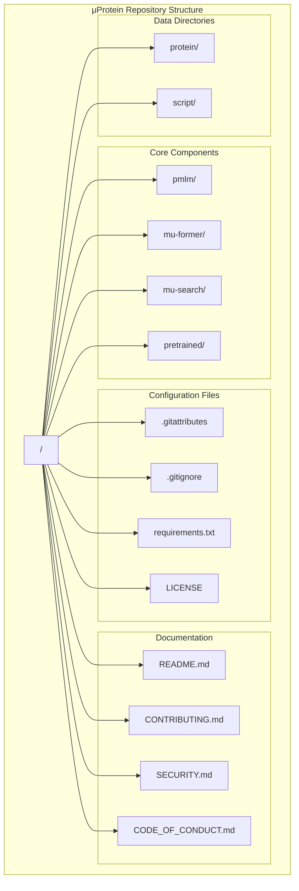
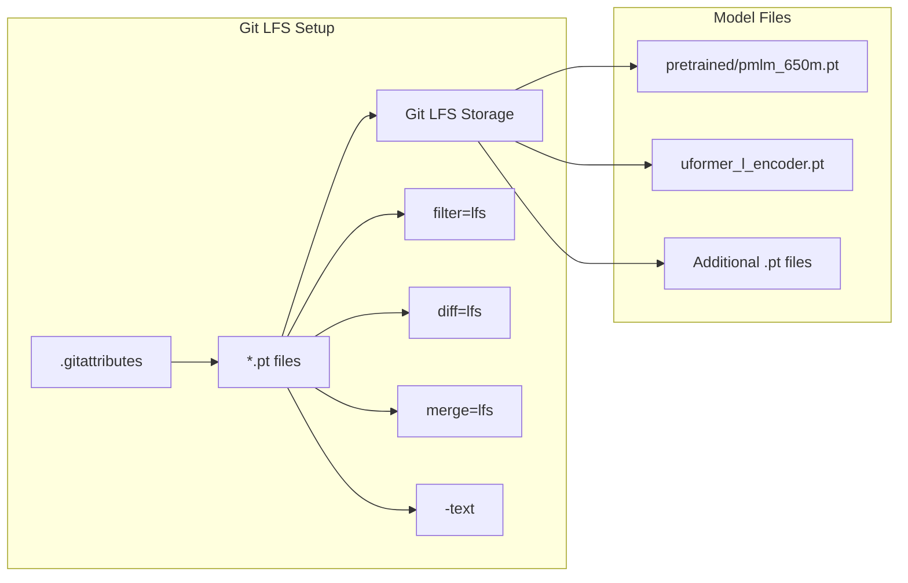
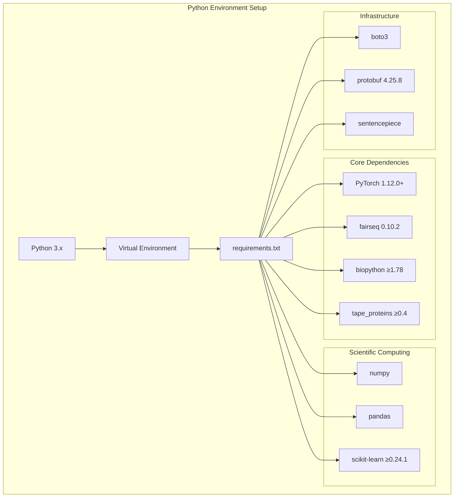
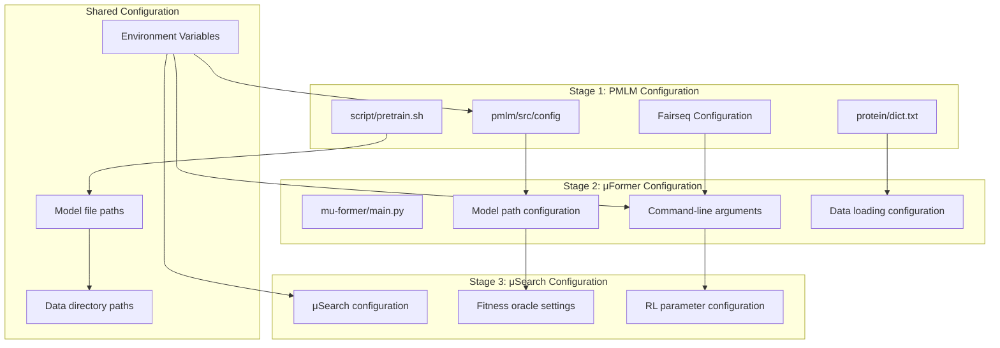

<!-- source: DeepWiki mcp.deepwiki.com · repo microsoft/Mu-Protein · page 6 Configuration & Setup · fetched 2026-10-26 -->

# Configuration & Setup

Relevant source files

The following files were used as context for generating this wiki page:

- [.gitattributes](.gitattributes)
- [.gitignore](.gitignore)
- [LICENSE](LICENSE)

This page covers the essential configuration and setup procedures for the μProtein framework repository. It explains the repository structure, Git configuration for large model files, development environment setup, and how configuration files coordinate the three-stage pipeline. For detailed repository-specific configurations, see [Repository Configuration](#6.1). For protein task and fairseq integration configurations, see [Protein Task Configuration](#6.2).

## Repository Structure and Configuration Overview

The μProtein framework uses a multi-component architecture where configuration spans across three main systems: PMLM pretraining, μFormer training, and μSearch optimization. Each component requires specific configuration for data handling, model parameters, and training procedures.

### Repository Organization

Sources: [.gitattributes:1-2](), [.gitignore:1-175](), [LICENSE:1-22]()

## Git Large File Storage Configuration

The repository uses Git LFS to manage large model files, particularly the pretrained PMLM models which can exceed 2GB in size.

### LFS Configuration

The `.gitattributes` file configures all PyTorch model files (`.pt` extension) to use Git LFS with the following settings:

| Attribute | Purpose |
|-----------|---------|
| `filter=lfs` | Routes files through LFS clean/smudge filters |
| `diff=lfs` | Uses LFS-aware diff for large files |
| `merge=lfs` | Handles LFS files during merge operations |
| `-text` | Treats files as binary, preventing line ending conversion |

Sources: [.gitattributes:1-2]()

## Development Environment Configuration

### Dependency Management

The repository follows standard Python project conventions for dependency management and environment configuration.

### Ignored Files and Directories

The repository uses comprehensive `.gitignore` patterns to exclude development artifacts:

| Category | Examples | Lines |
|----------|----------|-------|
| Python artifacts | `__pycache__/`, `*.pyc`, `*.egg-info/` | [.gitignore:1-27]() |
| Virtual environments | `.venv`, `venv/`, `ENV/` | [.gitignore:130-137]() |
| Testing artifacts | `.coverage`, `.pytest_cache/`, `htmlcov/` | [.gitignore:39-52]() |
| IDE/Editor files | `.spyderproject`, `.ropeproject` | [.gitignore:139-144]() |
| Documentation builds | `docs/_build/`, `/site` | [.gitignore:71-147]() |

Sources: [.gitignore:1-175]()

## Configuration Flow Between Components

The μProtein framework coordinates configuration across its three-stage architecture through a combination of configuration files, environment variables, and command-line arguments.

### Component Configuration Dependencies

Sources: [.gitattributes:1-2](), [.gitignore:130-137]()

## License and Legal Configuration

The repository operates under the MIT License, providing broad permissions for use, modification, and distribution while requiring attribution.

### License Terms Summary

| Permission | Restriction | Condition |
|------------|-------------|-----------|
| Commercial use | None | Include copyright notice |
| Modification | None | Include license text |
| Distribution | None | Include original license |
| Private use | None | No warranty provided |

The MIT License allows users to:
- Use the software commercially
- Modify and distribute the code
- Sublicense under different terms
- Include in proprietary software

Sources: [LICENSE:1-22]()

## Security and Contribution Configuration

The repository includes structured policies for security reporting and community contributions, establishing clear procedures for:

- **Security vulnerabilities**: Reporting through designated channels
- **Code contributions**: Following contributor license agreement requirements
- **Community standards**: Adherence to code of conduct policies
- **Development workflow**: Contribution guidelines and pull request procedures

For detailed contribution procedures, see [Contributing](#7.1). For security policy details, see [Security](#7.2).

Sources: [.gitignore:1-175](), [LICENSE:1-22]()

---

