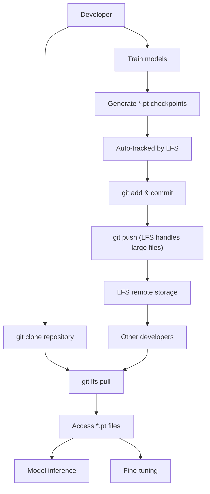
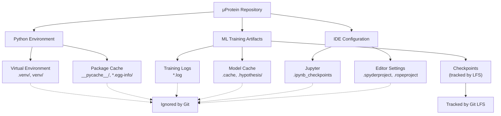
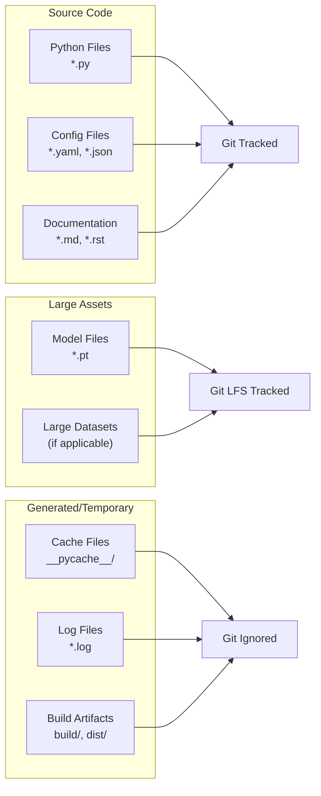

<!-- source: DeepWiki mcp.deepwiki.com · repo microsoft/Mu-Protein · page 6.1 Repository Configuration · fetched 2026-10-26 -->

# Repository Configuration

<details>
<summary>Relevant source files</summary>

The following files were used as context for generating this wiki page:

- [.gitattributes](.gitattributes)
- [.gitignore](.gitignore)
- [LICENSE](LICENSE)

</details>


This page covers the essential Git and development environment configuration for the μProtein framework repository. It explains how Git LFS is configured to handle large model files, the gitignore setup for Python development, and how these configurations support the repository's needs for managing large-scale protein language models and training artifacts.

For information about installing dependencies and setting up the Python environment, see [Installation & Setup](#3.1). For details about using the pretrained model files managed by these configurations, see [Using Pretrained Models](#3.2).

## Git LFS Configuration

The μProtein repository uses Git Large File Storage (LFS) to efficiently manage large model files, particularly the pretrained PMLM model which is approximately 2.7GB in size.

### LFS Tracking Configuration

The repository's Git LFS configuration is defined in [.gitattributes:1]():

```
*.pt filter=lfs diff=lfs merge=lfs -text
```

This configuration ensures that all PyTorch model files (`.pt` extension) are automatically tracked by Git LFS. This includes critical files such as:

- `pretrained/pmlm_650m.pt` - The 650M parameter pretrained PMLM model
- Training checkpoints and saved model states
- Fine-tuned μFormer models

### LFS File Handling Workflow

The following diagram illustrates how Git LFS integrates with the μProtein development workflow:



**Sources:** [.gitattributes:1]()

## Git Ignore Configuration

The repository includes a comprehensive `.gitignore` file that excludes development artifacts and temporary files specific to Python machine learning workflows.

### Key Ignored Categories

| Category | Files/Patterns | Purpose |
|----------|----------------|---------|
| **Python Artifacts** | `__pycache__/`, `*.pyc`, `*.egg-info/` | Compiled Python and package artifacts |
| **Virtual Environments** | `.venv/`, `venv/`, `.env` | Development environment isolation |
| **ML Training Artifacts** | `.cache`, `*.log`, `.hypothesis/` | Training logs and caching |
| **IDE Configuration** | `.spyderproject`, `.ropeproject` | Editor-specific settings |
| **Documentation Build** | `docs/_build/`, `/site` | Generated documentation |

### Development Environment Patterns

The gitignore configuration specifically supports common Python ML development patterns:



**Sources:** [.gitignore:1-175]()

## Repository Structure and File Management

The configuration supports the μProtein framework's modular structure while ensuring efficient version control of both source code and large model assets.

### File Classification System



### Development Environment Isolation

The configuration ensures clean separation between:

- **Tracked Source Code**: Core Python modules, configuration files, and documentation
- **LFS-Managed Assets**: Large model files and training checkpoints  
- **Local Development**: Virtual environments, IDE settings, and temporary files

This structure allows developers to:
1. Clone the repository efficiently (source code only initially)
2. Pull large model files on-demand with `git lfs pull`
3. Work in isolated environments without polluting the repository
4. Share model checkpoints efficiently through LFS

**Sources:** [.gitattributes:1](), [.gitignore:130-138](), [.gitignore:78-79]()

## License and Legal Configuration

The repository is distributed under the MIT License, providing broad permissions for use, modification, and distribution while requiring attribution and disclaiming warranties.

### MIT License Terms

The [LICENSE:1-22]() file establishes:

- **Copyright**: Microsoft (2025)
- **Permissions**: Use, modify, distribute, sublicense, sell
- **Conditions**: Include copyright notice and license text
- **Limitations**: No warranty, limited liability

This permissive license supports both academic research and commercial applications of the μProtein framework.

**Sources:** [LICENSE:1-22]()

---

