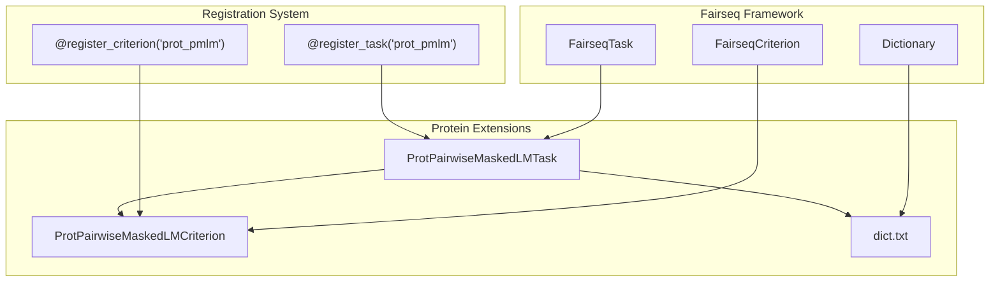
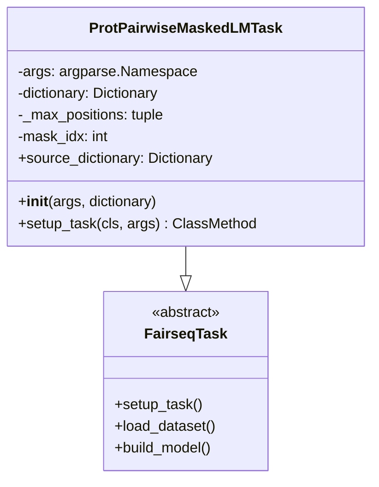
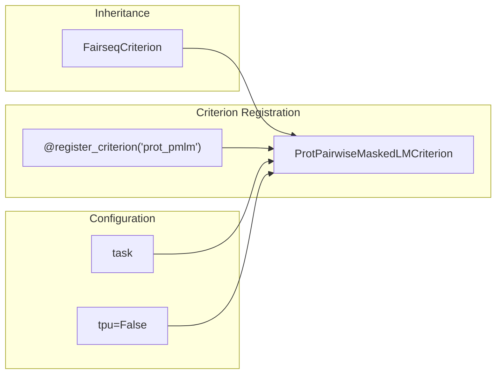
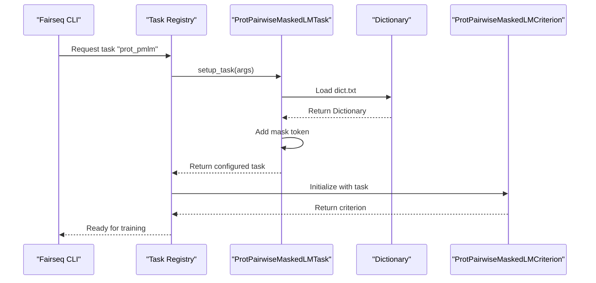

<!-- source: DeepWiki mcp.deepwiki.com · repo microsoft/Mu-Protein · page 6.2 Protein Task Configuration · fetched 2026-10-26 -->

# Protein Task Configuration

Relevant source files

The following files were used as context for generating this wiki page:

- [mu-former/src/protein/criterions/pmlm.py](mu-former/src/protein/criterions/pmlm.py)
- [mu-former/src/protein/dict.txt](mu-former/src/protein/dict.txt)
- [mu-former/src/protein/tasks/pmlm.py](mu-former/src/protein/tasks/pmlm.py)

This document covers the configuration and implementation of protein-specific tasks within the μProtein framework's fairseq integration. It focuses on the custom task definitions, criterions, and dictionary configurations that enable protein language modeling within the fairseq ecosystem.

For information about the broader μFormer training configuration, see [μFormer Training](#4.1). For details about the PMLM pretraining system, see [PMLM Pretraining](#2.1).

## Purpose and Scope

The protein task configuration system provides the bridge between fairseq's general sequence modeling framework and protein-specific requirements. This includes custom task definitions for protein masked language modeling, specialized criterions for protein fitness prediction, and amino acid vocabularies optimized for protein sequences.

## Task System Architecture

Sources: [mu-former/src/protein/tasks/pmlm.py:1-38](), [mu-former/src/protein/criterions/pmlm.py:1-7](), [mu-former/src/protein/dict.txt:1-23]()

## Task Implementation

The core protein task is implemented in the `ProtPairwiseMaskedLMTask` class, which extends fairseq's `FairseqTask` to handle protein-specific requirements.

### Task Registration and Setup

The task is registered with fairseq using the decorator `@register_task('prot_pmlm')`, making it available for use in training configurations. The task setup process includes:

| Component | Description | Implementation |
|-----------|-------------|----------------|
| Dictionary Loading | Loads amino acid vocabulary from `dict.txt` | [mu-former/src/protein/tasks/pmlm.py:32]() |
| Max Positions | Configures sequence length limits | [mu-former/src/protein/tasks/pmlm.py:17-24]() |
| Mask Token | Adds special mask token for MLM | [mu-former/src/protein/tasks/pmlm.py:26]() |

### Task Class Structure

Sources: [mu-former/src/protein/tasks/pmlm.py:11-38]()

### Key Configuration Parameters

The task configuration handles several protein-specific parameters:

- **max_source_positions**: Maximum length for source protein sequences
- **max_target_positions**: Maximum length for target protein sequences  
- **tokens_per_sample**: Set equal to max_positions for consistency
- **mask_idx**: Index of the mask token in the vocabulary

Sources: [mu-former/src/protein/tasks/pmlm.py:17-26]()

## Criterion Implementation

The `ProtPairwiseMaskedLMCriterion` class provides the loss function for protein masked language modeling tasks.

### Criterion Structure

Sources: [mu-former/src/protein/criterions/pmlm.py:1-7]()

The criterion accepts the following initialization parameters:
- **task**: The associated protein task instance
- **tpu**: Boolean flag for TPU optimization (defaults to False)

## Protein Dictionary Configuration

The protein vocabulary is defined in the dictionary file, which maps amino acid symbols to token indices.

### Amino Acid Vocabulary

| Symbol | Amino Acid | Index |
|--------|------------|-------|
| A | Alanine | 0 |
| R | Arginine | 0 |
| N | Asparagine | 0 |
| D | Aspartic acid | 0 |
| C | Cysteine | 0 |
| Q | Glutamine | 0 |
| E | Glutamic acid | 0 |
| G | Glycine | 0 |
| H | Histidine | 0 |
| I | Isoleucine | 0 |
| L | Leucine | 0 |
| K | Lysine | 0 |
| M | Methionine | 0 |
| F | Phenylalanine | 0 |
| P | Proline | 0 |
| S | Serine | 0 |
| T | Threonine | 0 |
| W | Tryptophan | 0 |
| Y | Tyrosine | 0 |
| V | Valine | 0 |

### Special Tokens

The dictionary also includes special tokens for protein sequence processing:

- **X**: Unknown or ambiguous amino acid
- **-**: Gap character for sequence alignment

Sources: [mu-former/src/protein/dict.txt:1-23]()

## Integration with Fairseq

The protein task configuration integrates seamlessly with fairseq's training pipeline through the registration system.

### Component Integration Flow

Sources: [mu-former/src/protein/tasks/pmlm.py:10](), [mu-former/src/protein/criterions/pmlm.py:3]()

The registration decorators enable fairseq to automatically discover and instantiate the protein-specific components when the task name `'prot_pmlm'` is specified in training configurations.

---

