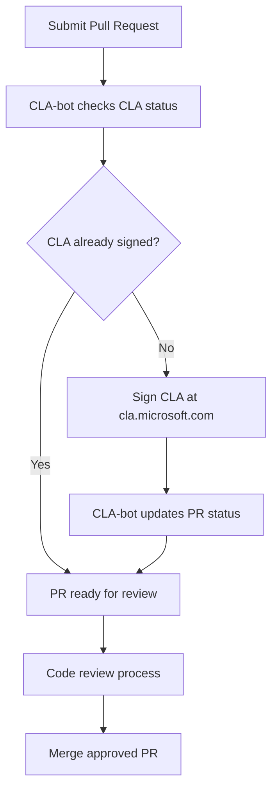
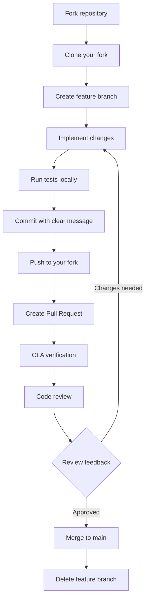

<!-- source: DeepWiki mcp.deepwiki.com · repo microsoft/Mu-Protein · page 7.1 Contributing · fetched 2026-10-26 -->

# Contributing

<details>
<summary>Relevant source files</summary>

The following files were used as context for generating this wiki page:

- [CODE_OF_CONDUCT.md](CODE_OF_CONDUCT.md)
- [CONTRIBUTING.md](CONTRIBUTING.md)

</details>


This document provides comprehensive guidelines for contributing to the μProtein framework project. It covers the requirements, processes, and best practices for submitting contributions including bug fixes, feature enhancements, documentation improvements, and model developments.

For information about security-related contributions, see [Security](#7.2). For general project information and architecture details, see [Overview](#1) and [System Architecture](#2).

## Contribution Requirements

### Contributor License Agreement (CLA)

All contributions to the μProtein project require agreement to Microsoft's Contributor License Agreement (CLA). This legal requirement ensures that Microsoft has the rights to use and distribute your contributions.

When you submit your first pull request, a CLA-bot will automatically:
- Determine if you need to sign a CLA
- Add appropriate labels and comments to your PR
- Provide instructions for completing the CLA process

The CLA process is a one-time requirement that applies across all Microsoft repositories. Once completed, you can contribute to any Microsoft open source project.

**CLA Process Flow:**



Sources: [CONTRIBUTING.md:3-10]()

### Code of Conduct

The μProtein project has adopted the Microsoft Open Source Code of Conduct. All contributors must adhere to these guidelines to maintain a welcoming and inclusive environment.

Key resources:
- **Primary Policy**: Microsoft Open Source Code of Conduct
- **FAQ**: Detailed explanations of conduct expectations  
- **Contact**: opencode@microsoft.com for questions or concerns
- **Employee Support**: aka.ms/opensource/moderation-support for Microsoft employees

Sources: [CODE_OF_CONDUCT.md:3-10](), [CONTRIBUTING.md:12-14]()

## Types of Contributions

The μProtein framework welcomes various types of contributions across its three-stage architecture. Each contribution type has specific areas of impact within the codebase.

### Contribution Areas by Component

```mermaid
graph TB
    subgraph "μProtein Framework Contributions"
        subgraph "PMLM_CONTRIB[\"PMLM Contributions\"]"
            PMLM_TRAINING["Training optimizations<br/>pmlm/src/"]
            PMLM_DATA["Data preprocessing<br/>pmlm/data/"]
            PMLM_SCRIPTS["Training scripts<br/>script/pretrain.sh"]
        end
        
        subgraph "MUFORMER_CONTRIB[\"μFormer Contributions\"]"
            MF_MODEL["Model architecture<br/>mu-former/src/model.py"]
            MF_TRAINING["Training improvements<br/>mu-former/src/trainer.py"]
            MF_DATA["Data processing<br/>mu-former/src/data.py"]
            MF_MAIN["Main orchestration<br/>mu-former/main.py"]
        end
        
        subgraph "MUSEARCH_CONTRIB[\"μSearch Contributions\"]"
            MS_RL["RL algorithms<br/>mu-search/"]
            MS_OPTIMIZATION["Optimization strategies"]
            MS_SEARCH["Search algorithms"]
        end
        
        subgraph "INFRASTRUCTURE_CONTRIB[\"Infrastructure Contributions\"]"
            DOCS["Documentation<br/>README.md, wiki pages"]
            TESTS["Testing framework"]
            CONFIG["Configuration<br/>requirements.txt"]
            PRETRAINED["Model management<br/>pretrained/"]
        end
    end
    
    PMLM_CONTRIB --> MUFORMER_CONTRIB
    MUFORMER_CONTRIB --> MUSEARCH_CONTRIB
    INFRASTRUCTURE_CONTRIB --> PMLM_CONTRIB
    INFRASTRUCTURE_CONTRIB --> MUFORMER_CONTRIB
    INFRASTRUCTURE_CONTRIB --> MUSEARCH_CONTRIB
```

Sources: Based on repository structure analysis

### Common Contribution Types

| Contribution Type | Primary Location | Review Requirements |
|------------------|------------------|-------------------|
| Bug fixes | Component-specific directories | Unit tests + integration tests |
| Feature enhancements | `mu-former/src/`, `pmlm/src/` | Design discussion + tests |
| Documentation | Root directory, wiki pages | Technical accuracy review |
| Model improvements | `mu-former/src/model.py` | Performance validation |
| Training optimizations | `trainer.py`, training scripts | Convergence verification |
| Data processing | `data.py` files | Data integrity checks |

## Development Workflow

### Standard Contribution Process



Sources: Standard GitHub workflow for [CONTRIBUTING.md]()

### Branch Naming Conventions

Use descriptive branch names that indicate the type and scope of changes:

- `feature/muformer-attention-optimization`
- `bugfix/pmlm-tokenization-error`
- `docs/api-reference-update`
- `perf/training-memory-optimization`

### Commit Message Guidelines

Follow conventional commit format for clear change tracking:

```
type(scope): brief description

- Detailed explanation of changes
- Why the change was needed
- Any breaking changes or migration notes
```

Examples:
- `feat(muformer): add attention head visualization`
- `fix(pmlm): resolve tokenization boundary error`
- `docs(api): update trainer class documentation`

## Code Quality Standards

### Testing Requirements

All contributions must include appropriate tests:

- **Unit tests**: For individual functions and classes
- **Integration tests**: For component interactions
- **Performance tests**: For training and inference optimizations
- **Regression tests**: For bug fixes

### Code Style Guidelines

- Follow Python PEP 8 conventions
- Use type hints for function parameters and returns
- Include docstrings for all public methods and classes
- Maintain compatibility with existing fairseq integration

### Documentation Standards

- Update API documentation for new functions/classes
- Include inline code comments for complex algorithms
- Update README.md for significant feature additions
- Add examples for new functionality

## Validation and Testing

### Model Validation Requirements

For contributions affecting model performance:

1. **Baseline comparison**: Compare against existing model checkpoints
2. **Convergence verification**: Ensure training stability
3. **Performance metrics**: Validate on standard protein benchmarks
4. **Resource usage**: Monitor memory and compute requirements

### Data Processing Validation

For contributions to data handling:

1. **Data integrity**: Verify no corruption during processing
2. **Format compatibility**: Ensure compatibility with FASTA/TSV inputs
3. **Tokenization consistency**: Maintain protein vocabulary alignment
4. **Batch processing**: Test scalability with large datasets

## Getting Help

### Communication Channels

- **Issues**: GitHub Issues for bug reports and feature requests
- **Discussions**: GitHub Discussions for general questions
- **Email**: opencode@microsoft.com for conduct or legal questions

### Before Contributing

1. Search existing issues to avoid duplication
2. Review relevant documentation sections
3. Check recent pull requests for similar work
4. Consider opening an issue for discussion before major changes

### Contribution Review Process

The review process typically involves:

1. **Automated checks**: CLA verification, basic linting
2. **Technical review**: Code quality and functionality assessment  
3. **Architecture review**: For significant changes to core components
4. **Performance review**: For changes affecting training or inference
5. **Documentation review**: Ensuring adequate documentation updates

Sources: [CONTRIBUTING.md:8-10](), [CODE_OF_CONDUCT.md]()

---

