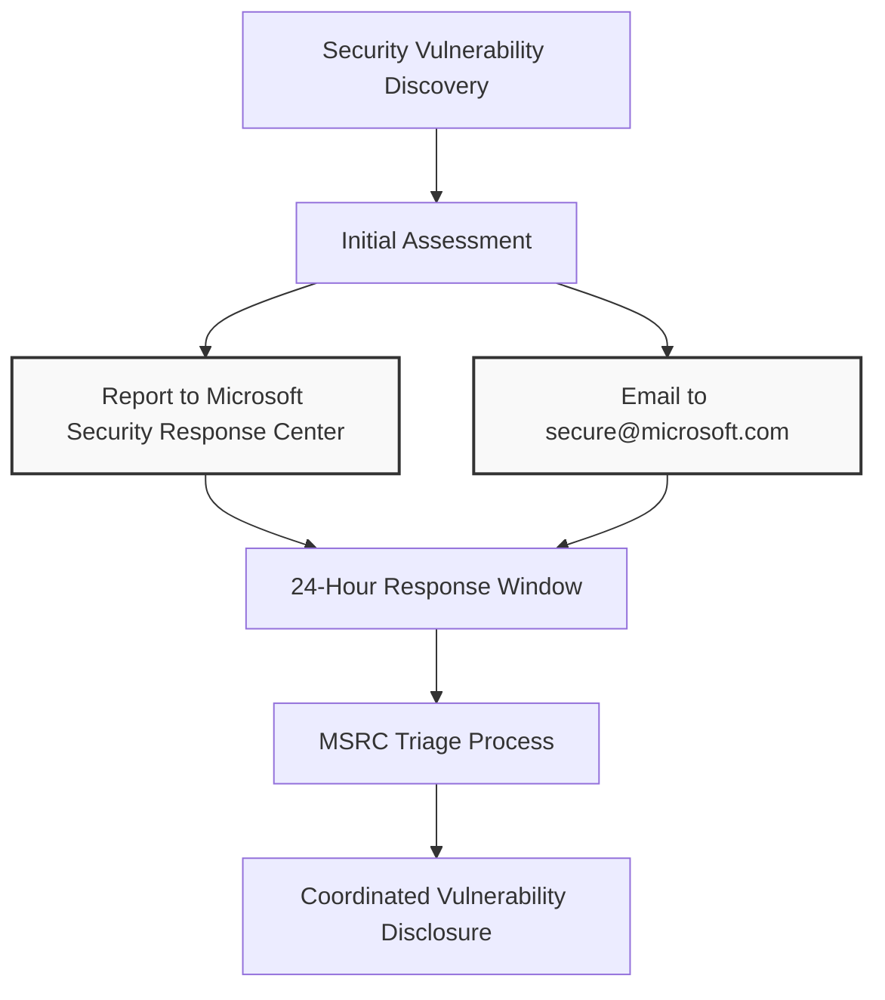
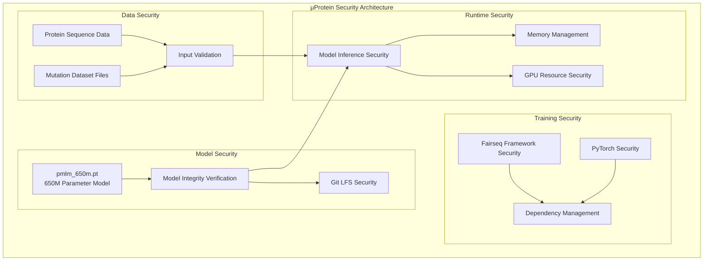
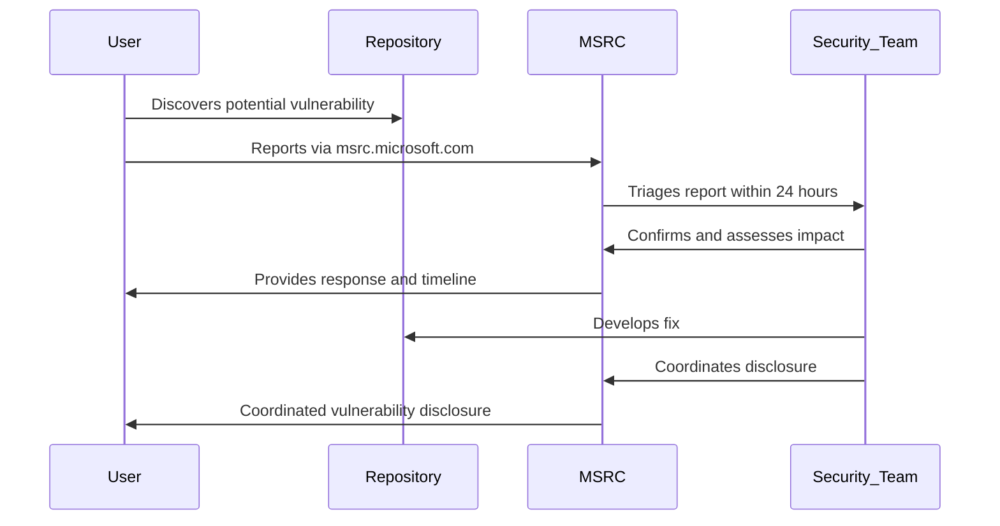

<!-- source: DeepWiki mcp.deepwiki.com · repo microsoft/Mu-Protein · page 7.2 Security · fetched 2026-10-26 -->

# Security

Relevant source files

The following files were used as context for generating this wiki page:

- [SECURITY.md](SECURITY.md)

This document outlines the security policies, vulnerability reporting procedures, and security considerations for the μProtein framework. It covers Microsoft's coordinated vulnerability disclosure process and specific security considerations for machine learning models and protein engineering workflows.

For general project information and contributing guidelines, see [Contributing](#7.1).

## Security Policy Overview

The μProtein framework follows Microsoft's standard security policies as outlined in the repository's security documentation. Microsoft takes security seriously across all software products and services, including open-source repositories.

### Vulnerability Reporting Process

Security vulnerabilities should be reported through established Microsoft channels rather than public GitHub issues to ensure proper handling and coordinated disclosure.

**Security Reporting Workflow**

Sources: [SECURITY.md:1-42]()

### Reporting Channels

| Method | Details | Use Case |
|--------|---------|----------|
| **MSRC Portal** | [https://msrc.microsoft.com/create-report](https://msrc.microsoft.com/create-report) | Primary reporting method with web interface |
| **Email** | secure@microsoft.com | Alternative method, supports PGP encryption |
| **PGP Encryption** | [Microsoft Security Response Center PGP Key](https://aka.ms/security.md/msrc/pgp) | For sensitive vulnerability details |

Sources: [SECURITY.md:13-15]()

### Required Information for Reports

When reporting security vulnerabilities, include the following information to help with triage and resolution:

- **Issue Type**: Buffer overflow, injection vulnerabilities, authentication bypass, etc.
- **Source File Paths**: Full paths to affected files in the μProtein codebase
- **Code Location**: Specific tag/branch/commit or direct URL
- **Configuration Requirements**: Any special setup needed to reproduce
- **Reproduction Steps**: Detailed step-by-step instructions
- **Proof of Concept**: Exploit code or demonstration (if available)
- **Impact Assessment**: How an attacker might exploit the vulnerability

Sources: [SECURITY.md:19-28]()

## Framework-Specific Security Considerations

The μProtein framework presents unique security considerations due to its machine learning components, large model files, and protein engineering applications.

**μProtein Framework Security Components**

Sources: [SECURITY.md:1-42]()

### Model File Security

The framework includes large pretrained models stored via Git LFS that require integrity verification:

- **Large File Storage**: The `pmlm_650m.pt` model file (2.7GB) is managed through Git LFS
- **File Integrity**: Users should verify model file checksums before use
- **Download Security**: Ensure models are downloaded from official Microsoft repositories only

The `.gitattributes` configuration manages LFS tracking for `.pt` model files.

Sources: [SECURITY.md:1-42]()

### Data Processing Security

The framework processes protein sequences and mutation data that may require secure handling:

| Component | Security Consideration | Location |
|-----------|----------------------|----------|
| **FASTA Files** | Input validation for protein sequences | `mu-former/src/data.py` |
| **TSV Files** | Mutation data parsing and validation | `mu-former/src/data.py` |
| **Preprocessing** | Secure data pipeline operations | `pmlm/src/` |

### Dependency Security

The framework relies on multiple external dependencies that should be kept updated:

- **Core ML Libraries**: PyTorch, Fairseq versions specified in `requirements.txt`
- **Protein Libraries**: TAPE, Fair-ESM, BioPython with specific version constraints
- **Scientific Computing**: NumPy, Pandas, SciKit-Learn dependencies

Regular dependency updates and security scanning are recommended for production deployments.

Sources: [SECURITY.md:1-42]()

## Security Best Practices

### For Users

1. **Model Verification**: Always verify the integrity of downloaded pretrained models
2. **Input Validation**: Validate protein sequence inputs before processing
3. **Environment Security**: Use isolated environments for training and inference
4. **Resource Monitoring**: Monitor GPU and memory usage during training operations

### For Developers

1. **Code Review**: Follow secure coding practices for contributions
2. **Dependency Management**: Keep dependencies updated and scan for vulnerabilities
3. **Data Handling**: Implement proper validation for protein sequence and mutation data
4. **Model Security**: Ensure model checkpoints are properly validated before loading

**Security Response Timeline**

Sources: [SECURITY.md:17-39]()

## Coordinated Vulnerability Disclosure

Microsoft follows the principle of Coordinated Vulnerability Disclosure (CVD) for all security issues. This ensures:

- **Responsible Disclosure**: Security issues are addressed before public disclosure
- **Coordinated Timeline**: Sufficient time for fixes and user notification
- **Clear Communication**: Transparent communication with researchers and users
- **Bug Bounty Eligibility**: Complete reports may be eligible for Microsoft's bug bounty program

All communications regarding security issues should be conducted in English to ensure clear understanding and rapid response.

Sources: [SECURITY.md:31-40]()