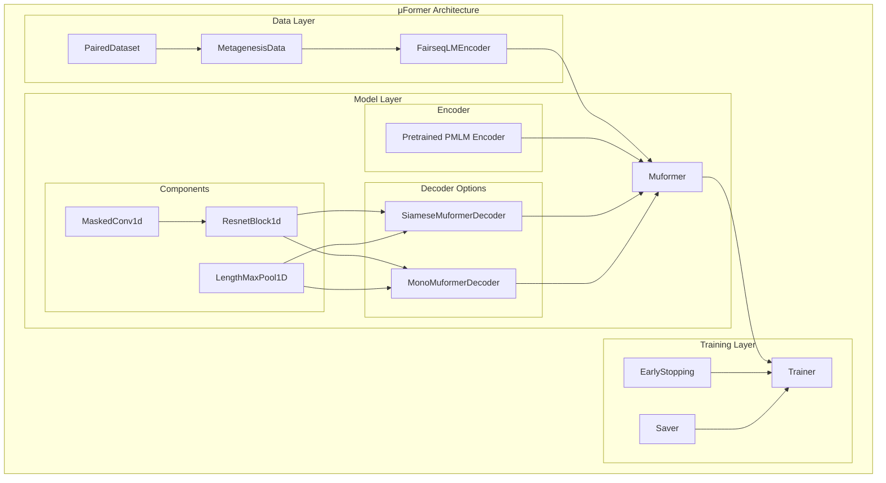
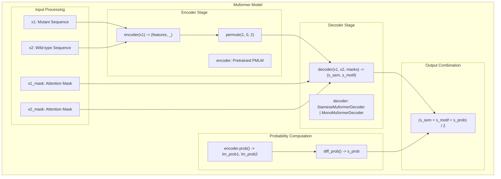
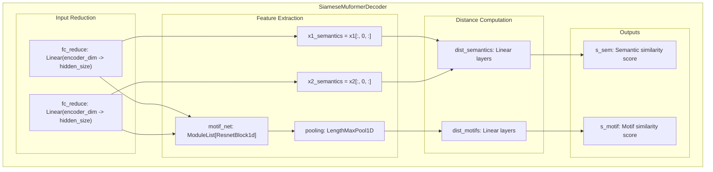
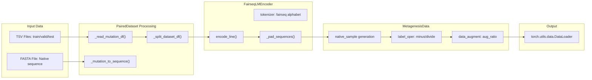
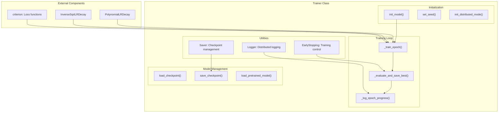
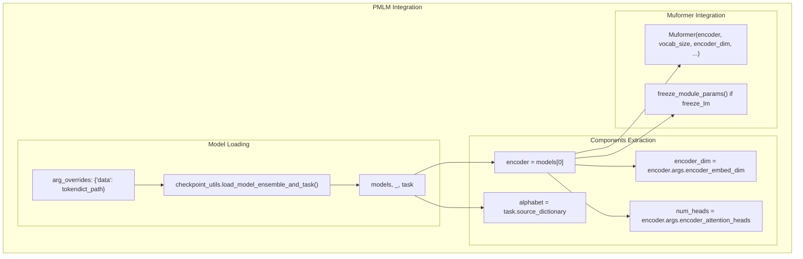

<!-- source: DeepWiki mcp.deepwiki.com · repo microsoft/Mu-Protein · page 2.2 μFormer Architecture · patched2 2026-10-26 -->

# μFormer Architecture
# μFormer Architecture

Relevant source files

The following files were used as context for generating this wiki page:

- [mu-former/requirements.txt](mu-former/requirements.txt)
- [mu-former/src/data.py](mu-former/src/data.py)
- [mu-former/src/model.py](mu-former/src/model.py)
- [mu-former/src/trainer.py](mu-former/src/trainer.py)

This document provides a detailed explanation of the μFormer model architecture, the second stage of the μProtein framework responsible for predicting mutational effects on protein fitness. μFormer leverages pretrained protein language models (PMLM) to create accurate fitness prediction models that serve as differentiable oracles for protein optimization.

For information about the overall system architecture, see [System Architecture](#2). For details about PMLM pretraining, see [PMLM Pretraining](#2.1). For training procedures, see [μFormer Training](#4.1).

## Architecture Overview

μFormer implements a siamese encoder-decoder architecture that processes pairs of protein sequences to predict fitness differences. The system combines semantic representations from pretrained language models with motif-based features through specialized decoder components.

**μFormer System Architecture**

Sources: [mu-former/src/model.py:1-315](), [mu-former/src/data.py:1-454](), [mu-former/src/trainer.py:1-600]()

## Core Model Components

The μFormer architecture consists of several key components that work together to predict mutational effects.

### Muformer Class

The `Muformer` class serves as the main model orchestrator, combining a pretrained encoder with specialized decoders for mutation effect prediction.

**Muformer Component Structure**

Sources: [mu-former/src/model.py:225-315]()

### Decoder Architectures

μFormer supports two decoder architectures for different use cases:

| Component | Purpose | Key Features |
|-----------|---------|--------------|
| `SiameseMuformerDecoder` | Paired sequence comparison | Processes wild-type and mutant sequences simultaneously |
| `MonoMuformerDecoder` | Single sequence analysis | Processes individual sequences independently |

**SiameseMuformerDecoder Architecture**

Sources: [mu-former/src/model.py:93-158]()

### Convolutional Components

The decoder uses specialized convolutional components for motif detection and sequence analysis.

| Component | Function | Implementation |
|-----------|----------|----------------|
| `MaskedConv1d` | Masked 1D convolution | Applies attention masks during convolution |
| `ResnetBlock1d` | Residual block | Two masked conv layers with skip connection |
| `LengthMaxPool1D` | Length-aware pooling | Max pooling across sequence length |

Sources: [mu-former/src/model.py:50-92]()

## Data Processing Pipeline

The data processing pipeline handles protein sequences, mutations, and fitness labels through several specialized classes.

**Data Processing Flow**

Sources: [mu-former/src/data.py:139-454]()

### Data Classes and Methods

| Class/Method | Purpose | Key Parameters |
|--------------|---------|----------------|
| `PairedDataset` | Main data orchestrator | `train_tsv`, `valid_tsv`, `test_tsv`, `fasta` |
| `MetagenesisData` | Dataset wrapper with augmentation | `mode`, `label_oper`, `aug_ratio` |
| `FairseqLMEncoder` | Sequence tokenization | `alphabet`, `batch_size` |
| `_mutation_to_sequence()` | Convert mutation strings to sequences | Handles format like "A123G" |
| `_pad_sequences()` | Batch sequence padding | `constant_value=1`, variable `length` |

Sources: [mu-former/src/data.py:85-454]()

## Training Infrastructure

The training infrastructure provides comprehensive support for model training, evaluation, and distributed computing.

**Training Component Interactions**

Sources: [mu-former/src/trainer.py:80-600]()

### Training Configuration

The trainer supports extensive configuration for different training scenarios:

| Parameter | Purpose | Default Value |
|-----------|---------|---------------|
| `encoder_lr` | Learning rate for pretrained encoder | `1e-5` |
| `decoder_lr` | Learning rate for decoder | `1e-4` |
| `weight_decay` | L2 regularization strength | `0.0` |
| `freeze_lm` | Whether to freeze language model | `False` |
| `num_ensembles` | Number of ensemble models | `1` |
| `batch_size` | Training batch size | `128` |

Sources: [mu-former/src/trainer.py:191-210]()

## Integration with PMLM

μFormer integrates closely with pretrained protein language models through the fairseq framework.

**PMLM Integration Architecture**

Sources: [mu-former/src/trainer.py:114-132]()

The integration enables μFormer to leverage pretrained representations while fine-tuning for specific mutation prediction tasks. The system supports both frozen and trainable encoder configurations depending on the available training data and computational resources.

Sources: [mu-former/src/trainer.py:1-600](), [mu-former/src/model.py:225-315]()

---

