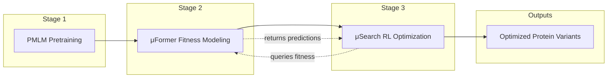
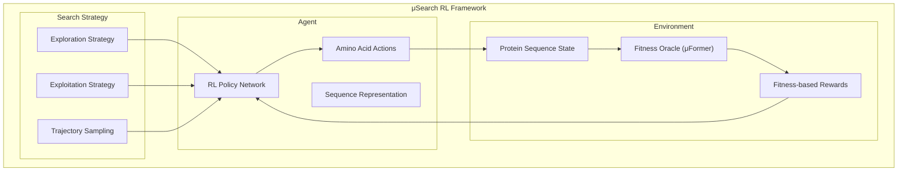
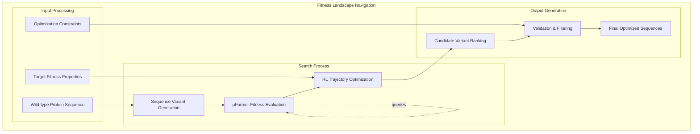
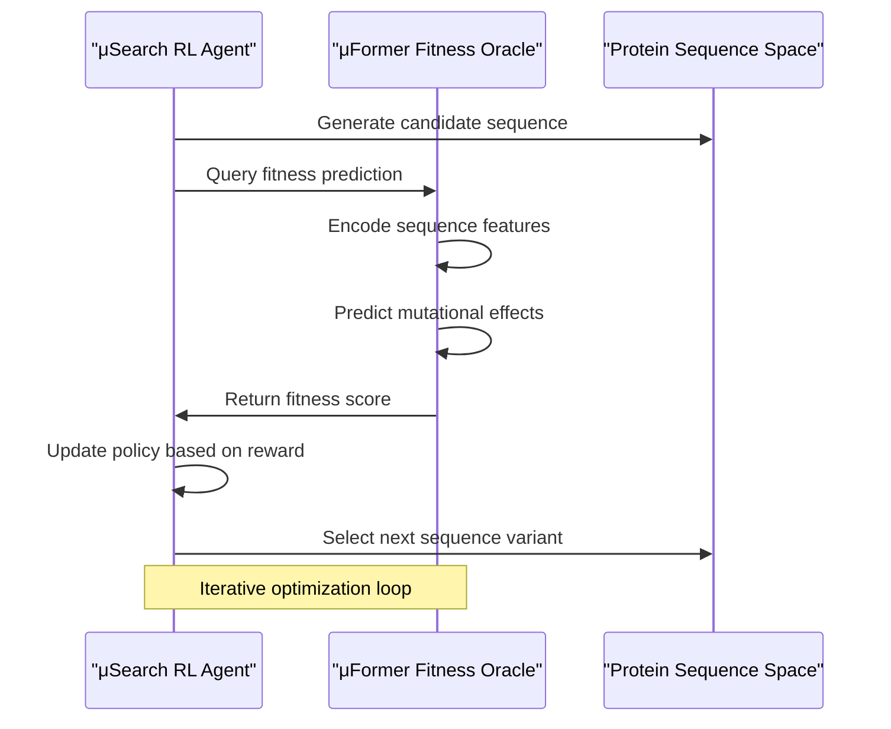
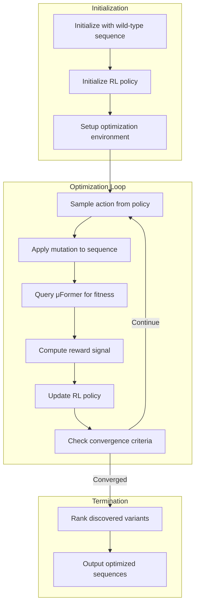

<!-- source: DeepWiki mcp.deepwiki.com · repo microsoft/Mu-Protein · page 2.3 μSearch System · patched2 2026-10-26 -->

# μSearch System
# μSearch System

Relevant source files

The following files were used as context for generating this wiki page:

- [README.md](README.md)

## Purpose and Scope

This document provides an overview of the μSearch system, the third and final stage of the μProtein framework pipeline. μSearch is a reinforcement learning-based protein optimization system that navigates fitness landscapes to discover improved protein variants. It leverages the fitness predictions from μFormer models to efficiently explore the protein sequence space and identify optimized proteins.

For detailed information about the fitness modeling component that feeds into μSearch, see [μFormer Architecture](#2.2). For implementation details of training μSearch systems, see [Training & Development](#4).

## System Overview

μSearch represents the optimization stage of the μProtein framework, where reinforcement learning algorithms are employed to navigate the protein fitness landscape constructed by μFormer. The system takes fitness predictions as an oracle and uses them to guide the search for protein variants with improved properties.

### μSearch Position in Framework Pipeline

Sources: [README.md:8-16]()

## Core Components

### Reinforcement Learning Framework

μSearch implements reinforcement learning algorithms specifically designed for protein sequence optimization. The system treats protein engineering as a sequential decision-making problem where each amino acid position represents a decision point in the optimization process.

Sources: [README.md:8](), [README.md:16]()

### Fitness Landscape Navigation

The system efficiently navigates the high-dimensional protein fitness landscape by leveraging the μFormer predictions as a differentiable oracle. This allows for gradient-based optimization strategies while maintaining the flexibility of reinforcement learning for discrete sequence spaces.

Sources: [README.md:8](), [README.md:16]()

## Integration with μFormer

μSearch relies heavily on the μFormer system to provide accurate fitness predictions that guide the reinforcement learning process. This integration creates a closed-loop optimization system where the quality of fitness modeling directly impacts the effectiveness of the search process.

### Fitness Oracle Interface

Sources: [README.md:8](), [README.md:15-16]()

## System Architecture

The μSearch system is organized within the `mu-search/` directory and follows a modular architecture that separates the reinforcement learning components from the protein-specific optimization logic.

### Directory Structure

| Component | Location | Purpose |
|-----------|----------|---------|
| Core RL System | `mu-search/` | Main reinforcement learning implementation |
| Configuration | `mu-search/README.md` | System documentation and setup |
| Integration Layer | Interface with `mu-former/` | Fitness oracle communication |

Sources: [README.md:16](), [README.md:22]()

## Optimization Process

The μSearch optimization process follows a systematic approach to protein engineering that balances exploration of novel sequences with exploitation of promising regions in the fitness landscape.

### Search Algorithm Flow

Sources: [README.md:8](), [README.md:16]()

## Performance Characteristics

μSearch is designed to efficiently explore the vast protein sequence space while minimizing the number of fitness evaluations required. The reinforcement learning approach enables the system to learn from previous optimization attempts and progressively improve its search strategy.

### Key Performance Features

- **Sample Efficiency**: Reduces the number of fitness evaluations needed compared to exhaustive search
- **Scalability**: Handles proteins of varying lengths and complexity
- **Adaptability**: Learns optimization strategies specific to different protein families
- **Constraint Handling**: Incorporates biochemical and structural constraints into the search process

Sources: [README.md:8]()

## Future Extensions

The μSearch system provides a foundation for various protein engineering applications and can be extended to support multi-objective optimization, ensemble-based search strategies, and integration with experimental validation pipelines.

Sources: [README.md:8-16]()

---

