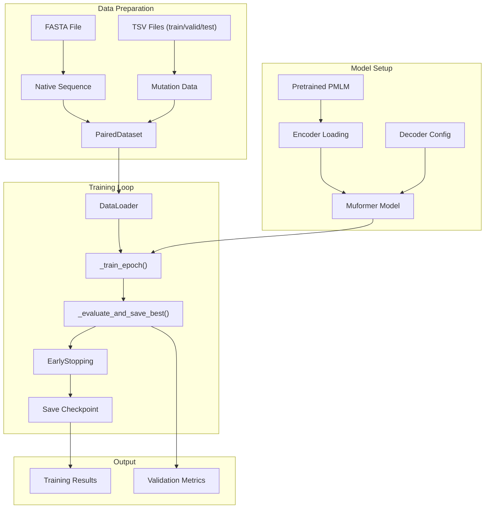
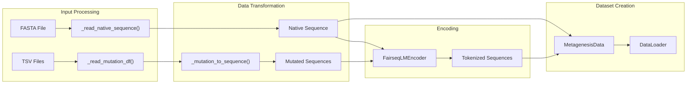
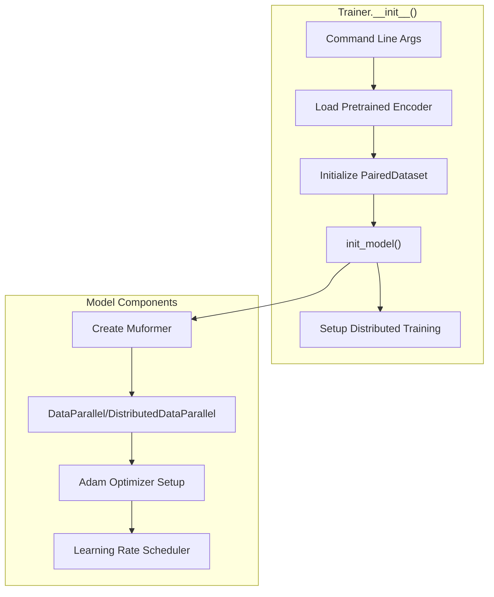
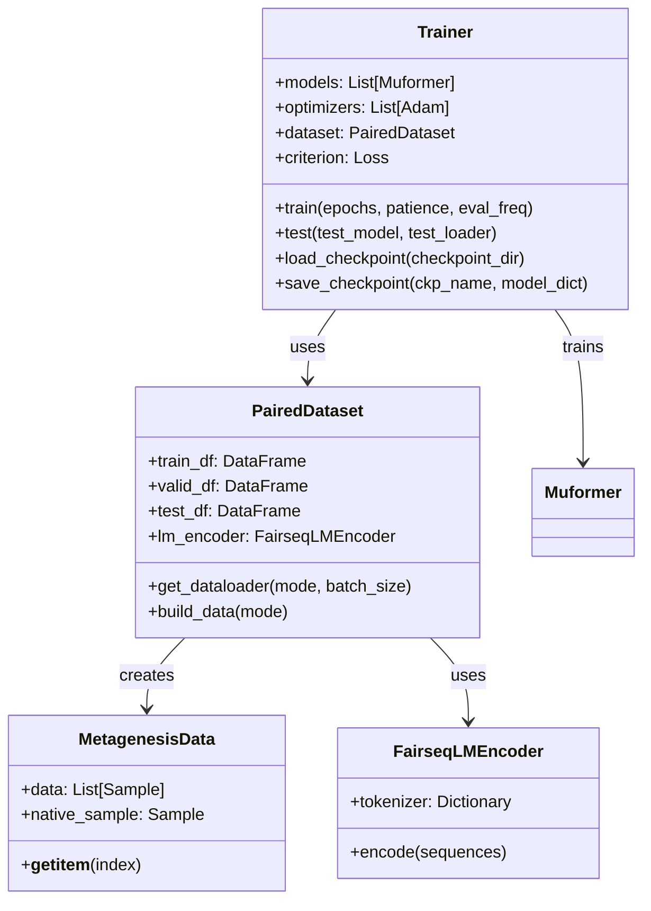

<!-- source: DeepWiki mcp.deepwiki.com · repo microsoft/Mu-Protein · page 4.1 μFormer Training · patched2 2026-10-26 -->

# μFormer Training
# μFormer Training

<details>
<summary>Relevant source files</summary>

The following files were used as context for generating this wiki page:

- [mu-former/README.md](mu-former/README.md)
- [mu-former/main.py](mu-former/main.py)
- [mu-former/src/data.py](mu-former/src/data.py)
- [mu-former/src/trainer.py](mu-former/src/trainer.py)

</details>


This document provides a comprehensive guide to training μFormer models for protein mutation effect prediction. It covers data preparation, configuration options, training procedures, and the underlying code architecture. For information about the μFormer model architecture itself, see [μFormer Architecture](#2.2). For using pretrained models, see [Using Pretrained Models](#3.2).

## Training Overview

μFormer training involves fine-tuning a pretrained protein language model (PMLM) with a siamese decoder architecture to predict mutation effects. The training process requires paired protein sequence data with fitness scores and follows a standard supervised learning pipeline with specialized data handling for protein mutations.

### Training Workflow



Sources: [mu-former/main.py:16-72](), [mu-former/src/trainer.py:389-429]()

## Data Preparation

The μFormer training system processes protein mutation data through the `PairedDataset` class, which handles both native sequences and mutated variants.

### Data Input Requirements

| File Type | Purpose | Format | Required |
|-----------|---------|--------|----------|
| FASTA | Native protein sequence | `.fasta` | Yes |
| Training TSV | Training mutations & scores | `.tsv` | Yes |
| Validation TSV | Validation mutations & scores | `.tsv` | Optional* |
| Test TSV | Test mutations & scores | `.tsv` | Optional* |

*If validation/test files are not provided, the system automatically splits the training data based on `split_ratio`.

### Data Processing Pipeline



Sources: [mu-former/src/data.py:139-211](), [mu-former/src/data.py:267-287](), [mu-former/src/data.py:48-84]()

### Key Data Classes

- **`PairedDataset`**: Main dataset orchestrator that handles data splitting, reading, and preprocessing
- **`MetagenesisData`**: PyTorch Dataset implementation for paired sequence data (native vs mutated)
- **`FairseqLMEncoder`**: Tokenizer wrapper for protein language model encoding

The system supports automatic data splitting when complete train/valid/test sets are not provided, using configurable ratios through the `split_ratio` parameter.

Sources: [mu-former/src/data.py:139-453](), [mu-former/src/data.py:85-138]()

## Training Configuration

Training is configured through command-line arguments parsed in `main.py`. The configuration system supports both single-GPU and distributed multi-GPU training.

### Core Training Arguments

```python
# Learning rates (different for encoder vs decoder)
--encoder-lr 1e-5        # Learning rate for pretrained encoder
--decoder-lr 1e-4        # Learning rate for decoder layers

# Training schedule
--epochs 300             # Total training epochs
--warmup-epochs 10       # Warmup epochs for learning rate
--batch-size 8           # Batch size per GPU

# Model configuration
--decoder-name siamese   # Decoder architecture type
--hidden-size 256        # Hidden dimension in decoder
--dropout 0.2            # Dropout rate
```

### Data Configuration

```python
# Data files
--fasta path/to/sequence.fasta    # Native sequence
--train path/to/train.tsv         # Training data
--valid path/to/valid.tsv         # Validation data
--test path/to/test.tsv           # Test data

# Data processing
--split-ratio 0.7 0.1 0.2         # Train/valid/test split
--label-oper minus                # Label operation (minus/divide)
--aug-ratio -1                    # Data augmentation ratio
```

Sources: [mu-former/main.py:73-135](), [mu-former/README.md:30-37]()

## Training Execution

The training process is orchestrated by the `Trainer` class, which manages model initialization, distributed training setup, and the training loop.

### Trainer Initialization



Sources: [mu-former/src/trainer.py:80-217](), [mu-former/src/trainer.py:220-245]()

### Training Loop Architecture

The main training loop in `Trainer.train()` follows this structure:

1. **Data Loading**: Prepare train/validation dataloaders with distributed sampling
2. **Model Training**: Execute training epochs with gradient updates
3. **Validation**: Periodic evaluation and best model tracking
4. **Early Stopping**: Configurable patience-based stopping
5. **Checkpointing**: Save best model states for later use

```mermaid
sequenceDiagram
    participant Main as "main.py"
    participant Trainer as "Trainer"
    participant Model as "Muformer"
    participant Data as "PairedDataset"
    
    Main->>Trainer: train(epochs, patience, eval_freq)
    loop For each model in ensemble
        Trainer->>Data: get_dataloader('train_valid')
        Data-->>Trainer: train_loader, valid_loader
        
        loop For each epoch
            Trainer->>Trainer: _train_epoch(model, optimizer, train_loader)
            Note over Trainer: Forward pass, loss calculation, backprop
            
            alt Every eval_freq epochs
                Trainer->>Trainer: _evaluate_and_save_best(model, valid_loader)
                Trainer->>Trainer: Check early stopping criteria
            end
            
            alt Early stop or final epoch
                Trainer->>Trainer: save_checkpoint()
                break
            end
        end
    end
```

Sources: [mu-former/src/trainer.py:389-429](), [mu-former/src/trainer.py:467-499]()

### Key Training Methods

- **`_train_epoch()`**: Executes one training epoch with gradient updates and loss calculation
- **`_evaluate_and_save_best()`**: Performs validation and tracks best model performance
- **`_prepare_dataloaders()`**: Sets up distributed data loading and sampling
- **`_init_scheduler()`**: Configures learning rate scheduling (InverseSqrtLRDecay)

The training supports ensemble learning by training multiple model instances with the same configuration.

Sources: [mu-former/src/trainer.py:467-499](), [mu-former/src/trainer.py:501-515]()

## Command Line Usage

### Single GPU Training

```bash
python main.py \
  --decoder-name siamese \
  --encoder-lr 1e-5 \
  --decoder-lr 1e-4 \
  --epochs 300 \
  --warmup-epochs 10 \
  --batch-size 8 \
  --pretrained-model path/to/uformer_l_encoder.pt \
  --fasta path/to/sequence.fasta \
  --train path/to/train.tsv \
  --valid path/to/valid.tsv \
  --test path/to/test.tsv \
  --output-dir output/
```

### Multi-GPU Distributed Training

```bash
python -m torch.distributed.run \
  --nnodes=1 \
  --nproc_per_node=4 \
  --node_rank=0 \
  --master_port=6005 \
  main.py \
  --decoder-name siamese \
  --encoder-lr 1e-5 \
  --decoder-lr 1e-4 \
  --batch-size 2 \
  --epochs 300 \
  --warmup-epochs 10 \
  --pretrained-model path/to/uformer_l_encoder.pt \
  --fasta path/to/sequence.fasta \
  --train path/to/train.tsv \
  --valid path/to/valid.tsv \
  --test path/to/test.tsv \
  --output-dir output/
```

Note that batch size should be reduced proportionally when using multiple GPUs since it represents the per-GPU batch size.

Sources: [mu-former/README.md:27-51](), [mu-former/README.md:59-69]()

## Code Architecture Overview

The training system follows a modular architecture with clear separation of concerns:



Sources: [mu-former/src/trainer.py:80-217](), [mu-former/src/data.py:139-211](), [mu-former/src/data.py:85-138](), [mu-former/src/data.py:48-84]()

The training pipeline integrates with the broader μProtein framework by:
- Loading pretrained PMLM encoders from checkpoint files
- Outputting trained models compatible with μSearch optimization
- Supporting evaluation metrics (Spearman correlation, MAE) standard in protein engineering

Sources: [mu-former/main.py:1-142](), [mu-former/src/trainer.py:1-600]()

---

