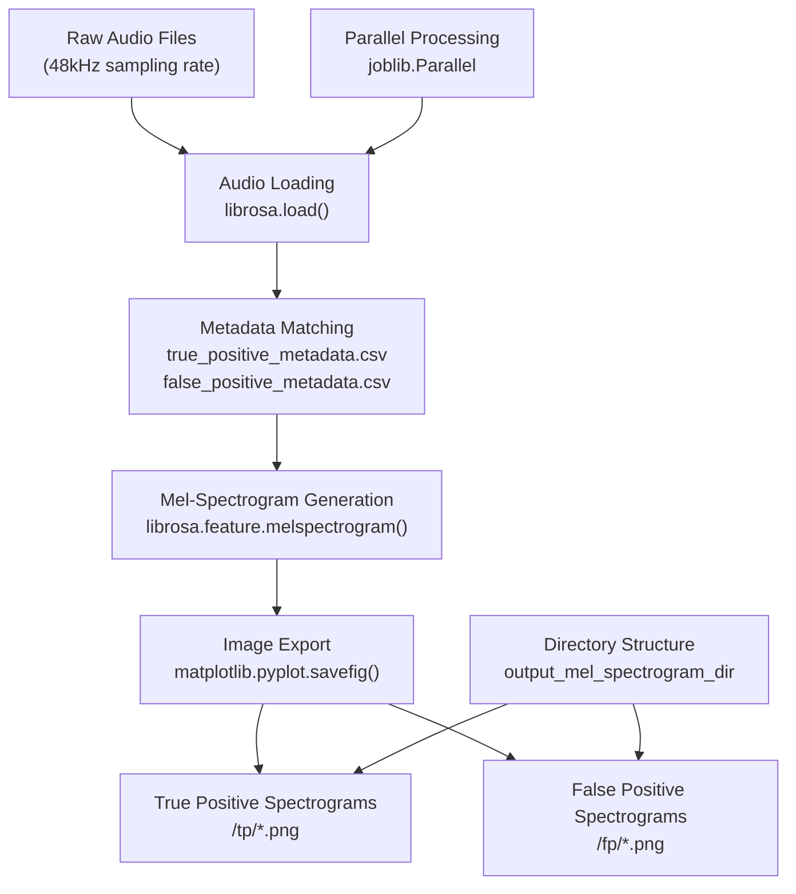
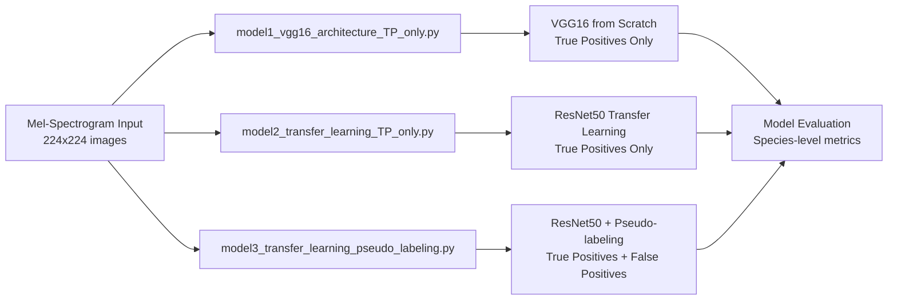
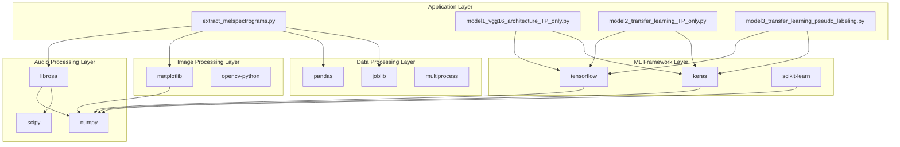
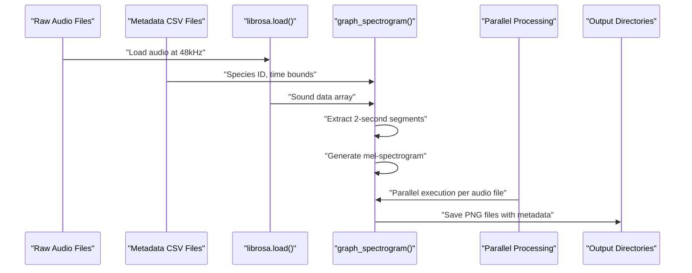
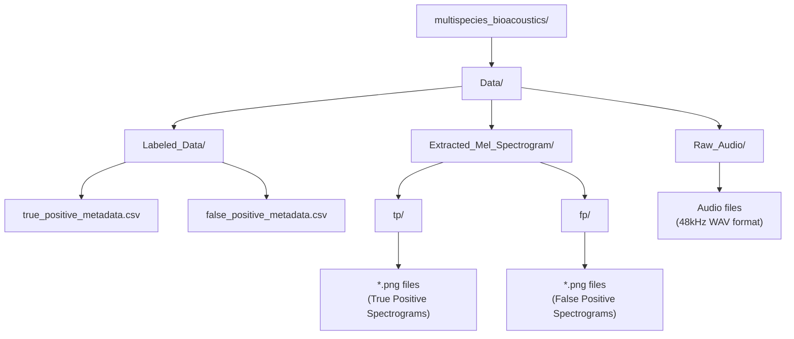
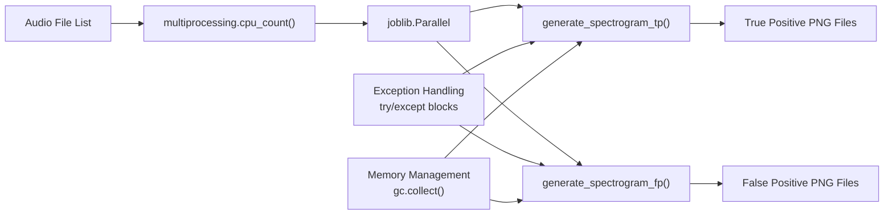
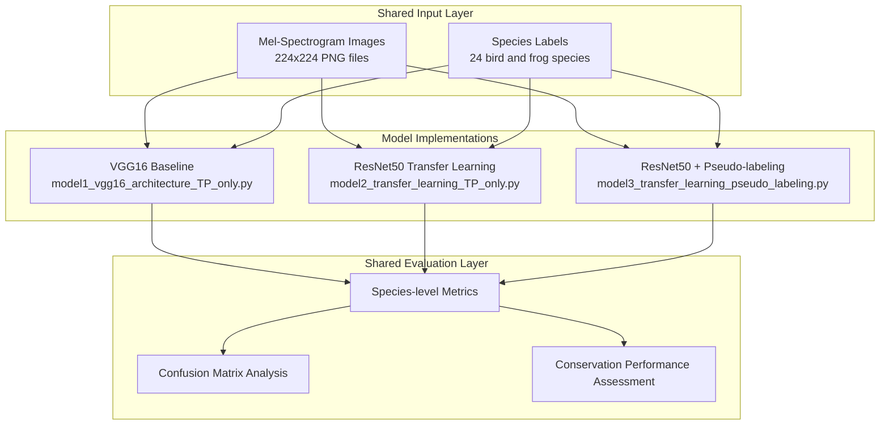

<!-- source: DeepWiki mcp.deepwiki.com · repo microsoft/Multi_Species_Bioacoustic_Classification · page 2 System Architecture · fetched 2026-10-26 -->

# System Architecture

Relevant source files

The following files were used as context for generating this wiki page:

- [README.md](README.md)
- [extract_melspectrograms.py](extract_melspectrograms.py)
- [requirements.txt](requirements.txt)

This document provides a comprehensive overview of the Multi-Species Bioacoustic Classification system architecture, including core components, data flow patterns, and the relationship between the three deep learning models. For detailed information about individual models, see [Deep Learning Models](#4). For environment setup details, see [Environment Setup and Dependencies](#5).

## Overview

The system implements a multi-stage pipeline that transforms raw audio recordings into species classifications through mel-spectrogram extraction and deep learning models. The architecture consists of three primary subsystems: data processing, model training, and evaluation frameworks.

## Core System Components

### Data Processing Pipeline Architecture

The central component of the system is the mel-spectrogram extraction pipeline implemented in `extract_melspectrograms.py`. This module orchestrates the transformation from raw audio data to visual representations suitable for CNN processing.

**Data Processing Pipeline Components**

The pipeline processes two distinct data types through parallel execution paths:

Sources: [extract_melspectrograms.py:50-56](), [extract_melspectrograms.py:147-161]()

### Model Training Architecture

The system implements three distinct model training approaches that operate on the same mel-spectrogram inputs but use different architectures and training strategies.

**Model Training Components**

Each model represents increasing sophistication in training methodology:

1. **Model 1**: Baseline CNN implementation using VGG16 architecture
2. **Model 2**: Transfer learning approach with pre-trained ResNet50
3. **Model 3**: Advanced semi-supervised learning with custom loss functions

Sources: [README.md:17-22]()

### Technology Stack Architecture

The system dependencies form a layered architecture supporting audio processing, machine learning, and parallel computation.

**Technology Stack Components**

The stack is organized into functional layers with clear dependencies between components.

Sources: [requirements.txt:1-11]()

## Data Flow Architecture

### Audio Processing Data Flow

The core data processing follows a systematic pipeline from raw audio files to labeled spectrograms ready for model training.

**Data Flow Implementation Details**

Key processing functions handle the transformation pipeline:

- `graph_spectrogram()`: Core spectrogram generation function [extract_melspectrograms.py:107-137]()
- `generate_spectrogram_tp()`: True positive processing wrapper [extract_melspectrograms.py:140-145]()
- `generate_spectrogram_fp()`: False positive processing wrapper [extract_melspectrograms.py:152-157]()

Sources: [extract_melspectrograms.py:107-161]()

### File Organization Structure

The system maintains a structured directory hierarchy that separates raw data, processed spectrograms, and model outputs.

**Directory Structure Configuration**

The path configuration defines the complete file organization:

| Directory Variable | Purpose | Path |
|-------------------|---------|------|
| `current_dir` | Root project directory | `./multispecies_bioacoustics/` |
| `data_dir` | Main data directory | `Data/` |
| `labeled_data_dir` | Metadata CSV files | `Data/Labeled_Data/` |
| `audio_dir` | Raw audio recordings | `Data/Raw_Audio/` |
| `output_mel_spectrogram_dir` | Processed spectrograms | `Data/Extracted_Mel_Spectrogram/` |

Sources: [extract_melspectrograms.py:27-46]()

## Processing Configuration

### Spectrogram Generation Parameters

The mel-spectrogram extraction uses standardized parameters to ensure consistency across all model training:

| Parameter | Value | Purpose |
|-----------|-------|---------|
| Sampling Rate | 48,000 Hz | Audio loading resolution |
| Spectrogram Duration | 2 seconds | Fixed-length segments |
| Image Resolution | 300x300 pixels | CNN input size |
| DPI | 100 | Image quality setting |
| Audio Segment Extraction | `floor(t_min)` to `ceil(t_max)` | Time boundary calculation |

Sources: [extract_melspectrograms.py:108-124]()

### Parallel Processing Implementation

The system leverages multi-core processing for efficient spectrogram generation across large audio datasets.

**Parallel Processing Configuration**

The implementation uses joblib for distributed processing with automatic core detection and memory management.

Sources: [extract_melspectrograms.py:147-161]()

## Model Integration Architecture

The three models operate independently but share common input formats and evaluation frameworks, enabling direct performance comparison.

**Model Integration Points**

The architecture enables systematic comparison through standardized interfaces and shared evaluation metrics.

Sources: [README.md:17-22]()

---

