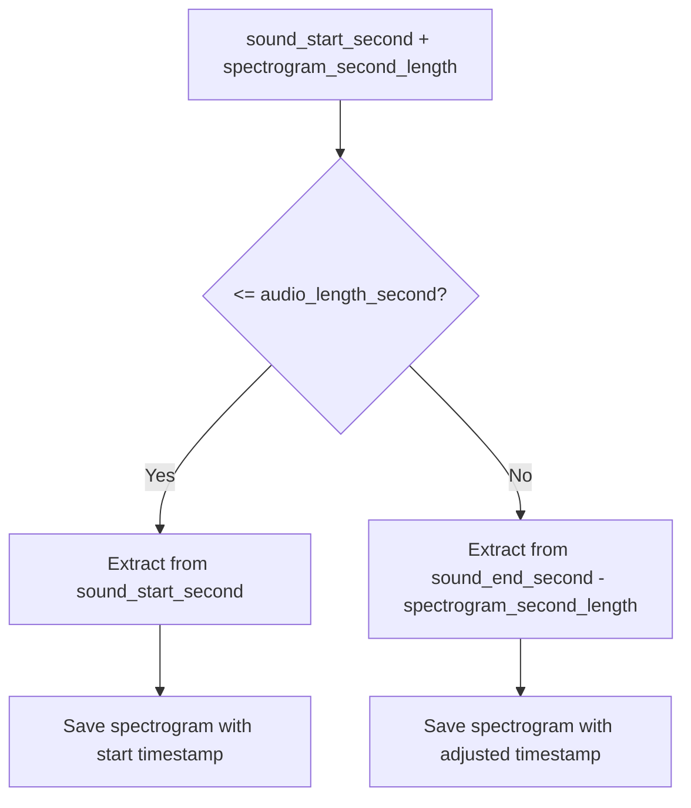
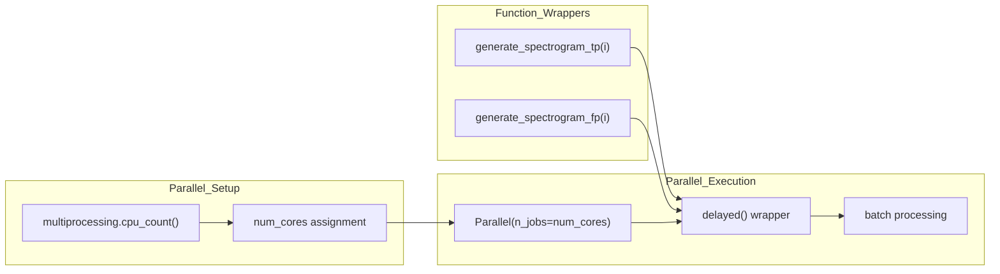

<!-- source: DeepWiki mcp.deepwiki.com · repo microsoft/Multi_Species_Bioacoustic_Classification · page 3 Data Processing Pipeline · fetched 2026-10-26 -->

# Data Processing Pipeline

<details>
<summary>Relevant source files</summary>

The following files were used as context for generating this wiki page:

- [extract_melspectrograms.py](extract_melspectrograms.py)

</details>


## Purpose and Scope

This document covers the mel-spectrogram extraction pipeline, which serves as the foundational data processing component of the Multi-Species Bioacoustic Classification system. The pipeline transforms raw audio recordings and labeled metadata into standardized mel-spectrogram images suitable for deep learning model training and inference.

For information about the deep learning models that consume these spectrograms, see [Deep Learning Models](#4). For details about the input data formats and file organization requirements, see [Data Formats and File Organization](#6).

## Pipeline Overview

The data processing pipeline implemented in `extract_melspectrograms.py` performs three primary functions: metadata loading and matching, audio segment extraction, and mel-spectrogram generation. This pipeline processes both true positive (species present) and false positive (species absent) labeled data to create balanced training datasets.

### Data Flow Architecture

```mermaid
flowchart TD
    subgraph "Input_Data"
        A["`true_positive_metadata.csv`"]
        B["`false_positive_metadata.csv`"]
        C["`Raw_Audio/` directory"]
    end
    
    subgraph "Processing_Functions"
        D["`pd.read_csv()` metadata loading"]
        E["`audio filename matching`"]
        F["`graph_spectrogram()` function"]
        G["`librosa.feature.melspectrogram()`"]
    end
    
    subgraph "Output_Structure"
        H["`Extracted_Mel_Spectrogram/tp/` directory"]
        I["`Extracted_Mel_Spectrogram/fp/` directory"]
        J["`*.png spectrogram files`"]
    end
    
    A --> D
    B --> D
    C --> E
    D --> E
    E --> F
    F --> G
    G --> H
    G --> I
    H --> J
    I --> J
```

**Sources:** [extract_melspectrograms.py:48-57](), [extract_melspectrograms.py:107-137](), [extract_melspectrograms.py:139-161]()

## Input Data Processing

### Metadata Loading and Structure

The pipeline begins by loading two primary metadata files that contain labeled detection events with temporal and species information.

| Metadata File | Purpose | Key Columns |
|---------------|---------|-------------|
| `true_positive_metadata.csv` | Species presence detections | `species_id`, `uri`, `t_min`, `t_max`, `tod` |
| `false_positive_metadata.csv` | False alarm detections | `species_id`, `uri`, `t_min`, `t_max`, `tod` |

**Sources:** [extract_melspectrograms.py:50-56]()

### Audio File Matching Process

The pipeline implements a sophisticated matching algorithm to associate metadata records with corresponding raw audio files:

```mermaid
flowchart LR
    subgraph "URI_Parsing"
        A["`row['uri']`"]
        B["`project/site/year/month/filename`"]
        C["`audio_filename construction`"]
    end
    
    subgraph "Matching_Logic"
        D["`all_audio_filenames list`"]
        E["`filename in all_audio_filenames`"]
        F["`matched_audio_filename assignment`"]
    end
    
    subgraph "Time_Extraction"
        G["`floor(t_min)` -> sound_start_second"]
        H["`ceil(t_max)` -> sound_end_second"]
    end
    
    A --> B
    B --> C
    C --> E
    D --> E
    E --> F
    A --> G
    A --> H
```

**Sources:** [extract_melspectrograms.py:65-76](), [extract_melspectrograms.py:86-96]()

## Core Spectrogram Generation

### The `graph_spectrogram` Function

The central processing function `graph_spectrogram` handles the conversion from audio segments to mel-spectrogram images:

| Parameter | Purpose | Default Value |
|-----------|---------|---------------|
| `spectrogram_second_length` | Duration of audio segment | 2 seconds |
| `matched_labeled_data` | Filtered metadata DataFrame | - |
| `audio_filename` | Target audio file | - |
| `label` | Output directory designation | 'tp' or 'fp' |

**Key Processing Steps:**
1. **Audio Loading**: Uses `librosa.load()` with 48kHz sampling rate
2. **Segment Extraction**: Extracts 2-second audio windows based on detection timestamps
3. **Mel-Spectrogram Computation**: Applies `librosa.feature.melspectrogram()`
4. **Image Generation**: Saves 300x300 pixel PNG files with 100 DPI resolution

**Sources:** [extract_melspectrograms.py:107-137]()

### Audio Segment Boundary Handling

The pipeline implements intelligent boundary condition handling for audio segments that extend beyond file limits:



**Sources:** [extract_melspectrograms.py:117-134]()

## Parallel Processing Implementation

### Multi-Core Spectrogram Generation

The pipeline leverages `joblib.Parallel` for efficient multi-core processing of spectrogram generation:



**Sources:** [extract_melspectrograms.py:147-149](), [extract_melspectrograms.py:159-161]()

## Output File Organization

### Directory Structure Creation

The pipeline automatically creates the required output directory structure:

```
Extracted_Mel_Spectrogram/
├── tp/                    # True positive spectrograms
└── fp/                    # False positive spectrograms
```

**Sources:** [extract_melspectrograms.py:34-45]()

### File Naming Convention

Generated spectrogram files follow a standardized naming pattern that preserves metadata:

```
{audio_filename_base}_{start_second}_{end_second}_{species_id}_{tod}_{label}.png
```

**Example:** `project_site_2020_01_recording_120_122_species_001_1200_tp.png`

**Sources:** [extract_melspectrograms.py:124](), [extract_melspectrograms.py:133]()

## Performance and Memory Management

### Memory Optimization

The pipeline implements several memory management strategies:

- **Garbage Collection**: Explicit `gc.collect()` calls after processing each audio file
- **Exception Handling**: Try-catch blocks prevent memory leaks from failed processing
- **Batch Processing**: Processing audio files in parallel rather than loading all simultaneously

**Sources:** [extract_melspectrograms.py:136](), [extract_melspectrograms.py:144-145](), [extract_melspectrograms.py:156-157]()

### Processing Requirements

| Resource | Requirement | Notes |
|----------|-------------|-------|
| CPU Cores | All available (`multiprocessing.cpu_count()`) | Parallel processing |
| Memory | ~48MB per audio file | 48kHz sampling rate |
| Storage | ~50KB per spectrogram | 300x300 PNG files |
| Dependencies | `librosa==0.6.3`, `joblib==0.12.0` | Version-specific |

**Sources:** [extract_melspectrograms.py:18](), [extract_melspectrograms.py:22](), [extract_melspectrograms.py:108]()

---

