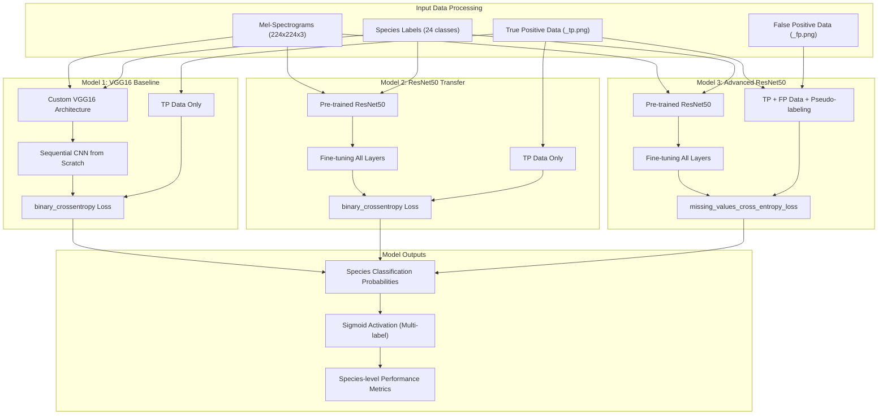
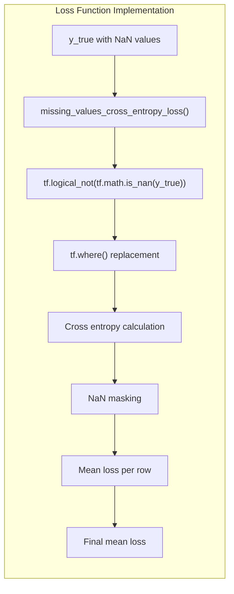
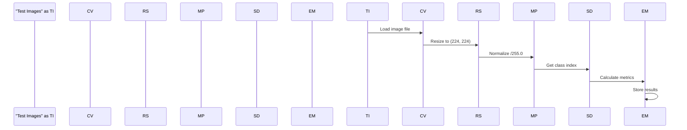

<!-- source: DeepWiki mcp.deepwiki.com · repo microsoft/Multi_Species_Bioacoustic_Classification · page 4 Deep Learning Models · fetched 2026-10-26 -->

# Deep Learning Models

Relevant source files

The following files were used as context for generating this wiki page:

- [README.md](README.md)
- [model1_vgg16_architecture_TP_only.py](model1_vgg16_architecture_TP_only.py)
- [model2_transfer_learning_TP_only.py](model2_transfer_learning_TP_only.py)
- [model3_transfer_learning_pseudo_labeling.py](model3_transfer_learning_pseudo_labeling.py)

This document provides a comprehensive overview of the three deep learning models implemented for multi-species bioacoustic classification. Each model represents a different approach to convolutional neural network (CNN) design and training methodology, progressing from baseline implementation to advanced semi-supervised learning techniques.

For information about the mel-spectrogram extraction process that feeds these models, see [Data Processing Pipeline](#3). For detailed implementation specifics of each individual model, see [Model 1: VGG16 Baseline CNN](#4.1), [Model 2: ResNet50 Transfer Learning](#4.2), and [Model 3: Advanced ResNet50 with Pseudo-labeling](#4.3).

## Model Architecture Overview

The system implements three distinct modeling approaches that enable comparative analysis of different CNN architectures and training strategies for bioacoustic classification tasks.

**Sources:** [README.md:17-21](), [model1_vgg16_architecture_TP_only.py:112-135](), [model2_transfer_learning_TP_only.py:112-135](), [model3_transfer_learning_pseudo_labeling.py:208-231]()

## Data Processing and Label Management

All three models utilize a consistent data preprocessing pipeline with species-specific label encoding and image standardization.

| Component | Implementation | File Reference |
|-----------|---------------|----------------|
| Image Dimensions | `ncol, nrow = 224, 224` | [model1_vgg16_architecture_TP_only.py:89]() |
| Normalization | `img = cv2.resize(img, (ncol, nrow)) / 255.0` | [model1_vgg16_architecture_TP_only.py:96]() |
| Label Encoding | `LabelBinarizer()` for multi-label classification | [model1_vgg16_architecture_TP_only.py:78]() |
| Species Filtering | Exclude insects: `['16769', '16770', '16772']` | [model1_vgg16_architecture_TP_only.py:60]() |
| Species Mapping | `species_id_class_dict` for class index lookup | [model1_vgg16_architecture_TP_only.py:83-86]() |

The species identification system extracts `species_id` from filenames using the pattern `filename.split('_')[-3]`, enabling automatic label assignment during both training and evaluation phases.

**Sources:** [model1_vgg16_architecture_TP_only.py:56-86](), [model2_transfer_learning_TP_only.py:56-86](), [model3_transfer_learning_pseudo_labeling.py:56-131]()

## Model Implementation Comparison

**Sources:** [model1_vgg16_architecture_TP_only.py:112-135](), [model2_transfer_learning_TP_only.py:112-135](), [model3_transfer_learning_pseudo_labeling.py:208-231]()

## Training Configuration and Optimization

All models share common training hyperparameters while differing in loss functions and data utilization strategies:

| Parameter | Value | Implementation |
|-----------|-------|---------------|
| Optimizer | `optimizers.adam(lr=0.0001, decay=1e-7)` | All models |
| Batch Size | `16` | All models |
| Epochs | `5` | Models 1 & 2; iterative in Model 3 |
| Validation Split | `test_size = 0.3` | All models |
| Activation Function | `sigmoid` (final layer) | All models |

### Model-Specific Loss Functions

**Models 1 & 2:** Standard `binary_crossentropy` for multi-label classification
**Model 3:** Custom `missing_values_cross_entropy_loss` function that handles NaN values in pseudo-labeled data

**Sources:** [model1_vgg16_architecture_TP_only.py:138-139](), [model2_transfer_learning_TP_only.py:134-135](), [model3_transfer_learning_pseudo_labeling.py:181-204]()

## Pseudo-labeling Implementation (Model 3)

Model 3 implements an iterative semi-supervised learning approach using pseudo-labeling with confidence thresholds:

| Component | Implementation | Purpose |
|-----------|---------------|---------|
| High Threshold | `threshold_score_high = 0.9` | Convert predictions ≥0.9 to positive labels |
| Low Threshold | `threshold_score_low = 0.1` | Convert predictions ≤0.1 to negative labels |
| Intermediate Range | `(0.1, 0.9)` | Maintain as `np.nan` (unlabeled) |
| Iterative Training | `for i in range(2)` | Two rounds of self-learning |
| Label Update | `y_train = np.maximum(y_train, y_train_pseudo_label)` | Merge original and pseudo labels |

The pseudo-labeling process operates on both True Positive and False Positive data, with False Positive labels initially set to 0 and updated through the iterative process.

**Sources:** [model3_transfer_learning_pseudo_labeling.py:235-244]()

## Model Persistence and Output Files

Each model saves its trained state using consistent file naming conventions:

| Model | Architecture File | Weights File |
|-------|------------------|--------------|
| Model 1 | `cnn__architecture.json` | `cnn_weights.h5` |
| Model 2 | `resnet_architecture.json` | `resnet_weights.h5` |
| Model 3 | `resnet_architecture_pseudo_label_TP_FP_0.01_0.99.json` | `resnet_weights_pseudo_label.h5` |

All models generate comprehensive evaluation metrics including species-level precision, recall, accuracy, F-score, TPR, TNR, and AUC values through the `evaluation_metrics_by_species` DataFrame.

**Sources:** [model1_vgg16_architecture_TP_only.py:153-157](), [model2_transfer_learning_TP_only.py:149-153](), [model3_transfer_learning_pseudo_labeling.py:254-258]()

## Prediction and Evaluation Pipeline

The prediction process follows a standardized approach across all models:

Each model extracts species predictions by indexing into the prediction array using `species_id_class_dict[species_id]`, enabling consistent species-level evaluation across different model architectures.

**Sources:** [model1_vgg16_architecture_TP_only.py:162-172](), [model2_transfer_learning_TP_only.py:158-168](), [model3_transfer_learning_pseudo_labeling.py:278-290]()

---

